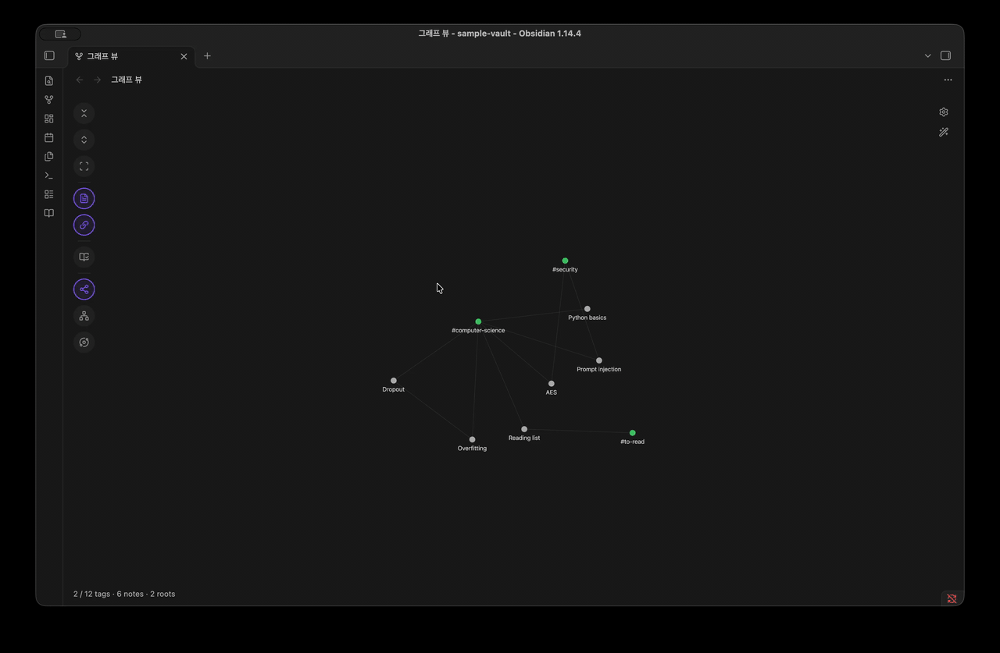
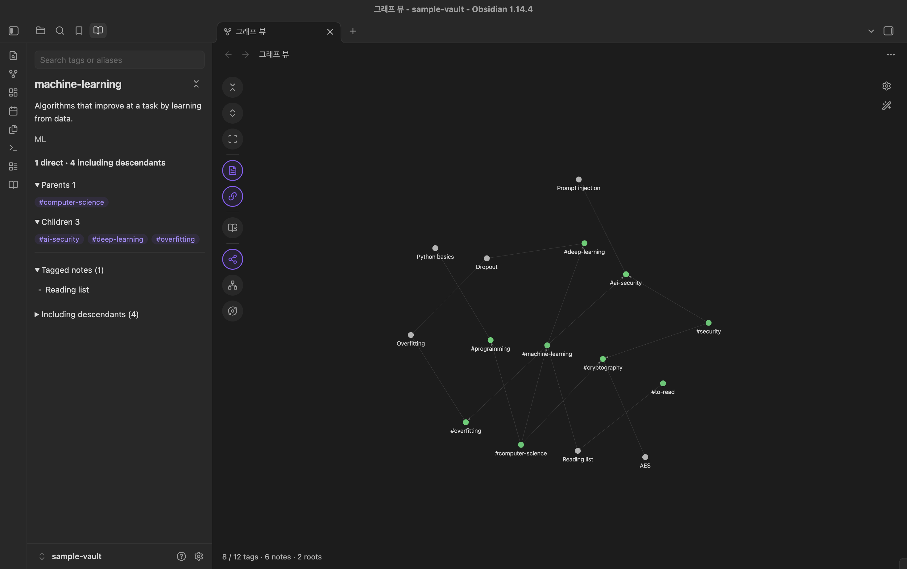
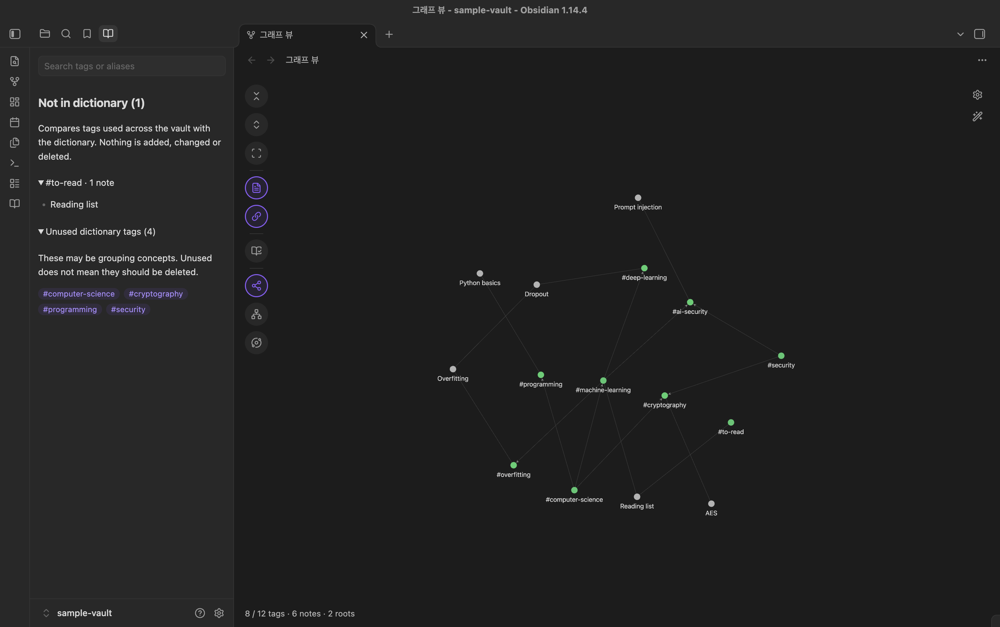
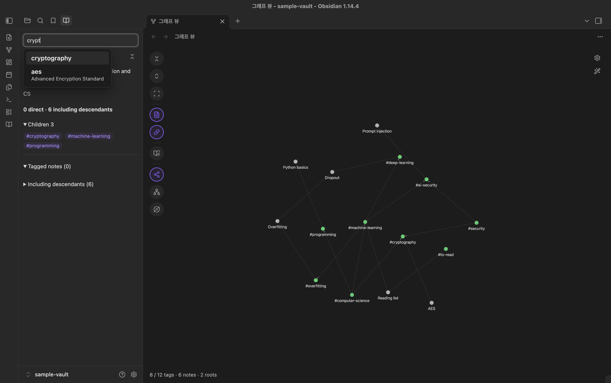
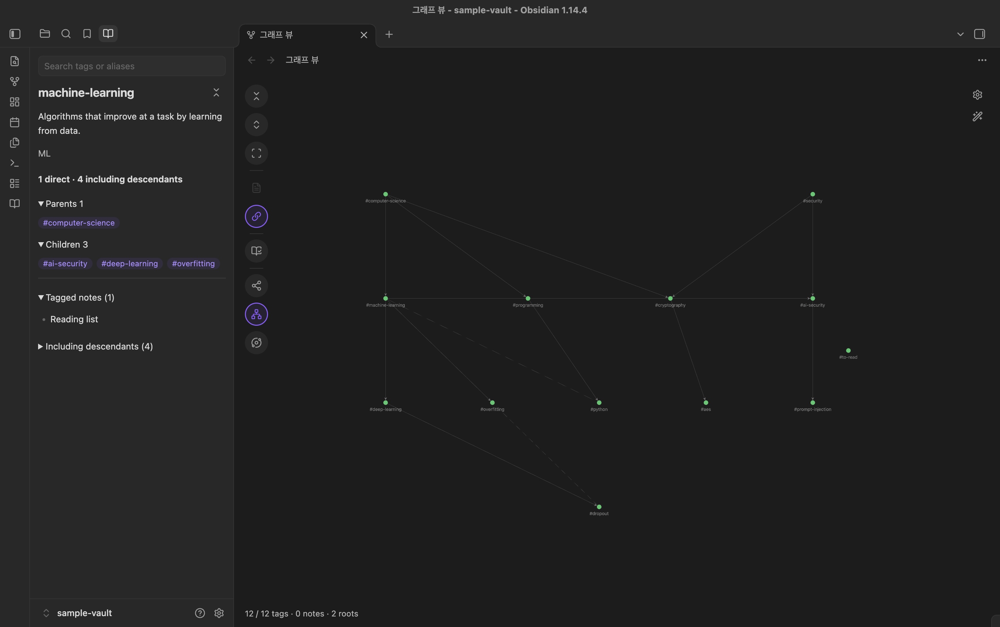
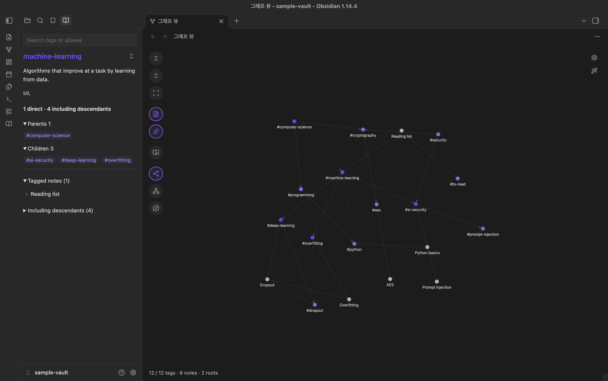
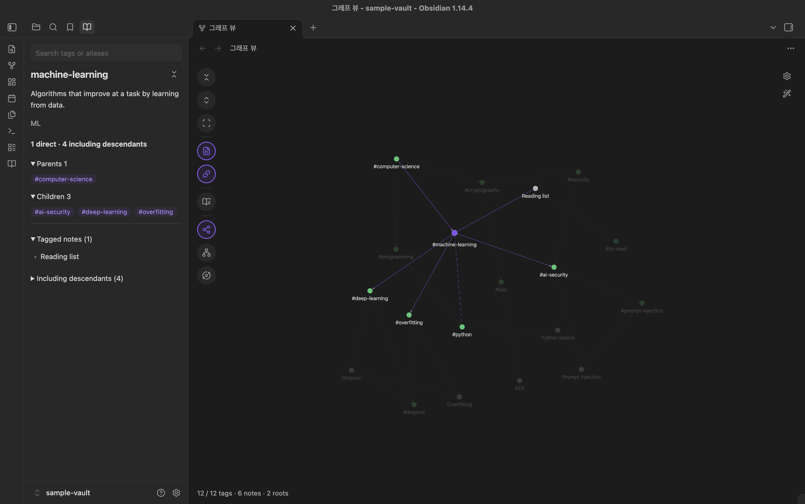

# Tag Ontology

[](https://github.com/NamhyeonKo/obsidian-tag-ontology/releases/latest)
[](https://github.com/NamhyeonKo/obsidian-tag-ontology/actions/workflows/release.yml)
[](LICENSE)

[English](README.md) | **한국어**

Tag Ontology는 Obsidian 기본 **그래프 뷰**에 **태그 계층**을 더해 줍니다. 태그의 정의, 별칭, 상위 태그, 연관 태그를 JSON 사전에 적어 두면, 평소 쓰는 그래프 위에 그 계층을 얹습니다. 노트, 노트 사이 링크, 필터, 색상 그룹, 표시 설정 등 기본 그래프의 나머지 기능은 그대로 유지됩니다.

**읽기 전용**입니다. 노트와 사전 파일은 절대 수정하지 않습니다.

> **시작하기:** 계층은 태그 노드로 만들어지므로 그래프 설정의 **필터 → Tags**가 켜져 있어야 합니다. 처음 설치하면 한 번 자동으로 켜 드리고, 그 뒤로는 플러그인이 이 설정을 바꾸지 않습니다. 직접 껐다면 다시 켜야 계층이 보입니다.



## 기능

- **기본 그래프의 확장.** 노트, 노트 링크, 필터, 색상 그룹, 화살표 등 기본 설정이 평소처럼 동작합니다. 노드 크기도 링크가 많을수록 커집니다.
- **접고 펼치는 태그 계층.** 사전 태그는 루트까지 접힌 상태로 시작하고, 각 노트는 보이는 가장 가까운 상위 태그에 연결됩니다. 태그를 클릭하면 한 단계 펼쳐지고, 노트가 더 구체적인 하위 태그로 옮겨 붙습니다.
- **하위 포함 노트 수.** 태그마다 *직접* 달린 노트 수와, *하위 태그까지 포함한* 노트 수를 보여 줍니다. 노트에 여러 태그가 달렸거나 태그가 여러 부모를 가져도 같은 노트는 한 번만 셉니다.
- **다중 부모와 연관 관계.** 실선 화살표는 상위에서 하위로 향하고, 점선은 연관 태그를 잇습니다.
- **세 가지 배치.** Force, Tree, Radial.
- **사이드바 탭.** 파일·검색 탭 옆의 탭에서 태그 이름이나 별칭으로 찾고, 태그 정보를 보고, 사전 대조를 합니다. 여기서 태그를 고르면 열린 그래프가 그 태그를 가운데로 옮깁니다.
- **사전 대조.** vault에서 쓰이지만 사전에 없는 태그와, 사전에는 있지만 아직 아무 노트도 쓰지 않는 태그를 보여 줍니다. 보고만 하고 아무것도 바꾸지 않습니다.
- **사용자 색상(선택).** 모든 태그를 한 가지 색으로 칠하고, 선택한 태그(원하면 그 하위 태그나 바로 연결된 태그까지)를 강조색으로 칠합니다. 선택한 태그를 마우스를 올린 것처럼 계속 강조해 둘 수도 있습니다.
- **보던 상태 기억.** 펼친 태그와 Notes·Related 토글이 저장되고, 기본 그래프 설정처럼 모든 그래프 탭이 같은 상태를 씁니다.

| 사이드바 탭 | 사전 대조 |
| --- | --- |
|  |  |
| **검색 추천** | **Tree 배치** |
|  |  |
| **사용자 색상** | **선택한 태그 포커스 유지** |
|  |  |

## 동작 방식

기본 그래프 뷰는 평소처럼(필터와 색상 그룹을 적용해) 그래프 데이터를 계산해서 렌더러에 넘깁니다. Tag Ontology는 그 데이터를 중간에서 조정합니다. 사전 태그를 접고, 노트→태그 연결을 보이는 가장 가까운 상위 태그로 옮기고, 태그 사이에 계층·연관 선을 추가합니다. 사전에 없는 태그는 일반 태그 노드로 그대로 둡니다.

계층에는 태그 노드가 필요하므로 **그래프 설정의 필터에서 Tags를 켜야 합니다**(Obsidian 기본값은 꺼짐). 꺼져 있으면 그래프 아래 상태 줄에 안내가 나옵니다. 로컬 그래프에는 영향이 없습니다. 플러그인을 끄면 기본 그래프가 원래대로 돌아옵니다.

태그 사용 정보는 Obsidian 메타데이터 캐시에서 가져옵니다. 모든 Markdown 노트의 frontmatter `tags`와 본문 `#태그`가 포함되며, 이름이 `.`으로 시작하는 파일과 폴더는 제외됩니다.

## 설치

### 커뮤니티 플러그인

**설정 → 커뮤니티 플러그인 → 탐색**에서 "Tag Ontology"를 검색해 설치하고 켭니다. [디렉터리 페이지](https://community.obsidian.md/plugins/tag-ontology)에서도 설치할 수 있습니다.

### BRAT (베타)

1. [BRAT](https://github.com/TfTHacker/obsidian42-brat)을 설치합니다.
2. **BRAT: Add a beta plugin**을 실행하고 `NamhyeonKo/obsidian-tag-ontology`를 입력합니다.

### 수동 설치

1. [최신 릴리스](https://github.com/NamhyeonKo/obsidian-tag-ontology/releases)에서 `main.js`, `manifest.json`, `styles.css`를 내려받습니다.
2. 세 파일을 vault 안의 `.obsidian/plugins/tag-ontology/`에 복사합니다. Obsidian에서 설정 폴더 이름을 바꿨다면 `.obsidian` 대신 그 폴더를 씁니다.
3. Obsidian을 다시 불러온 뒤 **설정 → 커뮤니티 플러그인**에서 **Tag Ontology**를 켭니다.

기본 **그래프 뷰** 코어 플러그인이 켜져 있어야 합니다.

## 예제 vault로 바로 써 보기

저장소에 작은 예제 vault가 들어 있습니다. [`examples/sample-vault`](examples/sample-vault)에는 태그 12개짜리 사전과 노트 6개가 있습니다.

1. Obsidian에서 **폴더를 vault로 열기**를 선택하고 `examples/sample-vault`를 고릅니다.
2. 위 방법 중 하나로 그 vault에 플러그인을 설치합니다.
3. 리본의 **Open tag ontology** 아이콘(책 모양)을 누르거나, 명령 팔레트에서 **Tag Ontology: Open graph**를 실행합니다.
4. 처음에는 플러그인이 **필터 → Tags**를 켜 줍니다. 태그가 보이지 않으면 그래프 설정(톱니바퀴 아이콘)에서 켭니다.

루트 `computer-science`와 `security`에 노트 6개가 연결되어 있고, 미등록 태그 `#to-read`가 보이면 정상입니다. `computer-science`, `machine-learning`을 차례로 클릭하면 `Dropout` 노트가 `deep-learning`으로 옮겨 붙습니다. `cryptography`와 `ai-security`는 부모가 둘입니다.

## 태그 사전 형식

기본값으로 vault 루트의 `Tag-Dictionary.json`을 읽습니다. 경로는 플러그인 설정에서 바꿀 수 있습니다.

파일 전체가 하나의 JSON 객체입니다. 각 키는 **`#`을 뺀 태그 이름**입니다. 기본 그래프처럼 대소문자를 구분하지 않고 맞추며(`#ML`은 키 `ml`), 키는 소문자를 권장합니다. `#lang/python` 같은 중첩 태그는 키를 `lang/python`으로 씁니다.

```json
{
  "machine-learning": {
    "aliases": ["ML", "머신러닝"],
    "description": "데이터로부터 학습해 성능이 향상되는 알고리즘",
    "broader": ["computer-science"]
  },
  "dropout": {
    "description": "학습 중 일부 유닛을 무작위로 끄는 과적합 완화 기법",
    "broader": ["deep-learning"],
    "related": ["overfitting"],
    "facet": "technique"
  },
  "computer-science": {
    "description": "계산, 정보, 자동화를 다루는 학문",
    "broader": []
  }
}
```

| 필드 | 필수 | 타입 | 의미 |
| --- | --- | --- | --- |
| `description` | 예 | string | 태그 정보 패널에 표시됩니다. |
| `aliases` | 아니오 | string[] | 다른 이름입니다. 검색에 쓰이고, 사전 대조에서 미등록 태그와 일치하는 별칭을 알려 줄 때도 쓰입니다. |
| `broader` | 아니오 | string[] | 상위 태그입니다. **`[]`이면 루트 태그입니다.** |
| `related` | 아니오 | string[] | 계층이 아닌 연관 관계이며, 점선으로 그려집니다. |
| `facet` | 아니오 | string | 자유 분류입니다. 형식 검사만 하고 아직 화면에는 표시하지 않습니다. |

규칙:

- **루트 태그에는 `"broader": []`가 꼭 있어야 합니다.** `broader` 키가 아예 없는 태그는 아직 분류되지 않은 것으로 보고 그래프에 나타나지 않습니다.
- `broader`나 `related`에 적은 태그는 모두 사전에 있어야 합니다.
- 자기 자신을 참조할 수 없고, `broader` 관계가 순환해서도 안 됩니다.
- 사전에 오류가 있으면 뷰를 열 때 이유를 알림으로 보여 줍니다. 자동 새로고침 때는 마지막으로 정상이던 그래프를 유지합니다.

전체 예시는 [`examples/sample-vault/Tag-Dictionary.json`](examples/sample-vault/Tag-Dictionary.json)을 참고하세요.

## 사용법

UI는 영어로 표시됩니다.

### 사이드바 탭

**Open tag ontology**(리본의 책 아이콘 또는 **Open graph** 명령)를 실행하면 왼쪽 사이드바의 파일·검색 탭 옆에 **Tag dictionary** 탭이 생깁니다. 이때 보던 탭은 그대로 둡니다. 그래프에서 태그를 클릭하거나 **Dictionary check**를 눌러도 이 탭이 열리고 앞으로 나오므로, 닫은 탭도 다시 생깁니다. 탭을 오른쪽 사이드바로 끌어다 놓아도 되고, 옮긴 자리가 유지됩니다.

- 탭 맨 위의 **Search tags or aliases**: 태그 이름이나 별칭의 일부를 입력하면 아래에 후보가 뜹니다. 별칭으로 맞은 후보는 태그 아래에 그 별칭이 함께 보여서, `convolution`이나 `합성곱`으로도 `cnn`을 찾을 수 있습니다. 클릭하거나 Enter로 고르면 그 태그까지 펼치고, 탭에 그 태그를 보여 주고, 열린 그래프가 그 태그를 가운데로 옮깁니다. 그래프가 열려 있지 않아도 검색할 수 있고, 펼친 상태는 다음 그래프에 적용됩니다.
- 아무 태그도 고르지 않았으면 최상위 태그 목록이 보입니다.
- 태그를 고르면 정의, 별칭, 노트 수(직접 / 하위 포함), 상위·하위·연관 태그(`#태그` 링크), 그리고 구분선 아래에 노트 목록이 표시됩니다. `#태그`를 누르면 그 태그로 이동합니다. 제목 옆 아이콘으로 그 태그를 펼치거나 접습니다.

### 그래프 도구 모음

그래프 왼쪽의 동그란 버튼은 커서를 올리면 이름이 보입니다.

| 아이콘 | 버튼 | 하는 일 |
| --- | --- | --- |
| `chevrons-down-up` | Collapse all | 사전 태그를 모두 루트까지 접기 |
| `chevrons-up-down` | Expand all | 사전 태그를 모두 펼치기 |
| `scan` | Fit | 그래프를 화면에 맞추기 |
| `file-text` | Notes | 태그가 아닌 노드(노트, 첨부파일, 아직 없는 파일) 보이기/숨기기 |
| `link` | Related | 점선 연관 관계 보이기/숨기기 |
| `book-open-check` | Dictionary check | 사전에 없는 태그와 쓰이지 않는 태그를 사이드바 탭에 보기 |
| `share-2` / `network` / `orbit` | Force / Tree / Radial | 배치 바꾸기. 현재 배치가 강조됨 |

- **Tree**와 **Radial**에서는 태그 관계가 잘 보이도록 노트를 항상 숨깁니다. 이때 Notes 버튼은 비활성이 되고, Force로 돌아오면 원래 Notes 설정이 다시 적용됩니다.
- 그래프에서 태그를 클릭하면 펼쳐지면서 사이드바 탭에 그 태그가 표시됩니다. 다른 탭을 보고 있었다면 이 탭이 앞으로 나옵니다. 이미 펼친 태그를 클릭하면 다시 보여 주기만 합니다. 접으려면 탭에서 제목 옆 아이콘을 누릅니다.
- 나머지는 기본 동작을 따릅니다. 노트를 클릭하면 열리고(Cmd/Ctrl+클릭은 새 탭), 사전에 없는 태그를 클릭하면 검색이 열립니다.
- 기본 그래프는 많이 축소하면 라벨과 화살표를 숨깁니다. 확대하면 보입니다.

### 명령

| 명령 | 설명 |
| --- | --- |
| Tag Ontology: Open graph | 기본 그래프 뷰에서 온톨로지를 엽니다. 이미 열린 그래프 탭이 있으면 그 탭을 씁니다. |
| Tag Ontology: Reload dictionary | 사전과 노트 색인을 다시 불러옵니다. |

### 설정

| 설정 | 설명 |
| --- | --- |
| Dictionary path | 태그 사전 경로. vault 기준 상대 경로의 `.json` 파일이며 기본값은 `Tag-Dictionary.json`입니다. vault 설정 폴더(보통 `.obsidian/`)와 `.git/` 안의 경로는 쓸 수 없습니다. |
| Layout | 그래프 배치. Force, Tree, Radial 중 하나를 고릅니다. |
| Keep the selected tag focused | 마우스를 올렸을 때처럼 선택한 태그와 그 연결선은 밝게 두고 나머지는 흐리게 유지합니다. 다른 노드에 마우스를 올리면 그 노드가 보입니다. 기본값은 꺼짐입니다. |
| Custom colors | 기본값은 꺼짐이며, 이때는 그래프 본래 색을 그대로 씁니다. 켜면 아래 항목이 나타납니다. |
| &nbsp;&nbsp;Tag color | 그래프의 모든 태그 색. 사전에 없는 태그와 색상 그룹에 속한 태그도 이 색이 됩니다. 기본값은 `#8b6cef`(Obsidian 기본 강조색)입니다. |
| &nbsp;&nbsp;Highlight color | 강조할 태그의 색. 기본값은 조금 더 어두운 `#6d47eb`입니다. |
| &nbsp;&nbsp;Highlight the selected tag | 클릭하거나 검색한 태그를 강조합니다. 기본값은 켜짐입니다. |
| &nbsp;&nbsp;Highlight its descendants | 그 아래 모든 하위 태그도 강조합니다. 기본값은 꺼짐입니다. |
| &nbsp;&nbsp;Highlight its connected tags | 상위·하위·연관 태그도 강조합니다. 기본값은 꺼짐입니다. 세 항목은 합쳐서 적용됩니다. |
| &nbsp;&nbsp;Tag title in the highlight color | 사이드바 탭에서 선택한 태그의 제목을 강조색으로 표시합니다. 기본값은 켜짐입니다. |

## 개인정보

- 네트워크 요청, 사용 통계 수집, 계정이 없습니다.
- 노트의 메타데이터와 사전 파일만 읽습니다.
- 자체 설정 파일(설정 폴더 안의 `plugins/tag-ontology/data.json`, 보통 `.obsidian/` 아래, 위 설정과 펼친 태그, Notes·Related 토글 저장)에만 씁니다.

## 호환성과 알려진 한계

- **데스크톱 전용**입니다. Obsidian 1.14.4(macOS)에서 검증했습니다.
- 기본 그래프 뷰의 **비공개 내부 구조**(렌더러, PIXI, 배치 Worker)에 연결합니다. 이후 Obsidian 업데이트에서 동작하지 않을 수 있습니다. 내부 구조가 예상과 다르면 플러그인은 연결을 해제하고 기본 그래프를 그대로 둡니다.
- 계층은 기본 그래프의 **Tags** 필터가 켜져 있을 때만 보입니다.
- 큰 vault에서 노트를 켠 채 모든 태그를 펼치면 노드와 링크 수천 개를 다시 그리므로 잠깐 멈출 수 있습니다.
- 모든 태그를 펼치면 라벨이 빽빽해지고, 그 상태에서 Tree/Radial로 바꾸면 잠깐 지연이 있습니다.
- 그래프 뷰를 고치는 다른 플러그인과 함께 쓰는 경우는 검증하지 않았습니다.

## 로드맵

- 로컬 그래프에도 계층 표시

버그 제보와 기능 제안은 [Issues](https://github.com/NamhyeonKo/obsidian-tag-ontology/issues)에 남겨 주세요. 버그라면 Obsidian 버전과 OS를 함께 적어 주세요.

## 개발

Node.js **22.18 이상**이 필요합니다. 테스트가 Node의 내장 타입 제거 기능으로 TypeScript를 바로 실행하기 때문입니다.

```sh
npm ci
npm run lint        # Obsidian 심사 규칙 검사 (eslint-plugin-obsidianmd)
npm test            # 단위 테스트, vault 불필요
npm run build       # 타입 검사 후 main.js로 번들
npm run deploy -- "/path/to/vault"   # main.js, manifest.json, styles.css를 vault에 복사
```

`deploy`는 대상 vault에 `.obsidian/` 폴더가 있어야 하며, 기존 `data.json`은 보존합니다. 복사한 뒤 Obsidian에서 플러그인을 다시 불러오세요.

`npm run test:vault`는 메인테이너의 개인 vault(`OBSIDIAN_VAULT_PATH`)를 대상으로 하는 연동 테스트입니다. 다른 기여자는 실행하지 않아도 됩니다.

### 프로젝트 구조

```text
src/
├── main.ts         # Plugin entry: commands, settings tab, vault/metadata events
├── ontology.ts     # Dictionary validation, hierarchy, note roll-up, dictionary check
├── native.ts       # Hooks the core Graph view renderer (toolbar, sidebar tab, clicks, layouts)
├── layer.ts        # Pure functions that layer the dictionary onto the core graph data
├── layout.ts       # Tree/Radial positions (breadth-first levels)
└── settings.ts     # Settings shape and path validation
tests/              # node:test unit tests (tests/integration is maintainer-only)
examples/           # Sample vault with a Tag-Dictionary.json
scripts/deploy.mjs  # Copies the build into a local vault
```

### 기여와 릴리스

커밋 규칙(Conventional Commits), 커밋 전 검사, Obsidian에서 테스트하는 방법, 메인테이너용 릴리스 절차는 [CONTRIBUTING.md](CONTRIBUTING.md)에 있습니다(영어).

## 감사의 말

- 기본 그래프 렌더러에 사용자 데이터를 공급하는 방식은 [Nested tags graph](https://github.com/drpilman/obsidian-graph-nested-tags)에서 아이디어를 얻었습니다. 해당 플러그인을 설치할 필요는 없습니다.
- Tree/Radial 배치는 [Cytoscape.js](https://js.cytoscape.org/)의 breadthfirst 배치 규칙을 의존성 없이 다시 구현한 것입니다.

## 라이선스

Copyright (C) 2026 NamhyeonKo

Tag Ontology는 자유 소프트웨어입니다. 자유 소프트웨어 재단이 발표한 [GNU Affero General Public License](LICENSE) 버전 3 또는 (선택에 따라) 그 이후 버전의 조건에 따라 재배포하거나 수정할 수 있습니다. 유용하게 쓰이기를 바라며 배포하지만 어떠한 보증도 하지 않습니다. 자세한 내용은 라이선스 전문을 보세요.

0.2.0 이하 버전은 MIT 라이선스로 배포되었고, 그 릴리스들은 계속 MIT입니다.
