# Tag Ontology

[](https://github.com/NamhyeonKo/obsidian-tag-ontology/releases/latest)
[](https://github.com/NamhyeonKo/obsidian-tag-ontology/actions/workflows/release.yml)
[](LICENSE)

[English](README.md) | **한국어**

**노트를 잇듯 태그도 이어 보세요.**

Tag Ontology는 사이드바 탭에서 태그마다 상위·하위·연관 태그를 정할 수 있게 해 줍니다. 파일을 직접 고칠 필요가 없습니다. 만든 구조는 Obsidian 기본 **그래프 뷰**에서 가지별로 접고 펼치고, 트리 배치로 바꾸고, 선택한 태그에 포커스를 줄 수 있습니다. 노트, 노트 사이 링크, 필터, 색상 그룹, 표시 설정은 그대로 동작합니다.

노트는 절대 수정하지 않습니다. 태그 사전(vault 안의 JSON 파일)에만 쓰고, 그것도 사이드바 탭에서 태그를 추가·편집·삭제할 때만 씁니다.

> **시작하기:** 계층은 태그 노드로 만들어지므로 그래프 설정의 **필터 → Tags**가 켜져 있어야 합니다. 처음 설치하면 자동으로 켜 드립니다.

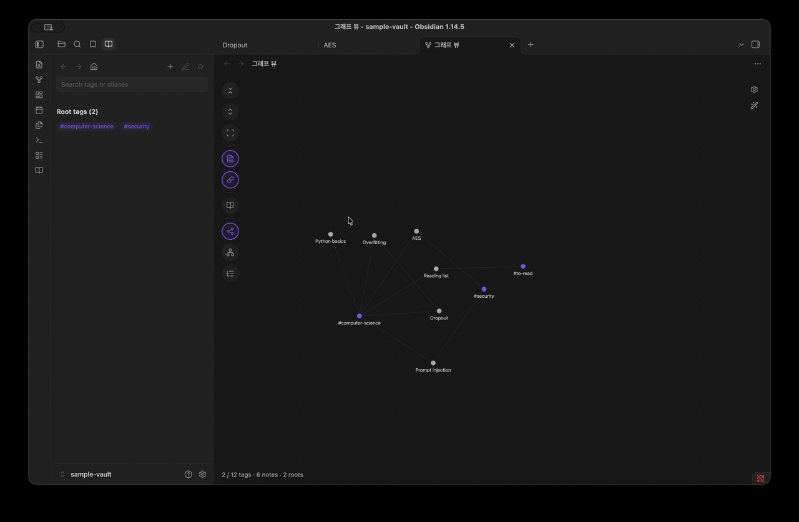

## 기능

- **사이드바에서 계층 만들기.** 노트에서 이미 쓰는 태그나 새 이름을 추가하고, 태그의 이름·설명·별칭·상위·하위·연관 태그를 고치고, 태그를 삭제합니다. 파일을 직접 고칠 필요가 없고, 저장할 때 다른 곳에서 바뀐 내용을 덮어쓰지 않습니다.
- **기본 그래프의 확장.** 노트, 노트 링크, 필터, 색상 그룹, 화살표 등 기본 설정이 평소처럼 동작합니다.
- **접고 펼치는 태그 계층.** 사전 태그는 루트까지 접힌 상태로 시작하고, 각 노트는 보이는 가장 가까운 상위 태그에 연결됩니다. 태그를 클릭하면 선택되고 더블 클릭하면 한 단계 펼쳐지며, 노트가 더 구체적인 하위 태그로 옮겨 붙습니다. 다시 더블 클릭하면 접힙니다.
- **하위 포함 노트 수.** 태그마다 *직접* 달린 노트 수와, *하위 태그까지 포함한* 노트 수를 보여 줍니다.
- **다중 부모와 연관 관계.** 실선 화살표는 상위에서 하위로 향하고, 점선은 연관 태그를 잇습니다.
- **세 가지 배치.** Force, 세로 트리, 가로 트리.
- **3D 보기 (beta).** 같은 계층을 입체로 봅니다. 주위를 돌려 보고, 태그를 클릭하면 그 태그로 날아갑니다. 설정의 **Layout**에서 고릅니다.
- **사이드바 탭.** 파일·검색 탭 옆의 탭에서 태그 이름이나 별칭으로 찾고, 태그 정보를 보고, 사전 대조를 합니다. 여기서 태그를 고르면 열린 그래프가 그 태그를 가운데로 옮깁니다.
- **사전 대조.** vault에서 쓰이지만 사전에 없는 태그와, 사전에는 있지만 아직 아무 노트도 쓰지 않는 태그를 보여 줍니다. 보고만 하고 아무것도 바꾸지 않습니다.
- **사용자 색상(선택).** 그래프와 사이드바의 모든 태그를 한 가지 색(따로 고르지 않으면 강조색)으로 칠합니다.
- **포커스(선택).** 선택한 태그와 바로 옆 태그(상위·하위·연관 태그)는 밝게 두고 나머지는 흐리게 합니다. 옵션으로 아래의 모든 하위 태그와 노트를 더할 수 있습니다.
- **보던 상태 기억.** 펼친 태그와 Notes·Related 토글이 저장되고, 모든 그래프 탭이 같은 상태를 씁니다.

| 사이드바 탭 | 사전 대조 |
| --- | --- |
| 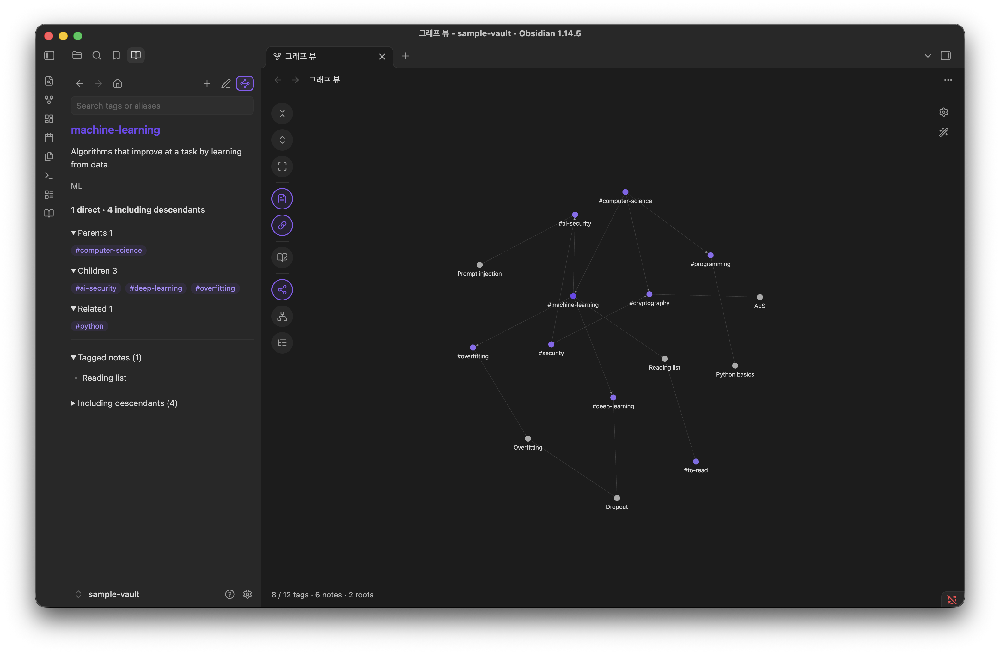 | 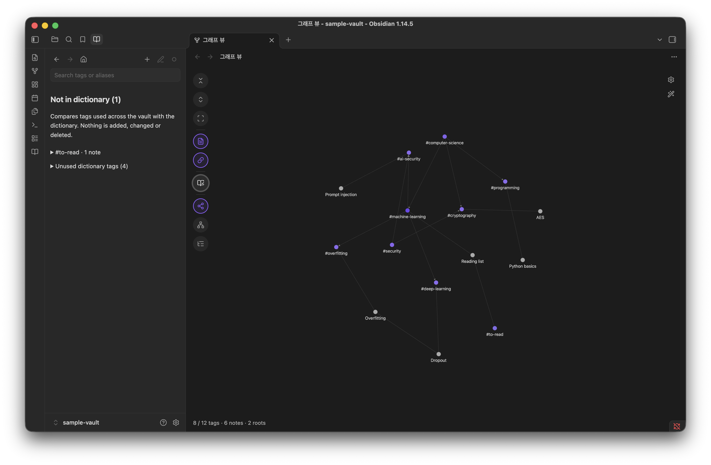 |
| **세로 트리** | **가로 트리** |
| 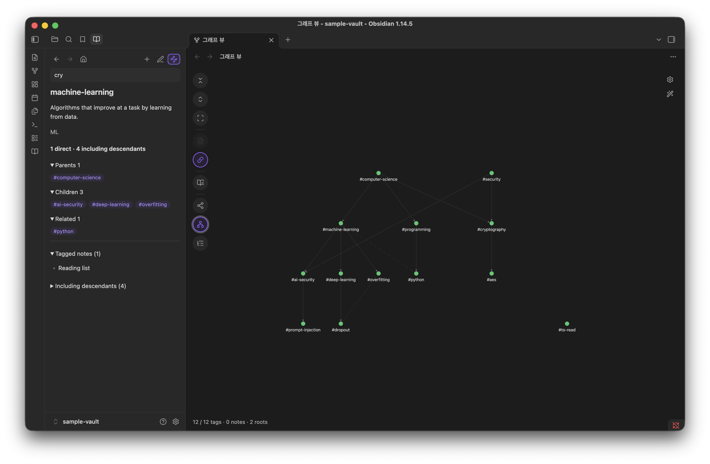 | 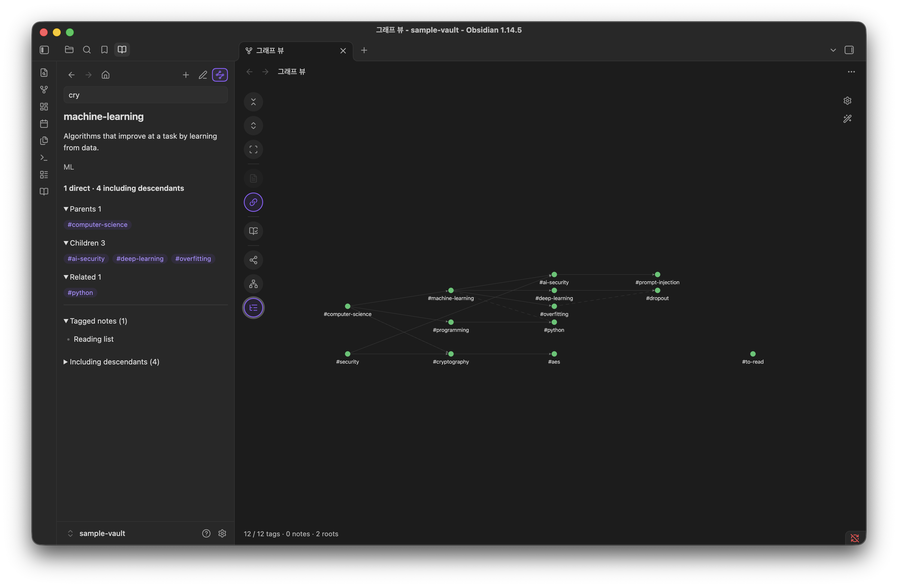 |
| **원래 테마** | **선택한 태그 포커스 유지** |
| 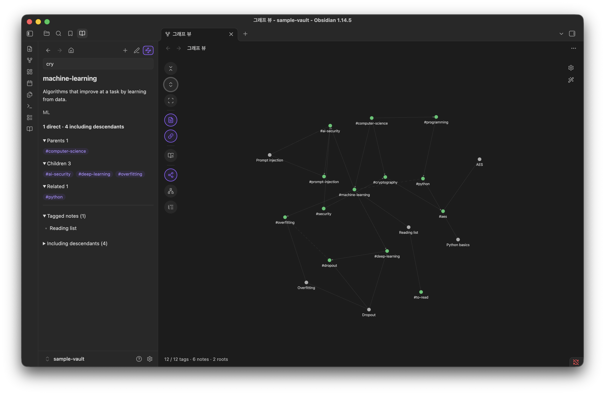 | 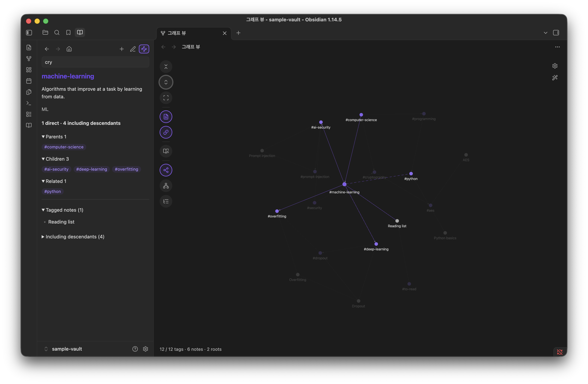 |
| **태그 편집** | **새 태그** |
| 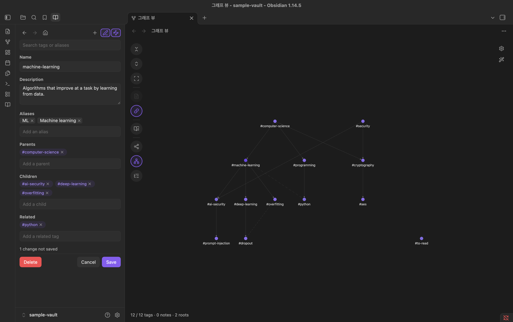 | 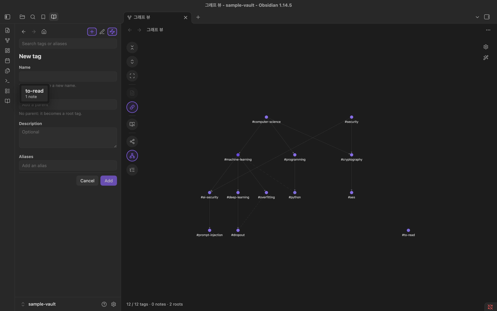 |
| **검색 추천** | **태그 삭제** |
| 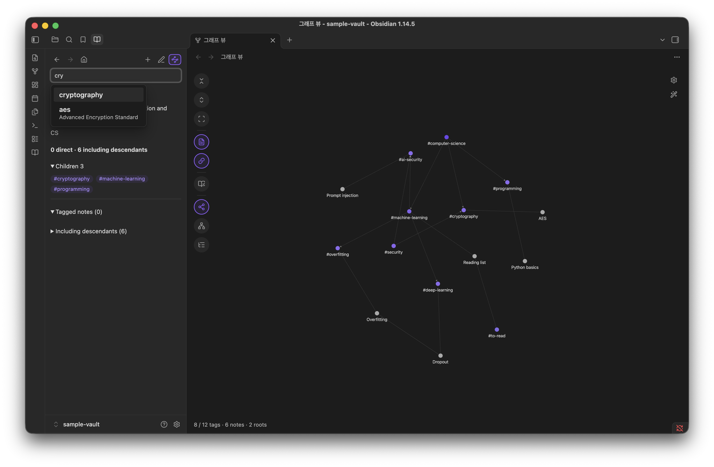 | 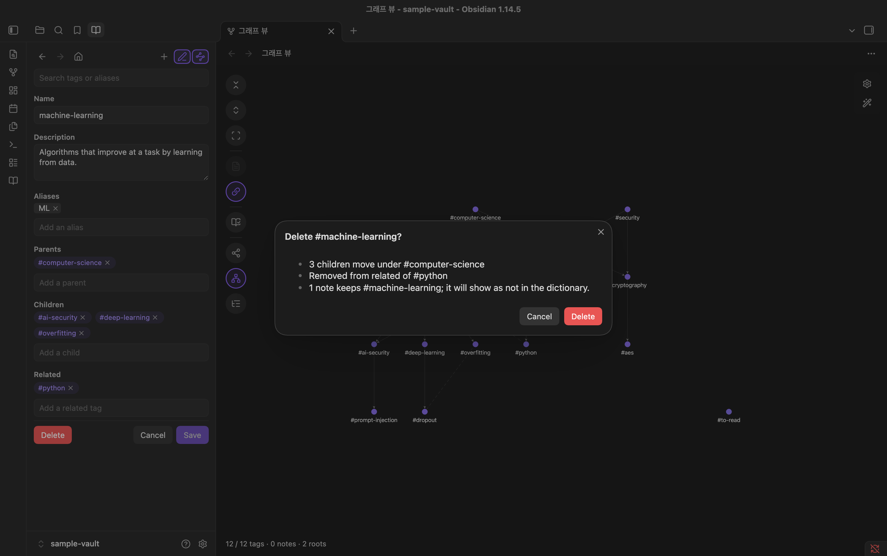 |

## 동작 방식

Tag Ontology는 기본 그래프 뷰 안에서 동작합니다. Obsidian이 필터와 색상 그룹을 적용해 만든 그래프를 받아, 사전 태그를 접고 태그 사이에 계층·연관 선을 더합니다. 사전에 없는 태그는 일반 태그 노드로 그대로 둡니다. 로컬 그래프에는 영향이 없고, 플러그인을 끄면 그래프 뷰가 원래대로 돌아옵니다.

3D 보기(beta)는 따로 열리는 탭입니다. vault에서 같은 노트와 태그를 모아, 같은 코드로 사전을 얹고, three.js로 그립니다.

사이드바 탭에서 만든 계층은 사전 파일에 저장됩니다. 파일을 직접 보거나 고치고 싶다면 [고급: 사전 파일](#고급-사전-파일)을 참고하세요.

태그 사용 정보는 Obsidian 메타데이터 캐시에서 가져옵니다. 모든 Markdown 노트의 frontmatter `tags`와 본문 `#태그`가 포함됩니다.

## 설치

### 커뮤니티 플러그인

**설정 → 커뮤니티 플러그인 → 탐색**에서 "Tag Ontology"를 검색해 설치하고 켭니다. [디렉터리 페이지](https://community.obsidian.md/plugins/tag-ontology)에서도 설치할 수 있습니다.

### BRAT (베타)

1. [BRAT](https://github.com/TfTHacker/obsidian42-brat)을 설치합니다.
2. **BRAT: Add a beta plugin**을 실행하고 `NamhyeonKo/obsidian-tag-ontology`를 입력합니다.

### 수동 설치

1. [최신 릴리스](https://github.com/NamhyeonKo/obsidian-tag-ontology/releases)에서 `main.js`, `manifest.json`, `styles.css`를 내려받습니다.
2. 세 파일을 vault 안의 `.obsidian/plugins/tag-ontology/`에 복사합니다.
3. Obsidian을 다시 불러온 뒤 **설정 → 커뮤니티 플러그인**에서 **Tag Ontology**를 켭니다.

기본 **그래프 뷰** 코어 플러그인이 켜져 있어야 합니다.

## 예제 vault로 바로 써 보기

저장소에 작은 예제 vault가 들어 있습니다. [`examples/sample-vault`](examples/sample-vault)에는 태그 12개짜리 사전과 노트 6개가 있습니다.

1. Obsidian에서 **폴더를 vault로 열기**를 선택하고 `examples/sample-vault`를 고릅니다.
2. 위 방법 중 하나로 그 vault에 플러그인을 설치합니다.
3. 리본의 **Open tag ontology** 아이콘(책 모양)을 누르거나, 명령 팔레트에서 **Tag Ontology: Open graph**를 실행합니다.
4. 태그가 보이지 않으면 그래프 설정(톱니바퀴 아이콘)에서 **필터 → Tags**를 켭니다.

루트 `computer-science`와 `security`에 노트 6개가 연결되어 있고, 미등록 태그 `#to-read`가 보이면 정상입니다. `computer-science`, `machine-learning`을 차례로 더블 클릭하면 `Dropout` 노트가 `deep-learning`으로 옮겨 붙습니다. `cryptography`와 `ai-security`는 부모가 둘입니다.

이어서 사이드바 탭에서 **+**를 눌러 `machine-learning` 아래에 나만의 태그를 추가해 보세요.

## 사용법

UI는 영어로 표시됩니다.

### 사이드바 탭

**Open tag ontology**(리본의 책 아이콘 또는 **Open graph** 명령)를 실행하면 그래프가 열리고, 왼쪽 사이드바의 파일·검색 탭 옆에 **Tag dictionary** 탭이 앞으로 나옵니다. 그래프에서 태그를 클릭하거나 **Dictionary check**를 눌러도 이 탭이 앞으로 나옵니다. 탭은 오른쪽 사이드바로 옮길 수 있습니다.

- **맨 위 버튼 줄**: 왼쪽에 뒤로·앞으로·홈(최상위 태그 목록), 오른쪽에 **New tag**·**Edit tag**와 그래프에서 태그를 펼치거나 접는 버튼이 있습니다.
- **Search tags or aliases**: 태그 이름이나 별칭의 일부를 입력하고 후보를 클릭하거나 Enter로 고릅니다. 별칭으로 맞은 후보는 태그 아래에 그 별칭이 함께 보여서, `convolution`이나 `합성곱`으로도 `cnn`을 찾을 수 있습니다. 고른 태그까지 그래프가 펼쳐지고 그 태그가 가운데로 옵니다.
- 아무 태그도 고르지 않았으면 최상위 태그 목록이 보입니다.
- 태그를 고르면 설명, 별칭, 노트 수(직접 / 하위 포함), 상위·하위·연관 태그(`#태그` 링크), 노트 목록이 표시됩니다. `#태그`를 누르면 그 태그로 이동합니다.

### 사전 편집

- **New tag**(버튼 줄의 `+`): 노트에서 쓰이지만 사전에 없는 태그를 쓰인 노트 수 순으로 보여 주니 하나를 고르거나, 새 이름을 입력합니다. 상위 태그를 골라 다른 태그 밑에 둘 수 있고, 고르지 않으면 최상위 태그가 됩니다. 하위·연관 태그도 함께 고를 수 있으며, 사전에 이미 있는 태그 중에서 고릅니다.
- **Edit tag**(연필): 이름·설명·별칭·상위·하위·연관 태그를 고칩니다. 칸의 마지막 항목 뒤 **+**를 누르면 그 칸에 추가할 수 있습니다. 상위·하위·연관 태그는 사전에 이미 있는 태그만 고를 수 있고, 연관 태그는 양쪽에 함께 저장됩니다. 이름을 바꿔도 그 태그를 쓰는 노트는 바뀌지 않습니다. 노트에는 옛 태그가 남고, 그 태그는 사전에 없는 태그로 표시됩니다. 대소문자만 바꾸면(`ml` → `ML`) 태그는 대소문자를 가리지 않고 맞추므로 노트는 그대로 연결됩니다.
- **Delete**(편집 양식 안)는 먼저 물어보며 결과를 보여 줍니다. 그 태그의 하위 태그는 그 태그의 상위 태그 밑으로 옮겨 가고, 연관 목록에서 빠지며, 노트의 태그는 그대로 남습니다.
- 변경은 **Save**를 누를 때까지 양식에만 있고, 저장하지 않은 채 다른 곳으로 가려 하면 먼저 묻습니다. 고친 태그가 그사이 다른 곳에서 바뀌었으면 저장하지 않고 알려 주며, 편집 내용은 양식에 남아 있습니다.
- 사전은 한 줄에 태그 하나씩 저장되므로, 저장하면 관련된 줄만 바뀝니다. 다른 모양으로 쓰인 사전은 처음 저장할 때 이 모양으로 바뀝니다. 줄바꿈 방식(LF·CRLF)은 그대로 둡니다.

### 그래프 도구 모음

그래프 왼쪽의 동그란 버튼은 커서를 올리면 이름이 보입니다.

| 버튼 | 하는 일 |
| --- | --- |
| Collapse all | 사전 태그를 모두 루트까지 접기 |
| Expand all | 사전 태그를 모두 펼치기 |
| Fit | 그래프를 화면에 맞추기 |
| Notes | 태그가 아닌 노드(노트, 첨부파일, 아직 없는 파일) 보이기/숨기기 |
| Related | 점선 연관 관계 보이기/숨기기 |
| Dictionary check | 사전에 없는 태그와 쓰이지 않는 태그를 사이드바 탭에 보기 |
| Force / Vertical tree / Horizontal tree | 현재 배치만 강조되어 보임. 누르면 세 가지가 이 순서대로 펼쳐지고, 하나를 누르면 바뀜 |

- 트리 배치에서는 각 태그가 부모 밑에 놓이고, 태그 관계가 잘 보이도록 노트는 숨깁니다.
- 그래프에서 태그를 클릭하면 사이드바 탭에 그 태그가 표시됩니다. 더블 클릭하면 펼쳐지고 다시 더블 클릭하면 접혀서, 탭 맨 위의 버튼과 같습니다. 그 아래에 펼쳐 둔 태그는 다음에도 펼친 채로 남습니다.
- 나머지는 기본 동작을 따릅니다. 노트를 클릭하면 열리고, 사전에 없는 태그를 클릭하면 검색이 열립니다.
- 기본 그래프는 많이 축소하면 라벨과 화살표를 숨깁니다. 확대하면 보입니다.

### 3D 보기 (beta)

설정의 **Layout**을 3D로 두면 리본 아이콘과 **Open graph**가 기본 그래프 대신 3D 보기를 엽니다. 펼친 태그, Notes·Related 토글, 색, Focus, 사이드바 탭을 2D 그래프와 함께 쓰므로, 한쪽에서 펼친 태그는 다른 쪽에서도 펼쳐집니다.

- 드래그로 돌리고, 오른쪽 드래그로 옮기고, 스크롤로 확대·축소합니다.
- 태그를 클릭하면 선택하고 그 태그로 날아가며, 더블 클릭하면 펼치거나 접습니다. 노트를 클릭하면 엽니다. 사이드바에서 태그를 골라도 그 태그로 날아갑니다.
- 툴바에는 Collapse all, Expand all, Fit, Notes, Related, Dictionary check가 있습니다. 3D에는 트리 배치가 없습니다.
- 3D 보기는 노트와 태그를 vault에서 직접 모으므로, 기본 그래프의 필터·색상 그룹·첨부파일 설정은 적용되지 않습니다.

### 명령

| 명령 | 설명 |
| --- | --- |
| Tag Ontology: Open graph | 기본 그래프 뷰에서 온톨로지를 엽니다. Layout이 3D면 3D 보기를 엽니다. 이미 열린 탭이 있으면 그 탭을 씁니다. |
| Tag Ontology: Reload dictionary | 사전과 노트 색인을 다시 불러옵니다. |

### 설정

| 설정 | 설명 |
| --- | --- |
| Dictionary path | 태그 사전 경로. vault 기준 상대 경로의 `.json` 파일이며 기본값은 `Tag-Dictionary.json`입니다. |
| Layout | 2D 또는 3D (beta): 리본 아이콘과 Open graph가 여는 그래프. Force와 트리 레이아웃은 2D 그래프 툴바에서 고릅니다. |
| Keep the selected tag focused | 선택한 태그와 바로 옆 태그(상위·하위·연관 태그)는 밝게 두고 나머지는 흐리게 합니다. 선택한 태그와 그 연결선은 마우스를 올린 것처럼 보입니다. 기본값은 꺼짐이며, 켜면 아래 항목이 나타납니다. |
| &nbsp;&nbsp;Its descendants | 아래의 모든 하위 태그도 펼쳐서 보이는 데까지 밝게 둡니다. 기본값은 켜짐입니다. |
| &nbsp;&nbsp;Include notes | 선택한 태그의 노트도 밝게 두고, Its descendants가 켜져 있으면 하위 태그의 노트도 밝게 둡니다. 바로 옆 태그의 노트는 흐리게 남습니다. 기본값은 켜짐입니다. |
| Custom colors | 기본값은 꺼짐이며, 이때는 그래프 본래 색을 그대로 쓰고 사이드바 탭의 태그도 그래프의 태그 색을 따릅니다. 켜면 아래 항목이 나타납니다. |
| &nbsp;&nbsp;Tag color | 그래프와 사이드바 탭의 모든 태그 색. 직접 고르기 전까지는 강조색(설정 → 테마 또는 테마의 색)을 따라가고, 되돌리기 버튼을 누르면 다시 강조색을 따릅니다. |
| &nbsp;&nbsp;Tag title in the tag color | 사이드바 탭에서 선택한 태그의 제목을 태그 색으로 표시합니다. 끄면 기본 글자색입니다. 기본값은 켜짐입니다. |

## 고급: 사전 파일

사이드바 탭이 이 파일을 읽고 쓰므로 직접 열 필요는 없습니다. vault 안의 평범한 JSON이라 직접 고칠 수도 있습니다.

기본값으로 vault 루트의 `Tag-Dictionary.json`을 읽으며, 경로는 플러그인 설정에서 바꿀 수 있습니다. 처음 설치했을 때 파일이 없으면 빈 사전을 만들고, 나중에 파일이 없어지면 사이드바 탭에서 새로 만들 수 있습니다.

파일 전체가 하나의 JSON 객체입니다. 각 키는 **`#`을 뺀 태그 이름**입니다. 기본 그래프처럼 대소문자를 구분하지 않고 맞추며(`#ML`은 키 `ml`), 키는 소문자를 권장합니다. `#lang/python` 같은 중첩 태그는 키를 `lang/python`으로 씁니다.

```json
{
  "machine-learning": {
    "aliases": ["ML", "머신러닝"],
    "description": "데이터로부터 학습해 성능이 향상되는 알고리즘",
    "broader": ["computer-science"]
  },
  "dropout": {
    "description": "학습 중 일부 유닛을 무작위로 끄는 과적합 완화 기법",
    "broader": ["deep-learning"],
    "related": ["overfitting"],
    "facet": "technique"
  },
  "computer-science": {
    "description": "계산, 정보, 자동화를 다루는 학문",
    "broader": []
  }
}
```

| 필드 | 필수 | 타입 | 의미 |
| --- | --- | --- | --- |
| `description` | 예 | string | 태그 정보 패널에 표시됩니다. |
| `aliases` | 아니오 | string[] | 다른 이름입니다. 검색에 쓰이고, 사전 대조에서 미등록 태그와 일치하는 별칭을 알려 줄 때도 쓰입니다. |
| `broader` | 아니오 | string[] | 상위 태그입니다. **`[]`이면 루트 태그입니다.** |
| `related` | 아니오 | string[] | 계층이 아닌 연관 관계이며, 점선으로 그려집니다. |
| `facet` | 아니오 | string | 자유 분류입니다. 형식 검사만 하고 아직 화면에는 표시하지 않습니다. |

규칙:

- **루트 태그에는 `"broader": []`가 꼭 있어야 합니다.** `broader` 키가 아예 없는 태그는 아직 분류되지 않은 것으로 보고 그래프에 나타나지 않습니다.
- `broader`나 `related`에 적은 태그는 모두 사전에 있어야 합니다.
- 자기 자신을 참조할 수 없고, `broader` 관계가 순환해서도 안 됩니다.
- 사전에 오류가 있으면 Obsidian을 시작하거나 뷰를 열 때 이유를 알림으로 보여 주고, 파일을 고칠 때까지 사이드바에도 이유를 보여 줍니다. 그동안 그래프는 마지막으로 읽은 사전을 그대로 보여 주고, **New tag**·**Edit tag**는 꺼집니다.

전체 예시는 [`examples/sample-vault/Tag-Dictionary.json`](examples/sample-vault/Tag-Dictionary.json)을 참고하세요.

## 개인정보

- 네트워크 요청, 사용 통계 수집, 계정이 없습니다.
- 노트의 메타데이터와 사전 파일만 읽습니다.
- 자체 설정 파일(설정 폴더 안의 `plugins/tag-ontology/data.json`, 보통 `.obsidian/` 아래)과, 사이드바에서 변경을 저장할 때의 사전 파일에만 씁니다.

## 호환성과 알려진 한계

- **데스크톱 전용**입니다. Obsidian 1.14.5(macOS)에서 검증했습니다.
- 기본 그래프 뷰의 **비공개 내부 구조**(렌더러, PIXI, 배치 Worker)에 연결합니다. 이후 Obsidian 업데이트에서 동작하지 않을 수 있습니다. 내부 구조가 예상과 다르면 플러그인은 연결을 해제하고 기본 그래프를 그대로 둡니다.
- 큰 vault에서 노트를 켠 채 모든 태그를 펼치면 노드와 링크 수천 개를 다시 그리므로 잠깐 멈출 수 있습니다.
- 모든 태그를 펼치면 라벨이 빽빽해집니다. 특히 Force에서 그렇습니다.
- 그래프 뷰를 고치는 다른 플러그인과 함께 쓰는 경우는 검증하지 않았습니다.
- 3D 보기는 WebGL을 쓰고 three.js를 함께 담아서 플러그인 파일이 약 1.4MB입니다. three.js는 3D 보기를 열 때만 불러옵니다. 노트 수천 개를 보이면 3D 보기가 느려집니다(노트 1만 개에서 한 프레임에 약 70ms). 노트를 숨기면 빠릅니다.

## 로드맵

- 로컬 그래프에도 계층 표시

버그 제보와 기능 제안은 [Issues](https://github.com/NamhyeonKo/obsidian-tag-ontology/issues)에 남겨 주세요. 버그라면 Obsidian 버전과 OS를 함께 적어 주세요.

## 개발

Node.js **22.18 이상**이 필요합니다. 테스트가 Node의 내장 타입 제거 기능으로 TypeScript를 바로 실행하기 때문입니다.

```sh
npm ci
npm run lint        # Obsidian 심사 규칙 검사 (eslint-plugin-obsidianmd)
npm test            # 단위 테스트, vault 불필요
npm run build       # 타입 검사 후 main.js로 번들
npm run deploy -- "/path/to/vault"   # main.js, manifest.json, styles.css를 vault에 복사
```

`deploy`는 대상 vault에 `.obsidian/` 폴더가 있어야 하며, 기존 `data.json`은 보존합니다. 복사한 뒤 Obsidian에서 플러그인을 다시 불러오세요.

`npm run test:vault`는 메인테이너의 개인 vault(`OBSIDIAN_VAULT_PATH`)를 대상으로 하는 연동 테스트입니다. 다른 기여자는 실행하지 않아도 됩니다.

### 프로젝트 구조

```text
src/
├── main.ts         # Plugin entry: commands, settings tab, vault/metadata events
├── ontology.ts     # Dictionary validation, hierarchy, note roll-up, dictionary check
├── dictionary.ts   # Pure functions that apply sidebar edits to the dictionary JSON and write it
├── search.ts       # Suggestion popover for the search box and the edit forms
├── native.ts       # Hooks the core Graph view renderer (toolbar, sidebar tab, clicks, layouts)
├── graph3d.ts      # The 3D view: draws the same layered data with 3d-force-graph
├── three.ts        # three.js and 3d-force-graph, imported only when a 3D view opens
├── vault-data.ts   # Builds the core graph's data shape from the vault for the 3D view
├── layer.ts        # Pure functions that layer the dictionary onto the core graph data
├── layout.ts       # Vertical and horizontal tree positions
└── settings.ts     # Settings shape and path validation
tests/              # node:test unit tests (tests/integration is maintainer-only)
examples/           # Sample vault with a Tag-Dictionary.json
scripts/deploy.mjs  # Copies the build into a local vault
```

### 기여와 릴리스

커밋 규칙(Conventional Commits), 커밋 전 검사, Obsidian에서 테스트하는 방법, 메인테이너용 릴리스 절차는 [CONTRIBUTING.md](CONTRIBUTING.md)에 있습니다(영어).

## 후원

Tag Ontology는 무료 오픈 소스입니다. 시간을 아껴 줬다면 [커피 한 잔](https://buymeacoffee.com/namhyunko)을 선물해 주시거나 [GitHub Sponsors](https://github.com/sponsors/NamhyeonKo)로 후원해 주셔도 좋습니다.

## 감사의 말

- 기본 그래프 렌더러에 사용자 데이터를 공급하는 방식은 [Nested tags graph](https://github.com/drpilman/obsidian-graph-nested-tags)에서 아이디어를 얻었습니다. 해당 플러그인을 설치할 필요는 없습니다.
- 3D 보기는 [3d-force-graph](https://github.com/vasturiano/3d-force-graph), [three-spritetext](https://github.com/vasturiano/three-spritetext), [three.js](https://threejs.org)(모두 MIT)로 만들었습니다.

## 라이선스

Copyright (C) 2026 NamhyeonKo

Tag Ontology는 자유 소프트웨어입니다. 자유 소프트웨어 재단이 발표한 [GNU Affero General Public License](LICENSE) 버전 3 또는 (선택에 따라) 그 이후 버전의 조건에 따라 재배포하거나 수정할 수 있습니다. 유용하게 쓰이기를 바라며 배포하지만 어떠한 보증도 하지 않습니다. 자세한 내용은 라이선스 전문을 보세요.

0.2.0 이하 버전은 MIT 라이선스로 배포되었고, 그 릴리스들은 계속 MIT입니다.
