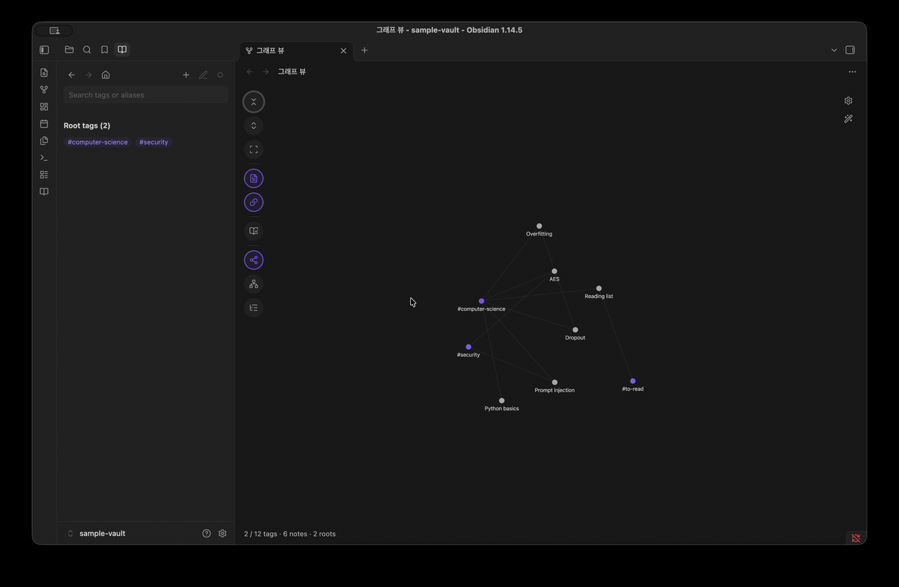

# Tag Ontology

[](https://github.com/NamhyeonKo/obsidian-tag-ontology/releases/latest)
[](https://github.com/NamhyeonKo/obsidian-tag-ontology/actions/workflows/release.yml)
[](LICENSE)

**English** | [한국어](README.ko.md)

Tag Ontology adds your **tag hierarchy** to Obsidian's core **Graph view**. You describe your tags in a JSON dictionary (description, aliases, parents, related tags), and the plugin layers that hierarchy on top of the graph you already use. Notes, links between notes, filters, color groups and display settings keep working as before.

It never edits your notes. The dictionary changes only when you add, edit or delete a tag in the sidebar tab.

> **To start:** the hierarchy is built from tag nodes, so it needs **Filters → Tags** on in the graph settings. A fresh install turns it on for you.



## Features

- **An extension of the core graph.** Notes, note links, filters, color groups, arrows and the other core settings work as usual.
- **Collapsible tag hierarchy.** Dictionary tags start collapsed to their roots, and each note links to its nearest visible ancestor. Click a tag to select it and double-click it to expand it one level, and watch its notes move to the more specific child tags.
- **Note counts with roll-up.** For each tag you see the notes tagged *directly* and the notes tagged with the tag *or any descendant*.
- **Multiple parents and related tags.** Solid arrows go from parent to child. Dashed lines connect related tags.
- **Three layouts.** Force, a vertical tree and a horizontal tree.
- **A sidebar tab.** Search by tag name or alias, read a tag's details and run the dictionary check in a tab next to Files and Search. Choosing a tag there centers it in the open graph.
- **Edit the dictionary in the sidebar.** Add tags your notes already use or new names, edit a tag's name, description, aliases, parents, children and related tags, and delete tags. Saving never overwrites changes made elsewhere.
- **Dictionary check.** Lists tags used in your vault but missing from the dictionary, and dictionary tags no note uses yet. It only reports and never changes anything.
- **Custom colors (optional).** Give every tag in the graph and in the sidebar one color, the accent color unless you pick another.
- **Focus (optional).** Keep the selected tag and its related tags bright while the rest fades. Options add its descendants and its notes.
- **Remembers your view.** Expanded tags and the Notes/Related toggles are saved and shared by every graph tab.

| Sidebar tab | Dictionary check |
| --- | --- |
|  |  |
| **Vertical tree** | **Horizontal tree** |
|  |  |
| **Original theme** | **Keep the selected tag focused** |
|  |  |
| **Edit a tag** | **New tag** |
|  |  |
| **Search suggestions** | **Delete a tag** |
|  |  |

## How it works

Tag Ontology works inside the core Graph view. It takes the graph Obsidian has already built with your filters and color groups, collapses the dictionary tags and adds the hierarchy and related links between them. Tags that are not in the dictionary stay ordinary tag nodes. The local graph is not affected, and disabling the plugin returns the Graph view to normal.

Tag usage comes from Obsidian's metadata cache, which includes frontmatter `tags` and inline `#tags` in every Markdown note.

## Installation

### From Community plugins

Open **Settings → Community plugins → Browse**, search for "Tag Ontology", then install and enable it. You can also install it from its [directory page](https://community.obsidian.md/plugins/tag-ontology).

### With BRAT (beta)

1. Install [BRAT](https://github.com/TfTHacker/obsidian42-brat).
2. Choose **BRAT: Add a beta plugin** and enter `NamhyeonKo/obsidian-tag-ontology`.

### Manually

1. Download `main.js`, `manifest.json` and `styles.css` from the [latest release](https://github.com/NamhyeonKo/obsidian-tag-ontology/releases).
2. Copy them into `.obsidian/plugins/tag-ontology/` inside your vault.
3. Reload Obsidian, then enable **Tag Ontology** in **Settings → Community plugins**.

The core **Graph view** plugin must be enabled.

## Quick start with the sample vault

The repository includes a small vault in [`examples/sample-vault`](examples/sample-vault): a 12-tag dictionary and six notes.

1. In Obsidian, choose **Open folder as vault** and select `examples/sample-vault`.
2. Install the plugin into that vault using one of the methods above.
3. Click the **Open tag ontology** ribbon icon (a book) or run **Tag Ontology: Open graph** from the command palette.
4. If the graph shows no tags, turn on **Filters → Tags** in the graph settings (gear icon).

You should see two roots, `computer-science` and `security`, with the six notes linked to them, plus the unregistered tag `#to-read`. Double-click `computer-science`, then `machine-learning`: the `Dropout` note moves to `deep-learning`. `cryptography` and `ai-security` have two parents each.

## Tag dictionary format

By default the plugin reads `Tag-Dictionary.json` at the vault root; you can change the path in the plugin settings. On a fresh install with no file there, the plugin creates an empty dictionary. If the file goes missing later, the sidebar tab offers to create one.

The file is a single JSON object. Each key is a tag **without `#`**, matched case-insensitively like the core graph (`#ML` uses the key `ml`). Lowercase keys are recommended. A nested tag such as `#lang/python` uses the key `lang/python`.

```json
{
  "machine-learning": {
    "aliases": ["ML"],
    "description": "Algorithms that improve at a task by learning from data.",
    "broader": ["computer-science"]
  },
  "dropout": {
    "description": "Randomly disabling units during training to reduce overfitting.",
    "broader": ["deep-learning"],
    "related": ["overfitting"],
    "facet": "technique"
  },
  "computer-science": {
    "description": "The study of computation, information and automation.",
    "broader": []
  }
}
```

| Field | Required | Type | Meaning |
| --- | --- | --- | --- |
| `description` | yes | string | Shown in the tag panel. |
| `aliases` | no | string[] | Other names. Used by search and by the dictionary check to suggest a match for an unregistered tag. |
| `broader` | no | string[] | Parent tags. **`[]` marks a root tag.** |
| `related` | no | string[] | Non-hierarchical links, drawn as dashed lines. |
| `facet` | no | string | Free-form category. Validated but not displayed yet. |

Rules:

- **Roots need `"broader": []`.** A tag with no `broader` key at all is treated as not yet placed and does not appear in the graph.
- Every tag named in `broader` or `related` must exist in the dictionary.
- A tag cannot reference itself, and `broader` links cannot form a cycle.
- If the dictionary is invalid, a notice shows the reason when Obsidian starts or when you open the view, and the sidebar keeps showing it until you fix the file. The graph keeps the last version that loaded, and **New tag** and **Edit tag** are off until then.

See [`examples/sample-vault/Tag-Dictionary.json`](examples/sample-vault/Tag-Dictionary.json) for a complete example.

## Usage

### Sidebar tab

**Open tag ontology** (the book ribbon icon or the **Open graph** command) adds a **Tag dictionary** tab to the left sidebar, next to Files and Search. Clicking a tag in the graph or **Dictionary check** opens it too and brings it forward. You can drag the tab to the right sidebar.

- **The bar at the top** has back, forward and home (the root tags) on the left, and **New tag**, **Edit tag** and a button that expands or collapses the tag in the graph on the right.
- **Search tags or aliases**: type part of a tag name or alias and choose a suggestion with a click or Enter. An alias match shows the alias under the tag, so `convolution` or `합성곱` can find `cnn`. The graph expands down to the chosen tag and centers it.
- With no tag chosen, the tab lists the root tags.
- A tag shows its description, aliases, note counts (direct and including descendants), its parents, children and related tags as `#tag` links, and its notes. Click a `#tag` to move to it.

### Editing the dictionary

- **New tag** (`+` in the bar): pick a tag your notes use but the dictionary lacks, listed by how many notes use it, or type a new name. Choose parents to place it under other tags; without parents it becomes a root tag.
- **Edit tag** (the pencil): change the name, description, aliases, parents, children and related tags. Press **+** after the last item of a field to add to it. Parents, children and related tags must already be in the dictionary, and related tags are saved on both sides. Renaming a tag doesn't change the notes that use it: they keep the old tag, which then shows as not in the dictionary. Changing only the case (`ml` to `ML`) keeps them linked, since tags match regardless of case.
- **Delete** (in the edit form) asks first and shows what happens: the tag's children move under its parents, it leaves the related lists, and notes keep their tags.
- Changes stay in the form until you press **Save**, and leaving with unsaved changes asks first. If the tags you changed were changed elsewhere in the meantime, the save stops and tells you, and your edits stay in the form.
- The dictionary is saved one tag per line, so a save changes only the lines involved. A file written in another layout is reformatted on its first save. Its line endings (LF or CRLF) are kept.

### Graph toolbar

The round buttons on the left of the graph show their name when you hover them:

| Button | What it does |
| --- | --- |
| Collapse all | Collapse every dictionary tag to its root |
| Expand all | Expand every dictionary tag |
| Fit | Fit the graph to the view |
| Notes | Show or hide every node that is not a tag (notes, attachments, unresolved links) |
| Related | Show or hide the dashed related links |
| Dictionary check | List unregistered and unused tags in the sidebar tab |
| Force / Vertical tree / Horizontal tree | Switch the layout; the current one is highlighted |

- In the tree layouts each tag hangs under its parent and notes are hidden, so the tag relations stay readable.
- Click a tag in the graph to show it in the sidebar tab, and double-click it to expand it. Collapse it with the button at the top of the tab.
- Everything else keeps the core behavior: clicking a note opens it, and clicking a tag that is not in the dictionary opens search.

### Commands

| Command | Description |
| --- | --- |
| Tag Ontology: Open graph | Open the ontology in the core Graph view. Reuses an open graph tab. |
| Tag Ontology: Reload dictionary | Reload the dictionary and the note index. |

### Settings

| Setting | Description |
| --- | --- |
| Dictionary path | Vault-relative path to a `.json` file. Default: `Tag-Dictionary.json`. |
| Layout | Force, Vertical tree or Horizontal tree. |
| Keep the selected tag focused | Keep the selected tag and its related tags bright and fade the rest. Off by default. Turn it on to show the options below. |
| &nbsp;&nbsp;Its descendants | Also keep the tags under it bright, as far as they are expanded. On by default. |
| &nbsp;&nbsp;Include notes | Also keep the notes on the selected tag bright, and on its descendants when those are on. A related tag's notes still fade. On by default. |
| Custom colors | Off by default: the graph keeps its own colors, and the tags in the sidebar tab take the graph's tag color. Turn it on to show the options below. |
| &nbsp;&nbsp;Tag color | Color of every tag in the graph and in the sidebar tab. Follows the accent color (Settings → Appearance, or your theme) until you pick one; the reset button goes back to it. |
| &nbsp;&nbsp;Tag title in the tag color | Show the selected tag's title in the sidebar tab in the tag color. Off: the text color. On by default. |

At low zoom levels the core graph hides labels and arrows. Zoom in to see them.

## Privacy

- No network requests, telemetry or accounts.
- Reads your notes' metadata and the dictionary file only.
- Writes only its own settings file (`plugins/tag-ontology/data.json` in the config folder, usually `.obsidian/`) and the dictionary file when you save a change in the sidebar.

## Compatibility and known limitations

- **Desktop only.** Tested on Obsidian 1.14.5 (macOS).
- The plugin hooks into **undocumented internals** of the core Graph view (renderer, PIXI, layout worker). A future Obsidian update may break it. If the internals look unfamiliar, the plugin detaches and leaves the core graph alone.
- On large vaults, expanding every tag with notes shown redraws a few thousand nodes and links; expect a short pause.
- Labels get dense when every tag is expanded, especially in Force.
- Untested together with other plugins that patch the Graph view.

## Roadmap

- Show the hierarchy in the local graph too.

Bug reports and feature requests are welcome in [Issues](https://github.com/NamhyeonKo/obsidian-tag-ontology/issues). Please include your Obsidian version and OS for bugs.

## Development

Requires Node.js **22.18 or later**. The tests run TypeScript directly with Node's built-in type stripping.

```sh
npm ci
npm run lint        # Obsidian review rules (eslint-plugin-obsidianmd)
npm test            # unit tests, no vault needed
npm run build       # type-check + bundle to main.js
npm run deploy -- "/path/to/vault"   # copy main.js, manifest.json, styles.css into the vault
```

`deploy` requires an existing `.obsidian/` folder in the target vault and preserves an existing `data.json`. Reload the plugin in Obsidian afterwards.

`npm run test:vault` is the maintainer's integration test against a private vault (`OBSIDIAN_VAULT_PATH`). Other contributors don't need to run it.

### Project structure

```text
src/
├── main.ts         # Plugin entry: commands, settings tab, vault/metadata events
├── ontology.ts     # Dictionary validation, hierarchy, note roll-up, dictionary check
├── dictionary.ts   # Pure functions that apply sidebar edits to the dictionary JSON and write it
├── search.ts       # Suggestion popover for the search box and the edit forms
├── native.ts       # Hooks the core Graph view renderer (toolbar, sidebar tab, clicks, layouts)
├── layer.ts        # Pure functions that layer the dictionary onto the core graph data
├── layout.ts       # Vertical and horizontal tree positions
└── settings.ts     # Settings shape and path validation
tests/              # node:test unit tests (tests/integration is maintainer-only)
examples/           # Sample vault with a Tag-Dictionary.json
scripts/deploy.mjs  # Copies the build into a local vault
```

### Contributing and releasing

See [CONTRIBUTING.md](CONTRIBUTING.md) for the commit convention (Conventional Commits), pre-commit checks, testing in Obsidian, and the maintainer release checklist.

## Acknowledgements

- The approach of feeding custom data to the core graph renderer was inspired by [Nested tags graph](https://github.com/drpilman/obsidian-graph-nested-tags). That plugin is not required.

## License

Copyright (C) 2026 NamhyeonKo

Tag Ontology is free software: you can redistribute it and/or modify it under the terms of the [GNU Affero General Public License](LICENSE) as published by the Free Software Foundation, either version 3 of the License, or (at your option) any later version. It is distributed in the hope that it will be useful, but WITHOUT ANY WARRANTY; see the license for details.

Versions 0.2.0 and earlier were released under the MIT License, and those releases remain under MIT.
