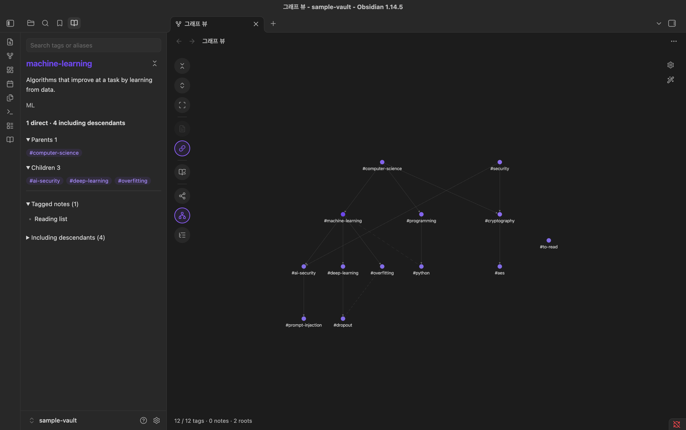
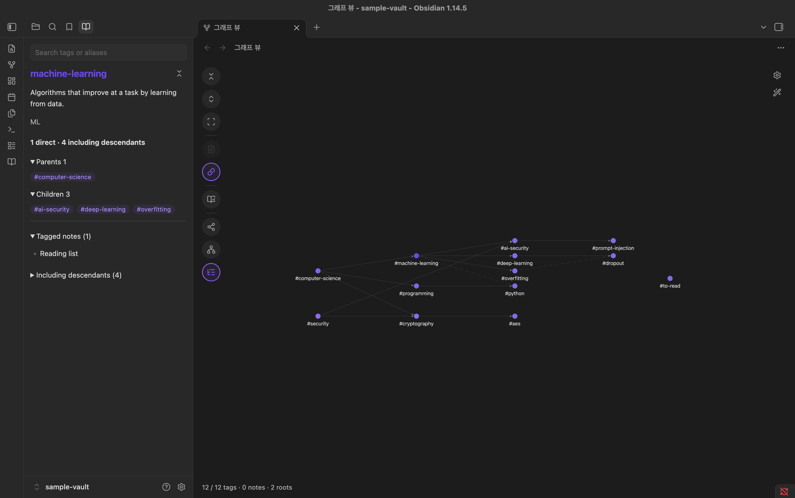

# Tag Ontology

[](https://github.com/NamhyeonKo/obsidian-tag-ontology/releases/latest)
[](https://github.com/NamhyeonKo/obsidian-tag-ontology/actions/workflows/release.yml)
[](LICENSE)

**English** | [한국어](README.ko.md)

Tag Ontology adds your **tag hierarchy** to Obsidian's core **Graph view**. You describe your tags in a JSON dictionary (definition, aliases, parents, related tags). The plugin layers that hierarchy on top of the graph you already use, and keeps everything else the core graph does: notes, links between notes, filters, color groups and display settings.

It never edits your notes. It changes the dictionary file only when you add, edit or delete a tag in the sidebar tab.

> **To start:** the hierarchy is built from tag nodes, so it needs **Filters → Tags** on in the graph settings. A fresh install turns it on once for you; after that the plugin never changes it, so if you turn it off, turn it back on to see the hierarchy.


## Features

- **An extension of the core graph.** Notes, note links, filters, color groups, arrows and the other core settings work as usual. Node size still grows with links.
- **Collapsible tag hierarchy.** Dictionary tags start collapsed to their roots, and each note links to its nearest visible ancestor. Click a tag to expand it one level and watch its notes move to the more specific child tags.
- **Note counts with roll-up.** For each tag you see notes tagged *directly* and notes tagged with the tag *or any descendant*. Notes are de-duplicated across multiple tags and multiple parents.
- **Multiple parents and related tags.** Solid arrows go from parent to child. Dashed lines connect related tags.
- **Three layouts.** Force, a vertical tree and a horizontal tree.
- **A sidebar tab.** Search by tag name or alias, read a tag's details and run the dictionary check in a tab next to Files and Search. Choosing a tag there centers it in the open graph.
- **Edit the dictionary in the sidebar.** Add tags your notes already use (most used first) or new names, edit a tag's name, description, aliases, parents, children and related tags, and delete tags. Saving checks the file first and never overwrites changes made elsewhere.
- **Dictionary check.** Lists tags used in your vault but missing from the dictionary, and dictionary tags no note uses yet. It only reports and never changes anything.
- **Custom colors (optional).** Give every tag one color and the selected tag (and, if you like, its descendants or directly connected tags) a highlight color. You can also keep the selected tag focused, as if you were hovering it.
- **Remembers your view.** Expanded tags and the Notes/Related toggles are saved and shared by every graph tab, like the core graph's own options.

| Sidebar tab | Dictionary check |
| --- | --- |
|  |  |
| **Vertical tree** | **Horizontal tree** |
|  |  |
| **Custom colors** | **Keep the selected tag focused** |
|  |  |
| **Edit a tag** | **New tag** |
|  |  |
| **Search suggestions** | **Delete a tag** |
|  |  |

## How it works

The core Graph view computes its graph as usual (with your filters and color groups applied) and hands it to the renderer. Tag Ontology adjusts that data on the way: it collapses dictionary tags, re-routes note-to-tag links to the nearest visible ancestor, and adds hierarchy and related links between tags. Tags that are not in the dictionary stay as ordinary tag nodes.

The hierarchy needs tag nodes, so **turn on Tags in the graph's Filters** (it is off by default in Obsidian). If it is off, the status line at the bottom of the graph tells you so. The local graph is not affected. Disable the plugin and the core Graph view goes back to normal.

Tag usage comes from Obsidian's metadata cache, which includes frontmatter `tags` and inline `#tags` in every Markdown note. Files and folders whose names start with `.` are skipped.

## Installation

### From Community plugins

Open **Settings → Community plugins → Browse**, search for "Tag Ontology", then install and enable it. You can also install it from its [directory page](https://community.obsidian.md/plugins/tag-ontology).

### With BRAT (beta)

1. Install [BRAT](https://github.com/TfTHacker/obsidian42-brat).
2. Choose **BRAT: Add a beta plugin** and enter `NamhyeonKo/obsidian-tag-ontology`.

### Manually

1. Download `main.js`, `manifest.json` and `styles.css` from the [latest release](https://github.com/NamhyeonKo/obsidian-tag-ontology/releases).
2. Copy them into `.obsidian/plugins/tag-ontology/` inside your vault. If you changed the config folder in Obsidian, use that folder instead of `.obsidian`.
3. Reload Obsidian, then enable **Tag Ontology** in **Settings → Community plugins**.

The core **Graph view** plugin must be enabled.

## Quick start with the sample vault

The repository includes a small vault in [`examples/sample-vault`](examples/sample-vault): a 12-tag dictionary and six notes.

1. In Obsidian, choose **Open folder as vault** and select `examples/sample-vault`.
2. Install the plugin into that vault using one of the methods above.
3. Click the **Open tag ontology** ribbon icon (a book) or run **Tag Ontology: Open graph** from the command palette.
4. The plugin turns on **Filters → Tags** the first time. If the graph shows no tags, turn it on in the graph settings (gear icon).

You should see two roots, `computer-science` and `security`, with the six notes linked to them, plus the unregistered tag `#to-read`. Click `computer-science`, then `machine-learning`: the `Dropout` note moves to `deep-learning`. `cryptography` and `ai-security` have two parents each.

## Tag dictionary format

By default the plugin reads `Tag-Dictionary.json` at the vault root. You can change the path in the plugin settings. On a fresh install, if no file is there, the plugin creates an empty dictionary (`{}`) to add tags to. After that it never creates the file on its own, because a file that is still syncing looks missing too: the sidebar tab says the dictionary was not found and offers **Create empty dictionary**, and the file shows up by itself once it arrives. Neither ever replaces an existing file.

The file is a single JSON object. Each key is a tag **without `#`**, matched case-insensitively like the core graph (`#ML` uses the key `ml`). Lowercase keys are recommended. A nested tag such as `#lang/python` uses the key `lang/python`.

```json
{
  "machine-learning": {
    "aliases": ["ML"],
    "description": "Algorithms that improve at a task by learning from data.",
    "broader": ["computer-science"]
  },
  "dropout": {
    "description": "Randomly disabling units during training to reduce overfitting.",
    "broader": ["deep-learning"],
    "related": ["overfitting"],
    "facet": "technique"
  },
  "computer-science": {
    "description": "The study of computation, information and automation.",
    "broader": []
  }
}
```

| Field | Required | Type | Meaning |
| --- | --- | --- | --- |
| `description` | yes | string | Shown in the tag panel. |
| `aliases` | no | string[] | Other names. Used by search and by the dictionary check to suggest a match for an unregistered tag. |
| `broader` | no | string[] | Parent tags. **`[]` marks a root tag.** |
| `related` | no | string[] | Non-hierarchical links, drawn as dashed lines. |
| `facet` | no | string | Free-form category. Validated but not displayed yet. |

Rules:

- **Roots need `"broader": []`.** A tag with no `broader` key at all is treated as not yet placed and does not appear in the graph.
- Every tag named in `broader` or `related` must exist in the dictionary.
- A tag cannot reference itself, and `broader` links cannot form a cycle.
- If the dictionary is invalid, opening the view shows a notice with the reason. Automatic refreshes keep the last valid graph.

See [`examples/sample-vault/Tag-Dictionary.json`](examples/sample-vault/Tag-Dictionary.json) for a complete example.

## Usage

### Sidebar tab

**Open tag ontology** (the book ribbon icon or the **Open graph** command) adds a **Tag dictionary** tab to the left sidebar, next to Files and Search, without switching to it. Clicking a tag in the graph or **Dictionary check** opens it too and brings it forward, so a closed tab comes back. Drag the tab to the right sidebar if you prefer; it stays where you put it.

- **The bar at the top**: back, forward and home (the root tags) on the left; **New tag**, **Edit tag** and the graph expand button on the right. The expand button shows `waypoints` while the tag is expanded in the graph and `circle-small` while it is collapsed.
- **Search tags or aliases** below the bar: type part of a tag name or alias; suggestions appear below (an alias match shows the alias under the tag, so `convolution` or `합성곱` can find `cnn`). Choose one with a click or Enter to expand down to that tag, show it in the tab and center it in the open graph. Search works with no graph open too: the expansion is saved for the next graph.
- With no tag chosen, the tab lists the root tags.
- A tag shows its description, aliases, note counts (direct and including descendants), its parents, children and related tags as `#tag` links, and below a rule its note lists. Click a `#tag` to move to it.

### Editing the dictionary

- **New tag** (`+` in the bar): pick a tag your notes use but the dictionary lacks, listed by how many notes use it, or type a new name. Choose its parents to place it under other tags; with no parent it becomes a root tag. Description and aliases are optional.
- **Edit tag** (the pencil): change the name, description, aliases, parents, children and related tags. Press **+** after the last item of a field to add to it. Parents, children and related tags must already be in the dictionary, and tags that would make a cycle are left out of the suggestions. Related tags are saved on both sides. Renaming a tag does not change the notes that use it: they keep the old tag, which then shows as not in the dictionary.
- **Delete** (in the edit form) asks first and shows what happens: the tag's children move under its parents (a deleted root's children become roots), it leaves the related lists, and notes keep their tags.
- Changes stay in the form until you press **Save**. Leaving with unsaved changes asks whether to keep editing, discard or save. Editing notes meanwhile doesn't reset the form.
- Saving reads the latest file and writes only if the tags you changed weren't changed elsewhere in the meantime; otherwise it says so and keeps your edits. The file is written one tag per line in key order, so a save changes only the lines of the tags involved. The first save reformats a dictionary written in another layout.

### Graph toolbar

The round buttons on the left of the graph show their name when you hover them:

| Icon | Button | What it does |
| --- | --- | --- |
| `chevrons-down-up` | Collapse all | Collapse every dictionary tag to its root |
| `chevrons-up-down` | Expand all | Expand every dictionary tag |
| `scan` | Fit | Fit the graph to the view |
| `file-text` | Notes | Show or hide every node that is not a tag (notes, attachments, unresolved links) |
| `link` | Related | Show or hide the dashed related links |
| `book-open-check` | Dictionary check | List unregistered and unused tags in the sidebar tab |
| `share-2` / `network` / `list-tree` | Force / Vertical tree / Horizontal tree | Switch the layout; the current one is highlighted |

- The **tree layouts** always hide notes so the tag relations stay readable. The Notes button is disabled there, and your Notes choice applies again in Force.
- In a tree, each tag sits one level below its deepest parent and hangs under it; arrows from its other parents are drawn too. Root trees wrap into rows (or columns) to fit the screen. Tags that are not in the dictionary sit together in the tree's bottom-right corner. Drag a tag and it springs back to its place when you let go.
- Click a tag in the graph to expand it and show it in the sidebar tab, which comes forward if another tab was showing. Clicking an expanded tag only shows it again. Collapse it with the expand button at the top of the tab.
- Everything else keeps the core behavior: clicking a note opens it (Cmd/Ctrl-click for a new tab), and clicking a tag that is not in the dictionary opens search.

### Commands

| Command | Description |
| --- | --- |
| Tag Ontology: Open graph | Open the ontology in the core Graph view. Reuses an open graph tab. |
| Tag Ontology: Reload dictionary | Reload the dictionary and the note index. |

### Settings

| Setting | Description |
| --- | --- |
| Dictionary path | Vault-relative path to a `.json` file. Default: `Tag-Dictionary.json`. Paths inside the vault's config folder (usually `.obsidian/`) or `.git/` are rejected. |
| Layout | Force, Vertical tree or Horizontal tree. A saved Radial layout (removed in 0.6.0) opens as the vertical tree. |
| Keep the selected tag focused | Keep the selected tag and its links bright and fade the rest, as when you hover it. Hovering another node still shows that node. Off by default. |
| Custom colors | Off by default: the graph keeps its own colors. Turn it on to show the options below. |
| &nbsp;&nbsp;Tag color | Color of every tag in the graph, including tags that are not in the dictionary and tags in a color group. Default `#8b6cef` (Obsidian's default accent). |
| &nbsp;&nbsp;Highlight color | Color of the highlighted tags. Default `#6d47eb`, a little darker. |
| &nbsp;&nbsp;Highlight the selected tag | Highlight the tag you clicked or searched. On by default. |
| &nbsp;&nbsp;Highlight its descendants | Also highlight every tag under it. Off by default. |
| &nbsp;&nbsp;Highlight its connected tags | Also highlight its parents, children and related tags. Off by default. The three switches add up. |
| &nbsp;&nbsp;Tag title in the highlight color | Show the selected tag's title in the sidebar tab in the highlight color. On by default. |

At low zoom levels the core graph hides labels and arrows. Zoom in to see them.

## Privacy

- No network requests, telemetry or accounts.
- Reads your notes' metadata and the dictionary file only.
- Writes its own settings file (`plugins/tag-ontology/data.json` in the config folder, usually `.obsidian/`), which holds the settings above, the expanded tags and the Notes/Related toggles. It writes the dictionary file only when you save a change in the sidebar, or to create an empty one (on a fresh install, or when you press Create empty dictionary).

## Compatibility and known limitations

- **Desktop only.** Tested on Obsidian 1.14.4 (macOS).
- The plugin hooks into **undocumented internals** of the core Graph view (renderer, PIXI, layout worker). A future Obsidian update may break it. If the internals look unfamiliar, the plugin detaches and leaves the core graph alone.
- The hierarchy appears only while the core graph's **Tags** filter is on.
- On large vaults, expanding every tag with notes shown redraws a few thousand nodes and links; expect a short pause.
- Labels get dense when every tag is expanded, especially in Force.
- Untested together with other plugins that patch the Graph view.

## Roadmap

- Show the hierarchy in the local graph too.

Bug reports and feature requests are welcome in [Issues](https://github.com/NamhyeonKo/obsidian-tag-ontology/issues). Please include your Obsidian version and OS for bugs.

## Development

Requires Node.js **22.18 or later**. The tests run TypeScript directly with Node's built-in type stripping.

```sh
npm ci
npm run lint        # Obsidian review rules (eslint-plugin-obsidianmd)
npm test            # unit tests, no vault needed
npm run build       # type-check + bundle to main.js
npm run deploy -- "/path/to/vault"   # copy main.js, manifest.json, styles.css into the vault
```

`deploy` requires an existing `.obsidian/` folder in the target vault and preserves an existing `data.json`. Reload the plugin in Obsidian afterwards.

`npm run test:vault` is the maintainer's integration test against a private vault (`OBSIDIAN_VAULT_PATH`). Other contributors don't need to run it.

### Project structure

```text
src/
├── main.ts         # Plugin entry: commands, settings tab, vault/metadata events
├── ontology.ts     # Dictionary validation, hierarchy, note roll-up, dictionary check
├── dictionary.ts   # Pure functions that apply sidebar edits to the dictionary JSON and write it
├── search.ts       # Suggestion popover for the search box and the edit forms
├── native.ts       # Hooks the core Graph view renderer (toolbar, sidebar tab, clicks, layouts)
├── layer.ts        # Pure functions that layer the dictionary onto the core graph data
├── layout.ts       # Vertical and horizontal tree positions
└── settings.ts     # Settings shape and path validation
tests/              # node:test unit tests (tests/integration is maintainer-only)
examples/           # Sample vault with a Tag-Dictionary.json
scripts/deploy.mjs  # Copies the build into a local vault
```

### Contributing and releasing

See [CONTRIBUTING.md](CONTRIBUTING.md) for the commit convention (Conventional Commits), pre-commit checks, testing in Obsidian, and the maintainer release checklist.

## Acknowledgements

- The approach of feeding custom data to the core graph renderer was inspired by [Nested tags graph](https://github.com/drpilman/obsidian-graph-nested-tags). That plugin is not required.

## License

Copyright (C) 2026 NamhyeonKo

Tag Ontology is free software: you can redistribute it and/or modify it under the terms of the [GNU Affero General Public License](LICENSE) as published by the Free Software Foundation, either version 3 of the License, or (at your option) any later version. It is distributed in the hope that it will be useful, but WITHOUT ANY WARRANTY; see the license for details.

Versions 0.2.0 and earlier were released under the MIT License, and those releases remain under MIT.
