# Tag Ontology

[](https://github.com/NamhyeonKo/obsidian-tag-ontology/stargazers)
[](https://community.obsidian.md/plugins/tag-ontology)
[](https://github.com/NamhyeonKo/obsidian-tag-ontology/releases/latest)
[](https://www.npmjs.com/package/tag-ontology)
[](https://github.com/NamhyeonKo/obsidian-tag-ontology/actions/workflows/release.yml)
[](LICENSE)

**English** | [한국어](docs/readme/README.ko.md) | [简体中文](docs/readme/README.zh-CN.md) | [繁體中文](docs/readme/README.zh-TW.md) | [日本語](docs/readme/README.ja.md) | [Español](docs/readme/README.es.md) | [Français](docs/readme/README.fr.md)

**Link your tags the way you link notes.**

Tag Ontology lets you give each tag parents, children and related tags from a sidebar tab, with no file to edit. Then explore them in Obsidian's own **Graph view**: collapse and expand each branch, switch to a tree layout and keep the selected tag in focus. Notes, links between notes, filters, color groups and display settings keep working as before.

It never edits your notes. It writes only to the tag dictionary, a plain JSON file in your vault, and only when you add, edit or delete a tag in the sidebar tab.

> **To start:** the hierarchy is built from tag nodes, so it needs **Filters → Tags** on in the graph settings. A fresh install turns it on for you.

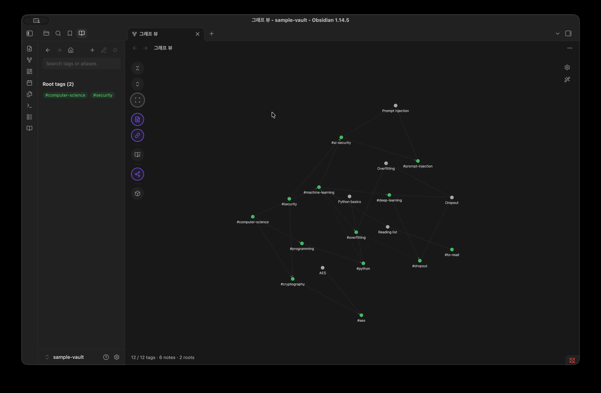

> [!TIP]
> **Using with AI agents**: Pair it with [TOW](https://github.com/NamhyeonKo/tag-ontology-wiki) to manage tags and dictionaries with AI agents, alongside broader vault tasks. ([Learn more](#related-projects))

## Features

- **Build your hierarchy in the sidebar.** Add tags your notes already use or new names, edit a tag's name, description, aliases, facet, parents, children and related tags, and delete tags. No file editing, and saving never overwrites changes made elsewhere.
- **An extension of the core graph.** Notes, note links, filters, color groups, arrows and the other core settings work as usual.
- **Collapsible tag hierarchy.** Dictionary tags start collapsed to their roots, and each note links to its nearest visible ancestor. Click a tag to select it and double-click it to expand it one level, and watch its notes move to the more specific child tags. Double-click it again to collapse it.
- **Note counts with roll-up.** For each tag you see the notes tagged *directly* and the notes tagged with the tag *or any descendant*.
- **Multiple parents and related tags.** Solid arrows go from parent to child. Dashed lines connect related tags.
- **Three layouts.** Force, a vertical tree and a horizontal tree.
- **3D view (beta).** The same hierarchy in three dimensions: orbit around it and click a tag to fly to it. Open it from the bottom of the graph toolbar.
- **Ontology explorer (beta).** Start from one tag on an empty canvas and bring out its children, parents, related tags and notes with a right-click, as object cards, in the style of Palantir's ontology graphs.
- **A sidebar tab.** Search by tag name or alias, read a tag's details and run the dictionary check in a tab next to Files and Search. Choosing a tag there centers it in the open graph.
- **Dictionary check.** Lists tags used in your vault but missing from the dictionary, with similar dictionary names; dictionary tags no note uses yet; notes that write a tag as an alias or in another case; and notes that carry a broader tag next to a narrower one. It only reports and never changes anything.
- **Custom colors (optional).** Give every tag in the graph and in the sidebar one color, the accent color unless you pick another.
- **Focus (optional).** Keep the selected tag and the tags next to it (parents, children and related tags) bright while the rest fades. Options add every tag below it and its notes.
- **Remembers your view.** Expanded tags and the Notes/Related toggles are saved and shared by every graph tab.

| Sidebar tab | Dictionary check |
| --- | --- |
| 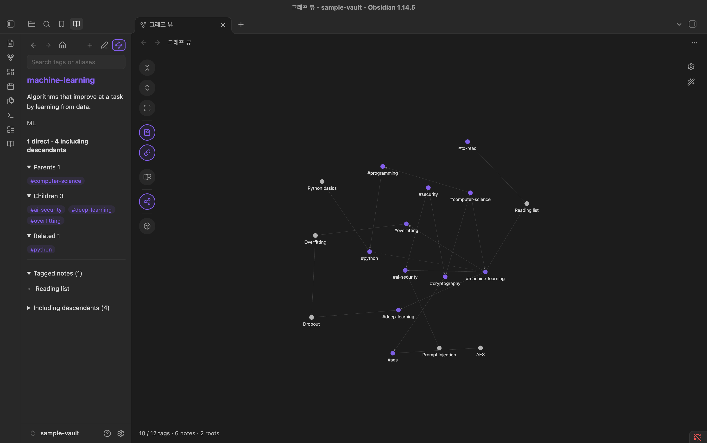 | 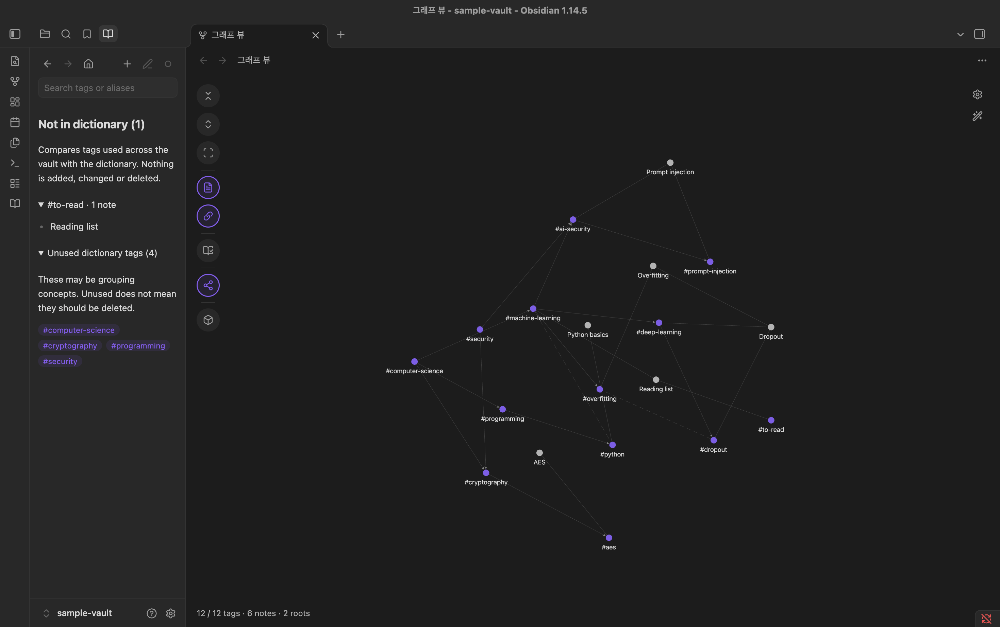 |
| **Collapsed to the roots** | **Expanded** |
| 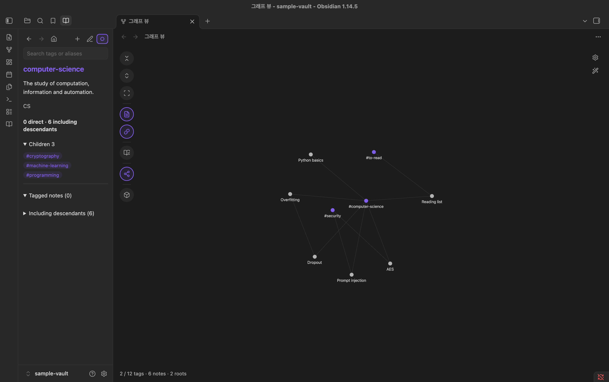 | 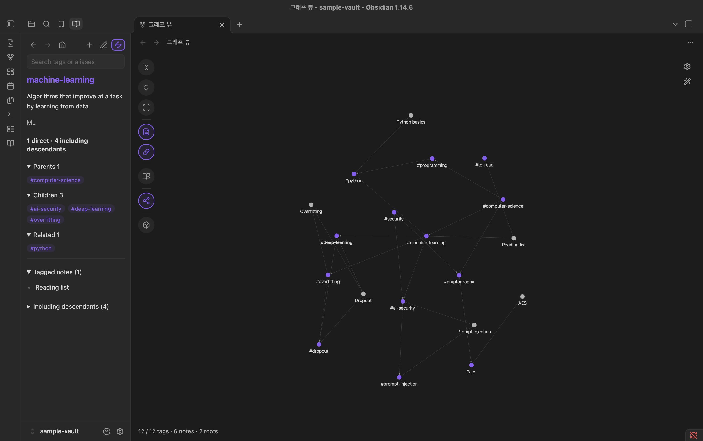 |
| **Vertical tree** | **Horizontal tree** |
| 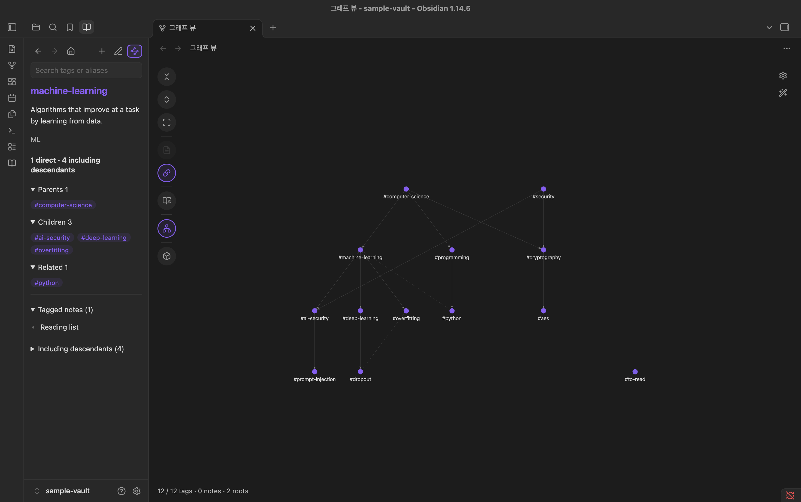 | 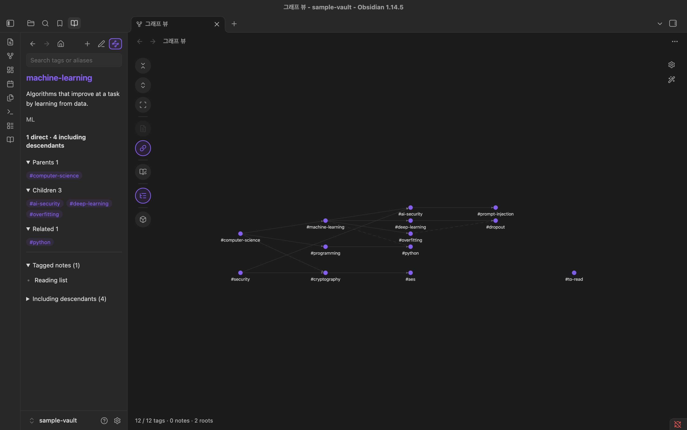 |
| **Original theme** | **Keep the selected tag focused** |
| 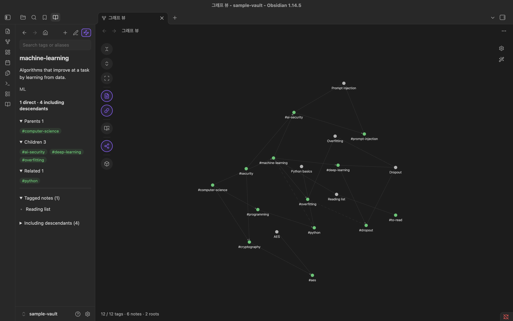 | 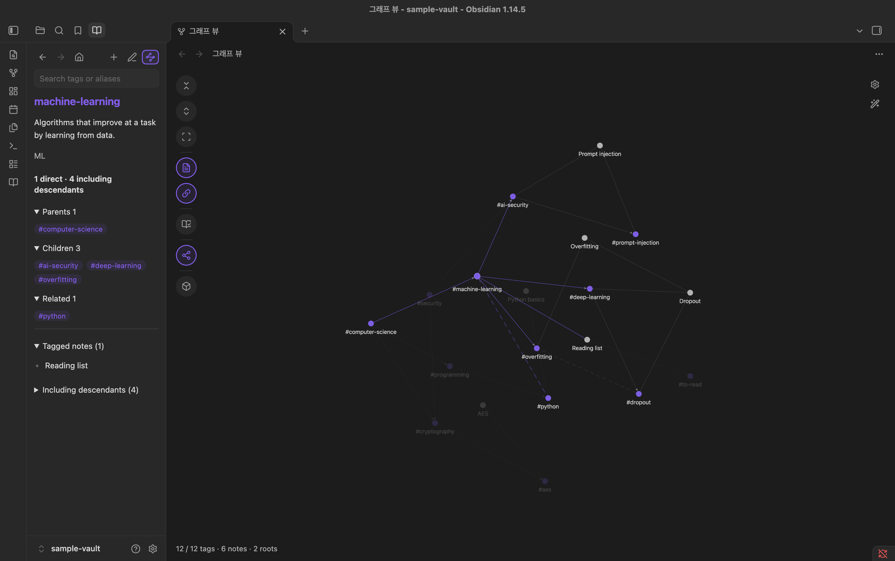 |
| **Edit a tag** | **New tag** |
| 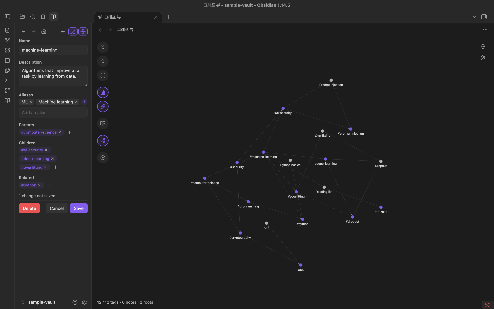 | 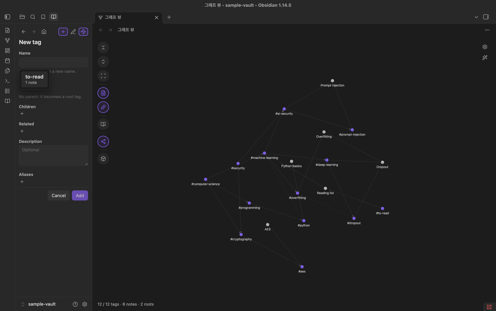 |
| **Search suggestions** | **Delete a tag** |
| 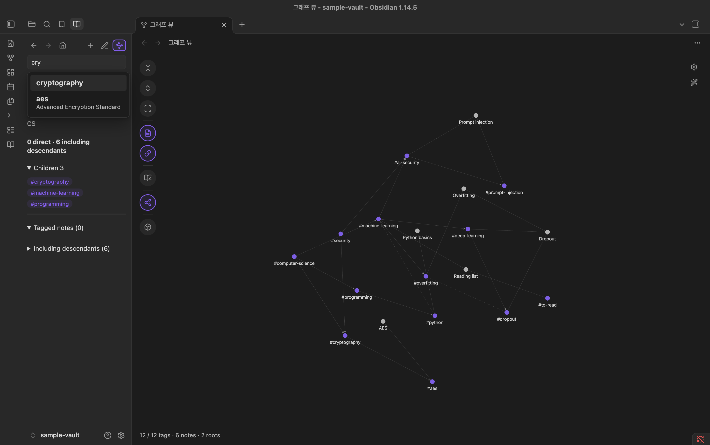 | 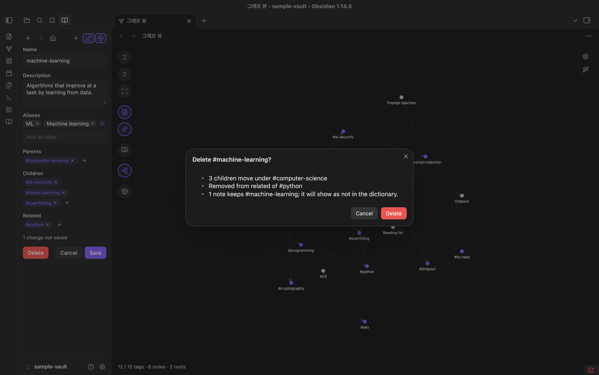 |

## How it works

Tag Ontology works inside the core Graph view. It takes the graph Obsidian has already built with your filters and color groups, collapses the dictionary tags and adds the hierarchy and related links between them. Tags that are not in the dictionary stay ordinary tag nodes. The local graph is not affected, and disabling the plugin returns the Graph view to normal.

The 3D view (beta) is a separate tab. It builds the same notes and tags from the vault, layers the dictionary onto them with the same code, and draws them with three.js.

The ontology explorer (beta) is a separate tab too. It doesn't show the whole dictionary: you put tags on its canvas one by one and draw it with Cytoscape.js.

The hierarchy you build in the sidebar tab is saved in the dictionary file. See [Advanced: the dictionary file](#advanced-the-dictionary-file) if you want to read or edit it directly.

Tag usage comes from Obsidian's metadata cache, which includes frontmatter `tags` and inline `#tags` in every Markdown note.

## Installation and Updating

> For complete details, development builds, and troubleshooting, see the [Full Installation & Updating Guide](docs/installation.md).

### From Community plugins

- **Install**: Open **Settings → Community plugins → Browse**, search for "Tag Ontology", then install and enable it. You can also install it from its [directory page](https://community.obsidian.md/plugins/tag-ontology).
- **Update**: Go to **Settings → Community plugins**, click **Check for updates**, then click **Update all** or **Update** next to Tag Ontology.

### With BRAT (beta releases)

- **Install**:
  1. Install and enable [BRAT](https://github.com/TfTHacker/obsidian42-brat).
  2. Choose **BRAT: Add a beta plugin for testing** and enter `NamhyeonKo/obsidian-tag-ontology`.
- **Update**: Run command `BRAT: Check for updates to all beta plugins` (or `BRAT: Check for plugin updates`).

### Manually

- **Install**:
  1. Download `main.js`, `manifest.json` and `styles.css` from the [latest release](https://github.com/NamhyeonKo/obsidian-tag-ontology/releases).
  2. Copy them into `.obsidian/plugins/tag-ontology/` inside your vault.
  3. Reload Obsidian, then enable **Tag Ontology** in **Settings → Community plugins**.
- **Update**:
  1. Download the latest `main.js`, `manifest.json`, and `styles.css`.
  2. Overwrite the files in `.obsidian/plugins/tag-ontology/`.
  3. Run command `Reload app without saving` or restart Obsidian.

### Standalone CLI tool

The standalone CLI is published on npm as [`tag-ontology`](https://www.npmjs.com/package/tag-ontology):

```sh
# Run latest directly without installing:
npx tag-ontology@latest check --root /path/to/vault --json

# Or install / update globally:
npm install -g tag-ontology@latest
npm update -g tag-ontology
```

> **Requirement**: The core **Graph view** plugin must be enabled, with **Filters → Tags** toggled ON in the graph settings.

## Quick start with the sample vault

The repository includes a small vault in [`examples/sample-vault`](examples/sample-vault): a 12-tag dictionary and six notes.

1. In Obsidian, choose **Open folder as vault** and select `examples/sample-vault`.
2. Install the plugin into that vault using one of the methods above.
3. Click the **Open tag ontology** ribbon icon (a book) or run **Tag Ontology: Open graph** from the command palette.
4. If the graph shows no tags, turn on **Filters → Tags** in the graph settings (gear icon).

You should see two roots, `computer-science` and `security`, with the six notes linked to them, plus the unregistered tag `#to-read`. Double-click `computer-science`, then `machine-learning`: the `Dropout` note moves to `deep-learning`. `cryptography` and `ai-security` have two parents each.

Then try the sidebar tab: press **+** to add a tag of your own under `machine-learning`.

## Usage

### Sidebar tab

**Open tag ontology** (the book ribbon icon or the **Open graph** command) opens the graph and brings a **Tag dictionary** tab forward in the left sidebar, next to Files and Search. Clicking a tag in the graph or **Dictionary check** brings it forward too. You can drag the tab to the right sidebar.

- **The bar at the top** has back, forward and home (the root tags) on the left, and **New tag**, **Edit tag** and a button that expands or collapses the tag in the graph on the right.
- **Search tags or aliases**: type part of a tag name or alias and choose a suggestion with a click or Enter. An alias match shows the alias under the tag, so `convolution` or `합성곱` can find `cnn`. The graph expands down to the chosen tag and centers it.
- With no tag chosen, the tab lists the root tags.
- A tag shows its description, aliases, note counts (direct and including descendants), its parents, children and related tags as `#tag` links, and its notes. Click a `#tag` to move to it.

### Editing the dictionary

- **New tag** (`+` in the bar): pick a tag your notes use but the dictionary lacks, listed by how many notes use it, or type a new name. Choose parents to place it under other tags; without parents it becomes a root tag. You can add children and related tags too, from the tags already in the dictionary.
- **Edit tag** (the pencil): change the name, description, aliases, facet, parents, children and related tags. Press **+** after the last item of a field to add to it. Parents, children and related tags must already be in the dictionary, and related tags are saved on both sides. Renaming a tag doesn't change the notes that use it: they keep the old tag, which then shows as not in the dictionary. Changing only the case (`ml` to `ML`) keeps them linked, since tags match regardless of case.
- **Kebab-case tag names** (a setting, off by default): a new or renamed tag must be lowercase letters and digits joined by hyphens, such as `machine-learning`, the names TOW checks. Existing names are kept.
- **Delete** (in the edit form) asks first and shows what happens: the tag's children move under its parents, it leaves the related lists, and notes keep their tags.
- Changes stay in the form until you press **Save**, and leaving with unsaved changes asks first. If the tags you changed were changed elsewhere in the meantime, the save stops and tells you, and your edits stay in the form.
- The dictionary is saved one tag per line, so a save changes only the lines involved. A file written in another layout is reformatted on its first save. Its line endings (LF or CRLF) are kept.

### Graph toolbar

The round buttons on the left of the graph show their name when you hover them:

| Button | What it does |
| --- | --- |
| Collapse all | Collapse every dictionary tag to its root |
| Expand all | Expand every dictionary tag |
| Fit | Fit the graph to the view |
| Notes | Show or hide every node that is not a tag (notes, attachments, unresolved links) |
| Related | Show or hide the dashed related links |
| Dictionary check | List unregistered and unused tags in the sidebar tab |
| Force / Vertical tree / Horizontal tree | Only the current layout shows, highlighted. Click it to show all three in this order, then click one to switch |
| Open in 3D (beta) | Open the 3D view, or bring an open 3D tab forward. Hidden while **Enable 3D view** is off |
| Open ontology explorer (beta) | Open the ontology explorer, or bring an open explorer tab forward. Hidden while **Enable ontology explorer** is off |

- In the tree layouts each tag hangs under its parent and notes are hidden, so the tag relations stay readable.
- Click a tag in the graph to show it in the sidebar tab. Double-click it to expand it, and double-click it again to collapse it, like the button at the top of the tab. Tags you expanded below it stay expanded for the next time.
- Everything else keeps the core behavior: clicking a note opens it, and clicking a tag that is not in the dictionary opens search.

### 3D view (beta)

The button at the bottom of the graph toolbar, or **Open 3D graph**, opens the 3D view in its own tab. The button at the bottom of the 3D toolbar brings you back to the core graph. It shares the expanded tags, the Notes and Related toggles, colors, Focus and the sidebar tab with the 2D graph, so a tag you expand in one is expanded in the other.

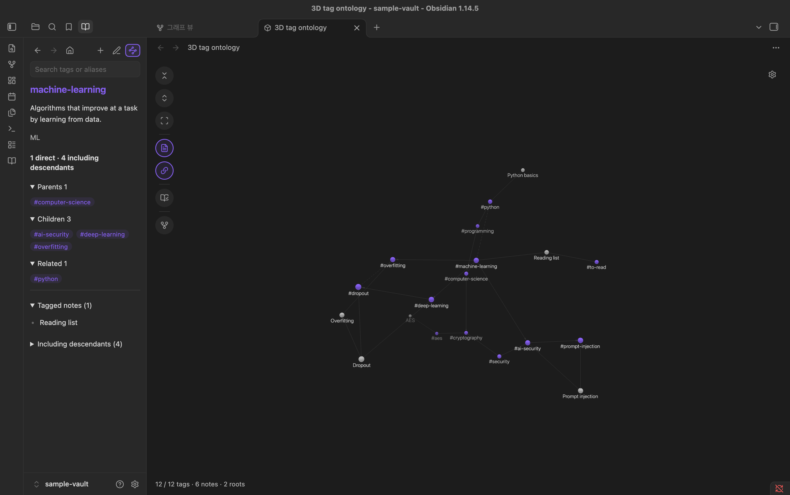

- Drag empty space to orbit, right-drag to pan and scroll to zoom.
- Drag a node to move it on its own. Let go and it springs back to its place, as in the tree layouts. The layout settles after the view opens and after expanding, then holds still.
- Click a tag to select it and fly to it, and double-click it to expand or collapse it. Click a note to open it. Choosing a tag in the sidebar flies to it too. A click on a tag that is not in the dictionary does nothing here; in 2D it opens search.
- The toolbar has Collapse all, Expand all, Fit, Notes, Related, Dictionary check and Open in 2D. There are no tree layouts in 3D.
- The gear at the top right opens the label settings. **Perspective labels** (on by default) lets labels grow as you come closer; off, they keep one size at any distance. **Label size** (0.5 to 2, 0.8 by default) makes every label bigger or smaller. They apply to every 3D tab and are saved with the plugin's settings.
- The 3D view takes its notes and tags from the vault, so the core graph's filters, color groups and attachments don't apply to it.
- If the 3D view is slow or you don't use it, turn off **Enable 3D view (beta)** in the settings. Its button, its command and its open tabs go away, and the 2D graph is unchanged.

### Ontology explorer (beta)

The button at the bottom of the graph toolbar, or **Open ontology explorer**, opens the explorer in its own tab. It shares the sidebar tab with the graphs, but not their expanded tags, Notes and Related toggles or Focus.

- An empty canvas asks where to start: search for a tag, pick a root tag, or continue from the tag selected in the sidebar. Choosing a tag in the sidebar search or a tag link adds it to the canvas too.
- Every tag is an object card with its facet (or `concept`), its direct notes, its notes including descendants and its number of children. Facets get their own colors; tags without one take the tag color.
- Right-click a tag for **Expand children**, **Expand parents**, **Expand related** and **Show notes**. Each shows how many are not on the canvas yet. New cards stand in columns beside it, children and notes to the right and parents to the left, and nothing already on the canvas moves. Double-click a tag to expand its children.
- Lines follow the dictionary: `narrower` arrows from parent to child and dashed `related` lines join any two tags on the canvas, whoever brought them out.
- A tag with more than 15 notes shows one group card instead. Click it to list its notes in the sidebar tab, newest first, filter them and take out the ones you tick or the latest 10. Double-click it to take out the latest 10. The group holds every note of the tag that isn't a card on the canvas: notes tagged later join it, and a note card you remove goes back into it.
- Click a card to show it in the sidebar tab; double-click a note to open it. Drag cards anywhere; they stay where you put them. Right-click a card to remove it; the cards brought out of it stay.
- The toolbar has Fit, Clear canvas and Open in 2D. The canvas is not saved: closing the tab clears it.
- Editing the dictionary or notes updates the cards: renamed tags and notes keep their place, and deleted ones leave the canvas.
- If you don't use it, turn off **Enable ontology explorer (beta)** in the settings. Its button, its command and its open tab go away.

### Commands

| Command | Description |
| --- | --- |
| Tag Ontology: Open graph | Open the ontology in the core Graph view. Reuses an open tab. |
| Tag Ontology: Open 3D graph | Open the 3D view. Reuses an open tab. Only offered while **Enable 3D view (beta)** is on. |
| Tag Ontology: Open ontology explorer | Open the ontology explorer. Reuses an open tab. Only offered while **Enable ontology explorer (beta)** is on. |
| Tag Ontology: Reload dictionary | Reload the dictionary and the note index. |

### Settings

| Setting | Description |
| --- | --- |
| Dictionary path | Vault-relative path to a `.json` file. Leave it empty to find the dictionary automatically: `tow/tag-dictionary.json`, then `.tow/tag-dictionary.json`, then `Tag-Dictionary.json`; when none exists, `tow/tag-dictionary.json`. A path you enter is always used. The field saves when you press Enter or leave it. |
| Kebab-case tag names | Off by default. On: the edit form accepts a new or renamed tag only as lowercase letters and digits joined by hyphens, the names TOW checks. Existing names are kept. |
| Enable 3D view (beta) | Show the 3D button on the graph toolbar and the Open 3D graph command. Turning it off closes the 3D tabs. On by default. |
| Enable ontology explorer (beta) | Show the explorer button on the graph toolbar and the Open ontology explorer command. Turning it off closes the explorer tab. On by default. |
| Keep the selected tag focused | Keep the selected tag and the tags next to it (its parents, children and related tags) bright and fade the rest. The selected tag and its links look hovered. Off by default. Turn it on to show the options below. |
| &nbsp;&nbsp;Its descendants | Also keep every tag under it bright, as far as they are expanded. On by default. |
| &nbsp;&nbsp;Include notes | Also keep the notes on the selected tag bright, and on its descendants when those are on. The notes on the tags next to it still fade. On by default. |
| Custom colors | Off by default: the graph keeps its own colors, and the tags in the sidebar tab take the graph's tag color. Turn it on to show the options below. |
| &nbsp;&nbsp;Tag color | Color of every tag in the graph and in the sidebar tab. Follows the accent color (Settings → Appearance, or your theme) until you pick one; the reset button goes back to it. |
| &nbsp;&nbsp;Tag title in the tag color | Show the selected tag's title in the sidebar tab in the tag color. Off: the text color. On by default. |

At low zoom levels the core graph hides labels and arrows. Zoom in to see them.

## Advanced: the dictionary file

The sidebar tab reads and writes this file, so you never have to open it. It is plain JSON in your vault, so you can also edit it by hand.

The dictionary can live at any vault-relative path ending in `.json`, including inside `tow/` or `.tow/`. With the **Dictionary path** field empty, the plugin checks `tow/tag-dictionary.json`, then `.tow/tag-dictionary.json`, then `Tag-Dictionary.json`. New installs create `tow/tag-dictionary.json`; existing `Tag-Dictionary.json` files keep working, and `.tow/tag-dictionary.json` from TOW 0.5.0–0.5.1 is still read. A chosen path is always used. If the dictionary goes missing later, the sidebar tab offers to create it.

**Obsidian Sync does not sync dot-folders other than `.obsidian`** ([Sync settings](https://obsidian.md/help/sync/settings)). If you use Obsidian Sync, choose a visible path for the dictionary. Git and file-level sync tools carry dot-folders unless they are ignored.

The file is a single JSON object. Each key is a tag **without `#`**, matched case-insensitively like the core graph (`#ML` uses the key `ml`). Lowercase keys are recommended. A nested tag such as `#lang/python` uses the key `lang/python`.

```json
{
  "machine-learning": {
    "aliases": ["ML"],
    "description": "Algorithms that improve at a task by learning from data.",
    "broader": ["computer-science"]
  },
  "dropout": {
    "description": "Randomly disabling units during training to reduce overfitting.",
    "broader": ["deep-learning"],
    "related": ["overfitting"],
    "facet": "technique"
  },
  "computer-science": {
    "description": "The study of computation, information and automation.",
    "broader": []
  }
}
```

| Field | Required | Type | Meaning |
| --- | --- | --- | --- |
| `description` | yes | string | Shown in the tag panel. |
| `aliases` | no | string[] | Other names. Used by search and by the dictionary check to suggest a match for an unregistered tag. |
| `broader` | no | string[] | Parent tags. **`[]` marks a root tag.** |
| `related` | no | string[] | Non-hierarchical links, drawn as dashed lines. |
| `facet` | no | string | Free-form category, such as `language`. Set it in the edit form or in the draft of a CLI changes file; a facet tag next to its narrower tags is not reported as redundant. |

Rules:

- **Roots need `"broader": []`.** A tag with no `broader` key at all is treated as not yet placed and does not appear in the graph.
- Every tag named in `broader` or `related` must exist in the dictionary.
- A tag cannot reference itself, and `broader` links cannot form a cycle.
- If the dictionary is invalid, a notice shows the reason when Obsidian starts or when you open the view, and the sidebar keeps showing it until you fix the file. The graph keeps the last version that loaded, and **New tag** and **Edit tag** are off until then.

See [`examples/sample-vault/Tag-Dictionary.json`](examples/sample-vault/Tag-Dictionary.json) for a complete example.

## Privacy

- No network requests, telemetry or accounts.
- Reads your notes' metadata and the dictionary file only.
- Writes only its own settings file (`plugins/tag-ontology/data.json` in the config folder, usually `.obsidian/`) and, when you save a change in the sidebar, the dictionary file in use: the path you chose (including a custom path saved in an earlier version), or `tow/tag-dictionary.json`, `.tow/tag-dictionary.json`, or `Tag-Dictionary.json` in automatic lookup order.

## Compatibility and known limitations

- **Desktop only.** Tested on Obsidian 1.14.5 (macOS).
- The plugin hooks into **undocumented internals** of the core Graph view (renderer, PIXI, layout worker). A future Obsidian update may break it. If the internals look unfamiliar, the plugin detaches and leaves the core graph alone.
- On large vaults, expanding every tag with notes shown redraws a few thousand nodes and links; expect a short pause.
- Labels get dense when every tag is expanded, especially in Force.
- Untested together with other plugins that patch the Graph view.
- The 3D view uses WebGL and bundles three.js, and the explorer bundles Cytoscape.js, so the plugin file is about 1.35 MB. Each loads only when its tab opens. With many thousands of notes shown the 3D view slows down; hiding notes keeps it fast.

## Roadmap

- Show the hierarchy in the local graph too.

Bug reports and feature requests are welcome in [Issues](https://github.com/NamhyeonKo/obsidian-tag-ontology/issues). Please include your Obsidian version and OS for bugs.

## Library and CLI

The standalone [`tag-ontology` package](packages/tag-ontology/README.md) exposes the same dictionary rules as an MIT-licensed ESM library and a Node CLI. It checks and scans a vault, reports tag usage, shows a tag's hierarchy and previews/applies dictionary changes with a content-hash check. Obsidian does not need to be installed.

It is published on npm as [`tag-ontology`](https://www.npmjs.com/package/tag-ontology):

```sh
npx tag-ontology check --root /path/to/vault --json
```

See the [package guide](packages/tag-ontology/README.md) for library examples and the [CLI contract](docs/cli.md) for commands, JSON fields, exit codes and parser limits. The plugin and package have independent versions and release tags.

## Related projects

### [TOW (Tag Ontology Wiki)](https://github.com/NamhyeonKo/tag-ontology-wiki)

When used together with [TOW](https://github.com/NamhyeonKo/tag-ontology-wiki), you can leverage AI agents to manage tags and dictionaries, alongside broader vault tasks like note search, frontmatter management, and document formatting.

- **CLI-based dictionary management**: Uses the `tag-ontology` CLI to inspect tags, validate dictionary integrity, and apply safe updates.
- **AI agent workflows**: Automates repetitive vault maintenance such as discovering unregistered tags, syncing ontology entries, verifying frontmatter schema, and cleaning up note structure.
- **Visual graph integration**: Explore and navigate the agent-managed tag hierarchies directly within Obsidian's Graph view using this plugin.

## Development

Requires Node.js **22.18 or later**. The tests run TypeScript directly with Node's built-in type stripping.

```sh
npm ci
npm run lint        # Obsidian review rules + checked package lint
npm test            # unit tests, no vault needed
npm run build       # type-check + package dist + plugin main.js
npm run check:package  # inspect and install the actual npm tarball
npm run deploy -- "/path/to/vault"   # copy main.js, manifest.json, styles.css into the vault
```

`deploy` requires an existing `.obsidian/` folder in the target vault and preserves an existing `data.json`. Reload the plugin in Obsidian afterwards.

`npm run test:vault` is the maintainer's integration test against a private vault (`OBSIDIAN_VAULT_PATH`). Other contributors don't need to run it.

### Project structure

```text
src/
├── main.ts         # Plugin entry: commands, settings tab, vault/metadata events
├── search.ts       # Suggestion popover for the search box and the edit forms
├── native.ts       # Hooks the core Graph view renderer (toolbar, sidebar tab, clicks, layouts)
├── graph3d.ts      # The 3D view: draws the same layered data with 3d-force-graph
├── three.ts        # three.js and 3d-force-graph, imported only when a 3D view opens
├── vault-data.ts   # Builds the core graph's data shape from the vault for the 3D view
├── explorer.ts     # The ontology explorer: a Cytoscape.js canvas of object cards
├── explorer-layout.ts # Pure functions for the explorer: card placement, Search Around counts, lines
├── explorer-card.ts   # The explorer's object cards as SVG images
├── layer.ts        # Pure functions that layer the dictionary onto the core graph data
├── layout.ts       # Vertical and horizontal tree positions
└── settings.ts     # Settings shape and path validation
tests/              # node:test unit tests (tests/integration is maintainer-only)
packages/tag-ontology/
├── src/core/       # Pure dictionary validation, hierarchy, usage and edits
├── src/vault/      # Node file access and Markdown/frontmatter readers
├── src/cli/        # Command-line arguments, JSON results and exit codes
└── tests/          # Package unit and real-process CLI tests
docs/cli.md         # Versioned CLI contract
examples/           # Sample vault with a tag dictionary
scripts/deploy.mjs  # Copies the build into a local vault
scripts/check-package.mjs  # Inspects and exercises the packed npm package
```

## Contributing

Contributions from the community are warmly welcome! Whether you are fixing bugs, proposing new features, or improving documentation:

1. Check existing [Issues](https://github.com/NamhyeonKo/obsidian-tag-ontology/issues) or open a new one.
2. Fork the repository and create your feature branch based on `dev`.
3. Follow [Conventional Commits](https://www.conventionalcommits.org/en/v1.0.0/) for commit messages.
4. Ensure all checks pass: `npm run lint && npm test && npm run build`.
5. Submit a Pull Request targeting the `dev` branch.

Please review our [CONTRIBUTING.md](CONTRIBUTING.md) for full development guidelines, testing workflows, and the [Code of Conduct](CODE_OF_CONDUCT.md).

## Support

Tag Ontology is free and open source. If it saves you time, you can [buy me a coffee](https://buymeacoffee.com/namhyunko).

## Acknowledgements

- The approach of feeding custom data to the core graph renderer was inspired by [Nested tags graph](https://github.com/drpilman/obsidian-graph-nested-tags). That plugin is not required.
- The 3D view is built on [3d-force-graph](https://github.com/vasturiano/3d-force-graph), [three-spritetext](https://github.com/vasturiano/three-spritetext) and [three.js](https://threejs.org), all MIT. The ontology explorer is built on [Cytoscape.js](https://js.cytoscape.org) (MIT). The licence notices of every bundled package are at the top of `main.js`.

## License

Copyright (c) 2026 NamhyeonKo

This project is licensed under the [MIT License](LICENSE). You are free to use, modify, and distribute this software under the terms of the MIT License.
