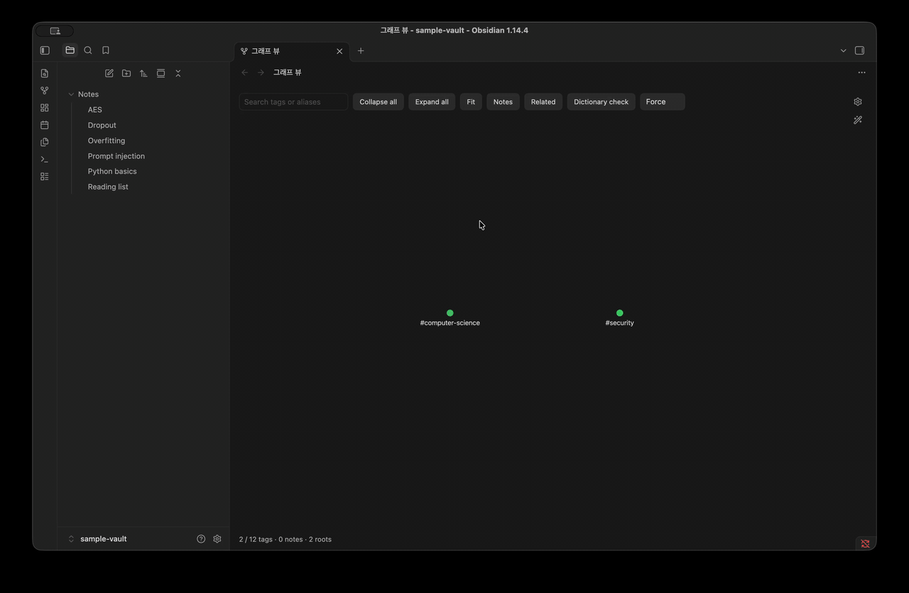
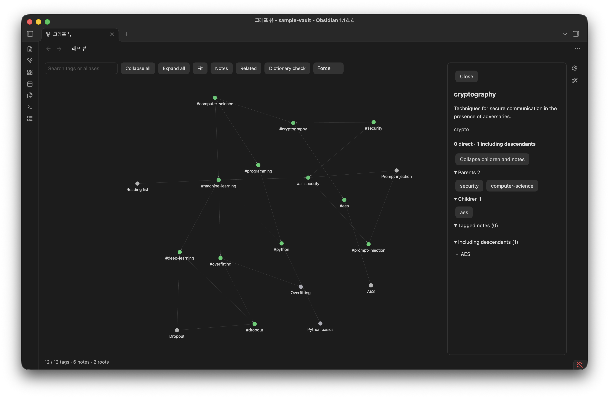
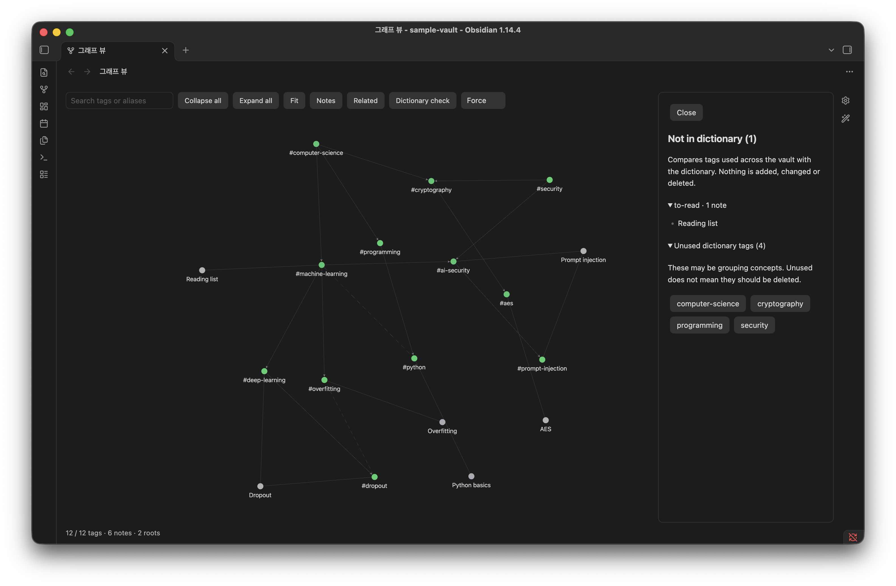

# Tag Ontology

[](https://github.com/NamhyeonKo/obsidian-tag-ontology/releases/latest)
[](https://github.com/NamhyeonKo/obsidian-tag-ontology/actions/workflows/release.yml)
[](LICENSE)

**English** | [한국어](README.ko.md)

Tag Ontology adds your **tag hierarchy** to Obsidian's core **Graph view**. You describe your tags in a JSON dictionary (definition, aliases, parents, related tags). The plugin layers that hierarchy on top of the graph you already use, and keeps everything else the core graph does: notes, links between notes, filters, color groups and display settings.

It is **read-only**. It never edits your notes or your dictionary.

> **To start:** the hierarchy is built from tag nodes, so it needs **Filters → Tags** on in the graph settings. A fresh install turns it on once for you; after that the plugin never changes it, so if you turn it off, turn it back on to see the hierarchy.



## Features

- **An extension of the core graph.** Notes, note links, filters, color groups, arrows and the other core settings work as usual. Node size still grows with links.
- **Collapsible tag hierarchy.** Dictionary tags start collapsed to their roots, and each note links to its nearest visible ancestor. Click a tag to expand it one level and watch its notes move to the more specific child tags.
- **Note counts with roll-up.** For each tag you see notes tagged *directly* and notes tagged with the tag *or any descendant*. Notes are de-duplicated across multiple tags and multiple parents.
- **Multiple parents and related tags.** Solid arrows go from parent to child. Dashed lines connect related tags.
- **Three layouts.** Force, Tree and Radial.
- **Search** by tag name or alias.
- **Dictionary check.** Lists tags used in your vault but missing from the dictionary, and dictionary tags no note uses yet. It only reports and never changes anything.
- **Remembers your view.** Expanded tags and the Notes/Related toggles are saved and shared by every graph tab, like the core graph's own options.

| Tag panel | Dictionary check |
| --- | --- |
|  |  |

## How it works

The core Graph view computes its graph as usual (with your filters and color groups applied) and hands it to the renderer. Tag Ontology adjusts that data on the way: it collapses dictionary tags, re-routes note-to-tag links to the nearest visible ancestor, and adds hierarchy and related links between tags. Tags that are not in the dictionary stay as ordinary tag nodes.

The hierarchy needs tag nodes, so **turn on Tags in the graph's Filters** (it is off by default in Obsidian). If it is off, the status line at the bottom of the graph tells you so. The local graph is not affected. Disable the plugin and the core Graph view goes back to normal.

Tag usage comes from Obsidian's metadata cache, which includes frontmatter `tags` and inline `#tags` in every Markdown note. Files and folders whose names start with `.` are skipped.

## Installation

### From Community plugins

Open **Settings → Community plugins → Browse**, search for "Tag Ontology", then install and enable it. You can also install it from its [directory page](https://community.obsidian.md/plugins/tag-ontology).

### With BRAT (beta)

1. Install [BRAT](https://github.com/TfTHacker/obsidian42-brat).
2. Choose **BRAT: Add a beta plugin** and enter `NamhyeonKo/obsidian-tag-ontology`.

### Manually

1. Download `main.js`, `manifest.json` and `styles.css` from the [latest release](https://github.com/NamhyeonKo/obsidian-tag-ontology/releases).
2. Copy them into `.obsidian/plugins/tag-ontology/` inside your vault. If you changed the config folder in Obsidian, use that folder instead of `.obsidian`.
3. Reload Obsidian, then enable **Tag Ontology** in **Settings → Community plugins**.

The core **Graph view** plugin must be enabled.

## Quick start with the sample vault

The repository includes a small vault in [`examples/sample-vault`](examples/sample-vault): a 12-tag dictionary and six notes.

1. In Obsidian, choose **Open folder as vault** and select `examples/sample-vault`.
2. Install the plugin into that vault using one of the methods above.
3. Click the **graph** ribbon icon or run **Tag Ontology: Open graph** from the command palette.
4. The plugin turns on **Filters → Tags** the first time. If the graph shows no tags, turn it on in the graph settings (gear icon).

You should see two roots, `computer-science` and `security`, with the six notes linked to them, plus the unregistered tag `#to-read`. Click `computer-science`, then `machine-learning`: the `Dropout` note moves to `deep-learning`. `cryptography` and `ai-security` have two parents each.

## Tag dictionary format

By default the plugin reads `Tag-Dictionary.json` at the vault root. You can change the path in the plugin settings.

The file is a single JSON object. Each key is a tag **without `#`**, matched case-insensitively like the core graph (`#ML` uses the key `ml`). Lowercase keys are recommended. A nested tag such as `#lang/python` uses the key `lang/python`.

```json
{
  "machine-learning": {
    "aliases": ["ML"],
    "description": "Algorithms that improve at a task by learning from data.",
    "broader": ["computer-science"]
  },
  "dropout": {
    "description": "Randomly disabling units during training to reduce overfitting.",
    "broader": ["deep-learning"],
    "related": ["overfitting"],
    "facet": "technique"
  },
  "computer-science": {
    "description": "The study of computation, information and automation.",
    "broader": []
  }
}
```

| Field | Required | Type | Meaning |
| --- | --- | --- | --- |
| `description` | yes | string | Shown in the tag panel. |
| `aliases` | no | string[] | Other names. Used by search and by the dictionary check to suggest a match for an unregistered tag. |
| `broader` | no | string[] | Parent tags. **`[]` marks a root tag.** |
| `related` | no | string[] | Non-hierarchical links, drawn as dashed lines. |
| `facet` | no | string | Free-form category. Validated but not displayed yet. |

Rules:

- **Roots need `"broader": []`.** A tag with no `broader` key at all is treated as not yet placed and does not appear in the graph.
- Every tag named in `broader` or `related` must exist in the dictionary.
- A tag cannot reference itself, and `broader` links cannot form a cycle.
- If the dictionary is invalid, opening the view shows a notice with the reason. Automatic refreshes keep the last valid graph.

See [`examples/sample-vault/Tag-Dictionary.json`](examples/sample-vault/Tag-Dictionary.json) for a complete example.

## Usage

### Toolbar and tag panel

- **Search tags or aliases**: type an exact tag name or alias and press Enter. The graph expands down to that tag and selects it.
- **Collapse all** / **Expand all**: collapse every dictionary tag to its root, or expand them all.
- **Fit**: fit the graph to the view.
- **Notes** / **Related**: hide every node that is not a tag (notes, attachments, unresolved links) to see the tag hierarchy alone, or hide the dashed related links.
- **Dictionary check**: list unregistered and unused tags.
- **Layout**: Force, Tree or Radial.
- Click a tag to expand it and open its panel: description, aliases, note counts (direct and including descendants), parents, children, related tags and note lists. Clicking an expanded tag only reopens the panel. Use **Collapse children and notes** in the panel to collapse it.
- Everything else keeps the core behavior: clicking a note opens it (Cmd/Ctrl-click for a new tab), and clicking a tag that is not in the dictionary opens search.

### Commands

| Command | Description |
| --- | --- |
| Tag Ontology: Open graph | Open the ontology in the core Graph view. Reuses an open graph tab. |
| Tag Ontology: Reload dictionary | Reload the dictionary and the note index. |

### Settings

| Setting | Description |
| --- | --- |
| Dictionary path | Vault-relative path to a `.json` file. Default: `Tag-Dictionary.json`. Paths inside the vault's config folder (usually `.obsidian/`) or `.git/` are rejected. |
| Layout | Force, Tree or Radial. |

At low zoom levels the core graph hides labels and arrows. Zoom in to see them.

## Privacy

- No network requests, telemetry or accounts.
- Reads your notes' metadata and the dictionary file only.
- Writes only its own settings file (`plugins/tag-ontology/data.json` in the config folder, usually `.obsidian/`), which holds `dictionaryPath`, `layout`, `expanded`, `showNotes` and `showRelated`.

## Compatibility and known limitations

- **Desktop only.** Tested on Obsidian 1.14.4 (macOS).
- The plugin hooks into **undocumented internals** of the core Graph view (renderer, PIXI, layout worker). A future Obsidian update may break it. If the internals look unfamiliar, the plugin detaches and leaves the core graph alone.
- The hierarchy appears only while the core graph's **Tags** filter is on.
- On large vaults, expanding every tag with notes shown redraws a few thousand nodes and links; expect a short pause.
- Labels get dense when every tag is expanded, and switching Tree/Radial on a fully expanded graph takes a moment.
- Untested together with other plugins that patch the Graph view.

## Roadmap

- Show the hierarchy in the local graph too.

Bug reports and feature requests are welcome in [Issues](https://github.com/NamhyeonKo/obsidian-tag-ontology/issues). Please include your Obsidian version and OS for bugs.

## Development

Requires Node.js **22.18 or later**. The tests run TypeScript directly with Node's built-in type stripping.

```sh
npm ci
npm run lint        # Obsidian review rules (eslint-plugin-obsidianmd)
npm test            # unit tests, no vault needed
npm run build       # type-check + bundle to main.js
npm run deploy -- "/path/to/vault"   # copy main.js, manifest.json, styles.css into the vault
```

`deploy` requires an existing `.obsidian/` folder in the target vault and preserves an existing `data.json`. Reload the plugin in Obsidian afterwards.

`npm run test:vault` is the maintainer's integration test against a private vault (`OBSIDIAN_VAULT_PATH`). Other contributors don't need to run it.

### Project structure

```text
src/
├── main.ts         # Plugin entry: commands, settings tab, vault/metadata events
├── ontology.ts     # Dictionary validation, hierarchy, note roll-up, dictionary check
├── native.ts       # Hooks the core Graph view renderer (toolbar, panel, clicks, layouts)
├── layer.ts        # Pure functions that layer the dictionary onto the core graph data
├── layout.ts       # Tree/Radial positions (headless Cytoscape)
└── settings.ts     # Settings shape and path validation
tests/              # node:test unit tests (tests/integration is maintainer-only)
examples/           # Sample vault with a Tag-Dictionary.json
scripts/deploy.mjs  # Copies the build into a local vault
```

### Contributing and releasing

See [CONTRIBUTING.md](CONTRIBUTING.md) for the commit convention (Conventional Commits), pre-commit checks, testing in Obsidian, and the maintainer release checklist.

## Acknowledgements

- The approach of feeding custom data to the core graph renderer was inspired by [Nested tags graph](https://github.com/drpilman/obsidian-graph-nested-tags). That plugin is not required.
- [Cytoscape.js](https://js.cytoscape.org/) computes the Tree/Radial layouts.

## License

[MIT](LICENSE)
