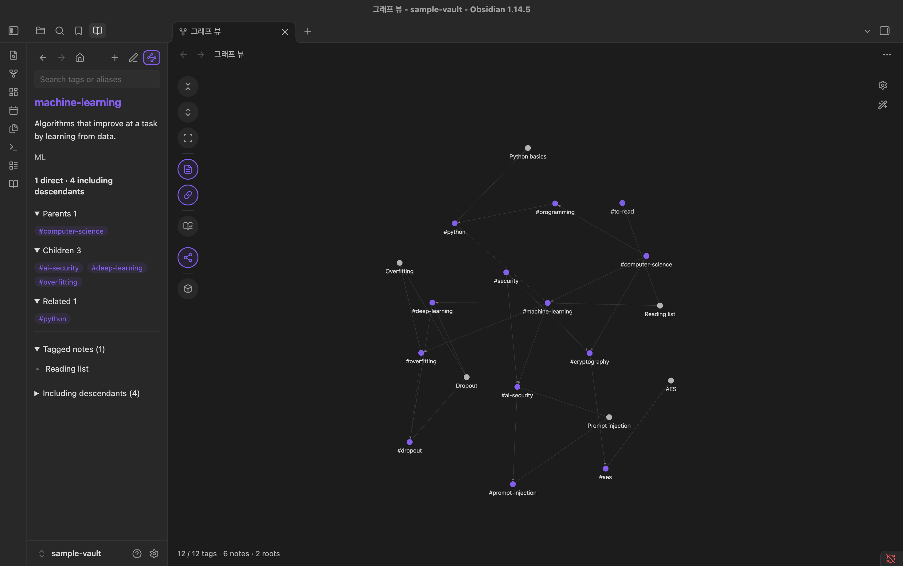
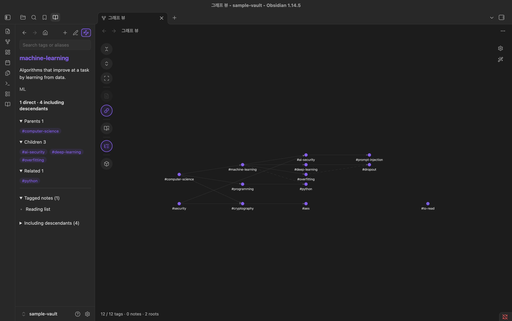

# Tag Ontology

[](https://github.com/NamhyeonKo/obsidian-tag-ontology/stargazers)
[](https://community.obsidian.md/plugins/tag-ontology)
[](https://github.com/NamhyeonKo/obsidian-tag-ontology/releases/latest)
[](https://www.npmjs.com/package/tag-ontology)
[](https://github.com/NamhyeonKo/obsidian-tag-ontology/actions/workflows/release.yml)
[](../../LICENSE)

[English](../../README.md) | [한국어](README.ko.md) | [简体中文](README.zh-CN.md) | [繁體中文](README.zh-TW.md) | [日本語](README.ja.md) | [Español](README.es.md) | [Français](README.fr.md) | **Deutsch** | [Português (Brasil)](README.pt-BR.md) | [Русский](README.ru.md) | [Italiano](README.it.md)

**Verknüpfe deine Tags so, wie du Notizen verknüpfst.**

Mit Tag Ontology kannst du jedem Tag über einen Seitenleisten-Tab übergeordnete, untergeordnete und verwandte Tags zuweisen, ohne eine Datei manuell bearbeiten zu müssen. Anschließend kannst du sie in Obsidians eigener **Graph-Ansicht** erkunden: Zweige ein- und ausklappen, in ein Baum-Layout wechseln und den ausgewählten Tag im Fokus behalten. Notizen, Notiz-Links, Filter, Farbgruppen und Anzeigeeinstellungen funktionieren weiterhin wie gewohnt.

Das Plugin verändert niemals deine Notizen. Es schreibt ausschließlich in das Tag-Wörterbuch – eine einfache JSON-Datei in deinem Vault – und nur dann, wenn du im Seitenleisten-Tab einen Tag hinzufügst, bearbeitest oder löschst.

## Warum Tag Ontology?

Ein Konzept kann gleichzeitig mit mehreren Bereichen verknüpft sein. RAG hängt beispielsweise mit LLMs, Information Retrieval und Knowledge Graphs zusammen. Bei der Organisation über Ordner oder verschachtelte Tags musste ich mich immer für einen einzigen Pfad entscheiden – und dieser eine Pfad machte die übrigen Beziehungen schwer sichtbar.

Ich wollte Beziehungen zwischen Konzepten separat verwalten und erkunden, während Speicherort und Quelltext der Dokumente unangetastet bleiben. Deshalb habe ich Tag Ontology so gebaut, dass Tags mehrere übergeordnete sowie verwandte Tags haben können und diese Beziehungen im Graph von Obsidian navigierbar sind. Später habe ich es erweitert, damit CLI und TOW dieselben Beziehungen und Regeln nutzen können.

> **Zum Start:** Da die Hierarchie aus Tag-Knoten aufgebaut wird, muss **Filter → Tags** in den Graph-Einstellungen aktiviert sein. Bei einer Neuinstallation wird diese Option automatisch aktiviert.


> [!TIP]
> **Einsatz mit KI-Agenten**: Kombiniere das Plugin mit [TOW](https://github.com/NamhyeonKo/tag-ontology-wiki), um Tags und Wörterbücher gemeinsam mit KI-Agenten sowie umfassendere Vault-Aufgaben zu verwalten. ([Mehr erfahren](#verwandte-projekte))

## Funktionen

- **Hierarchie in der Seitenleiste aufbauen.** Füge Tags hinzu, die deine Notizen bereits verwenden, oder lege neue Namen an; bearbeite Name, Beschreibung, Aliase, Facet, übergeordnete, untergeordnete und verwandte Tags und lösche Tags. Keine Dateibearbeitung nötig, und beim Speichern werden anderswo vorgenommene Änderungen niemals überschrieben.
- **Erweiterung des Core-Graphs.** Notizen, Notiz-Links, Filter, Farbgruppen, Pfeile und die übrigen Core-Einstellungen funktionieren wie gewohnt.
- **Einklappbare Tag-Hierarchie.** Wörterbuch-Tags starten eingeklappt auf ihre Wurzeln, und jede Notiz verknüpft sich mit ihrem nächsten sichtbaren Vorfahren. Klicke einen Tag an, um ihn auszuwählen, und doppelklicke ihn, um ihn um eine Ebene auszuklappen – beobachte dabei, wie seine Notizen zu den spezifischeren Unter-Tags wandern. Doppelklicke ihn erneut, um ihn wieder einzuklappen.
- **Notizzahlen mit Roll-up.** Zu jedem Tag siehst du sowohl die *direkt* verknüpften Notizen als auch die Notizen mit dem Tag *oder einem beliebigen Unter-Tag*.
- **Mehrere übergeordnete und verwandte Tags.** Durchgezogene Pfeile führen vom übergeordneten zum untergeordneten Tag. Gestrichelte Linien verbinden verwandte Tags.
- **Vier Layouts.** Force, **Mindmap**, ein vertikaler Baum und ein horizontaler Baum. Die regulären Bäume behalten ihr sichtbares Hierarchie-Layout und brechen Wurzelbäume in Zeilen um. Mindmap startet mit dem gewählten Wurzel-Tag auf Ebene 0 und nutzt für die Abstände den längsten aktuell geöffneten Elternpfad. Tag-Farben verwenden weiterhin die vollständige Wörterbuch-Tiefe.
- **Mindmap.** Mindmap fragt zuerst, wo du starten möchtest: Suche nach Hierarchie-Tags oder wähle einen der vorgeschlagenen Wurzel-Tags und erkunde dann nur diesen Zweig. Mit **Start-Tag ändern** (dem Home-Button in der unteren Reihe) kehrst du zur Auswahl zurück. Beim Wechsel zu einem anderen Layout wird dessen vorheriger Ausklappzustand wiederhergestellt; beim erneuten Öffnen von Mindmap erscheint wieder die Auswahl. Wähle eine Beschriftung für ihre Details in der Seitenleiste und nutze die Pfeilschaltfläche zum Aus- oder Einklappen der Unter-Tags. Ziehe den Hintergrund zum Verschieben, scrolle zum Zoomen und nutze Einpassen, um die gesamte Map zu sehen. Mindmap teilt sich die Core-Graph-Filter und den gespeicherten Ausklappzustand. Gemeinsam genutzte Tags bleiben sichtbar, solange ein anderer ausgeklappter übergeordneter Tag sie erreicht. Notizen bleiben in diesem Layout ausgeblendet.
- **3D-Ansicht (Beta).** Dieselbe Hierarchie in drei Dimensionen: Kreise darum herum und klicke einen Tag an, um zu ihm zu fliegen. Wechsle die Modi über die Graph-Werkzeugleiste. Force, Mindmap, beide Bäume, 3D und der Ontologie-Explorer teilen sich einen Tab; ein Rechtsklick auf eine Modus-Schaltfläche öffnet zum Vergleichen einen separaten Tab. Passe **Filter** (Suche, Anhänge, Nur existierende Dateien zeigen, Verwaiste Dateien), **Anzeige** (Pfeile an Notiz-Links, Grenze Text-Transparenz, Knotengröße, Kantenstärke, Perspektivische Labels und Label-Größe) sowie **Kräfte** (Ziehkraft und Kraft-Regler) im 3-teiligen Zahnrad-Menü an – jeweils mit bereichsweiser und vollständiger Standard-Wiederherstellung. Beim Wechsel in 3D oder den Explorer bleibt die jeweils andere Canvas erhalten; verborgenes 3D-Rendering pausiert und das Schließen des Graph-Tabs gibt die Ressourcen frei.
- **Ontologie-Explorer (Beta).** Starte mit einem Tag auf einer leeren Canvas und hole per Rechtsklick dessen untergeordnete, übergeordnete und verwandte Tags sowie Notizen als Objektkarten heraus – im Stil der Ontologie-Graphen von Palantir.
- **Ein Seitenleisten-Tab.** Suche nach Tag-Name oder Alias, lies die Details eines Tags und starte die Wörterbuch-Prüfung in einem Tab neben Dateiexplorer und Suchen. Wählst du dort einen Tag aus, zoomt der geöffnete Graph auf ihn und zentriert ihn.
- **Wörterbuch prüfen.** Listet Tags auf, die in deinem Vault verwendet werden, aber im Wörterbuch fehlen (samt ähnlicher Wörterbuch-Namen); Wörterbuch-Tags, die noch keine Notiz nutzt; Notizen, die einen Tag als Alias oder in anderer Schreibweise führen; sowie Notizen, die einen weiter gefassten Tag zusammen mit einem Unter-Tag tragen. Die Prüfung meldet nur Befunde und verändert niemals etwas.
- **Benutzerdefinierte Farben (optional).** Gib jedem Tag im Graph und in der Seitenleiste eine einheitliche Farbe – standardmäßig die Akzentfarbe, sofern du keine andere wählst.
- **Farben nach Hierarchie-Tiefe (optional).** Wähle **Farben → Farbmodus → Hierarchie-Tiefe**, um Tags nach dem längsten Pfad von der Wurzel im vollständigen Wörterbuch einzufärben. Beim Filtern und Einklappen bleiben die Farben stabil, und tiefere Ebenen nutzen die letzte Palettenfarbe. Standard und Pastell nutzen dieselbe Reihenfolge Rot→Orange→Gelb→Grün→Cyan→Blau→Violett→Pink aus der [Tailwind-CSS-3.4-Farbtabelle](https://v3.tailwindcss.com/docs/customizing-colors) mit den Stufen 500 bzw. 200. Sie werden bei geänderter Stufenanzahl über den gesamten Bereich neu verteilt; die Beispiele Regenbogen, Warm sowie einfarbige Verläufe stehen ebenfalls bereit. Nummerierte Farben lassen sich horizontal bearbeiten und Stufen hinzufügen oder entfernen. Die kompakte Graph-Legende bietet Palettenwahl, Farbbearbeitung und **Palette speichern unter…**. Änderungen dort oder in den Einstellungen werden zu einer gemeinsamen **Arbeitskopie**, die über Neustarts hinweg automatisch erhalten bleibt. **Speichern unter…** legt einen unabhängigen benannten Schnappschuss unter **Meine Paletten** ab; beim Wechsel zu Beispielen oder gespeicherten Paletten bleibt die Arbeitskopie verfügbar. Gespeicherte Namen sind eindeutig und überschreiben niemals andere Paletten. **Meine Paletten → Verwalten…** listet gespeicherte Paletten mit bestätigtem Löschen; das Löschen der aktiven Palette wechselt zu Standard und behält die Arbeitskopie bei. Frühere Custom-Paletten bleiben als **My colors** erhalten, und bestehende aktive Farben bleiben beim Wechseln von Beispielen erhalten. Die Farben gelten für 2D, 3D, Explorer-Karten und die Seitenleiste. Inspiriert von [Colored Tags](https://github.com/pfrankov/obsidian-colored-tags).
- **Fokus (optional).** Hält den ausgewählten Tag und benachbarte Tags (übergeordnet, untergeordnet und verwandt) hell, während der Rest abgeblendet wird. Optionen fügen auch alle darunterliegenden Tags sowie die zugehörigen Notizen hinzu.
- **Merkt sich deine Ansicht.** Ausgeklappte Tags und die Umschalter Notizen/Verwandt werden gespeichert und von allen Graph-Tabs geteilt.
- **Lokalisierte Oberfläche (11 Sprachen).** Folgt standardmäßig automatisch Obsidians Sprache oder lässt sich unter **Allgemein → Sprache** manuell zwischen English, 한국어, 日本語, 简体中文, 繁體中文, Español, Français, Deutsch, Português (Brasil), Русский und Italiano umschalten. Einstellungen, Seitenleisten-Wörterbuch, 3D-Steuerung, Tiefenlegenden und Graph-Ansichten aktualisieren sich live.

| Seitenleisten-Tab | Wörterbuch prüfen |
| --- | --- |
|  |  |
| **Auf Wurzeln eingeklappt** | **Ausgeklappt** |
|  |  |
| **Vertikaler Baum** | **Horizontaler Baum** |
|  |  |
| **Ursprüngliches Theme** | **Ausgewählten Tag fokussieren** |
|  |  |
| **Tag bearbeiten** | **Neuer Tag** |
|  |  |
| **Suchvorschläge** | **Tag löschen** |
|  |  |

## Funktionsweise

Tag Ontology arbeitet direkt in der Core-Graph-Ansicht. Es übernimmt den von Obsidian bereits mit deinen Filtern und Farbgruppen erstellten Graph, klappt die Wörterbuch-Tags ein und ergänzt Hierarchie- sowie Verwandtschaftsverknüpfungen zwischen ihnen. Tags, die nicht im Wörterbuch stehen, bleiben normale Tag-Knoten. Das lokale Diagramm bleibt unberührt, und beim Deaktivieren des Plugins kehrt die Graph-Ansicht zum Normalzustand zurück.

Die 3D-Ansicht (Beta) ist ein eigener Modus/Tab. Sie liest dieselben Notizen und Tags aus dem Vault, legt das Wörterbuch mit demselben Code darüber und rendert sie mit three.js.

Der Ontologie-Explorer (Beta) ist ebenfalls ein eigener Modus/Tab. Er zeigt nicht das gesamte Wörterbuch auf einmal: Du holst Tags nacheinander auf seine Canvas und zeichnest sie mit Cytoscape.js.

Die im Seitenleisten-Tab aufgebaute Hierarchie wird in der Wörterbuchdatei gespeichert. Siehe [Erweitert: Die Wörterbuchdatei](#erweitert-die-wörterbuchdatei), falls du sie direkt lesen oder bearbeiten möchtest.

Die Tag-Nutzung stammt aus Obsidians Metadaten-Cache, der sowohl Frontmatter-`tags` als auch Inline-`#tags` in jeder Markdown-Notiz erfasst.

## Installation und Aktualisierung

> Ausführliche Hinweise, Entwickler-Builds und Fehlerbehebung findest du in der [vollständigen Installations- und Aktualisierungsanleitung](../installation.md).

### Über Community-Erweiterungen

- **Installieren**: Öffne **Einstellungen → Externe Erweiterungen → Durchsuchen** (unter *Community-Erweiterungen*), suche nach „Tag Ontology“, installiere und aktiviere das Plugin. Alternativ kannst du es über seine [Verzeichnis-Seite](https://community.obsidian.md/plugins/tag-ontology) installieren.
- **Aktualisieren**: Gehe zu **Einstellungen → Externe Erweiterungen**, klicke auf **Nach Aktualisierungen suchen** und danach auf **Alle aktualisieren** oder neben Tag Ontology auf **Aktualisieren**.

### Mit BRAT (Beta-Versionen)

- **Installieren**:
  1. Installiere und aktiviere [BRAT](https://github.com/TfTHacker/obsidian42-brat).
  2. Wähle **BRAT: Add a beta plugin for testing** und gib `NamhyeonKo/obsidian-tag-ontology` ein.
- **Aktualisieren**: Führe den Befehl `BRAT: Check for updates to all beta plugins` (oder `BRAT: Check for plugin updates`) aus.

### Manuelle Installation

- **Installieren**:
  1. Lade `main.js`, `manifest.json` und `styles.css` aus dem [neuesten Release](https://github.com/NamhyeonKo/obsidian-tag-ontology/releases) herunter.
  2. Kopiere sie in `.obsidian/plugins/tag-ontology/` innerhalb deines Vaults.
  3. Lade Obsidian neu und aktiviere **Tag Ontology** unter **Einstellungen → Externe Erweiterungen**.
- **Aktualisieren**:
  1. Lade die aktuellen Dateien `main.js`, `manifest.json` und `styles.css` herunter.
  2. Überschreibe die Dateien in `.obsidian/plugins/tag-ontology/`.
  3. Führe den Befehl `Anwendung neu laden ohne zu speichern` aus oder starte Obsidian neu.

### Eigenständiges CLI-Tool

Die eigenständige CLI ist auf npm als [`tag-ontology`](https://www.npmjs.com/package/tag-ontology) veröffentlicht:

```sh
# Neueste Version direkt ohne Installation ausführen:
npx tag-ontology@latest check --root /path/to/vault --json

# Oder global installieren / aktualisieren:
npm install -g tag-ontology@latest
npm update -g tag-ontology
```

> **Voraussetzung**: Das integrierte Plugin **Graph-Ansicht** muss aktiviert sein und in den Graph-Einstellungen muss **Filter → Tags** eingeschaltet sein.

## Schnellstart mit dem Beispiel-Vault

Das Repository enthält einen kleinen Vault unter [`examples/sample-vault`](../../examples/sample-vault): ein Wörterbuch mit 12 Tags und sechs Notizen.

1. Wähle in Obsidian **Ordner als Vault öffnen** und selektiere `examples/sample-vault`.
2. Installiere das Plugin in diesem Vault über eine der oben genannten Methoden.
3. Klicke auf das Ribbon-Symbol **Tag Ontology öffnen** (ein Buch) oder führe in der Befehlspalette **Tag Ontology: Graph öffnen** aus.
4. Falls der Graph keine Tags anzeigt, aktiviere **Filter → Tags** in den Graph-Einstellungen (Zahnrad-Symbol).

Du solltest zwei Wurzeln sehen, `computer-science` und `security`, an denen die sechs Notizen hängen, sowie den nicht registrierten Tag `#to-read`. Doppelklicke auf `computer-science`, dann auf `machine-learning`: Die Notiz `Dropout` wandert zu `deep-learning`. `cryptography` und `ai-security` besitzen jeweils zwei übergeordnete Tags.

Probiere danach den Seitenleisten-Tab aus: Drücke **+**, um einen eigenen Tag unter `machine-learning` anzulegen.

## Verwendung

### Seitenleisten-Tab

**Tag Ontology öffnen** (das Buch-Symbol im Ribbon oder der Befehl **Graph öffnen**) öffnet den Graph und holt links neben Dateiexplorer und Suchen den Tab **Tag-Wörterbuch** nach vorn. Ein Klick auf einen Tag im Graph oder **Wörterbuch prüfen** öffnet ihn ebenfalls. Du kannst den Tab auch in die rechte Seitenleiste ziehen.

- **Die Leiste oben** enthält links Zurück, Vorwärts und Start (die Wurzel-Tags und alle Tags) sowie rechts **Neuer Tag**, **Tag bearbeiten** und eine Schaltfläche zum Aus- oder Einklappen des Tags im Graph. Ist kein Graph geöffnet, öffnet diese Schaltfläche einen und zeigt den Tag an; bei einem Tag ohne Unter-Tags ist sie deaktiviert und zeigt **Keine Unter-Tags**.
- **Tags oder Aliase suchen**: Gib einen Teil eines Tag-Namens oder Alias ein und wähle einen Vorschlag per Klick oder Eingabetaste. Bei einem Alias-Treffer wird das Alias unter dem Tag angezeigt, sodass etwa `convolution` oder `합성곱` zu `cnn` führt. Der Graph klappt bis zum gewählten Tag aus, zoomt auf ihn und zentriert ihn.
- Ist kein Tag ausgewählt, listet der Tab die Wurzel-Tags und anschließend alle Tags alphabetisch unter ihrem Anfangsbuchstaben. Leiste und Suchfeld bleiben beim Scrollen der Liste fixiert.
- Ein Tag zeigt Beschreibung, Aliase, Notizzahlen (direkt und inkl. Unter-Tags), übergeordnete, untergeordnete und verwandte Tags als `#tag`-Links sowie seine Notizen. Klicke ein `#tag` an, um dorthin zu springen.

### Wörterbuch bearbeiten

- **Neuer Tag** (`+` in der Leiste): Wähle einen Tag aus, den deine Notizen verwenden, der aber noch im Wörterbuch fehlt (sortiert nach der Anzahl der Notizen), oder gib einen neuen Namen ein. Wähle übergeordnete Tags, um ihn einzuordnen; ohne übergeordneten Tag wird er ein Wurzel-Tag. Auch untergeordnete und verwandte Tags lassen sich aus den bereits vorhandenen Wörterbuch-Tags hinzufügen.
- **Tag bearbeiten** (der Stift): Ändere Name, Beschreibung, Aliase, Facet, übergeordnete, untergeordnete und verwandte Tags. Drücke **+** hinter dem letzten Eintrag eines Felds, um einen weiteren hinzuzufügen. Übergeordnete, untergeordnete und verwandte Tags müssen bereits im Wörterbuch stehen; verwandte Tags werden auf beiden Seiten gespeichert. Das Umbenennen eines Tags ändert nicht die Notizen, die ihn verwenden: Sie behalten den alten Tag, der dann als nicht im Wörterbuch angezeigt wird. Wird nur die Groß-/Kleinschreibung geändert (`ml` zu `ML`), bleibt die Verknüpfung erhalten, da Tags unabhängig von Groß-/Kleinschreibung zugeordnet werden.
- **Kebab-Case für Tag-Namen** (Einstellung, standardmäßig aus): Ein neuer oder umbenannter Tag darf nur aus Kleinbuchstaben und Ziffern mit Bindestrichen bestehen, z. B. `machine-learning` – genau die Schreibweise, die TOW prüft. Bestehende Namen bleiben erhalten.
- **Löschen** (im Bearbeitungsformular) fragt zuerst nach und zeigt die Folgen an: Untergeordnete Tags rücken unter die übergeordneten Tags des gelöschten Tags, der Tag wird aus den Verwandten-Listen entfernt und Notizen behalten ihre Tags.
- Änderungen bleiben im Formular, bis du auf **Speichern** klickst; beim Verlassen mit ungespeicherten Änderungen wird nachgefragt. Wurden die bearbeiteten Tags zwischenzeitlich anderswo geändert, bricht der Speichervorgang mit einem Hinweis ab und deine Eingaben bleiben im Formular erhalten.
- Das Wörterbuch wird mit einem Tag pro Zeile gespeichert, sodass ein Speichervorgang nur die betroffenen Zeilen verändert. Eine Datei in anderem Format wird beim ersten Speichern neu formatiert. Ihre Zeilenenden (LF oder CRLF) bleiben erhalten.

### Graph-Werkzeugleiste

Alles einklappen, Alles ausklappen und Einpassen sitzen in einer Reihe unten mittig im Graph; die übrigen runden Schaltflächen verlaufen an der linken Seite entlang, und die Tiefenlegende steht unten links in der Ecke. Jede Schaltfläche zeigt beim Darüberfahren ihren Namen an:

| Schaltfläche | Funktion |
| --- | --- |
| Alles einklappen | Alle Wörterbuch-Tags auf ihre Wurzel einklappen |
| Alles ausklappen | Alle Wörterbuch-Tags ausklappen |
| Einpassen | Den Graph in den von Werkzeugleiste, Legende und Einstellungen freien Bereich einpassen |
| Notizen | Alle Nicht-Tag-Knoten ein- oder ausblenden (Notizen, Anhänge, nicht aufgelöste Links) |
| Verwandt | Gestrichelte Verwandtschaftsverknüpfungen ein- oder ausblenden |
| Wörterbuch prüfen | Nicht registrierte und ungenutzte Tags im Seitenleisten-Tab auflisten |
| Force / Mindmap / Vertikaler Baum / Horizontaler Baum / 3D / Ontologie-Explorer | Modus in diesem Tab in dieser Reihenfolge wechseln. Der aktive Modus ist hervorgehoben. Rechtsklick auf eine Schaltfläche bietet **In neuem Tab öffnen**, um zwei Modi nebeneinander zu vergleichen. 3D und Explorer sind ausgeblendet, solange ihre Aktivierungs-Einstellung ausgeschaltet ist |

- In den Baum-Layouts und in Mindmap hängt jeder Tag unter seinem übergeordneten Tag und Notizen sind ausgeblendet, damit die Tag-Beziehungen lesbar bleiben.
- Klicke einen Tag im Graph an, um ihn zu zentrieren und im Seitenleisten-Tab anzuzeigen. Doppelklicke ihn zum Ausklappen und doppelklicke erneut zum Einklappen – genau wie die Schaltfläche oben im Tab. Darunter ausgeklappte Tags bleiben für das nächste Mal gemerkt.
- Alles andere behält das Standardverhalten: Ein Klick auf eine Notiz öffnet sie, und ein Klick auf einen Tag außerhalb des Wörterbuchs öffnet die Suche.

### 3D-Ansicht (Beta)

Die Modus-Schaltfläche **3D** in der Graph-Werkzeugleiste oder **3D-Graph öffnen** schaltet den Graph-Tab in die 3D-Ansicht um; eine andere Modus-Schaltfläche schaltet zurück. Ist ein anderer Modus aktiv, pausiert das 3D-Rendering. Die Ansicht teilt sich ausgeklappte Tags, die Umschalter Notizen und Verwandt, Farben, Fokus sowie den Seitenleisten-Tab mit dem 2D-Graph – was du in einer Ansicht ausklappst, ist auch in der anderen ausgeklappt.


- Leeren Raum ziehen zum Drehen (Orbit), Rechtsklick-Ziehen zum Verschieben, Scrollen zum Zoomen.
- Ziehe einen Knoten, um ihn einzeln zu bewegen. Lässt du los, federt er wie in den Baum-Layouts an seinen Platz zurück. Das Layout beruhigt sich nach dem Öffnen und nach dem Ausklappen und steht dann still.
- Klicke einen Tag an, um ihn auszuwählen und hinzufliegen; doppelklicke ihn zum Aus- oder Einklappen. Klicke eine Notiz an, um sie zu öffnen. Auch das Auswählen eines Tags in der Seitenleiste fliegt dorthin. Ein Klick auf einen nicht im Wörterbuch stehenden Tag hat hier keine Aktion; in 2D öffnet er die Suche.
- Die Werkzeugleiste enthält Alles einklappen, Alles ausklappen, Einpassen, Notizen, Verwandt, Wörterbuch prüfen sowie die Modus-Schaltflächen. Einpassen rahmt die meisten sichtbaren Knoten so ein, dass der Graph die Ansicht füllt; einzelne weit entfernte Ausreißer können außerhalb liegen.
- Die Zahnrad-Schaltfläche oben rechts öffnet das 3D-Einstellungspanel (**Filter**, **Anzeige**, **Kräfte**), analog zum 2D-Graph-Panel von Obsidian. Die Kopfzeile bietet **Voreinstellungen wiederherstellen** für alle Bereiche, jeder Bereich hat einen eigenen **Standard wiederherstellen**-Button, und Änderungen werden über alle offenen 3D-Tabs synchronisiert.
  - **Filter**: Suchfeld mit Unterstützung für `path:`, `file:`, `tag:`, `-`-Negation und Ausdrücke in Anführungszeichen; **Anhänge** (standardmäßig aus); **Nur existierende Dateien zeigen** (standardmäßig an); und **Verwaiste Dateien** (standardmäßig an).
  - **Anzeige**: **Pfeile** an Notiz-Links (standardmäßig aus; Hierarchie-Links zeigen immer Pfeile), **Grenze Text-Transparenz**, **Knotengröße**, **Kantenstärke**, **Perspektivische Labels** (standardmäßig an) und **Label-Größe** (`0.5` bis `2`, Standard `0.8`).
  - **Kräfte**: **Ziehkraft** (standardmäßig an – verbundene Knoten werden beim Ziehen mitgezogen; aus bewegt nur den gezogenen Knoten), **Zentrierkraft**, **Abstoßungskraft**, **Linkkraft** und **Linkabstand** mit den Bereichen und Standardwerten des 2D-Graphs. Das Bewegen eines Kraft-Reglers startet die Simulation neu.
- Die 3D-Ansicht baut Notizen, Tags, Anhänge und nicht aufgelöste Links direkt aus dem Vault auf und speichert ihre Zahnrad-Einstellungen getrennt vom 2D-Core-Graph.
- Wenn die 3D-Ansicht langsam ist oder du sie nicht nutzt, schalte **3D-Ansicht aktivieren (Beta)** in den Einstellungen aus. Modus-Schaltfläche und Befehl verschwinden, und der 2D-Graph bleibt unverändert.

### Ontologie-Explorer (Beta)

Die Modus-Schaltfläche **Ontologie-Explorer** in der Graph-Werkzeugleiste oder **Ontologie-Explorer öffnen** schaltet den Graph-Tab in den Explorer. Seine Canvas bleibt erhalten, während ein anderer Modus angezeigt wird. Er teilt sich den Seitenleisten-Tab mit den Graphen, nicht jedoch deren ausgeklappte Tags, die Umschalter Notizen und Verwandt oder den Fokus.

- Eine leere Canvas fragt nach dem Startpunkt: Suche einen Tag, wähle einen Wurzel-Tag oder fahre mit dem in der Seitenleiste ausgewählten Tag fort. Auch die Auswahl eines Tags über die Seitenleisten-Suche oder einen Tag-Link fügt ihn der Canvas hinzu.
- Jeder Tag erscheint als Objektkarte mit seinem Facet (oder `Konzept`), seinen direkten Notizen, den Notizen inkl. Unter-Tags sowie der Anzahl der Unter-Tags. Facets erhalten eigene Farben; Tags ohne Facet übernehmen die Tag-Farbe.
- Rechtsklick auf einen Tag bietet **Untergeordnete ausklappen**, **Übergeordnete ausklappen**, **Verwandte ausklappen** und **Notizen anzeigen**. Jeder Eintrag zeigt, wie viele noch nicht auf der Canvas sind. Neue Karten ordnen sich in Spalten daneben an – Untergeordnete und Notizen rechts, Übergeordnete links – und nichts bereits Platzierte bewegt sich. Ein Doppelklick auf einen Tag klappt seine Untergeordneten aus.
- Linien folgen dem Wörterbuch wie im 2D-Graph: Pfeile vom über- zum untergeordneten Tag und gestrichelte Linien zwischen verwandten Tags verbinden beliebige zwei Tags auf der Canvas, unabhängig davon, über welchen Tag sie hinzugefügt wurden.
- Ein Tag mit mehr als 15 Notizen zeigt stattdessen eine Gruppenkarte. Klicke sie an, um ihre Notizen im Seitenleisten-Tab (neueste zuerst) aufzulisten, sie zu filtern und die markierten oder die neuesten 10 herauszunehmen. Ein Doppelklick nimmt direkt die neuesten 10 heraus. Die Gruppe hält alle Notizen des Tags, die noch keine eigene Karte auf der Canvas haben: Später getaggte Notizen landen darin, und eine entfernte Notizkarte kehrt in die Gruppe zurück.
- Klicke eine Karte an, um sie im Seitenleisten-Tab anzuzeigen; doppelklicke eine Notiz, um sie zu öffnen. Ziehe Karten beliebig umher; sie bleiben dort, wo du sie ablegst. Ein Rechtsklick entfernt eine Karte aus der Canvas; die von ihr aus hinzugefügten Karten bleiben erhalten.
- Die Werkzeugleiste enthält Einpassen, Canvas leeren und die Modus-Schaltflächen. Die Canvas wird nicht gespeichert: Beim Schließen des Tabs wird sie geleert.
- Änderungen am Wörterbuch oder an Notizen aktualisieren die Karten: Umbenannte Tags und Notizen behalten ihren Platz, gelöschte verschwinden von der Canvas.
- Wenn du den Explorer nicht nutzt, schalte **Ontologie-Explorer aktivieren (Beta)** in den Einstellungen aus. Modus-Schaltfläche und Befehl verschwinden.

### Befehle

| Befehl | Beschreibung |
| --- | --- |
| Tag Ontology: Graph öffnen | Ontologie in der Core-Graph-Ansicht öffnen. Verwendet einen offenen Tab weiter. |
| Tag Ontology: 3D-Graph öffnen | Den offenen Graph-Tab auf 3D umschalten oder einen neuen öffnen. Nur verfügbar, wenn **3D-Ansicht aktivieren (Beta)** aktiv ist. |
| Tag Ontology: Ontologie-Explorer öffnen | Den offenen Graph-Tab auf den Explorer umschalten oder einen neuen öffnen. Nur verfügbar, wenn **Ontologie-Explorer aktivieren (Beta)** aktiv ist. |
| Tag Ontology: Wörterbuch neu laden | Wörterbuch und Notiz-Index neu laden. |

### Einstellungen

Die Einstellungen nutzen unter Obsidian 1.13+ und älteren Versionen dieselbe Reihenfolge der Bereiche und Punkte: **Allgemein**, **Wörterbuch**, **Farben**, **Seitenleiste**, **Fokus** und **Weitere Ansichten**. Die Modi Einzelfarbe und Hierarchie-Tiefe blenden Farboptionen ein; Paletten-Steuerungen erscheinen im Modus Hierarchie-Tiefe. Fokus-Optionen erscheinen, sobald Fokus aktiviert ist.

| Einstellung | Beschreibung |
| --- | --- |
| **Allgemein** | |
| Sprache | Übernimmt Obsidians Sprache (`Automatisch (Obsidian)`, Standard) oder wählt eine der 11 unterstützten Sprachen für Plugin-Einstellungen, Seitenleisten-Wörterbuch, 3D-Steuerung und Graph-Ansichten. Befehlsnamen und Titel bereits offener Tabs ändern sich nach einem Neustart von Obsidian. |
| **Wörterbuch** | |
| Wörterbuch-Pfad | Relativer Vault-Pfad zu einer `.json`-Datei. Leer lassen für automatische Suche: zuerst `tow/tag-dictionary.json`, dann `.tow/tag-dictionary.json`, dann `Tag-Dictionary.json`; existiert keine davon, `tow/tag-dictionary.json`. Ein selbst eingegebener Pfad wird immer verwendet. Das Feld speichert beim Drücken der Eingabetaste oder beim Verlassen. |
| Kebab-Case für Tag-Namen | Standardmäßig aus. An: Das Bearbeitungsformular akzeptiert neue oder umbenannte Tags nur als Kleinbuchstaben und Ziffern mit Bindestrichen – so wie TOW sie prüft. Bestehende Namen bleiben erhalten. |
| **Farben** | |
| Farbmodus | Obsidian-Standard, Einzelfarbe oder Hierarchie-Tiefe. Vorhandene Farben bleiben beim Moduswechsel erhalten. |
| &nbsp;&nbsp;Palette | Beispiele, die aktuelle Arbeitskopie und Meine Paletten. Beispiele behalten die aktive Stufenanzahl bei; benannte Paletten stellen ihre gespeicherten Farben und Stufenanzahl wieder her. |
| &nbsp;&nbsp;Stufenfarben | Nummerierte Farben horizontal bearbeiten; Stufen hinzufügen oder entfernen (mindestens eine). Ebenen über der letzten Farbe behalten diese Farbe. |
| &nbsp;&nbsp;Meine Paletten | Speichern unter… öffnet ein Namensfeld; Verwalten… listet Paletten zum bestätigten Löschen. Das Löschen der aktiven Palette wechselt zu Standard und behält die Arbeitskopie bei. Doppelte Namen werden abgelehnt. |
| &nbsp;&nbsp;Tag-Farbe / Farbe für Tags außerhalb der Hierarchie | Grundfarbe im Modus Einzelfarbe bzw. Ausweichfarbe für Tags außerhalb der Hierarchie im Modus Hierarchie-Tiefe. Folgt der Akzentfarbe, bis eine eigene gewählt wird; Zurücksetzen kehrt zur Akzentfarbe zurück. |
| &nbsp;&nbsp;Farbige Seitenleisten-Titel | Verwendet die Farbe des ausgewählten Tags für seinen Titel in der Seitenleiste. |
| **Seitenleiste** | |
| Tag-Listen | Zeigt Tags in der Seitenleiste (Wurzel-Tags, Alle Tags, Übergeordnet, Untergeordnet und Verwandt) als umbrochene Chips oder als Liste (einer pro Zeile). Standardmäßig Chips. |
| **Fokus** | |
| Ausgewählten Tag fokussieren | Hält den gewählten Tag und benachbarte Tags (übergeordnet, untergeordnet, verwandt) hell und blendet den Rest ab. Der ausgewählte Tag und seine Verknüpfungen erscheinen wie bei Hover. Standardmäßig aus. Einschalten zeigt die folgenden Optionen. |
| &nbsp;&nbsp;Untergeordnete einschließen | Hält auch alle untergeordneten Tags hell, soweit sie ausgeklappt sind. Standardmäßig an. |
| &nbsp;&nbsp;Notizen einschließen | Hält auch die Notizen am ausgewählten Tag hell – und an dessen Unter-Tags, wenn diese Option aktiv ist. Notizen an benachbarten Tags bleiben abgeblendet. Standardmäßig an. |
| **Weitere Ansichten** | |
| Vertikalen Baum aktivieren | Zeigt die Schaltfläche für den vertikalen Baum in der Graph-Werkzeugleiste. Ausschalten setzt einen Tab in diesem Modus zurück auf Force. Standardmäßig an. |
| Horizontalen Baum aktivieren | Dasselbe für die Schaltfläche des horizontalen Baums. Standardmäßig an. |
| 3D-Ansicht aktivieren (Beta) | Zeigt die 3D-Modus-Schaltfläche in der Graph-Werkzeugleiste sowie den Befehl 3D-Graph öffnen. Ausschalten gibt die 3D-Ansicht frei; ein aktiver Tab kehrt zu 2D zurück. Standardmäßig an. |
| Ontologie-Explorer aktivieren (Beta) | Zeigt die Explorer-Modus-Schaltfläche in der Graph-Werkzeugleiste sowie den Befehl Ontologie-Explorer öffnen. Ausschalten leert die Explorer-Canvas; ein aktiver Tab kehrt zu 2D zurück. Standardmäßig an. |

Bei niedrigen Zoomstufen blendet der Core-Graph Beschriftungen und Pfeile aus. Zoome näher heran, um sie zu sehen.

## Erweitert: Die Wörterbuchdatei

Der Seitenleisten-Tab liest und schreibt diese Datei, sodass du sie nie selbst öffnen musst. Da es sich um reines JSON in deinem Vault handelt, kannst du sie aber auch von Hand bearbeiten.

Das Wörterbuch kann an jedem relativen Vault-Pfad liegen, der auf `.json` endet, auch innerhalb von `tow/` oder `.tow/`. Ist das Feld **Wörterbuch-Pfad** leer, prüft das Plugin `tow/tag-dictionary.json`, dann `.tow/tag-dictionary.json` und dann `Tag-Dictionary.json`. Neuinstallationen legen `tow/tag-dictionary.json` an; bestehende `Tag-Dictionary.json`-Dateien funktionieren weiter, und `.tow/tag-dictionary.json` aus TOW 0.5.0–0.5.1 wird weiterhin gelesen. Ein gewählter Pfad wird immer verwendet. Fehlt das Wörterbuch später, bietet der Seitenleisten-Tab an, es zu erstellen.

**Obsidian Sync synchronisiert außer `.obsidian` keine Punkt-Ordner** ([Sync-Einstellungen](https://obsidian.md/help/sync/settings)). Wenn du Obsidian Sync nutzt, wähle einen sichtbaren Pfad für das Wörterbuch. Git und dateibasierte Sync-Tools übertragen Punkt-Ordner, sofern sie nicht ignoriert werden.

Die Datei ist ein einzelnes JSON-Objekt. Jeder Schlüssel ist ein Tag **ohne `#`** und wird wie im Core-Graph ohne Beachtung der Groß-/Kleinschreibung abgeglichen (`#ML` nutzt den Schlüssel `ml`). Kleingeschriebene Schlüssel werden empfohlen. Ein verschachtelter Tag wie `#lang/python` nutzt den Schlüssel `lang/python`.

```json
{
  "machine-learning": {
    "aliases": ["ML"],
    "description": "Algorithms that improve at a task by learning from data.",
    "broader": ["computer-science"]
  },
  "dropout": {
    "description": "Randomly disabling units during training to reduce overfitting.",
    "broader": ["deep-learning"],
    "related": ["overfitting"],
    "facet": "technique"
  },
  "computer-science": {
    "description": "The study of computation, information and automation.",
    "broader": []
  }
}
```

| Feld | Pflicht | Typ | Bedeutung |
| --- | --- | --- | --- |
| `description` | ja | string | Wird im Tag-Panel angezeigt. |
| `aliases` | nein | string[] | Weitere Namen. Wird von der Suche und von der Wörterbuch-Prüfung genutzt, um einen Treffer für einen nicht registrierten Tag vorzuschlagen. |
| `broader` | nein | string[] | Übergeordnete Tags. **`[]` kennzeichnet einen Wurzel-Tag.** |
| `related` | nein | string[] | Nicht-hierarchische Verknüpfungen, dargestellt als gestrichelte Linien. |
| `facet` | nein | string | Frei wählbare Kategorie, z. B. `language`. Im Bearbeitungsformular oder im Entwurf einer CLI-Änderungsdatei festlegbar; ein Facet-Tag neben seinen untergeordneten Tags wird nicht als redundant gemeldet. |

Regeln:

- **Wurzel-Tags brauchen `"broader": []`.** Ein Tag ganz ohne `broader`-Schlüssel gilt als noch nicht eingeordnet und erscheint nicht im Graph.
- Jeder in `broader` oder `related` genannte Tag muss im Wörterbuch existieren.
- Ein Tag darf nicht auf sich selbst verweisen, und `broader`-Verknüpfungen dürfen keinen Zyklus bilden.
- Ist das Wörterbuch ungültig, nennt ein Hinweis beim Start von Obsidian oder beim Öffnen der Ansicht den Grund, und die Seitenleiste zeigt ihn an, bis du die Datei korrigierst. Der Graph behält die zuletzt erfolgreich geladene Version, und **Neuer Tag** sowie **Tag bearbeiten** sind bis dahin deaktiviert.

Ein vollständiges Beispiel findest du unter [`examples/sample-vault/tow/tag-dictionary.json`](../../examples/sample-vault/tow/tag-dictionary.json).

## Datenschutz

- Keine Netzwerkanfragen, keine Telemetrie und keine Konten.
- Liest ausschließlich die Metadaten deiner Notizen und die Wörterbuchdatei.
- Schreibt nur seine eigene Einstellungsdatei (`plugins/tag-ontology/data.json` im Konfigurationsordner, üblicherweise `.obsidian/`) sowie beim Speichern in der Seitenleiste die aktuell verwendete Wörterbuchdatei: den von dir gewählten Pfad (einschließlich eines in einer früheren Version gespeicherten benutzerdefinierten Pfads) oder `tow/tag-dictionary.json`, `.tow/tag-dictionary.json` bzw. `Tag-Dictionary.json` in der automatischen Suchreihenfolge.

## Kompatibilität und bekannte Einschränkungen

- **Nur Desktop.** Getestet unter Obsidian 1.14.5 (macOS).
- Das Plugin klinkt sich in **undokumentierte Interna** der Core-Graph-Ansicht ein (Renderer, PIXI, Layout-Worker). Ein künftiges Obsidian-Update kann dies beeinträchtigen. Wirken die Interna unvertraut, trennt sich das Plugin automatisch und lässt den Core-Graph unberührt.
- In großen Vaults zeichnet das Ausklappen aller Tags bei eingeblendeten Notizen mehrere tausend Knoten und Verknüpfungen neu; rechne mit einer kurzen Pause.
- Beschriftungen werden dicht, wenn alle Tags ausgeklappt sind, besonders in Force.
- Nicht zusammen mit anderen Plugins getestet, die die Graph-Ansicht patchen.
- Die 3D-Ansicht nutzt WebGL und bündelt three.js, und der Explorer bündelt Cytoscape.js, sodass die Plugin-Datei rund 1,6 MB groß ist. Beide werden erst geladen, wenn ihr Tab geöffnet wird. Bei vielen tausend angezeigten Notizen verlangsamt sich die 3D-Ansicht; das Ausblenden der Notizen hält sie schnell.

## Roadmap

- Die Hierarchie auch im lokalen Diagramm anzeigen.

Fehlerberichte und Funktionswünsche sind unter [Issues](https://github.com/NamhyeonKo/obsidian-tag-ontology/issues) willkommen. Gib bei Fehlern bitte deine Obsidian-Version und dein Betriebssystem an.

## Bibliothek und CLI

Das eigenständige [`tag-ontology`-Paket](../../packages/tag-ontology/README.md) stellt dieselben Wörterbuch-Regeln als MIT-lizenzierte ESM-Bibliothek und Node-CLI bereit. Es prüft und scannt einen Vault, meldet die Tag-Nutzung, zeigt die Hierarchie eines Tags und erstellt eine Vorschau oder wendet Wörterbuch-Änderungen mit Inhalts-Hash-Prüfung an. Obsidian muss dafür nicht installiert sein.

Es ist auf npm unter [`tag-ontology`](https://www.npmjs.com/package/tag-ontology) veröffentlicht:

```sh
npx tag-ontology check --root /path/to/vault --json
```

Siehe die [Paket-Dokumentation](../../packages/tag-ontology/README.md) für Bibliotheksbeispiele und den [CLI-Vertrag](../cli.md) für Befehle, JSON-Felder, Exit-Codes und Parser-Grenzen. Plugin und Paket besitzen unabhängige Versionen und Release-Tags.

## Verwandte Projekte

### [TOW (Tag Ontology Wiki)](https://github.com/NamhyeonKo/tag-ontology-wiki)

In Kombination mit [TOW](https://github.com/NamhyeonKo/tag-ontology-wiki) kannst du KI-Agenten nutzen, um Tags und Wörterbücher zusammen mit umfassenderen Vault-Aufgaben wie Notizsuche, Frontmatter-Verwaltung und Dokumentformatierung zu pflegen.

- **CLI-basierte Wörterbuch-Verwaltung**: Nutzt die `tag-ontology`-CLI, um Tags zu inspizieren, die Wörterbuch-Integrität zu prüfen und sichere Aktualisierungen anzuwenden.
- **KI-Agenten-Workflows**: Automatisiert wiederkehrende Vault-Wartung wie das Aufspüren nicht registrierter Tags, Abgleichen von Ontologie-Einträgen, Prüfen des Frontmatter-Schemas und Bereinigen der Notizstruktur.
- **Visuelle Graph-Integration**: Erkunde und navigiere die von Agenten gepflegten Tag-Hierarchien direkt in Obsidians Graph-Ansicht mit diesem Plugin.

## Entwicklung

Erfordert Node.js **22.18 oder neuer**. Die Tests führen TypeScript direkt mit Nodes integriertem Type-Stripping aus.

```sh
npm ci
npm run lint        # Obsidian-Review-Regeln + Paket-Lint-Prüfung
npm test            # Unit-Tests, kein Vault erforderlich
npm run build       # Type-Check + Paket-dist + Plugin main.js
npm run check:package  # Erzeugtes npm-Tarball prüfen und testweise installieren
npm run deploy -- "/path/to/vault"   # main.js, manifest.json, styles.css in den Vault kopieren
```

`deploy` setzt einen vorhandenen `.obsidian/`-Ordner im Ziel-Vault voraus und behält eine bestehende `data.json` bei. Lade das Plugin danach in Obsidian neu.

`npm run test:vault` ist der Integrationstest des Maintainers gegen einen privaten Vault (`OBSIDIAN_VAULT_PATH`). Andere Mitwirkende müssen ihn nicht ausführen.

### Projektstruktur

```text
src/
├── main.ts            # Plugin-Einstieg: Befehle, Einstellungs-Tab, Vault-/Metadaten-Events
├── search.ts          # Vorschlags-Popover für das Suchfeld und die Bearbeitungsformulare
├── native.ts          # Klinkt sich in den Core-Graph-Renderer ein (Werkzeugleiste, Seitenleisten-Tab, Klicks, Layouts)
├── graph-modes.ts     # Gemeinsame Graph-Modus-Umschaltleiste und Menü „In neuem Tab öffnen“
├── legend.ts          # Legende für Hierarchie-Tiefe, Palettenumschalter und Farbfelder
├── palettes.ts        # Paletten-Vorlagen, Arbeitskopie und Status gespeicherter Paletten
├── colors.ts          # Farb-Resampling und Farbzuordnung nach längstem Pfad der Hierarchie-Tiefe
├── hierarchy.ts       # Wörterbuch-Modelladapter und Roll-up-Notizzahlen
├── layer.ts           # Reine Funktionen, die das Wörterbuch über die Core-Graph-Daten legen
├── layout.ts          # Positionen für vertikalen und horizontalen Baum
├── mindmap.ts         # Cytoscape-gestützte Mindmap-Ansicht mit barrierefreien DOM-Karten
├── mindmap-layout.ts  # Mindmap-Abstände des sichtbaren Zweigs und Ankerplatzierung
├── graph3d.ts         # Die 3D-Ansicht: zeichnet dieselben überlagerten Daten mit 3d-force-graph
├── controls3d.ts      # Einklappbares 3-teiliges 3D-Einstellungspanel (Filter, Anzeige, Kräfte)
├── filter3d.ts        # Parser/Evaluator für Suchanfragen und Bereinigung verwaister Knoten in 3D
├── geometry3d.ts      # 3D-Pfeilplatzierung, Label-Skalierung und Kameratiefen-Helfer
├── three.ts           # three.js und 3d-force-graph, erst beim Öffnen einer 3D-Ansicht geladen
├── vault-data.ts      # Erzeugt die Core-Graph-Datenstruktur aus dem Vault für die 3D-Ansicht
├── explorer.ts        # Der Ontologie-Explorer: eine Cytoscape.js-Canvas aus Objektkarten
├── explorer-layout.ts # Reine Funktionen für den Explorer: Kartenplatzierung, Suchzähler, Linien
├── explorer-card.ts   # Die Objektkarten des Explorers als SVG-Grafiken
├── check.ts           # Helfer zur Gruppierung nicht-kanonischer und redundanter Tags für „Wörterbuch prüfen“
├── settings.ts        # Einstellungsschema, Standardwerte und Bereinigung
└── i18n/              # 11-Sprachen-Katalog, Laufzeitformatierung und Live-Aktualisierungshelfer
tests/              # node:test-Unit-Tests (tests/integration ist nur für Maintainer)
packages/tag-ontology/
├── src/core/       # Reine Wörterbuch-Validierung, Hierarchie, Nutzung und Bearbeitungen
├── src/vault/      # Node-Dateizugriff und Markdown-/Frontmatter-Reader
├── src/cli/        # Befehlszeilenargumente, JSON-Ergebnisse und Exit-Codes
└── tests/          # Paket-Unit-Tests und CLI-Tests mit echten Prozessen
docs/cli.md         # Versionierter CLI-Vertrag
examples/           # Beispiel-Vault mit einem Tag-Wörterbuch
scripts/deploy.mjs  # Kopiert den Build in einen lokalen Vault
scripts/check-package.mjs  # Prüft und testet das gepackte npm-Paket
```

## Mitwirken

Beiträge aus der Community sind herzlich willkommen! Ob Fehlerbehebung, Funktionsvorschläge oder Verbesserungen an der Dokumentation:

1. Prüfe bestehende [Issues](https://github.com/NamhyeonKo/obsidian-tag-ontology/issues) oder erstelle ein neues.
2. Forke das Repository und lege deinen Feature-Branch auf Basis von `dev` an.
3. Folge den [Conventional Commits](https://www.conventionalcommits.org/en/v1.0.0/) für Commit-Nachrichten.
4. Stelle sicher, dass alle Prüfungen bestehen: `npm run lint && npm test && npm run build`.
5. Reiche einen Pull Request gegen den Branch `dev` ein.

Bitte lies unsere [CONTRIBUTING.md](../../CONTRIBUTING.md) für vollständige Entwicklungsrichtlinien und Test-Workflows sowie den [Verhaltenskodex](../../CODE_OF_CONDUCT.md).

## Unterstützung

Tag Ontology ist kostenlos und Open Source. Wenn es dir Zeit spart, kannst du mir [einen Kaffee ausgeben](https://buymeacoffee.com/namhyunko).

## Danksagungen

- Der Ansatz, dem Core-Graph-Renderer eigene Daten zuzuführen, wurde von [Nested tags graph](https://github.com/drpilman/obsidian-graph-nested-tags) inspiriert. Dieses Plugin ist nicht erforderlich.
- Die 3D-Ansicht basiert auf [3d-force-graph](https://github.com/vasturiano/3d-force-graph), [three-spritetext](https://github.com/vasturiano/three-spritetext) und [three.js](https://threejs.org), jeweils unter MIT-Lizenz. Der Ontologie-Explorer basiert auf [Cytoscape.js](https://js.cytoscape.org) (MIT). Die Lizenzhinweise aller gebündelten Pakete stehen oben in `main.js`.

## Lizenz

Copyright (c) 2026 NamhyeonKo

Dieses Projekt steht unter der [MIT-Lizenz](../../LICENSE). Du darfst diese Software gemäß den Bedingungen der MIT-Lizenz frei verwenden, verändern und verbreiten.
