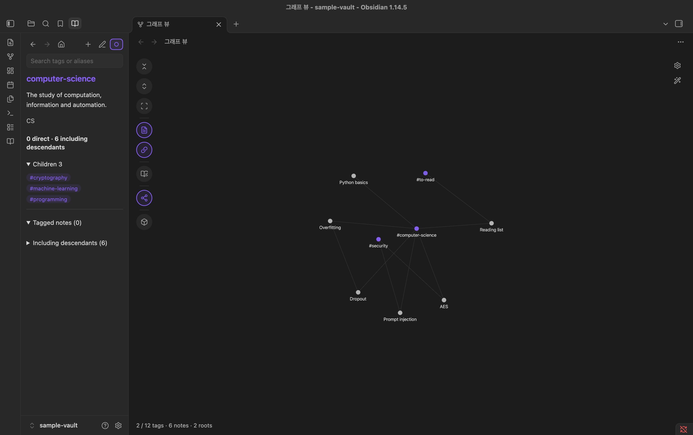
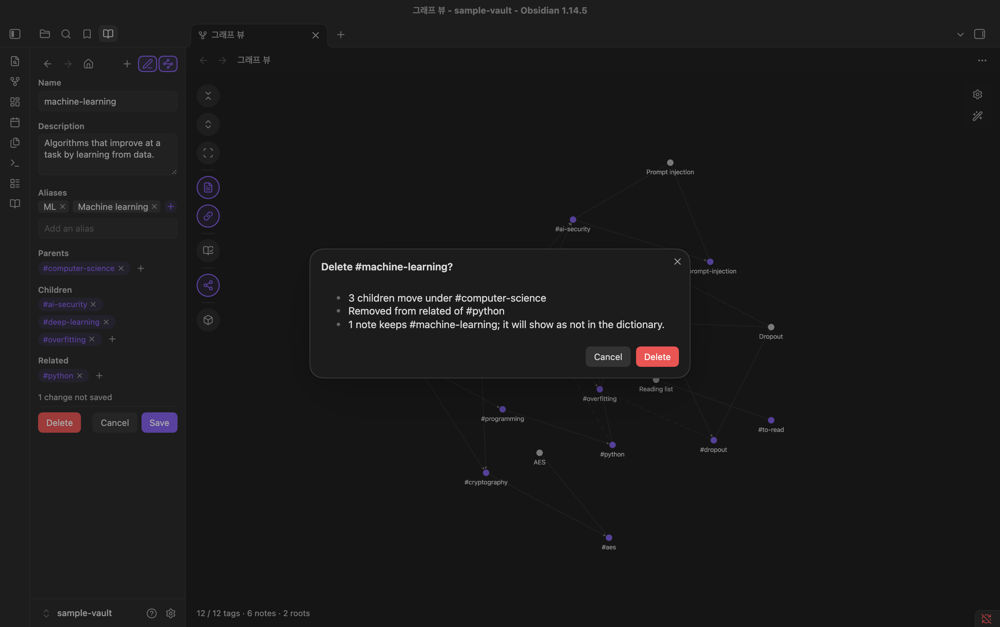

# Tag Ontology

[](https://github.com/NamhyeonKo/obsidian-tag-ontology/stargazers)
[](https://community.obsidian.md/plugins/tag-ontology)
[](https://github.com/NamhyeonKo/obsidian-tag-ontology/releases/latest)
[](https://www.npmjs.com/package/tag-ontology)
[](https://github.com/NamhyeonKo/obsidian-tag-ontology/actions/workflows/release.yml)
[](../../LICENSE)

[English](../../README.md) | [한국어](README.ko.md) | [简体中文](README.zh-CN.md) | [繁體中文](README.zh-TW.md) | [日本語](README.ja.md) | [Español](README.es.md) | **Français** | [Deutsch](README.de.md) | [Português (Brasil)](README.pt-BR.md) | [Русский](README.ru.md) | [Italiano](README.it.md)

**Liez vos étiquettes comme vous liez vos notes.**

Tag Ontology vous permet d’attribuer des parents, des enfants et des étiquettes associées à chaque étiquette depuis un onglet de la barre latérale, sans aucun fichier à modifier. Explorez-les ensuite directement dans la **Vue graphique** d’Obsidian : réduisez et développez chaque branche, passez à une disposition en arbre et gardez l’étiquette sélectionnée en focus. Vos notes, liens entre notes, filtres, groupes de couleurs et paramètres d’affichage continuent de fonctionner comme avant.

Il ne modifie jamais vos notes. Il écrit uniquement dans le dictionnaire d’étiquettes, un simple fichier JSON dans votre coffre, et seulement lorsque vous ajoutez, modifiez ou supprimez une étiquette dans l’onglet latéral.

## Pourquoi Tag Ontology ?

Un concept peut être relié à plusieurs domaines à la fois. Par exemple, le RAG est lié aux LLM, à la recherche d’information et aux graphes de connaissances. En l’organisant avec des dossiers ou des étiquettes imbriquées, je devais choisir sous quel chemin le placer, et ce seul chemin rendait ses autres relations difficiles à voir.

Je voulais gérer et explorer séparément les relations entre concepts, tout en gardant intacts l’emplacement des documents et le texte source. J’ai créé Tag Ontology pour que les étiquettes puissent avoir plusieurs parents et des étiquettes associées, avec des relations navigables dans le graphique d’Obsidian. Je l’ai ensuite étendu afin que la CLI et TOW puissent utiliser ces mêmes relations et règles.

> **Pour commencer :** la hiérarchie étant construite à partir des nœuds d’étiquettes, l’option **Filtres → Mots-clés** doit être activée dans les paramètres du graphique. Une nouvelle installation l’active automatiquement pour vous.


> [!TIP]
> **Utilisation avec des agents d’IA** : Associez-le à [TOW](https://github.com/NamhyeonKo/tag-ontology-wiki) pour gérer vos étiquettes et dictionnaires avec des agents d’IA, en parallèle de tâches plus larges sur votre coffre. ([En savoir plus](#projets-associés))

## Fonctionnalités

- **Construisez votre hiérarchie dans la barre latérale.** Ajoutez des étiquettes déjà utilisées par vos notes ou de nouveaux noms, modifiez le nom, la description, les alias, le `facet`, les parents, les enfants et les étiquettes associées d’une étiquette, et supprimez des étiquettes. Aucun fichier à éditer, et l’enregistrement n’écrase jamais les modifications effectuées ailleurs.
- **Une extension du graphique natif.** Les notes, les liens entre notes, les filtres, les groupes de couleurs, les flèches et les autres paramètres natifs fonctionnent comme d’habitude.
- **Hiérarchie d’étiquettes repliable.** Les étiquettes du dictionnaire commencent repliées sur leurs racines, et chaque note est reliée à son ancêtre visible le plus proche. Cliquez sur une étiquette pour la sélectionner et double-cliquez dessus pour la développer d’un niveau, et voyez ses notes se déplacer vers les étiquettes enfants plus spécifiques. Double-cliquez à nouveau pour la réduire.
- **Comptage des notes avec cumul.** Pour chaque étiquette, vous voyez les notes étiquetées *directement* et les notes étiquetées avec cette étiquette *ou l’un de ses descendants*.
- **Parents multiples et étiquettes associées.** Des flèches pleines vont du parent à l’enfant. Des lignes pointillées relient les étiquettes associées.
- **Quatre dispositions.** `Force`, **Carte mentale**, un arbre vertical et un arbre horizontal. Les arbres classiques conservent leur disposition basée sur la hiérarchie visible et répartissent les arbres racines sur plusieurs rangées. Carte mentale démarre la racine choisie au niveau 0 et utilise le plus long chemin parental actuellement ouvert pour l’espacement. Les couleurs des étiquettes continuent d’utiliser la profondeur complète du dictionnaire.
- **Carte mentale.** Carte mentale vous demande d’abord par où commencer : recherchez une étiquette de la hiérarchie ou choisissez l’une des racines suggérées, puis explorez uniquement la branche de cette étiquette. Utilisez **Changer l’étiquette de départ** (le bouton d’accueil dans la rangée du bas) pour revenir au sélecteur. Revenir à une autre disposition restaure son état de déploiement précédent ; entrer à nouveau dans Carte mentale réaffiche le sélecteur. Sélectionnez un libellé pour voir ses détails dans la barre latérale ; utilisez son bouton fléché pour développer ou réduire ses enfants. Faites glisser l’arrière-plan pour vous déplacer, faites défiler pour zoomer et utilisez **Ajuster à la vue** pour voir toute la carte. Partage les filtres du graphique natif et l’état de déploiement enregistré. Les étiquettes partagées restent visibles tant qu’un autre parent développé y mène. Les notes restent masquées dans cette disposition.
- **Vue 3D (bêta).** La même hiérarchie en trois dimensions : orbitez autour et cliquez sur une étiquette pour voler vers elle. Changez de mode dans la barre d’outils du graphique. Force, Carte mentale, les deux arbres, 3D et l’explorateur d’ontologie partagent un seul onglet ; faites un clic droit sur un bouton de mode pour ouvrir un onglet séparé afin de comparer. Ajustez **Filtres** (recherche, pièces jointes, fichiers existants uniquement, orphelins), **Afficher** (flèches sur les liens des notes, seuil de fondu du texte, taille des nœuds, épaisseur des liens, étiquettes en perspective et taille des étiquettes) et **Forces** (tension au glisser et curseurs de force) depuis son panneau d’engrenage en 3 sections, avec réinitialisation par section ou pour tout le panneau. Basculer vers la 3D ou l’explorateur préserve l’autre canevas ; le rendu 3D masqué se met en pause et la fermeture de l’onglet du graphique libère ses ressources.
- **Explorateur d’ontologie (bêta).** Partez d’une étiquette sur un canevas vide et faites apparaître ses enfants, parents, étiquettes associées et notes d’un clic droit, sous forme de cartes d’objet, dans le style des graphes d’ontologie de Palantir.
- **Un onglet dans la barre latérale.** Recherchez par nom d’étiquette ou par alias, consultez les détails d’une étiquette et lancez la vérification du dictionnaire dans un onglet à côté de Fichiers et Rechercher. Sélectionner une étiquette à cet endroit zoome le graphique ouvert dessus et la centre.
- **Vérification du dictionnaire.** Répertorie les étiquettes utilisées dans votre coffre mais absentes du dictionnaire, avec des noms similaires du dictionnaire ; les étiquettes du dictionnaire qu’aucune note n’utilise encore ; les notes qui écrivent une étiquette sous forme d’alias ou avec une autre casse ; et les notes portant une étiquette plus générale à côté d’une plus précise. Elle signale uniquement et ne modifie jamais rien.
- **Couleurs personnalisées (facultatif).** Attribuez une couleur unique à toutes les étiquettes dans le graphique et dans la barre latérale : la couleur d’accentuation par défaut, sauf si vous en choisissez une autre.
- **Couleurs par profondeur hiérarchique (facultatif).** Sélectionnez **Couleurs → Mode de couleur → Profondeur hiérarchique** pour colorer les étiquettes selon le plus long chemin de la racine à l’étiquette dans tout le dictionnaire. Le filtrage et le repli gardent les couleurs stables, et les niveaux plus profonds utilisent la dernière couleur de la palette. Par défaut et Pastel utilisent le même ordre rouge→orange→jaune→vert→cyan→bleu→violet→rose du [nuancier Tailwind CSS 3.4](https://v3.tailwindcss.com/docs/customizing-colors), respectivement avec les nuances 500 et 200. Elles sont rééchantillonnées sur toute la plage lorsque le nombre de niveaux change ; les exemples Arc-en-ciel, Tons chauds et dégradés monochromes sont également disponibles. Modifiez les couleurs numérotées horizontalement et ajoutez ou retirez des niveaux. La légende compacte du graphique propose la sélection de palette, la modification des couleurs et **Enregistrer la palette sous…**. Les modifications faites ici ou dans les paramètres deviennent une **Copie de travail** partagée, conservée automatiquement d’un redémarrage à l’autre. **Enregistrer sous…** ajoute un instantané nommé indépendant sous **Mes palettes** ; passer à un exemple ou à une palette enregistrée laisse la copie de travail disponible. Les noms enregistrés sont uniques et n’écrasent jamais une autre palette. **Mes palettes → Gérer…** liste les palettes enregistrées avec suppression confirmée ; supprimer la palette active sélectionne Par défaut et conserve la copie de travail. Les anciennes palettes Custom sont conservées sous le nom **My colors**, et les couleurs actives existantes sont préservées lorsque les exemples changent. Les couleurs s’appliquent à la 2D, à la 3D, aux cartes de l’explorateur et à la barre latérale. Inspiré de [Colored Tags](https://github.com/pfrankov/obsidian-colored-tags).
- **Mise en valeur (facultatif).** Gardez l’étiquette sélectionnée et les étiquettes voisines (parents, enfants et associées) lumineuses pendant que le reste s’estompe. Des options ajoutent toutes les étiquettes situées dessous ainsi que ses notes.
- **Mémorise votre affichage.** Les étiquettes développées ainsi que les interrupteurs Notes et Associées sont enregistrés et partagés par tous les onglets de graphique.
- **Interface localisée (11 langues).** Suit automatiquement la langue d’Obsidian par défaut, ou basculez manuellement sous **Général → Langue** entre English, 한국어, 日本語, 简体中文, 繁體中文, Español, Français, Deutsch, Português (Brasil), Русский et Italiano. Les paramètres, le dictionnaire latéral, les contrôles 3D, les légendes de profondeur et les vues de graphique se mettent à jour en direct.

| Onglet latéral | Vérification du dictionnaire |
| --- | --- |
|  |  |
| **Replié sur les racines** | **Développé** |
|  |  |
| **Arbre vertical** | **Arbre horizontal** |
|  |  |
| **Thème d’origine** | **Garder l’étiquette sélectionnée en focus** |
|  |  |
| **Modifier une étiquette** | **Nouvelle étiquette** |
|  |  |
| **Suggestions de recherche** | **Supprimer une étiquette** |
|  |  |

## Fonctionnement

Tag Ontology fonctionne à l’intérieur de la Vue graphique native. Il reprend le graphique déjà construit par Obsidian avec vos filtres et groupes de couleurs, replie les étiquettes du dictionnaire et ajoute les liens hiérarchiques et associés entre elles. Les étiquettes absentes du dictionnaire restent des nœuds d’étiquettes ordinaires. Le graphique local n’est pas affecté, et désactiver le module rétablit la Vue graphique normale.

La vue 3D (bêta) est un onglet séparé. Elle construit les mêmes notes et étiquettes à partir du coffre, y applique le dictionnaire avec le même code et les dessine avec three.js.

L’explorateur d’ontologie (bêta) est lui aussi un onglet séparé. Il n’affiche pas tout le dictionnaire : vous placez les étiquettes sur son canevas une par une et il le dessine avec Cytoscape.js.

La hiérarchie que vous construisez dans l’onglet latéral est enregistrée dans le fichier de dictionnaire. Consultez [Fichier de dictionnaire (avancé)](#fichier-de-dictionnaire-avancé) si vous souhaitez le lire ou le modifier directement.

L’utilisation des étiquettes provient du cache de métadonnées d’Obsidian, qui inclut les `tags` du frontmatter et les `#étiquettes` en ligne dans chaque note Markdown.

## Installation et mise à jour

> Pour tous les détails, les builds de développement et le dépannage, consultez le [Guide complet d’installation et de mise à jour](../installation.md) (en anglais).

### Depuis les Modules complémentaires

- **Installer** : Ouvrez **Paramètres → Modules complémentaires → Parcourir**, recherchez « Tag Ontology », puis installez-le et activez-le. Vous pouvez également l’installer depuis sa [page du répertoire](https://community.obsidian.md/plugins/tag-ontology).
- **Mettre à jour** : Allez dans **Paramètres → Modules complémentaires**, cliquez sur **Vérifier les mises à jour**, puis cliquez sur **Tout mettre à jour** ou **Mettre à jour** à côté de Tag Ontology.

### Avec BRAT (versions bêta)

- **Installer** :
  1. Installez et activez [BRAT](https://github.com/TfTHacker/obsidian42-brat).
  2. Choisissez **BRAT: Add a beta plugin for testing** et saisissez `NamhyeonKo/obsidian-tag-ontology`.
- **Mettre à jour** : Exécutez la commande `BRAT: Check for updates to all beta plugins` (ou `BRAT: Check for plugin updates`).

### Manuellement

- **Installer** :
  1. Téléchargez `main.js`, `manifest.json` et `styles.css` depuis la [dernière version](https://github.com/NamhyeonKo/obsidian-tag-ontology/releases).
  2. Copiez-les dans `.obsidian/plugins/tag-ontology/` à l’intérieur de votre coffre.
  3. Rechargez Obsidian, puis activez **Tag Ontology** dans **Paramètres → Modules complémentaires**.
- **Mettre à jour** :
  1. Téléchargez les derniers fichiers `main.js`, `manifest.json` et `styles.css`.
  2. Remplacez les fichiers dans `.obsidian/plugins/tag-ontology/`.
  3. Exécutez la commande `Recharger l’application sans sauvegarder` ou redémarrez Obsidian.

### Outil CLI autonome

La CLI autonome est publiée sur npm sous le nom [`tag-ontology`](https://www.npmjs.com/package/tag-ontology) :

```sh
# Exécuter directement la dernière version sans l’installer :
npx tag-ontology@latest check --root /path/to/vault --json

# Ou installer / mettre à jour globalement :
npm install -g tag-ontology@latest
npm update -g tag-ontology
```

> **Prérequis** : Le module principal **Vue graphique** doit être activé, avec **Filtres → Mots-clés** activé dans les paramètres du graphique.

## Démarrage rapide avec le coffre d’exemple

Le dépôt inclut un petit coffre dans [`examples/sample-vault`](../../examples/sample-vault) : un dictionnaire de 12 étiquettes et six notes.

1. Dans Obsidian, choisissez **Ouvrir un dossier comme coffre** et sélectionnez `examples/sample-vault`.
2. Installez le module dans ce coffre avec l’une des méthodes ci-dessus.
3. Cliquez sur l’icône du ruban **Ouvrir Tag Ontology** (un livre) ou exécutez **Tag Ontology: Ouvrir le graphique** depuis la palette de commandes.
4. Si le graphique n’affiche aucune étiquette, activez **Filtres → Mots-clés** dans les paramètres du graphique (icône d’engrenage).

Vous devriez voir deux racines, `computer-science` et `security`, avec les six notes reliées à elles, ainsi que l’étiquette non enregistrée `#to-read`. Double-cliquez sur `computer-science`, puis sur `machine-learning` : la note `Dropout` passe sous `deep-learning`. `cryptography` et `ai-security` ont chacune deux parents.

Essayez ensuite l’onglet latéral : appuyez sur **+** pour ajouter votre propre étiquette sous `machine-learning`.

## Utilisation

### Onglet latéral

**Ouvrir Tag Ontology** (l’icône de livre du ruban ou la commande **Ouvrir le graphique**) ouvre le graphique et met en avant un onglet **Dictionnaire d’étiquettes** dans la barre latérale gauche, à côté de Fichiers et Rechercher. Cliquer sur une étiquette dans le graphique ou sur **Vérifier le dictionnaire** le met également en avant. Vous pouvez faire glisser l’onglet vers la barre latérale droite.

- **La barre supérieure** comporte Précédent, Suivant et Accueil (les étiquettes racines et toutes les étiquettes) à gauche, ainsi que **Nouvelle étiquette**, **Modifier l’étiquette** et un bouton qui développe ou replie l’étiquette dans le graphique à droite. S’il n’y a aucun graphique affiché à l’écran, ce bouton en ouvre un et montre l’étiquette ; une étiquette sans enfant l’affiche désactivé, avec **Aucune étiquette enfant**.
- **Rechercher une étiquette ou un alias** : saisissez une partie du nom d’une étiquette ou d’un alias et choisissez une suggestion d’un clic ou avec Entrée. Une correspondance sur un alias affiche l’alias sous l’étiquette, de sorte que `convolution` ou `합성곱` permet de trouver `cnn`. Le graphique se déploie jusqu’à l’étiquette choisie, zoome dessus et la centre.
- Lorsqu’aucune étiquette n’est sélectionnée, l’onglet liste les étiquettes racines, puis toutes les étiquettes par ordre alphabétique sous leur première lettre. La barre et le champ de recherche restent fixes pendant que la liste défile.
- Une étiquette affiche sa description, ses alias, son nombre de notes (directes et descendants inclus), ses parents, enfants et étiquettes associées sous forme de liens `#tag`, ainsi que ses notes. Cliquez sur un `#tag` pour vous y rendre.

### Modifier le dictionnaire

- **Nouvelle étiquette** (`+` dans la barre) : choisissez une étiquette utilisée par vos notes mais absente du dictionnaire, classée selon le nombre de notes qui l’utilisent, ou tapez un nouveau nom. Choisissez des parents pour la placer sous d’autres étiquettes ; sans parent, elle devient une étiquette racine. Vous pouvez également ajouter des enfants et des étiquettes associées parmi celles déjà présentes dans le dictionnaire.
- **Modifier l’étiquette** (le crayon) : modifiez le nom, la description, les alias, le facet, les parents, les enfants et les étiquettes associées. Appuyez sur **+** après le dernier élément d’un champ pour y ajouter une entrée. Les parents, enfants et étiquettes associées doivent déjà exister dans le dictionnaire, et les étiquettes associées sont enregistrées des deux côtés. Renommer une étiquette ne modifie pas les notes qui l’utilisent : elles conservent l’ancienne étiquette, qui apparaît alors comme absente du dictionnaire. Changer uniquement la casse (`ml` en `ML`) conserve le lien, car les étiquettes sont comparées sans tenir compte de la casse.
- **Noms d’étiquettes en kebab-case** (un paramètre, désactivé par défaut) : une étiquette ajoutée ou renommée ne doit contenir que des minuscules et des chiffres reliés par des tirets, comme `machine-learning`, le format vérifié par TOW. Les noms existants sont conservés.
- **Supprimer** (dans le formulaire d’édition) demande confirmation et montre ce qui va se passer : les enfants de l’étiquette passent sous ses parents, elle est retirée des listes d’étiquettes associées et les notes conservent leurs étiquettes.
- Les modifications restent dans le formulaire jusqu’à ce que vous cliquiez sur **Enregistrer**, et quitter avec des modifications non enregistrées demande d’abord confirmation. Si les étiquettes modifiées ont été changées ailleurs entre-temps, l’enregistrement s’arrête et vous en informe, tout en conservant vos saisies dans le formulaire.
- Le dictionnaire est enregistré à raison d’une étiquette par ligne, de sorte qu’un enregistrement ne modifie que les lignes concernées. Un fichier écrit dans une autre mise en forme est reformaté lors de son premier enregistrement. Ses fins de ligne (LF ou CRLF) sont conservées.

### Barre d’outils du graphique

Tout réduire, Tout développer et Ajuster à la vue se trouvent sur une rangée au bas du graphique, au centre ; les autres boutons ronds descendent le long du côté gauche, et la légende de profondeur se tient dans le coin inférieur gauche. Chacun affiche son nom au survol :

| Bouton | Rôle |
| --- | --- |
| Tout réduire | Replie toutes les étiquettes du dictionnaire sur leur racine |
| Tout développer | Développe toutes les étiquettes du dictionnaire |
| Ajuster à la vue | Cadre le graphique dans la zone laissée libre par la barre d’outils, la légende et les boutons de paramètres |
| Notes | Affiche ou masque tous les nœuds qui ne sont pas des étiquettes (notes, pièces jointes, liens non résolus) |
| Associées | Affiche ou masque les liens en pointillés des étiquettes associées |
| Vérifier le dictionnaire | Liste les étiquettes non enregistrées et inutilisées dans l’onglet latéral |
| Force / Carte mentale / Arbre vertical / Arbre horizontal / 3D / Explorateur d’ontologie | Change le mode dans cet onglet, dans cet ordre. Le mode actif est mis en surbrillance. Faites un clic droit sur un bouton pour **Ouvrir dans un nouvel onglet** et comparer deux modes côte à côte. La 3D et l’explorateur sont masqués tant que leur option **Activer…** est désactivée |

- Dans les dispositions en arbre et en Carte mentale, chaque étiquette est placée sous son parent et les notes sont masquées afin que les relations entre étiquettes restent lisibles.
- Cliquez sur une étiquette du graphique pour la centrer et l’afficher dans l’onglet latéral. Double-cliquez dessus pour la développer, puis double-cliquez à nouveau pour la réduire, comme avec le bouton en haut de l’onglet. Les étiquettes développées en dessous restent développées pour la fois suivante.
- Tout le reste conserve le comportement natif : cliquer sur une note l’ouvre, et cliquer sur une étiquette absente du dictionnaire ouvre la recherche.

### Vue 3D (bêta)

Le bouton de mode **3D** de la barre d’outils du graphique, ou **Ouvrir le graphique 3D**, bascule l’onglet du graphique vers la vue 3D ; un autre bouton de mode permet de revenir en arrière. Lorsqu’un autre mode est affiché, le rendu 3D est mis en pause. Elle partage les étiquettes développées, les interrupteurs **Notes** et **Associées**, les couleurs, la **Mise en valeur** et l’onglet latéral avec le graphique 2D : une étiquette développée dans l’un l’est aussi dans l’autre.


- Faites glisser dans le vide pour orbiter, faites un clic droit maintenu pour déplacer la vue et faites défiler pour zoomer.
- Faites glisser un nœud pour le déplacer indépendamment. Relâchez-le et il revient à sa place par effet ressort, comme dans les vues en arbre. La disposition se stabilise après l’ouverture de la vue et après un déploiement, puis reste immobile.
- Cliquez sur une étiquette pour la sélectionner et voler vers elle, et double-cliquez dessus pour la développer ou la réduire. Cliquez sur une note pour l’ouvrir. Sélectionner une étiquette dans la barre latérale déclenche aussi le vol vers elle. Cliquer sur une étiquette absente du dictionnaire ne fait rien ici ; en 2D, cela ouvre la recherche.
- La barre d’outils comprend **Tout réduire**, **Tout développer**, **Ajuster à la vue**, **Notes**, **Associées**, **Vérifier le dictionnaire** et les boutons de mode. **Ajuster à la vue** cadre la plupart des nœuds visibles pour remplir la vue ; quelques nœuds très éloignés peuvent rester en dehors.
- Le bouton d’engrenage en haut à droite ouvre le panneau de paramètres 3D (**Filtres**, **Afficher**, **Forces**), à l’image du panneau 2D d’Obsidian. Son en-tête inclut un bouton **Restaurer les paramètres par défaut** pour toutes les sections, chaque section dispose de son propre bouton **Rétablir par défaut**, et les modifications se synchronisent entre tous les onglets 3D ouverts.
  - **Filtres** : champ de recherche prenant en charge `path:`, `file:`, `tag:`, la négation par `-` et les expressions entre guillemets ; **Pièces jointes** (désactivé par défaut) ; **Fichiers existants uniquement** (activé par défaut) ; et **Orphelins** (activé par défaut).
  - **Afficher** : **Flèches** sur les liens des notes (désactivé par défaut ; les liens de hiérarchie affichent toujours des flèches), **Seuil de fondu du texte**, **Taille des nœuds**, **Épaisseur des liens**, **Étiquettes en perspective** (activé par défaut) et **Taille des étiquettes** (`0.5` à `2`, `0.8` par défaut).
  - **Forces** : **Tension au glisser** (activée par défaut : entraîne les nœuds connectés lors du glisser d’un nœud ; désactivée, seul le nœud déplacé bouge), **Force centrale**, **Force de répulsion**, **Force de liaison** et **Distance des liens** avec les plages et valeurs par défaut du graphique 2D. Déplacer un curseur de force relance la simulation.
- La vue 3D construit ses notes, étiquettes, pièces jointes et liens non résolus directement depuis le coffre, et enregistre ses réglages d’engrenage séparément du graphique 2D natif.
- Si la vue 3D est lente ou que vous ne l’utilisez pas, désactivez **Activer la vue 3D (bêta)** dans les paramètres. Son bouton de mode et sa commande disparaissent, et le graphique 2D reste inchangé.

### Explorateur d’ontologie (bêta)

Le bouton de mode **Explorateur d’ontologie** de la barre d’outils du graphique, ou **Ouvrir l’explorateur d’ontologie**, bascule l’onglet du graphique vers l’explorateur. Son canevas est conservé pendant qu’un autre mode est affiché. Il partage l’onglet latéral avec les graphiques, mais pas leurs étiquettes développées, leurs interrupteurs **Notes** et **Associées** ni la **Mise en valeur**.

- Un canevas vide demande par où commencer : recherchez une étiquette, choisissez une étiquette racine ou continuez depuis l’étiquette sélectionnée dans la barre latérale. Choisir une étiquette dans la recherche latérale ou via un lien d’étiquette l’ajoute également au canevas.
- Chaque étiquette est une carte d’objet affichant son `facet` (ou `concept`), ses notes directes, ses notes avec descendants et son nombre d’enfants. Les facets reçoivent leurs propres couleurs ; les étiquettes sans facet prennent la couleur d’étiquette.
- Faites un clic droit sur une étiquette pour accéder à **Développer les enfants**, **Développer les parents**, **Développer les associées** et **Afficher les notes**. Chaque entrée indique combien ne sont pas encore sur le canevas. Les nouvelles cartes se disposent en colonnes à côté : les enfants et les notes à droite, les parents à gauche, sans déplacer ce qui est déjà sur le canevas. Double-cliquez sur une étiquette pour développer ses enfants.
- Les liens suivent le dictionnaire, comme dans le graphique 2D : des flèches du parent vers l’enfant et des traits pointillés entre étiquettes associées relient deux étiquettes présentes sur le canevas, quelle que soit la façon dont elles y ont été amenées.
- Une étiquette ayant plus de 15 notes affiche à la place une carte de groupe. Cliquez dessus pour lister ses notes dans l’onglet latéral, de la plus récente à la plus ancienne, les filtrer et extraire celles que vous cochez ou les 10 dernières. Double-cliquez dessus pour extraire les 10 dernières. Le groupe contient toutes les notes de l’étiquette qui ne sont pas affichées comme cartes sur le canevas : les notes étiquetées ultérieurement s’y ajoutent, et une carte de note retirée y retourne.
- Cliquez sur une carte pour l’afficher dans l’onglet latéral ; double-cliquez sur une note pour l’ouvrir. Faites glisser les cartes n’importe où ; elles restent là où vous les posez. Faites un clic droit sur une carte pour la retirer ; les cartes sorties à partir d’elle restent en place.
- La barre d’outils comporte **Ajuster à la vue**, **Effacer le canevas** et les boutons de mode. Le canevas n’est pas enregistré : fermer l’onglet l’efface.
- Modifier le dictionnaire ou les notes met à jour les cartes : les étiquettes et notes renommées gardent leur place, et celles supprimées quittent le canevas.
- Si vous ne l’utilisez pas, désactivez **Activer l’explorateur d’ontologie (bêta)** dans les paramètres. Son bouton de mode et sa commande disparaissent.

### Commandes

| Commande | Description |
| --- | --- |
| Tag Ontology: Ouvrir le graphique | Ouvre l’ontologie dans la Vue graphique native. Réutilise un onglet ouvert. |
| Tag Ontology: Ouvrir le graphique 3D | Bascule l’onglet de graphique ouvert vers la 3D, ou en ouvre un. Proposée uniquement lorsque **Activer la vue 3D (bêta)** est activé. |
| Tag Ontology: Ouvrir l’explorateur d’ontologie | Bascule l’onglet de graphique ouvert vers l’explorateur, ou en ouvre un. Proposée uniquement lorsque **Activer l’explorateur d’ontologie (bêta)** est activé. |
| Tag Ontology: Recharger le dictionnaire | Recharge le dictionnaire et l’index des notes. |

### Paramètres

Les paramètres utilisent le même ordre de sections et d’options sur Obsidian 1.13+ et sur les versions antérieures : **Général**, **Dictionnaire**, **Couleurs**, **Barre latérale**, **Mise en valeur** et **Vues supplémentaires**. Les modes Couleur unique et Profondeur hiérarchique affichent les options de couleur ; les contrôles de palette apparaissent en mode Profondeur hiérarchique. Les options de Mise en valeur apparaissent lorsque la mise en valeur est activée.

| Paramètre | Description |
| --- | --- |
| **Général** | |
| Langue | Suit la langue d’Obsidian (`Automatique (Obsidian)`, par défaut) ou choisit l’une des 11 langues prises en charge pour les paramètres du plugin, le dictionnaire latéral, les contrôles 3D et les vues de graphique. Les noms des commandes et les titres des onglets déjà ouverts sont mis à jour après redémarrage d’Obsidian. |
| **Dictionnaire** | |
| Chemin du dictionnaire | Chemin relatif au coffre vers un fichier `.json`. Laissez vide pour détecter le dictionnaire automatiquement : `tow/tag-dictionary.json`, puis `.tow/tag-dictionary.json`, puis `Tag-Dictionary.json` ; si aucun n’existe, `tow/tag-dictionary.json`. Un chemin saisi est toujours utilisé. Le champ est enregistré lorsque vous appuyez sur Entrée ou que vous le quittez. |
| Noms d’étiquettes en kebab-case | Désactivé par défaut. Activé : le formulaire d’édition n’accepte pour une étiquette ajoutée ou renommée que des minuscules et chiffres reliés par des tirets, le format vérifié par TOW. Les noms existants sont conservés. |
| **Couleurs** | |
| Mode de couleur | Par défaut (Obsidian), Couleur unique ou Profondeur hiérarchique. Les couleurs existantes sont conservées lors du changement de mode. |
| &nbsp;&nbsp;Palette | Exemples, la Copie de travail actuelle et Mes palettes. Les exemples conservent le nombre actif de niveaux ; les palettes nommées restaurent leurs couleurs et leur nombre de niveaux enregistrés. |
| &nbsp;&nbsp;Couleurs par niveau | Modifiez les couleurs numérotées horizontalement ; ajoutez ou retirez des niveaux (au moins un). Les niveaux au-delà de la dernière couleur conservent cette couleur. |
| &nbsp;&nbsp;Mes palettes | Enregistrer sous… ouvre un champ de nom ; Gérer… liste les palettes pour suppression confirmée. Supprimer la palette active bascule sur Par défaut et conserve la copie de travail. Les noms en double sont refusés. |
| &nbsp;&nbsp;Couleur des étiquettes / Couleur hors hiérarchie | Couleur de base en mode Couleur unique, ou couleur de secours pour les étiquettes hors hiérarchie en mode Profondeur hiérarchique. Suit la couleur d’accentuation tant qu’aucune couleur n’est choisie ; réinitialiser revient à la couleur d’accentuation. |
| &nbsp;&nbsp;Titres colorés dans la barre latérale | Utilise la couleur de l’étiquette sélectionnée pour son titre dans la barre latérale. |
| **Barre latérale** | |
| Affichage des listes | Affiche les étiquettes dans la barre latérale (étiquettes racines, toutes les étiquettes, parents, enfants et étiquettes associées) sous forme de pastilles ou une par ligne. Pastilles par défaut. |
| **Mise en valeur** | |
| Garder l’étiquette sélectionnée en focus | Maintient l’étiquette sélectionnée et les étiquettes voisines (ses parents, enfants et associées) lumineuses et estompe le reste. L’étiquette sélectionnée et ses liens apparaissent comme au survol. Désactivé par défaut. Activez-le pour afficher les options ci-dessous. |
| &nbsp;&nbsp;Ses descendants | Maintient aussi lumineuses toutes les étiquettes situées en dessous, tant qu’elles sont développées. Activé par défaut. |
| &nbsp;&nbsp;Inclure les notes | Maintient également lumineuses les notes de l’étiquette sélectionnée, et celles de ses descendants lorsque cette option est activée. Les notes des étiquettes voisines restent estompées. Activé par défaut. |
| **Vues supplémentaires** | |
| Activer l’arbre vertical | Affiche le bouton de mode arbre vertical dans la barre d’outils du graphique. Le désactiver replace en mode Force tout onglet utilisant ce mode. Activé par défaut. |
| Activer l’arbre horizontal | Identique pour le bouton de mode arbre horizontal. Activé par défaut. |
| Activer la vue 3D (bêta) | Affiche le bouton de mode 3D dans la barre d’outils du graphique et la commande Ouvrir le graphique 3D. La désactiver libère la vue 3D ; un onglet qui l’affiche revient en 2D. Activé par défaut. |
| Activer l’explorateur d’ontologie (bêta) | Affiche le bouton de mode de l’explorateur dans la barre d’outils du graphique et la commande Ouvrir l’explorateur d’ontologie. Le désactiver efface le canevas de l’explorateur ; un onglet qui l’affiche revient en 2D. Activé par défaut. |

À faible niveau de zoom, le graphique natif masque les libellés et les flèches. Zoomez pour les voir.

## Fichier de dictionnaire (avancé)

L’onglet latéral lit et écrit ce fichier, vous n’avez donc jamais besoin de l’ouvrir. Il s’agit d’un simple fichier JSON dans votre coffre, vous pouvez donc aussi le modifier à la main.

Le dictionnaire peut se trouver à n’importe quel chemin relatif au coffre se terminant par `.json`, y compris dans `tow/` ou `.tow/`. Lorsque le champ **Chemin du dictionnaire** est vide, le module vérifie `tow/tag-dictionary.json`, puis `.tow/tag-dictionary.json`, puis `Tag-Dictionary.json`. Les nouvelles installations créent `tow/tag-dictionary.json` ; les fichiers `Tag-Dictionary.json` existants continuent de fonctionner, et `.tow/tag-dictionary.json` issu de TOW 0.5.0–0.5.1 reste lu. Un chemin choisi est toujours utilisé. Si le dictionnaire vient à manquer par la suite, l’onglet latéral propose de le créer.

**Obsidian Sync ne synchronise pas les dossiers commençant par un point autres que `.obsidian`** ([paramètres de Sync](https://obsidian.md/help/sync/settings)). Si vous utilisez Obsidian Sync, choisissez un chemin visible pour le dictionnaire. Git et les outils de synchronisation au niveau des fichiers prennent en charge les dossiers cachés, sauf s’ils sont ignorés.

Le fichier est un unique objet JSON. Chaque clé est une étiquette **sans `#`**, comparée sans sensibilité à la casse comme dans le graphique natif (`#ML` utilise la clé `ml`). Les clés en minuscules sont recommandées. Une étiquette imbriquée telle que `#lang/python` utilise la clé `lang/python`.

```json
{
  "machine-learning": {
    "aliases": ["ML"],
    "description": "Algorithms that improve at a task by learning from data.",
    "broader": ["computer-science"]
  },
  "dropout": {
    "description": "Randomly disabling units during training to reduce overfitting.",
    "broader": ["deep-learning"],
    "related": ["overfitting"],
    "facet": "technique"
  },
  "computer-science": {
    "description": "The study of computation, information and automation.",
    "broader": []
  }
}
```

| Champ | Requis | Type | Signification |
| --- | --- | --- | --- |
| `description` | oui | string | Affichée dans le panneau de l’étiquette. |
| `aliases` | non | string[] | Autres noms. Utilisés par la recherche et par la vérification du dictionnaire pour suggérer une correspondance à une étiquette non enregistrée. |
| `broader` | non | string[] | Étiquettes parentes. **`[]` indique une étiquette racine.** |
| `related` | non | string[] | Liens non hiérarchiques, tracés en pointillés. |
| `facet` | non | string | Catégorie libre, par exemple `language`. Définissez-la dans le formulaire d’édition ou dans le brouillon d’un fichier de modifications CLI ; une étiquette de facet à côté de ses étiquettes plus précises n’est pas signalée comme redondante. |

Règles :

- **Les racines doivent avoir `"broader": []`.** Une étiquette sans clé `broader` est considérée comme non encore placée et n’apparaît pas dans le graphique.
- Chaque étiquette citée dans `broader` ou `related` doit exister dans le dictionnaire.
- Une étiquette ne peut pas se référencer elle-même, et les liens `broader` ne peuvent pas former de cycle.
- Si le dictionnaire est invalide, une notification indique la raison au démarrage d’Obsidian ou à l’ouverture de la vue, et la barre latérale continue de l’afficher jusqu’à ce que vous corrigiez le fichier. Le graphique conserve la dernière version chargée, et **Nouvelle étiquette** ainsi que **Modifier l’étiquette** restent désactivés en attendant.

Consultez [`examples/sample-vault/tow/tag-dictionary.json`](../../examples/sample-vault/tow/tag-dictionary.json) pour un exemple complet.

## Confidentialité

- Aucune requête réseau, télémétrie ni compte.
- Lit uniquement les métadonnées de vos notes et le fichier de dictionnaire.
- N’écrit que son propre fichier de paramètres (`plugins/tag-ontology/data.json` dans le dossier de configuration, généralement `.obsidian/`) et, lorsque vous enregistrez une modification dans la barre latérale, le fichier de dictionnaire utilisé : le chemin choisi (y compris un chemin personnalisé enregistré dans une version précédente), ou `tow/tag-dictionary.json`, `.tow/tag-dictionary.json` ou `Tag-Dictionary.json` selon l’ordre de recherche automatique.

## Compatibilité et limites connues

- **Ordinateur uniquement.** Testé sur Obsidian 1.14.5 (macOS).
- Le module s’appuie sur des **mécanismes internes non documentés** de la Vue graphique native (moteur de rendu, PIXI, worker de disposition). Une future mise à jour d’Obsidian pourrait le casser. Si ces mécanismes internes semblent différents, le module se détache et laisse le graphique natif intact.
- Sur de grands coffres, développer toutes les étiquettes avec les notes affichées redessine plusieurs milliers de nœuds et de liens ; attendez-vous à une courte pause.
- Les libellés deviennent denses lorsque toutes les étiquettes sont développées, en particulier en mode Force.
- Non testé avec d’autres modules qui modifient la Vue graphique.
- La vue 3D utilise WebGL et embarque three.js, et l’explorateur embarque Cytoscape.js, ce qui porte le fichier du module à environ 1,6 Mo. Chacun n’est chargé qu’à l’ouverture de son onglet. Avec plusieurs milliers de notes affichées, la vue 3D ralentit ; masquer les notes permet de garder de bonnes performances.

## Feuille de route

- Afficher également la hiérarchie dans le graphique local.

Les signalements de bugs et suggestions de fonctionnalités sont les bienvenus dans les [Issues](https://github.com/NamhyeonKo/obsidian-tag-ontology/issues). Veuillez indiquer votre version d’Obsidian et votre système d’exploitation pour les bugs.

## Bibliothèque et CLI

Le paquet autonome [`tag-ontology`](../../packages/tag-ontology/README.md) expose les mêmes règles de dictionnaire sous la forme d’une bibliothèque ESM sous licence MIT et d’une CLI Node. Il vérifie et analyse un coffre, rapporte l’utilisation des étiquettes, affiche la hiérarchie d’une étiquette et prévisualise ou applique les modifications du dictionnaire avec vérification par empreinte de contenu. Il n’est pas nécessaire qu’Obsidian soit installé.

Il est publié sur npm sous le nom [`tag-ontology`](https://www.npmjs.com/package/tag-ontology) :

```sh
npx tag-ontology check --root /path/to/vault --json
```

Consultez le [guide du paquet](../../packages/tag-ontology/README.md) pour des exemples de la bibliothèque et le [contrat CLI](../cli.md) pour les commandes, champs JSON, codes de sortie et limites de l’analyseur. Le module Obsidian et le paquet ont des versions et tags de publication indépendants.

## Projets associés

### [TOW (Tag Ontology Wiki)](https://github.com/NamhyeonKo/tag-ontology-wiki)

Utilisé avec [TOW](https://github.com/NamhyeonKo/tag-ontology-wiki), il vous permet de tirer parti d’agents d’IA pour gérer les étiquettes et dictionnaires, parallèlement à des tâches plus larges sur le coffre comme la recherche de notes, la gestion du frontmatter et la mise en forme des documents.

- **Gestion du dictionnaire par CLI** : Utilise la CLI `tag-ontology` pour inspecter les étiquettes, valider l’intégrité du dictionnaire et appliquer des mises à jour sûres.
- **Flux de travail par agents d’IA** : Automatise la maintenance répétitive du coffre telle que la découverte d’étiquettes non enregistrées, la synchronisation d’entrées d’ontologie, la vérification des schémas de frontmatter et le nettoyage de la structure des notes.
- **Intégration visuelle dans le graphique** : Explorez et parcourez les hiérarchies d’étiquettes gérées par les agents directement dans la Vue graphique d’Obsidian grâce à ce module.

## Développement

Nécessite Node.js **22.18 ou ultérieur**. Les tests exécutent TypeScript directement grâce au retrait natif des types de Node.

```sh
npm ci
npm run lint        # règles de revue Obsidian + lint du paquet vérifié
npm test            # tests unitaires, aucun coffre requis
npm run build       # vérification de types + dist du paquet + main.js du module
npm run check:package  # inspecte et installe l’archive tarball npm réelle
npm run deploy -- "/path/to/vault"   # copie main.js, manifest.json, styles.css dans le coffre
```

`deploy` nécessite un dossier `.obsidian/` existant dans le coffre cible et préserve un fichier `data.json` existant. Rechargez ensuite le module dans Obsidian.

`npm run test:vault` est le test d’intégration du mainteneur sur un coffre privé (`OBSIDIAN_VAULT_PATH`). Les autres contributeurs n’ont pas besoin de l’exécuter.

### Structure du projet

```text
src/
├── main.ts            # Point d’entrée du module : commandes, onglet paramètres, événements coffre/métadonnées
├── search.ts          # Fenêtre de suggestions pour le champ de recherche et les formulaires d’édition
├── native.ts          # Se raccorde au moteur de rendu de la Vue graphique native (barre, onglet latéral, clics, dispositions)
├── graph-modes.ts     # Barre partagée de changement de mode du graphique et menu ouvrir dans un nouvel onglet
├── legend.ts          # Légende de profondeur hiérarchique, sélecteur de palette et pastilles de couleur
├── palettes.ts        # Préréglages de palette, copie de travail et état de la bibliothèque de palettes enregistrées
├── colors.ts          # Rééchantillonnage des couleurs et association par plus long chemin de profondeur hiérarchique
├── hierarchy.ts       # Adaptateur du modèle de dictionnaire et comptages cumulés de notes
├── layer.ts           # Fonctions pures superposant le dictionnaire aux données du graphique natif
├── layout.ts          # Positions des arbres vertical et horizontal
├── mindmap.ts         # Vue carte mentale reposant sur Cytoscape avec cartes DOM accessibles
├── mindmap-layout.ts  # Espacement de la branche visible en carte mentale et placement des ancres
├── graph3d.ts         # Vue 3D : dessine les mêmes données superposées avec 3d-force-graph
├── controls3d.ts      # Panneau de paramètres 3D repliable en 3 sections (Filtres, Afficher, Forces)
├── filter3d.ts        # Analyseur/évaluateur de requêtes de recherche et élagage des orphelins pour la 3D
├── geometry3d.ts      # Placement des flèches 3D, mise à l’échelle des libellés et aides de profondeur caméra
├── three.ts           # three.js et 3d-force-graph, importés uniquement à l’ouverture d’une vue 3D
├── vault-data.ts      # Construit le format de données du graphique natif depuis le coffre pour la vue 3D
├── explorer.ts        # Explorateur d’ontologie : un canevas Cytoscape.js de cartes d’objet
├── explorer-layout.ts # Fonctions pures pour l’explorateur : placement des cartes, comptages Search Around, liens
├── explorer-card.ts   # Cartes d’objet de l’explorateur sous forme d’images SVG
├── check.ts           # Fonctions regroupant étiquettes non canoniques et redondantes pour Vérifier le dictionnaire
├── settings.ts        # Schéma des paramètres, valeurs par défaut et assainissement
└── i18n/              # Catalogue en 11 langues, formatage à l’exécution et actualisation en direct
tests/              # Tests unitaires node:test (tests/integration est réservé au mainteneur)
packages/tag-ontology/
├── src/core/       # Validation pure du dictionnaire, hiérarchie, utilisation et modifications
├── src/vault/      # Accès aux fichiers Node et lecteurs Markdown/frontmatter
├── src/cli/        # Arguments de ligne de commande, résultats JSON et codes de sortie
└── tests/          # Tests unitaires du paquet et tests CLI en processus réel
docs/cli.md         # Contrat CLI versionné
examples/           # Coffre d’exemple avec un dictionnaire d’étiquettes
scripts/deploy.mjs  # Copie le build dans un coffre local
scripts/check-package.mjs  # Inspecte et teste le paquet npm empaqueté
```

## Contribuer

Les contributions de la communauté sont les bienvenues ! Que ce soit pour corriger des bugs, proposer de nouvelles fonctionnalités ou améliorer la documentation :

1. Consultez les [Issues](https://github.com/NamhyeonKo/obsidian-tag-ontology/issues) existantes ou ouvrez-en une nouvelle.
2. Forkez le dépôt et créez votre branche de fonctionnalité à partir de `dev`.
3. Suivez [Conventional Commits](https://www.conventionalcommits.org/en/v1.0.0/) pour les messages de commit.
4. Assurez-vous que toutes les vérifications passent : `npm run lint && npm test && npm run build`.
5. Soumettez une Pull Request ciblant la branche `dev`.

Veuillez consulter [CONTRIBUTING.md](../../CONTRIBUTING.md) pour les directives complètes de développement et les workflows de test, ainsi que le [Code de conduite](../../CODE_OF_CONDUCT.md).

## Soutien

Tag Ontology est gratuit et open source. S’il vous fait gagner du temps, vous pouvez [m’offrir un café](https://buymeacoffee.com/namhyunko).

## Remerciements

- L’approche consistant à fournir des données personnalisées au moteur de rendu du graphique natif a été inspirée par [Nested tags graph](https://github.com/drpilman/obsidian-graph-nested-tags). Ce module n’est pas requis.
- La vue 3D repose sur [3d-force-graph](https://github.com/vasturiano/3d-force-graph), [three-spritetext](https://github.com/vasturiano/three-spritetext) et [three.js](https://threejs.org), tous sous licence MIT. L’explorateur d’ontologie repose sur [Cytoscape.js](https://js.cytoscape.org) (MIT). Les mentions de licence de chaque paquet embarqué figurent en tête de `main.js`.

## Licence

Copyright (c) 2026 NamhyeonKo

Ce projet est sous [licence MIT](../../LICENSE). Vous êtes libre d’utiliser, modifier et distribuer ce logiciel selon les termes de la licence MIT.
