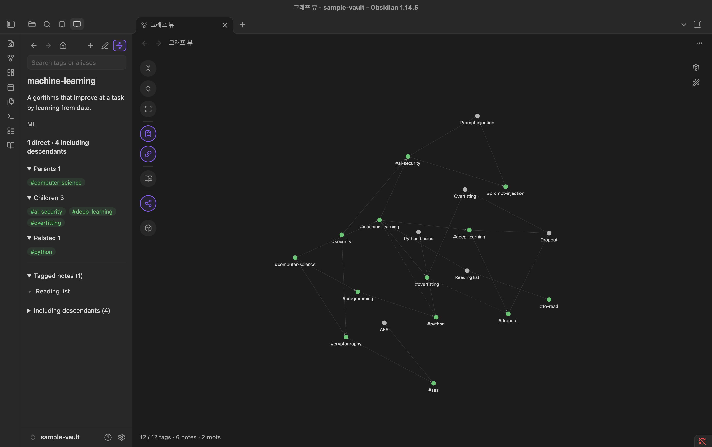

# Tag Ontology

[](https://github.com/NamhyeonKo/obsidian-tag-ontology/stargazers)
[](https://community.obsidian.md/plugins/tag-ontology)
[](https://github.com/NamhyeonKo/obsidian-tag-ontology/releases/latest)
[](https://www.npmjs.com/package/tag-ontology)
[](https://github.com/NamhyeonKo/obsidian-tag-ontology/actions/workflows/release.yml)
[](../../LICENSE)

[English](../../README.md) | [한국어](README.ko.md) | [简体中文](README.zh-CN.md) | [繁體中文](README.zh-TW.md) | [日本語](README.ja.md) | [Español](README.es.md) | [Français](README.fr.md) | [Deutsch](README.de.md) | [Português (Brasil)](README.pt-BR.md) | [Русский](README.ru.md) | **Italiano**

**Collega i tuoi tag come colleghi le note.**

Tag Ontology ti permette di assegnare a ogni tag genitori, figli e tag correlati da una scheda nella barra laterale, senza dover modificare alcun file. Puoi poi esplorarli direttamente nella **Vista grafo** nativa di Obsidian: comprimi ed espandi ciascun ramo, passa a un layout ad albero e mantieni a fuoco il tag selezionato. Note, collegamenti tra note, filtri, gruppi di colore e impostazioni di visualizzazione continuano a funzionare come prima.

Non modifica mai le tue note. Scrive soltanto nel dizionario dei tag — un semplice file JSON nel tuo vault — e solo quando aggiungi, modifichi o elimini un tag nella scheda laterale.

## Perché Tag Ontology?

Un concetto può essere collegato a più ambiti allo stesso tempo. Ad esempio, RAG è correlato a LLM, recupero delle informazioni e grafi della conoscenza. Quando lo organizzavo con cartelle o tag annidati, dovevo scegliere sotto quale percorso collocarlo, e quel solo percorso rendeva difficili da vedere le altre sue relazioni.

Volevo gestire ed esplorare le relazioni tra concetti separatamente, mantenendo intatti la posizione dei documenti e il testo originale. Ho creato Tag Ontology affinché i tag potessero avere più genitori e tag correlati, con queste relazioni navigabili nel grafo di Obsidian. In seguito l’ho esteso così che anche la CLI e TOW potessero usare le stesse relazioni e regole.

> **Per iniziare:** la gerarchia è costruita a partire dai nodi tag, quindi richiede che l’opzione **Filtri → Etichetta** sia attiva nelle impostazioni del grafo. Una nuova installazione la attiva automaticamente per te.


> [!TIP]
> **Uso con agenti IA**: abbinalo a [TOW](https://github.com/NamhyeonKo/tag-ontology-wiki) per gestire tag e dizionari con agenti IA, insieme alle attività più ampie sul vault. ([Scopri di più](#progetti-correlati))

## Funzionalità

- **Costruisci la gerarchia nella barra laterale.** Aggiungi tag già usati nelle tue note oppure nuovi nomi, modifica nome, descrizione, alias, `Facet`, genitori, figli e tag correlati di un tag ed elimina tag. Nessuna modifica manuale ai file, e il salvataggio non sovrascrive mai le modifiche fatte altrove.
- **Un’estensione del grafo nativo.** Note, collegamenti tra note, filtri, gruppi di colore, frecce e le altre impostazioni native funzionano come al solito.
- **Gerarchia di tag comprimibile.** I tag del dizionario partono compressi alle proprie radici e ogni nota si collega al proprio antenato visibile più vicino. Fai clic su un tag per selezionarlo e doppio clic per espanderlo di un livello, osservando le sue note spostarsi verso i tag figli più specifici. Un altro doppio clic lo comprime di nuovo.
- **Conteggio delle note con aggregazione (roll-up).** Per ciascun tag vedi le note etichettate *direttamente* e le note etichettate con il tag *o uno qualsiasi dei suoi discendenti*.
- **Più genitori e tag correlati.** Frecce continue vanno dal genitore al figlio. Linee tratteggiate collegano i tag correlati.
- **Quattro layout.** **Force**, **Mappa mentale**, **Albero verticale** e **Albero orizzontale**. I normali alberi mantengono il layout basato sulla gerarchia visibile e dispongono gli alberi radice su più righe. **Mappa mentale** avvia la radice scelta al livello 0 e usa il percorso di genitori attualmente aperto più lungo per la spaziatura. I colori dei tag continuano a usare la profondità dell’intero dizionario.
- **Mappa mentale.** La **Mappa mentale** chiede innanzitutto da dove iniziare: cerca tra i tag della gerarchia o scegli uno dei tag radice suggeriti, poi esplora soltanto il ramo di quel tag. Usa **Cambia tag iniziale** (il pulsante home nella riga in basso) per tornare alla scelta. Tornando a un altro layout viene ripristinato il suo stato di espansione precedente; rientrando in **Mappa mentale** viene mostrato di nuovo il selettore. Seleziona un’etichetta per vederne i dettagli nella barra laterale; usa il relativo pulsante con freccia per espandere o comprimere i figli. Trascina lo sfondo per spostarti, scorri per ingrandire o ridurre e usa **Adatta alla vista** per vedere l’intera mappa. Condivide i filtri del grafo nativo e lo stato di espansione salvato. I tag condivisi restano visibili finché un altro genitore espanso li raggiunge. Le note restano nascoste in questo layout.
- **Vista 3D (beta).** La stessa gerarchia in tre dimensioni: orbita attorno al grafo e fai clic su un tag per volarci sopra. Cambia modalità nella barra degli strumenti del grafo. **Force**, **Mappa mentale**, entrambi gli alberi, **3D** ed **Esploratore ontologia** condividono una stessa scheda; fai clic destro su un pulsante di modalità per aprire una scheda separata per il confronto. Regola **Filtri** (ricerca, **Allegati**, **Solo file esistenti**, **Orfani**), **Aspetto** (frecce sui collegamenti delle note, **Soglia dissolvenza testo**, **Dimensione nodo**, **Spessore linea**, **Etichette in prospettiva** e **Dimensione etichette**) e **Forze** (**Tensione trascinamento** e cursori delle forze) dal pannello a ingranaggio diviso in 3 sezioni, con **Ripristina predefiniti** per singola sezione e **Ripristina impostazioni predefinite** per l’intero pannello. Passando a **3D** o all’esploratore l’altra area di disegno viene preservata; il rendering 3D nascosto va in pausa e la chiusura della scheda grafo ne rilascia le risorse.
- **Esploratore ontologia (beta).** Parti da un tag su un’area vuota ed estrai figli, genitori, tag correlati e note con un clic destro, sotto forma di schede oggetto, nello stile dei grafi di ontologia di Palantir.
- **Una scheda nella barra laterale.** Cerca per nome del tag o alias, leggi i dettagli di un tag ed esegui il controllo del dizionario in una scheda accanto a **Esplora file** e **Ricerca**. Scegliere un tag qui ingrandisce e centra il grafo aperto su di esso.
- **Controllo dizionario.** Elenca i tag usati nel vault ma assenti dal dizionario, insieme a nomi simili presenti nel dizionario; i tag del dizionario non ancora usati da alcuna nota; le note che scrivono un tag come alias o con maiuscole/minuscole diverse; e le note che riportano un tag più ampio insieme a uno più specifico. Si limita a segnalare e non modifica mai nulla.
- **Colori personalizzati (facoltativo).** Assegna a ogni tag nel grafo e nella barra laterale un colore unico, il colore d’accento a meno che tu non ne scelga un altro.
- **Colori per profondità gerarchica (facoltativo).** Seleziona **Colori → Modalità colore → Profondità gerarchica** per colorare i tag in base al percorso radice-tag più lungo nell’intero dizionario. Filtri e compressioni mantengono i colori stabili, e i livelli più profondi usano l’ultimo colore della tavolozza. **Predefinita** e **Pastello** usano lo stesso ordine rosso→arancione→giallo→verde→ciano→blu→viola→rosa della [tabella colori Tailwind CSS 3.4](https://v3.tailwindcss.com/docs/customizing-colors), usando rispettivamente le tonalità 500 e 200. Si ricampionano sull’intero intervallo quando il numero di livelli cambia; sono disponibili anche gli esempi **Arcobaleno**, **Calda** e sfumature monocromatiche. Modifica i colori numerati in orizzontale e aggiungi o rimuovi livelli. La legenda compatta del grafo offre la selezione della tavolozza, la modifica dei colori e **Salva tavolozza con nome…**. Le modifiche lì o nelle impostazioni diventano una **Copia di lavoro** condivisa, conservata automaticamente tra i riavvii. **Salva con nome…** aggiunge un’istantanea indipendente con nome sotto **Le mie tavolozze**; passare a un esempio o a una tavolozza salvata lascia comunque disponibile la copia di lavoro. I nomi salvati sono univoci e non sovrascrivono mai un’altra tavolozza. **Le mie tavolozze → Gestisci…** elenca le tavolozze salvate con eliminazione confermata; eliminando la tavolozza attiva viene selezionata **Predefinita** mantenendo la copia di lavoro. Le precedenti tavolozze personalizzate vengono conservate come **My colors** e i colori attivi esistenti vengono preservati quando gli esempi cambiano. I colori si applicano a 2D, 3D, schede dell’esploratore e barra laterale. Ispirato a [Colored Tags](https://github.com/pfrankov/obsidian-colored-tags).
- **Focus (facoltativo).** Mantieni luminosi il tag selezionato e i tag adiacenti (genitori, figli e correlati) attenuando il resto. Le opzioni consentono di includere ogni tag sottostante e le relative note.
- **Ricorda la tua vista.** I tag espansi e gli interruttori **Note** / **Correlati** vengono salvati e condivisi da tutte le schede grafo.
- **Interfaccia localizzata (11 lingue).** Segue automaticamente la lingua di Obsidian per impostazione predefinita, oppure si imposta manualmente in **Generali → Lingua** tra English, 한국어, 日本語, 简体中文, 繁體中文, Español, Français, Deutsch, Português (Brasil), Русский e Italiano. Impostazioni, dizionario laterale, controlli 3D, legende di profondità e viste grafo si aggiornano in tempo reale.

| Scheda laterale | Controllo dizionario |
| --- | --- |
|  |  |
| **Compresso alle radici** | **Espanso** |
|  |  |
| **Albero verticale** | **Albero orizzontale** |
|  |  |
| **Tema originale** | **Mantieni a fuoco il tag selezionato** |
|  |  |
| **Modifica tag** | **Nuovo tag** |
|  |  |
| **Suggerimenti di ricerca** | **Eliminazione di un tag** |
|  |  |

## Come funziona

Tag Ontology opera all’interno della **Vista grafo** nativa. Prende il grafo che Obsidian ha già costruito con i tuoi filtri e gruppi di colore, comprime i tag del dizionario e aggiunge tra essi i collegamenti gerarchici e correlati. I tag che non sono nel dizionario restano normali nodi tag. Il **Grafo locale** non viene toccato e disabilitare il plugin riporta la **Vista grafo** alla normalità.

La **vista 3D (beta)** è una scheda separata. Costruisce dal vault le stesse note e gli stessi tag, vi sovrappone il dizionario con lo stesso codice e li disegna con three.js.

Anche l’**Esploratore ontologia (beta)** è una scheda separata. Non mostra l’intero dizionario: porti i tag nella sua area uno alla volta e li disegni con Cytoscape.js.

La gerarchia che costruisci nella scheda laterale viene salvata nel file del dizionario. Consulta [Avanzate: il file del dizionario](#avanzate-il-file-del-dizionario) se vuoi leggerlo o modificarlo direttamente.

L’utilizzo dei tag proviene dalla cache dei metadati di Obsidian, che include la proprietà `tags` nel frontmatter e i `#tag` inline in ogni nota Markdown.

## Installazione e aggiornamento

> Per tutti i dettagli, le build di sviluppo e la risoluzione dei problemi, consulta la [Guida completa all’installazione e all’aggiornamento](../installation.md).

### Dai plugin della comunità

- **Installazione**: apri **Impostazioni → Plugin di terze parti → Sfoglia** (sezione **Plugin della comunità**), cerca «Tag Ontology», quindi installalo e abilitalo. Puoi anche installarlo dalla sua [pagina nella directory](https://community.obsidian.md/plugins/tag-ontology).
- **Aggiornamento**: vai in **Impostazioni → Plugin di terze parti**, fai clic su **Controlla aggiornamenti**, poi su **Aggiorna tutti** oppure **Aggiorna** accanto a Tag Ontology.

### Con BRAT (versioni beta)

- **Installazione**:
  1. Installa e abilita [BRAT](https://github.com/TfTHacker/obsidian42-brat).
  2. Scegli **BRAT: Add a beta plugin for testing** e inserisci `NamhyeonKo/obsidian-tag-ontology`.
- **Aggiornamento**: esegui il comando `BRAT: Check for updates to all beta plugins` (oppure `BRAT: Check for plugin updates`).

### Manualmente

- **Installazione**:
  1. Scarica `main.js`, `manifest.json` e `styles.css` dall’[ultima release](https://github.com/NamhyeonKo/obsidian-tag-ontology/releases).
  2. Copiali in `.obsidian/plugins/tag-ontology/` dentro il tuo vault.
  3. Ricarica Obsidian, poi abilita **Tag Ontology** in **Impostazioni → Plugin di terze parti**.
- **Aggiornamento**:
  1. Scarica i file aggiornati `main.js`, `manifest.json` e `styles.css`.
  2. Sovrascrivi i file in `.obsidian/plugins/tag-ontology/`.
  3. Esegui il comando `Ricarica l'app senza salvare` oppure riavvia Obsidian.

### Strumento CLI autonomo

La CLI autonoma è pubblicata su npm come [`tag-ontology`](https://www.npmjs.com/package/tag-ontology):

```sh
# Esegui subito l'ultima versione senza installarla:
npx tag-ontology@latest check --root /path/to/vault --json

# Oppure installa / aggiorna globalmente:
npm install -g tag-ontology@latest
npm update -g tag-ontology
```

> **Requisito**: il plugin principale **Vista grafo** deve essere abilitato, con l’opzione **Filtri → Etichetta** attivata nelle impostazioni del grafo.

## Avvio rapido con il vault di esempio

Il repository include un piccolo vault in [`examples/sample-vault`](../../examples/sample-vault): un dizionario di 12 tag e sei note.

1. In Obsidian, scegli **Apri cartella come vault** e seleziona `examples/sample-vault`.
2. Installa il plugin in quel vault usando uno dei metodi sopra indicati.
3. Fai clic sull’icona **Apri Tag Ontology** nella barra multifunzione (un libro) oppure esegui **Tag Ontology: Apri grafo** dalla tavolozza dei comandi.
4. Se il grafo non mostra alcun tag, attiva **Filtri → Etichetta** nelle impostazioni del grafo (icona a ingranaggio).

Dovresti vedere due radici, `computer-science` e `security`, con le sei note collegate a esse, più il tag non registrato `#to-read`. Fai doppio clic su `computer-science`, poi su `machine-learning`: la nota `Dropout` si sposta su `deep-learning`. `cryptography` e `ai-security` hanno due genitori ciascuno.

Poi prova la scheda nella barra laterale: premi **+** per aggiungere un tuo tag sotto `machine-learning`.

## Utilizzo

### Scheda nella barra laterale

**Apri Tag Ontology** (l’icona a libro nella barra multifunzione oppure il comando **Apri grafo**) apre il grafo e porta in primo piano la scheda **Dizionario dei tag** nella barra laterale sinistra, accanto a **Esplora file** e **Ricerca**. Anche fare clic su un tag nel grafo o su **Controllo dizionario** la porta in primo piano. Puoi trascinare la scheda nella barra laterale destra.

- **La barra in alto** ha Indietro, Avanti e Home (i tag radice e tutti i tag) a sinistra, e **Nuovo tag**, **Modifica tag** e un pulsante che espande o comprime il tag nel grafo a destra. Senza alcun grafo aperto sullo schermo, quel pulsante ne apre uno e mostra il tag; un tag senza figli lo mostra disabilitato, con **Nessun tag figlio**.
- **Cerca tag o alias**: digita parte del nome di un tag o di un alias e scegli un suggerimento con un clic o Invio. Una corrispondenza per alias mostra l’alias sotto il tag, così `convolution` o `합성곱` possono trovare `cnn`. Il grafo si espande fino al tag scelto, lo ingrandisce e lo centra.
- Senza nessun tag selezionato, la scheda elenca i tag radice, poi tutti i tag in ordine alfabetico sotto la rispettiva lettera iniziale. La barra superiore e il campo di ricerca restano fermi mentre l’elenco scorre.
- Un tag mostra la sua descrizione, gli alias, i conteggi delle note (diretti e con discendenti), i genitori, i figli e i tag correlati come link `#tag`, nonché le relative note. Fai clic su un `#tag` per spostarti su di esso.

### Modifica del dizionario

- **Nuovo tag** (`+` nella barra): scegli un tag usato dalle tue note ma assente dal dizionario, ordinati per numero di note che lo usano, oppure digita un nuovo nome. Scegli i genitori per collocarlo sotto altri tag; senza genitori diventa un tag radice. Puoi aggiungere anche figli e tag correlati tra quelli già presenti nel dizionario.
- **Modifica tag** (la matita): cambia nome, descrizione, alias, `Facet`, genitori, figli e tag correlati. Premi **+** dopo l’ultimo elemento di un campo per aggiungerne un altro. Genitori, figli e tag correlati devono essere già presenti nel dizionario e i tag correlati vengono salvati su entrambi i lati. Rinominare un tag non modifica le note che lo usano: mantengono il vecchio tag, che poi appare come non nel dizionario. Cambiare solo le maiuscole/minuscole (`ml` in `ML`) mantiene il collegamento, poiché i tag vengono confrontati ignorando maiuscole e minuscole.
- **Nomi dei tag in kebab-case** (un’impostazione, disattivata per impostazione predefinita): un tag nuovo o rinominato deve contenere solo lettere minuscole e cifre unite da trattini, come `machine-learning`, i nomi verificati da TOW. I nomi esistenti restano invariati.
- **Elimina** (nel modulo di modifica) chiede prima conferma e mostra cosa accadrà: i figli del tag passano sotto i suoi genitori, viene rimosso dagli elenchi dei correlati e le note mantengono i propri tag.
- Le modifiche restano nel modulo finché non premi **Salva**, e uscire con modifiche non salvate chiede prima conferma. Se nel frattempo i tag che hai modificato sono stati cambiati altrove, il salvataggio si ferma e ti avvisa, lasciando le tue modifiche nel modulo.
- Il dizionario viene salvato un tag per riga, quindi un salvataggio modifica solo le righe coinvolte. Un file scritto con una formattazione diversa viene riformattato al primo salvataggio. I caratteri di fine riga (LF o CRLF) vengono conservati.

### Barra degli strumenti del grafo

**Comprimi tutto**, **Espandi tutto** e **Adatta alla vista** si trovano in una riga al centro in basso del grafo; gli altri pulsanti rotondi scendono lungo il lato sinistro, e la legenda della profondità si trova nell’angolo in basso a sinistra. Passando il puntatore su ciascun pulsante ne appare il nome:

| Pulsante | Funzione |
| --- | --- |
| Comprimi tutto | Comprime ogni tag del dizionario fino alla sua radice |
| Espandi tutto | Espande ogni tag del dizionario |
| Adatta alla vista | Adatta il grafo nella parte della vista lasciata libera da barra degli strumenti, legenda e pulsanti delle impostazioni |
| Note | Mostra o nasconde ogni nodo che non è un tag (note, allegati, collegamenti non risolti) |
| Correlati | Mostra o nasconde le linee tratteggiate dei tag correlati |
| Controllo dizionario | Elenca i tag non registrati e inutilizzati nella scheda laterale |
| Force / Mappa mentale / Albero verticale / Albero orizzontale / 3D / Esploratore ontologia | Cambia la modalità in questa scheda, in quest’ordine. La modalità attuale è evidenziata. Fai clic destro su una modalità per **Apri in nuova scheda**, così da confrontare due modalità affiancate. **3D** ed **Esploratore ontologia** restano nascosti finché la rispettiva impostazione di abilitazione è disattiva |

- Nei layout ad albero e in **Mappa mentale** ogni tag pende sotto il proprio genitore e le note sono nascoste, così le relazioni tra tag restano leggibili.
- Fai clic su un tag nel grafo per centrarlo e mostrarlo nella scheda laterale. Fai doppio clic per espanderlo e di nuovo doppio clic per comprimerlo, come il pulsante in cima alla scheda. I tag che hai espanso al di sotto restano espansi per la volta successiva.
- Tutto il resto mantiene il comportamento nativo: fare clic su una nota la apre, e fare clic su un tag non presente nel dizionario apre la ricerca.

### Vista 3D (beta)

Il pulsante di modalità **3D** sulla barra degli strumenti del grafo, oppure **Apri grafo 3D**, passa la scheda grafo alla vista 3D; un altro pulsante di modalità la riporta indietro. Mentre è visualizzata un’altra modalità, il rendering 3D va in pausa. Condivide con il grafo 2D i tag espansi, gli interruttori **Note** e **Correlati**, i colori, **Focus** e la scheda nella barra laterale, perciò un tag espanso in una vista risulta espanso anche nell’altra.


- Trascina uno spazio vuoto per orbitare, trascina con il tasto destro per spostarti (pan) e scorri la rotellina per ingrandire o ridurre.
- Trascina un nodo per spostarlo da solo. Rilascialo ed esso torna elasticamente al suo posto, come nei layout ad albero. Il layout si stabilizza dopo l’apertura della vista e dopo un’espansione, poi resta fermo.
- Fai clic su un tag per selezionarlo e volarci sopra, e doppio clic per espanderlo o comprimerlo. Fai clic su una nota per aprirla. Anche scegliere un tag nella barra laterale fa volare la vista su di esso. Qui un clic su un tag non presente nel dizionario non fa nulla; in 2D apre la ricerca.
- La barra degli strumenti contiene **Comprimi tutto**, **Espandi tutto**, **Adatta alla vista**, **Note**, **Correlati**, **Controllo dizionario** e i pulsanti di modalità. **Adatta alla vista** inquadra la maggior parte dei nodi visibili in modo che il grafo riempia la vista; alcuni nodi isolati molto distanti possono restare fuori.
- Il pulsante a ingranaggio in alto a destra apre il pannello delle impostazioni 3D (**Filtri**, **Aspetto**, **Forze**), rispecchiando il pannello del grafo 2D di Obsidian. La sua intestazione include il pulsante **Ripristina impostazioni predefinite** per tutte le sezioni, ogni sezione ha il proprio pulsante **Ripristina predefiniti**, e le modifiche si sincronizzano su tutte le schede 3D aperte.
  - **Filtri**: campo di ricerca che supporta `path:`, `file:`, `tag:`, negazione `-` e frasi tra virgolette; **Allegati** (disattivo per impostazione predefinita); **Solo file esistenti** (attivo per impostazione predefinita); e **Orfani** (attivo per impostazione predefinita).
  - **Aspetto**: **Frecce** sui collegamenti delle note (disattivo per impostazione predefinita; i collegamenti gerarchici mostrano sempre le frecce), **Soglia dissolvenza testo**, **Dimensione nodo**, **Spessore linea**, **Etichette in prospettiva** (attivo per impostazione predefinita) e **Dimensione etichette** (da `0.5` a `2`, `0.8` per impostazione predefinita).
  - **Forze**: **Tensione trascinamento** (attivo per impostazione predefinita — trascina anche i nodi collegati mentre sposti un nodo; disattivo muove solo il nodo afferrato), **Forza di centratura**, **Forza di repulsione**, **Forza collegamenti** e **Distanza collegamenti** con gli stessi intervalli e valori predefiniti del grafo 2D. Spostare un cursore delle forze riattiva la simulazione.
- La vista 3D costruisce note, tag, allegati e collegamenti non risolti direttamente dal vault e salva le proprie impostazioni a ingranaggio separatamente dal grafo nativo 2D.
- Se la vista 3D è lenta o non la usi, disattiva **Abilita vista 3D (beta)** nelle impostazioni. Il relativo pulsante di modalità e comando spariscono, e il grafo 2D rimane invariato.

### Esploratore ontologia (beta)

Il pulsante di modalità **Esploratore ontologia** sulla barra degli strumenti del grafo, oppure **Apri esploratore ontologia**, passa la scheda grafo all’esploratore. La sua area di disegno viene conservata mentre è visualizzata un’altra modalità. Condivide la scheda laterale con i grafi, ma non i relativi tag espansi, gli interruttori **Note** e **Correlati** o **Focus**.

- Un’area vuota chiede da dove iniziare: cerca un tag, scegli un tag radice oppure continua dal tag selezionato nella barra laterale. Anche scegliere un tag nella ricerca laterale o un collegamento a un tag lo aggiunge all’area.
- Ogni tag è una scheda oggetto con il proprio `Facet` (o `concetto`), le note dirette, le note inclusi i discendenti e il numero di figli. I `Facet` hanno colori propri; i tag che ne sono privi prendono il colore del tag.
- Fai clic destro su un tag per **Espandi figli**, **Espandi genitori**, **Espandi correlati** e **Mostra note**. Ciascuna voce mostra quanti elementi non sono ancora nell’area. Le nuove schede si dispongono in colonne accanto a esso — figli e note a destra, genitori a sinistra — e nulla di già presente nell’area si sposta. Fai doppio clic su un tag per espanderne i figli.
- Le linee seguono il dizionario, come nel grafo 2D: frecce dal genitore al figlio e linee tratteggiate tra tag correlati uniscono qualsiasi coppia di tag nell’area, chiunque li abbia portati fuori.
- Un tag con più di 15 note mostra invece un’unica scheda gruppo. Fai clic su di essa per elencare le sue note nella scheda laterale, dalla più recente, filtrarle ed estrarre quelle selezionate o le ultime 10. Fai doppio clic sul gruppo per estrarre le ultime 10. Il gruppo contiene tutte le note del tag che non sono presenti come schede nell’area: le note etichettate in seguito vi entrano e una scheda nota che rimuovi torna al suo interno.
- Fai clic su una scheda per mostrarla nella scheda laterale; doppio clic su una nota per aprirla. Trascina le schede ovunque: restano dove le metti. Fai clic destro su una scheda per rimuoverla dall’area; le schede estratte da essa restano.
- La barra degli strumenti contiene **Adatta alla vista**, **Pulisci area** e i pulsanti di modalità. L’area non viene salvata: chiudere la scheda la svuota.
- Modificare il dizionario o le note aggiorna le schede: i tag e le note rinominati mantengono la loro posizione, mentre quelli eliminati lasciano l’area.
- Se non lo usi, disattiva **Abilita esploratore ontologia (beta)** nelle impostazioni. Il relativo pulsante di modalità e comando spariscono.

### Comandi

| Comando | Descrizione |
| --- | --- |
| Tag Ontology: Apri grafo | Apre l’ontologia nella **Vista grafo** nativa. Riutilizza una scheda già aperta. |
| Tag Ontology: Apri grafo 3D | Passa al 3D la scheda grafo aperta, oppure ne apre una. Disponibile solo quando **Abilita vista 3D (beta)** è attivo. |
| Tag Ontology: Apri esploratore ontologia | Passa all’esploratore la scheda grafo aperta, oppure ne apre una. Disponibile solo quando **Abilita esploratore ontologia (beta)** è attivo. |
| Tag Ontology: Ricarica dizionario | Ricarica il dizionario e l’indice delle note. |

### Impostazioni

Le impostazioni usano lo stesso ordine di sezioni e voci su Obsidian 1.13+ e versioni precedenti: **Generali**, **Dizionario**, **Colori**, **Barra laterale**, **Focus** e **Viste aggiuntive**. Le modalità **Colore singolo** e **Profondità gerarchica** mostrano le opzioni colore; i controlli della tavolozza compaiono nella modalità **Profondità gerarchica**. Le opzioni di **Focus** compaiono quando il focus è attivo.

| Impostazione | Descrizione |
| --- | --- |
| **Generali** | |
| Lingua | Segue la lingua di Obsidian (`Automatica (Obsidian)`, predefinita) oppure sceglie una delle 11 lingue supportate per impostazioni del plugin, dizionario laterale, controlli 3D e viste grafo. I nomi dei comandi e i titoli delle schede già aperte si aggiornano al riavvio di Obsidian. |
| **Dizionario** | |
| Percorso del dizionario | Percorso relativo al vault verso un file `.json`. Lascia vuoto per trovare il dizionario automaticamente: `tow/tag-dictionary.json`, poi `.tow/tag-dictionary.json`, poi `Tag-Dictionary.json`; se non ne esiste alcuno, `tow/tag-dictionary.json`. Un percorso inserito manualmente viene sempre usato. Il campo salva quando premi Invio o lo lasci. |
| Nomi dei tag in kebab-case | Disattivo per impostazione predefinita. Attivo: il modulo di modifica accetta un tag nuovo o rinominato solo come lettere minuscole e cifre unite da trattini, i nomi attesi da TOW. I nomi esistenti restano invariati. |
| **Colori** | |
| Modalità colore | **Predefinito Obsidian**, **Colore singolo** o **Profondità gerarchica**. I colori esistenti vengono conservati quando si cambia modalità. |
| &nbsp;&nbsp;Tavolozza | **Esempi**, l’attuale **Copia di lavoro** e **Le mie tavolozze**. Gli esempi mantengono il numero di livelli attivo; le tavolozze con nome ripristinano i colori e il numero di livelli salvati. |
| &nbsp;&nbsp;Colori dei livelli | Modifica in orizzontale i colori numerati; aggiungi o rimuovi livelli (almeno uno). I livelli oltre l’ultimo colore mantengono quel colore. |
| &nbsp;&nbsp;Le mie tavolozze | **Salva con nome…** apre un campo per il nome; **Gestisci…** elenca le tavolozze per l’eliminazione confermata. Eliminare la tavolozza attiva passa a **Predefinita** e conserva la copia di lavoro. I nomi duplicati vengono rifiutati. |
| &nbsp;&nbsp;Colore dei tag / Colore per i tag fuori gerarchia | Colore di base nella modalità **Colore singolo**, oppure colore di riserva per i tag fuori gerarchia nella modalità **Profondità gerarchica**. Segue il colore d’accento finché non ne scegli uno; il ripristino torna all’accento. |
| &nbsp;&nbsp;Titoli laterali colorati | Usa il colore del tag selezionato per il suo titolo nella barra laterale. |
| **Barra laterale** | |
| Liste di tag | Mostra i tag nella barra laterale (tag radice, tutti i tag, genitori, figli e tag correlati) come **Badge** disposti su più righe oppure uno per riga (**Elenco**). **Badge** per impostazione predefinita. |
| **Focus** | |
| Mantieni a fuoco il tag selezionato | Mantiene luminosi il tag selezionato e i tag adiacenti (genitori, figli e correlati) attenuando il resto. Il tag selezionato e i suoi collegamenti appaiono come al passaggio del puntatore. Disattivo per impostazione predefinita. Attivalo per mostrare le opzioni seguenti. |
| &nbsp;&nbsp;I suoi discendenti | Mantiene luminosi anche tutti i tag sottostanti, fin dove sono espansi. Attivo per impostazione predefinita. |
| &nbsp;&nbsp;Includi note | Mantiene luminose anche le note sul tag selezionato, e sui suoi discendenti quando sono attivi. Le note sui tag adiacenti restano attenuate. Attivo per impostazione predefinita. |
| **Viste aggiuntive** | |
| Abilita albero verticale | Mostra il pulsante della modalità albero verticale nella barra degli strumenti del grafo. Disattivarlo riporta a Force le schede in quella modalità. Attivo per impostazione predefinita. |
| Abilita albero orizzontale | Lo stesso per il pulsante della modalità albero orizzontale. Attivo per impostazione predefinita. |
| Abilita vista 3D (beta) | Mostra il pulsante della modalità 3D nella barra degli strumenti del grafo e il comando **Apri grafo 3D**. Disattivarlo rilascia la vista 3D; una scheda che la mostra torna al 2D. Attivo per impostazione predefinita. |
| Abilita esploratore ontologia (beta) | Mostra il pulsante della modalità esploratore nella barra degli strumenti del grafo e il comando **Apri esploratore ontologia**. Disattivarlo svuota l’area dell’esploratore; una scheda che la mostra torna al 2D. Attivo per impostazione predefinita. |

A bassi livelli di zoom il grafo nativo nasconde etichette e frecce. Ingrandisci per vederle.

## Avanzate: il file del dizionario

La scheda laterale legge e scrive questo file, quindi non dovrai mai aprirlo. È semplice JSON nel tuo vault, quindi puoi anche modificarlo a mano.

Il dizionario può risiedere in qualsiasi percorso relativo al vault che termini in `.json`, inclusi `tow/` o `.tow/`. Con il campo **Percorso del dizionario** vuoto, il plugin controlla `tow/tag-dictionary.json`, poi `.tow/tag-dictionary.json`, poi `Tag-Dictionary.json`. Le nuove installazioni creano `tow/tag-dictionary.json`; i file `Tag-Dictionary.json` esistenti continuano a funzionare e `.tow/tag-dictionary.json` di TOW 0.5.0–0.5.1 viene ancora letto. Un percorso scelto manualmente viene sempre usato. Se in seguito il dizionario dovesse mancare, la scheda laterale propone di crearlo.

**Obsidian Sync non sincronizza le cartelle che iniziano con un punto diverse da `.obsidian`** ([Impostazioni di Sync](https://obsidian.md/help/sync/settings)). Se usi Obsidian Sync, scegli un percorso visibile per il dizionario. Git e gli strumenti di sincronizzazione a livello di file includono le cartelle con il punto a meno che non vengano ignorate.

Il file è un singolo oggetto JSON. Ogni chiave è un tag **senza `#`**, confrontato senza distinzione tra maiuscole e minuscole come nel grafo nativo (`#ML` usa la chiave `ml`). Si consigliano chiavi in minuscolo. Un tag annidato come `#lang/python` usa la chiave `lang/python`.

```json
{
  "machine-learning": {
    "aliases": ["ML"],
    "description": "Algorithms that improve at a task by learning from data.",
    "broader": ["computer-science"]
  },
  "dropout": {
    "description": "Randomly disabling units during training to reduce overfitting.",
    "broader": ["deep-learning"],
    "related": ["overfitting"],
    "facet": "technique"
  },
  "computer-science": {
    "description": "The study of computation, information and automation.",
    "broader": []
  }
}
```

| Campo | Obbligatorio | Tipo | Significato |
| --- | --- | --- | --- |
| `description` | sì | string | Mostrata nel pannello del tag. |
| `aliases` | no | string[] | Altri nomi. Usati dalla ricerca e dal controllo del dizionario per suggerire una corrispondenza per un tag non registrato. |
| `broader` | no | string[] | Tag genitori. **`[]` indica un tag radice.** |
| `related` | no | string[] | Collegamenti non gerarchici, disegnati come linee tratteggiate. |
| `facet` | no | string | Categoria libera, come `language`. Impostala nel modulo di modifica o nella bozza di un file di modifiche CLI; un tag facet accanto ai suoi tag più specifici non viene segnalato come ridondante. |

Regole:

- **Le radici richiedono `"broader": []`.** Un tag privo del tutto della chiave `broader` è considerato non ancora collocato e non compare nel grafo.
- Ogni tag nominato in `broader` o `related` deve esistere nel dizionario.
- Un tag non può fare riferimento a sé stesso e i collegamenti `broader` non possono formare un ciclo.
- Se il dizionario non è valido, un avviso mostra il motivo all’avvio di Obsidian o quando apri la vista, e la barra laterale continua a mostrarlo finché non correggi il file. Il grafo mantiene l’ultima versione caricata, mentre **Nuovo tag** e **Modifica tag** restano disattivati fino ad allora.

Consulta [`examples/sample-vault/tow/tag-dictionary.json`](../../examples/sample-vault/tow/tag-dictionary.json) per un esempio completo.

## Privacy

- Nessuna richiesta di rete, telemetria o account.
- Legge soltanto i metadati delle tue note e il file del dizionario.
- Scrive solo il proprio file delle impostazioni (`plugins/tag-ontology/data.json` nella cartella di configurazione, di solito `.obsidian/`) e, quando salvi una modifica nella barra laterale, il file del dizionario in uso: il percorso scelto (incluso un percorso personalizzato salvato in una versione precedente), oppure `tow/tag-dictionary.json`, `.tow/tag-dictionary.json` o `Tag-Dictionary.json` in ordine di ricerca automatica.

## Compatibilità e limitazioni note

- **Solo desktop.** Testato su Obsidian 1.14.5 (macOS).
- Il plugin si aggancia a **meccanismi interni non documentati** della **Vista grafo** nativa (renderer, PIXI, worker di layout). Un futuro aggiornamento di Obsidian potrebbe interromperne il funzionamento. Se i dettagli interni risultano sconosciuti, il plugin si scollega e lascia intatto il grafo nativo.
- Sui vault di grandi dimensioni, espandere ogni tag con le note visibili ridisegna alcune migliaia di nodi e collegamenti; aspettati una breve pausa.
- Le etichette diventano fitte quando ogni tag è espanso, soprattutto in **Force**.
- Non testato insieme ad altri plugin che modificano la **Vista grafo**.
- La vista 3D usa WebGL e include three.js, mentre l’esploratore include Cytoscape.js, quindi il file del plugin pesa circa 1,6 MB. Ciascuno viene caricato solo quando si apre la rispettiva scheda. Con molte migliaia di note mostrate la vista 3D rallenta; nascondere le note la mantiene veloce.

## Roadmap

- Mostrare la gerarchia anche nel grafo locale.

Segnalazioni di bug e richieste di funzionalità sono benvenute su [Issues](https://github.com/NamhyeonKo/obsidian-tag-ontology/issues). Per i bug indica la tua versione di Obsidian e il sistema operativo.

## Libreria e CLI

Il [pacchetto autonomo `tag-ontology`](../../packages/tag-ontology/README.md) espone le stesse regole del dizionario come libreria ESM con licenza MIT e CLI Node. Verifica e analizza un vault, riporta l’uso dei tag, mostra la gerarchia di un tag e visualizza in anteprima/applica modifiche al dizionario con controllo dell’hash dei contenuti. Non richiede l’installazione di Obsidian.

È pubblicato su npm come [`tag-ontology`](https://www.npmjs.com/package/tag-ontology):

```sh
npx tag-ontology check --root /path/to/vault --json
```

Consulta la [guida del pacchetto](../../packages/tag-ontology/README.md) per esempi della libreria e il [contratto CLI](../cli.md) per comandi, campi JSON, codici di uscita e limiti del parser. Plugin e pacchetto hanno versioni e tag di rilascio indipendenti.

## Progetti correlati

### [TOW (Tag Ontology Wiki)](https://github.com/NamhyeonKo/tag-ontology-wiki)

Usato insieme a [TOW](https://github.com/NamhyeonKo/tag-ontology-wiki), puoi sfruttare agenti IA per gestire tag e dizionari, oltre ad attività più ampie sul vault come ricerca di note, gestione del frontmatter e formattazione dei documenti.

- **Gestione del dizionario via CLI**: usa la CLI `tag-ontology` per ispezionare i tag, validare l’integrità del dizionario e applicare aggiornamenti sicuri.
- **Flussi di lavoro con agenti IA**: automatizza la manutenzione ripetitiva del vault come scoprire tag non registrati, sincronizzare voci dell’ontologia, verificare lo schema del frontmatter e riordinare la struttura delle note.
- **Integrazione visiva nel grafo**: esplora e naviga le gerarchie di tag gestite dagli agenti direttamente nella **Vista grafo** di Obsidian tramite questo plugin.

## Sviluppo

Richiede Node.js **22.18 o successivo**. I test eseguono TypeScript direttamente con lo stripping dei tipi integrato in Node.

```sh
npm ci
npm run lint        # regole di revisione Obsidian + lint del pacchetto controllato
npm test            # unit test, nessun vault necessario
npm run build       # type-check + dist del pacchetto + main.js del plugin
npm run check:package  # ispeziona e installa il tarball npm effettivo
npm run deploy -- "/path/to/vault"   # copia main.js, manifest.json, styles.css nel vault
```

`deploy` richiede una cartella `.obsidian/` esistente nel vault di destinazione e conserva un eventuale file `data.json` esistente. Ricarica poi il plugin in Obsidian.

`npm run test:vault` è il test di integrazione del maintainer contro un vault privato (`OBSIDIAN_VAULT_PATH`). Gli altri contributori non hanno bisogno di eseguirlo.

### Struttura del progetto

```text
src/
├── main.ts            # Punto di ingresso del plugin: comandi, scheda impostazioni, eventi vault/metadati
├── search.ts          # Popover dei suggerimenti per la casella di ricerca e i moduli di modifica
├── native.ts          # Aggancio al renderer nativo della Vista grafo (barra strumenti, scheda laterale, clic, layout)
├── graph-modes.ts     # Barra condivisa per cambiare modalità grafo e menu Apri in nuova scheda
├── legend.ts          # Legenda della profondità gerarchica, selettore tavolozza e campioni colore
├── palettes.ts        # Tavolozze predefinite, copia di lavoro e stato della libreria di tavolozze salvate
├── colors.ts          # Ricampionamento dei colori e mappatura per percorso più lungo di profondità gerarchica
├── hierarchy.ts       # Adattatore del modello di dizionario e conteggio aggregato delle note
├── layer.ts           # Funzioni pure che sovrappongono il dizionario ai dati del grafo nativo
├── layout.ts          # Posizioni dell’albero verticale e orizzontale
├── mindmap.ts         # Vista mappa mentale basata su Cytoscape con schede DOM accessibili
├── mindmap-layout.ts  # Spaziatura del ramo visibile e posizionamento delle ancore per la mappa mentale
├── graph3d.ts         # La vista 3D: disegna gli stessi dati stratificati con 3d-force-graph
├── controls3d.ts      # Pannello impostazioni 3D comprimibile a 3 sezioni (Filtri, Aspetto, Forze)
├── filter3d.ts        # Parser/valutatore delle query di ricerca ed esclusione degli orfani per il 3D
├── geometry3d.ts      # Posizionamento frecce 3D, ridimensionamento etichette e helper di profondità camera
├── three.ts           # three.js e 3d-force-graph, importati solo all’apertura di una vista 3D
├── vault-data.ts      # Costruisce dal vault la struttura dati del grafo nativo per la vista 3D
├── explorer.ts        # L’esploratore ontologia: un’area Cytoscape.js di schede oggetto
├── explorer-layout.ts # Funzioni pure per l’esploratore: posizionamento schede, conteggi di espansione, linee
├── explorer-card.ts   # Le schede oggetto dell’esploratore come immagini SVG
├── check.ts           # Helper che raggruppano tag non canonici e ridondanti per il controllo dizionario
├── settings.ts        # Schema delle impostazioni, valori predefiniti e sanificazione
└── i18n/              # Catalogo in 11 lingue, formattazione a runtime e helper di aggiornamento immediato
tests/              # Unit test con node:test (tests/integration è solo per il maintainer)
packages/tag-ontology/
├── src/core/       # Validazione pura del dizionario, gerarchia, utilizzo e modifiche
├── src/vault/      # Accesso ai file in Node e lettori Markdown/frontmatter
├── src/cli/        # Argomenti da riga di comando, risultati JSON e codici di uscita
└── tests/          # Unit test del pacchetto e test CLI su processo reale
docs/cli.md         # Contratto CLI versionato
examples/           # Vault di esempio con un dizionario di tag
scripts/deploy.mjs  # Copia la build in un vault locale
scripts/check-package.mjs  # Ispeziona ed esercita il pacchetto npm impacchettato
```

## Contribuire

I contributi della community sono molto graditi! Che tu voglia correggere bug, proporre nuove funzionalità o migliorare la documentazione:

1. Controlla le [Issues](https://github.com/NamhyeonKo/obsidian-tag-ontology/issues) esistenti o aprine una nuova.
2. Fai un fork del repository e crea il tuo branch di funzionalità basato su `dev`.
3. Segui [Conventional Commits](https://www.conventionalcommits.org/en/v1.0.0/) per i messaggi di commit.
4. Assicurati che tutti i controlli superino l’esecuzione: `npm run lint && npm test && npm run build`.
5. Invia una Pull Request verso il branch `dev`.

Consulta [CONTRIBUTING.md](../../CONTRIBUTING.md) per le linee guida complete allo sviluppo, i flussi di test e il [Codice di condotta](../../CODE_OF_CONDUCT.md).

## Supporto

Tag Ontology è gratuito e open source. Se ti fa risparmiare tempo, puoi [offrirmi un caffè](https://buymeacoffee.com/namhyunko).

## Ringraziamenti

- L’approccio di passare dati personalizzati al renderer nativo del grafo è stato ispirato da [Nested tags graph](https://github.com/drpilman/obsidian-graph-nested-tags). Quel plugin non è richiesto.
- La vista 3D è basata su [3d-force-graph](https://github.com/vasturiano/3d-force-graph), [three-spritetext](https://github.com/vasturiano/three-spritetext) e [three.js](https://threejs.org), tutti con licenza MIT. L’esploratore ontologia è basato su [Cytoscape.js](https://js.cytoscape.org) (MIT). Gli avvisi di licenza di ogni pacchetto incluso si trovano in cima a `main.js`.

## Licenza

Copyright (c) 2026 NamhyeonKo

Questo progetto è distribuito sotto [licenza MIT](../../LICENSE). Sei libero di utilizzare, modificare e distribuire questo software secondo i termini della licenza MIT.
