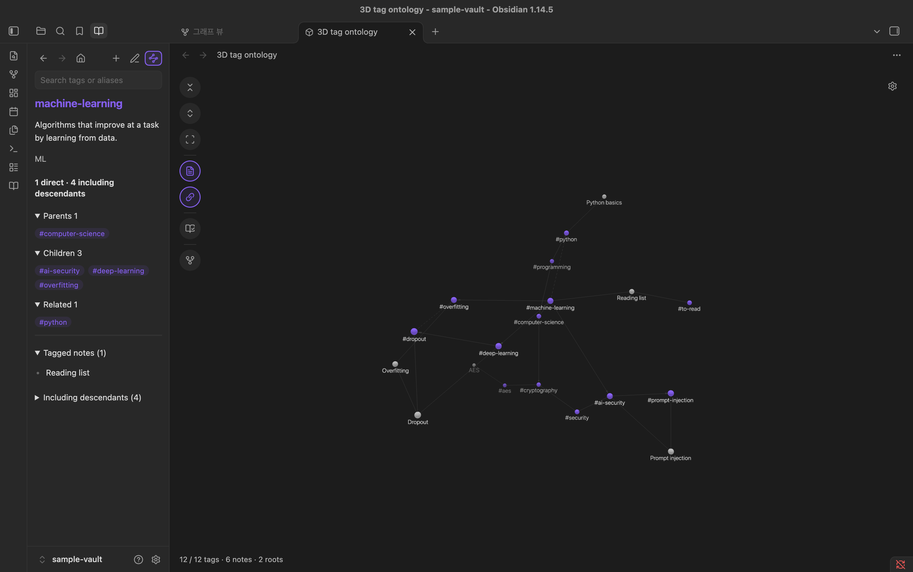

# Tag Ontology

[](https://github.com/NamhyeonKo/obsidian-tag-ontology/stargazers)
[](https://community.obsidian.md/plugins/tag-ontology)
[](https://github.com/NamhyeonKo/obsidian-tag-ontology/releases/latest)
[](https://www.npmjs.com/package/tag-ontology)
[](https://github.com/NamhyeonKo/obsidian-tag-ontology/actions/workflows/release.yml)
[](../../LICENSE)

[English](../../README.md) | [한국어](README.ko.md) | [简体中文](README.zh-CN.md) | [繁體中文](README.zh-TW.md) | **日本語** | [Español](README.es.md) | [Français](README.fr.md) | [Deutsch](README.de.md) | [Português (Brasil)](README.pt-BR.md) | [Русский](README.ru.md) | [Italiano](README.it.md)

**ノートをリンクするように、タグをつなぐ。**

Tag Ontology を使えば、ファイルを直接編集することなく、サイドバータブから各タグの親タグ・子タグ・関連タグを設定できます。そのあと Obsidian 標準の**グラフビュー**で枝ごとに折りたたんだり展開したりしながら探索し、ツリーレイアウトに切り替えたり、選択中のタグにフォーカスを合わせたりできます。ノート、ノート間のリンク、フィルタ、カラーグループ、表示設定はこれまでどおり動作します。

ノート本文を変更することは一切ありません。書き込み先は保管庫内のプレーンな JSON ファイルであるタグ辞書のみで、それもサイドバータブでタグを追加・編集・削除したときに限られます。

## なぜ Tag Ontology を作ったのか

一つの概念は、複数の分野と同時につながることがあります。たとえば RAG は、LLM、情報検索、知識グラフに関係しています。しかしフォルダーや入れ子のタグで整理しようとすると、どの経路の下に置くかを決めなければならず、その経路だけではほかの関係が見えにくくなってしまいます。

文書の場所と原文はそのまま保ちつつ、概念間の関係だけを別に管理して探索したいと考えました。そこで、タグに複数の親タグや関連タグを持たせ、その関係を Obsidian のグラフ上でたどれるように Tag Ontology を作りました。その後、CLI や TOW でも同じ関係とルールを使えるように拡張しました。

> **はじめに:** 階層はタグノードから構築されるため、グラフ設定の **フィルタ → タグ** をオンにする必要があります。新規インストール時には自動でオンになります。


> [!TIP]
> **AI エージェントとの併用**: [TOW](https://github.com/NamhyeonKo/tag-ontology-wiki) と組み合わせることで、保管庫全体のタスクとあわせて AI エージェントによるタグや辞書の管理を行えます。（[詳しく見る](#関連プロジェクト)）

## 主な機能

- **サイドバーで階層を構築。** ノートで既に使われているタグや新しいタグを追加し、名前・説明・エイリアス・Facet・親タグ・子タグ・関連タグの編集やタグの削除が行えます。ファイルの直接編集は不要で、保存時に外部の変更を上書きすることもありません。
- **標準グラフビューの拡張。** ノート、ノート間のリンク、フィルタ、カラーグループ、矢印などの標準設定はこれまでどおり動作します。
- **折りたたみ可能なタグ階層。** 辞書のタグはルートまで折りたたまれた状態で始まり、各ノートは表示中の最も近い親タグにリンクされます。タグをクリックして選択し、ダブルクリックすると 1 段階展開され、ノートがより具体的な子タグへと移り変わります。もう一度ダブルクリックすると折りたたまれます。
- **子孫を含むノート数の集計。** 各タグについて、*直接*付けられたノート数と、そのタグ*または任意の子孫タグ*が付いたノート数を表示します。
- **複数の親タグと関連タグ。** 実線の矢印は親タグから子タグへ向かい、破線は関連タグ同士を結びます。
- **4 つのレイアウト。** Force、**マインドマップ**、垂直ツリー、水平ツリーを備えています。通常のツリーは現在表示されている階層に基づく配置を保ち、ルートツリーを複数行に折り返します。マインドマップは選んだルートをレベル 0 に置き、現在開いている最も長い親パスを基準に間隔を決めます。タグの色分けには引き続き辞書全体の深さが使われます。
- **マインドマップ。** マインドマップでは最初にどこから始めるかを尋ねます。階層タグを検索するかおすすめのルートを 1 つ選び、そのタグの枝だけを探索します。選択画面に戻るには **開始タグを変更**（下段のホームボタン）を使います。別のレイアウトに戻ると以前の展開状態が復元され、再びマインドマップに入ると選択画面が表示されます。ラベルを選択するとサイドバーに詳細が表示され、矢印ボタンで子タグを展開・折りたたみできます。背景をドラッグして移動、スクロールで拡大・縮小し、**全体を表示** でマップ全体を収めます。標準グラフのフィルタと保存された展開状態を共有します。別の展開済みの親タグから到達できる間は、共有タグも表示されたままになります。このレイアウトではノートは非表示になります。
- **3D ビュー (beta)。** 同じ階層を 3 次元で表示し、周囲を回転させて眺めたり、タグをクリックしてそこへ移動したりできます。グラフツールバーからモードを切り替えます。Force、マインドマップ、両ツリー、3D、オントロジー エクスプローラーは 1 つのタブを共有し、モードボタンを右クリックすると比較用に別タブで開けます。3 セクション構成の歯車パネルでは **フィルタ**（検索、添付書類、存在するファイルのみ表示、オーファン）、**表示**（ノート間リンクの矢印、テキストフェードの閾値、ノードの大きさ、リンクの太さ、遠近ラベル、ラベルサイズ）、**力の強さ**（ドラッグ張力と各種フォーススライダー）を調整でき、セクション単位の **デフォルトに戻す** とパネル全体の **デフォルト設定に戻す** にも対応しています。3D やエクスプローラーへ切り替えても元のキャンバスは保持され、非表示の 3D 描画は一時停止し、グラフタブを閉じるとリソースが解放されます。
- **オントロジー エクスプローラー (beta)。** 空のキャンバスに 1 つのタグを置き、右クリックで子タグ・親タグ・関連タグやノートをオブジェクトカードとして引き出す、Palantir のオントロジーグラフのような表示方式です。
- **専用サイドバータブ。** ファイルや検索の隣にあるタブで、タグ名やエイリアスから検索し、タグの詳細を確認し、辞書チェックを実行できます。ここでタグを選ぶと、開いているグラフがそのタグにズームして中央に表示します。
- **辞書チェック。** 保管庫内で使われているが辞書にないタグ（類似する辞書名つき）、まだどのノートでも使われていない辞書タグ、エイリアスや異なる大文字・小文字で書かれたノート、上位タグと下位タグを併記しているノートを一覧表示します。報告のみを行い、何も変更しません。
- **単色カラー（オプション）。** グラフとサイドバーのすべてのタグに単一の色を適用します。別の色を選ばない限りテーマのアクセントカラーが使われます。
- **階層の深さ別カラー（オプション）。** **カラー → カラーモード → 階層の深さ別** を選ぶと、辞書全体のルートから各タグまでの最長パスに基づいてタグを色分けします。フィルタリングや折りたたみを行っても色は安定して保たれ、パレットより深い階層は最後の色を使います。デフォルトとパステルは [Tailwind CSS 3.4 カラーテーブル](https://v3.tailwindcss.com/docs/customizing-colors) の同じ赤→橙→黄→緑→シアン→青→紫→ピンクの順で、それぞれ 500 と 200 の階調を使用しています。レベル数を変更すると全範囲にわたって再サンプリングされます。レインボー、ウォーム、単色グラデーションなどのサンプルも用意されています。番号付きのカラーを横並びに編集したり、レベルを追加・削除したりできます。グラフ上のコンパクトな凡例でも、パレット選択、色の編集、**名前を付けて保存…** が行えます。凡例や設定で編集した内容は共有の **作業用コピー** となり、再起動後も自動で保持されます。**名前を付けて保存…** を使うと **マイパレット** に独立した名前付きスナップショットが追加され、サンプルや保存済みパレットに切り替えても作業用コピーは残ります。保存名は重複せず、ほかのパレットを上書きすることはありません。**マイパレット → 管理…** では確認ダイアログ付きで削除が行え、使用中のパレットを削除するとデフォルトに切り替わり作業用コピーは維持されます。旧バージョンのカスタムパレットは **以前の配色** として保持され、サンプルが変更されても現在使用中の色は維持されます。配色は 2D、3D、エクスプローラーのカード、サイドバーすべてに反映されます。[Colored Tags](https://github.com/pfrankov/obsidian-colored-tags) に着想を得ています。
- **フォーカス（オプション）。** 選択中のタグと隣接するタグ（親タグ・子タグ・関連タグ）を明るく保ち、それ以外をフェードさせます。オプションで配下のすべてのタグやノートも含められます。
- **表示状態の記憶。** 展開したタグやノート・関連タグの切り替え状態は保存され、すべてのグラフタブで共有されます。
- **多言語インターフェース（11 言語）。** デフォルトでは Obsidian の言語に自動で合わせますが、**一般 → 言語** から English、한국어、日本語、简体中文、繁體中文、Español、Français、Deutsch、Português (Brasil)、Русский、Italiano に手動で切り替えられます。設定、サイドバー辞書、3D コントロール、深さ凡例、グラフビューが即座に更新されます。

| サイドバータブ | 辞書チェック |
| --- | --- |
|  |  |
| **ルートまで折りたたみ** | **すべて展開** |
|  |  |
| **垂直ツリー** | **水平ツリー** |
|  |  |
| **元のテーマ** | **選択したタグをフォーカス表示** |
|  |  |
| **タグを編集** | **新規タグ** |
|  |  |
| **検索候補** | **タグを削除** |
|  |  |

## 仕組み

Tag Ontology は標準のグラフビュー内で動作します。Obsidian がフィルタやカラーグループを適用して構築したグラフを受け取り、辞書タグを折りたたんだうえで階層リンクや関連リンクを追加します。辞書にないタグは通常のタグノードのまま残ります。ローカルグラフには影響せず、プラグインを無効にするとグラフビューは元の状態に戻ります。

3D ビュー (beta) は別のタブとして動作します。保管庫から同じノートとタグを構築し、同じコードで辞書を重ね合わせ、three.js で描画します。

オントロジー エクスプローラー (beta) も別のタブです。辞書全体を表示するのではなく、キャンバスにタグを 1 つずつ取り出して Cytoscape.js で描画します。

サイドバータブで構築した階層は辞書ファイルに保存されます。ファイルを直接読んだり編集したりしたい場合は、[上級者向け: 辞書ファイル](#上級者向け-辞書ファイル)をご覧ください。

タグの使用状況は Obsidian のメタデータキャッシュから取得しており、すべての Markdown ノートの frontmatter `tags` と本文中のインライン `#タグ` が含まれます。

## インストールとアップデート

> 詳細な手順、開発版ビルド、トラブルシューティングについては、**[完全版インストール＆アップデートガイド（英語）](../installation.md)** をご覧ください。

### コミュニティプラグインから

- **インストール**: **設定 → コミュニティプラグイン → 閲覧** を開き、「Tag Ontology」を検索してインストールおよび有効化します。[コミュニティプラグインページ](https://community.obsidian.md/plugins/tag-ontology)からもインストールできます。
- **アップデート**: **設定 → コミュニティプラグイン** へ進み、**更新を確認** をクリックしてから、**すべて更新** または Tag Ontology の横にある **更新** をクリックします。

### BRAT を使う場合（ベータリリース）

- **インストール**:
  1. [BRAT](https://github.com/TfTHacker/obsidian42-brat) をインストールして有効化します。
  2. **BRAT: Add a beta plugin for testing** を選択し、`NamhyeonKo/obsidian-tag-ontology` と入力します。
- **アップデート**: `BRAT: Check for updates to all beta plugins`（または `BRAT: Check for plugin updates`）コマンドを実行します。

### 手動インストール

- **インストール**:
  1. [最新リリース](https://github.com/NamhyeonKo/obsidian-tag-ontology/releases)から `main.js`、`manifest.json`、`styles.css` をダウンロードします。
  2. 保管庫内の `.obsidian/plugins/tag-ontology/` にコピーします。
  3. Obsidian を再読み込みし、**設定 → コミュニティプラグイン** で **Tag Ontology** を有効にします。
- **アップデート**:
  1. 最新の `main.js`、`manifest.json`、`styles.css` をダウンロードします。
  2. `.obsidian/plugins/tag-ontology/` 内のファイルを上書きします。
  3. `保存せずにアプリを再読み込み`（Reload app without saving）コマンドを実行するか、Obsidian を再起動します。

### スタンドアロン CLI ツール

スタンドアロン CLI は npm に [`tag-ontology`](https://www.npmjs.com/package/tag-ontology) として公開されています:

```sh
# インストールせずに最新版を直接実行:
npx tag-ontology@latest check --root /path/to/vault --json

# またはグローバルにインストール / 更新:
npm install -g tag-ontology@latest
npm update -g tag-ontology
```

> **必須要件**: 標準の **グラフビュー** コアプラグインが有効になっており、グラフ設定の **フィルタ → タグ** がオンになっている必要があります。

## サンプル保管庫でのクイックスタート

リポジトリ内の [`examples/sample-vault`](../../examples/sample-vault) には、12 個のタグからなる辞書と 6 つのノートを含む小さな保管庫が用意されています。

1. Obsidian で **フォルダーを保管庫として開く**（Open folder as vault）を選び、`examples/sample-vault` を選択します。
2. 上記いずれかの方法でその保管庫にプラグインをインストールします。
3. **Tag Ontology を開く** リボンアイコン（本のアイコン）をクリックするか、コマンドパレットから **Tag Ontology: グラフを開く** を実行します。
4. グラフにタグが表示されない場合は、グラフ設定（歯車アイコン）で **フィルタ → タグ** をオンにします。

`computer-science` と `security` の 2 つのルートが表示され、6 つのノートがそれらにつながり、さらに未登録タグ `#to-read` が表示されます。`computer-science` をダブルクリックし、続けて `machine-learning` をダブルクリックすると、`Dropout` ノートが `deep-learning` へ移動します。`cryptography` と `ai-security` にはそれぞれ 2 つの親タグがあります。

次にサイドバータブを試し、**+** を押して `machine-learning` の配下に独自のタグを追加してみてください。

## 使い方

### サイドバータブ

**Tag Ontology を開く**（本のリボンアイコンまたは **グラフを開く** コマンド）を実行するとグラフが開き、左サイドバーのファイルと検索の隣に **タグ辞書** タブが前面に表示されます。グラフ上でタグをクリックした場合や **辞書チェック** を押した場合もこのタブが開きます。タブをドラッグして右サイドバーへ移動することもできます。

- **上部バー**の左側には戻る・進む・ホーム（ルートタグとすべてのタグ）があり、右側には **新規タグ**、**タグを編集**、そしてグラフ上でタグを展開・折りたたみするボタンがあります。画面にグラフが開いていない場合、そのボタンはグラフを開いて該当タグを表示します。子タグがないタグではボタンが無効になり、**子タグなし** と表示されます。
- **タグやエイリアスを検索**: タグ名またはエイリアスの一部を入力し、クリックまたは Enter で候補を選択します。エイリアスで一致した場合はタグ名の下にエイリアスが表示されるため、`convolution` や `합성곱` から `cnn` を探すことができます。グラフは選んだタグまで展開し、そのタグにズームして中央に配置します。
- タグが選択されていないときは、最初にルートタグが並び、そのあとにすべてのタグが頭文字ごとのアルファベット順に並びます。一覧をスクロールしても上部バーと検索ボックスは固定されたままになります。
- タグを開くと、説明、エイリアス、ノート数（直接と子孫を含む数）、親タグ・子タグ・関連タグの `#tag` リンク、および該当ノートが表示されます。`#tag` をクリックするとそのタグへ移動します。

### 辞書の編集

- **新規タグ**（上部バーの `+`）: ノートで使われているが辞書にないタグを使用ノート数順のリストから選ぶか、新しい名前を入力します。親タグを選べば他のタグの下に配置され、親タグを選ばなければルートタグになります。既に辞書にあるタグから子タグや関連タグも追加できます。
- **タグを編集**（鉛筆アイコン）: 名前、説明、エイリアス、Facet、親タグ、子タグ、関連タグを変更します。各項目末尾の **+** を押すと要素を追加できます。親タグ・子タグ・関連タグはあらかじめ辞書に登録されている必要があり、関連タグは双方に保存されます。タグ名を変更してもノート側のタグは書き換わらないため、元のタグが残り辞書未登録として表示されます。大文字・小文字のみを変えた場合（`ml` を `ML` に変更など）は、大文字・小文字を区別せず一致するためリンクが維持されます。
- **kebab-case タグ名のみ許可**（設定項目、デフォルトはオフ）: 新規作成や改名時に、TOW が検証する形式であるハイフンでつないだ英小文字と数字（`machine-learning` など）のみ受け付けます。既存の名前はそのまま保持されます。
- **削除**（編集フォーム内）を押すと最初に確認を求め、何が起きるかを表示します。子タグはその親タグの下に移動し、関連タグの一覧から外れ、ノート側は既存のタグを保持します。
- 変更は **保存** を押すまでフォーム内にとどまり、未保存の変更があるまま離れようとすると確認が出ます。編集している間にほかの場所で変更されたタグがあれば保存は中断して通知し、編集中の内容はフォームに残ります。
- 辞書は 1 タグ 1 行で保存されるため、保存時には変更した行だけが更新されます。別のレイアウトで書かれていたファイルは初回保存時に整形されます。改行コード（LF または CRLF）は維持されます。

### グラフツールバー

**すべて折りたたむ**、**すべて展開**、**全体を表示** はグラフ下部中央に横並びで配置され、その他の丸いボタンは左側に縦並び、深さの凡例は左下に配置されます。各ボタンにカーソルを合わせると名前が表示されます:

| ボタン | 機能 |
| --- | --- |
| すべて折りたたむ | すべての辞書タグをルートまで折りたたみます |
| すべて展開 | すべての辞書タグを展開します |
| 全体を表示 | ツールバー、凡例、設定ボタンが重ならない表示領域にグラフを収めます |
| ノート | タグ以外のすべてのノード（ノート、添付ファイル、未解決リンク）を表示／非表示にします |
| 関連タグ | 破線の関連リンクを表示／非表示にします |
| 辞書チェック | サイドバータブに未登録タグと未使用タグを一覧表示します |
| Force / マインドマップ / 垂直ツリー / 水平ツリー / 3D / オントロジー エクスプローラー | このタブのモードをこの順で切り替えます。現在のモードが強調表示されます。右クリックして **新しいタブで開く** を選ぶと 2 つのモードを並べて比較できます。3D とエクスプローラーは、それぞれの**有効にする**設定がオフの間は非表示になります |

- ツリーレイアウトとマインドマップでは、各タグが親タグの下にぶら下がり、ノートは非表示になるため、タグ同士の関係が見やすくなります。
- グラフ上のタグをクリックすると中央に配置され、サイドバータブに表示されます。ダブルクリックすると展開し、再度ダブルクリックすると折りたたみます（タブ上部のボタンと同じ動作です）。その配下で事前に展開していたタグは次回も展開されたままになります。
- それ以外の動作は標準の挙動のままです。ノートをクリックするとそのノートが開き、辞書にないタグをクリックすると検索が開きます。

### 3D ビュー (beta)

グラフツールバーの **3D** モードボタンまたは **3D グラフを開く** コマンドでグラフタブを 3D ビューに切り替え、別のモードボタンで元に戻します。別のモードを表示している間、3D の描画は一時停止します。展開中のタグ、**ノート**・**関連タグ**トグル、カラー、フォーカス、サイドバータブを 2D グラフと共有しているため、一方で展開したタグはもう一方でも展開されます。



- 何もない場所をドラッグすると回転、右ドラッグで平行移動、スクロールでズームします。
- ノードをドラッグするとそのノードだけが動き、離すとツリーレイアウトのようにバネで元の位置に戻ります。ビューを開いた直後や展開後に配置が落ち着くと静止します。
- タグをクリックすると選択してそこへ飛び、ダブルクリックで展開／折りたたみします。ノートをクリックすると開きます。サイドバーでタグを選んだ場合もそのタグへ移動します。辞書にないタグをクリックしてもここでは何も起きません（2D では検索が開きます）。
- ツールバーには **すべて折りたたむ**、**すべて展開**、**全体を表示**、**ノート**、**関連タグ**、**辞書チェック** とモードボタンがあります。**全体を表示** は可視ノードの大部分がビューに収まるよう調整しますが、遠く離れたわずかなノードは画面外に残る場合があります。
- 右上の歯車ボタンで、Obsidian の 2D グラフパネルを模した 3D 設定パネル（**フィルタ**、**表示**、**力の強さ**）が開きます。ヘッダーには全セクション向けの **デフォルト設定に戻す** ボタン、各セクションには個別の **デフォルトに戻す** ボタンがあり、変更は開いているすべての 3D タブで同期します。
  - **フィルタ**: `path:`、`file:`、`tag:`、`-` による否定、引用符付きフレーズに対応する検索欄、**添付書類**（デフォルトはオフ）、**存在するファイルのみ表示**（デフォルトはオン）、**オーファン**（デフォルトはオン）。
  - **表示**: ノートリンクの**矢印**（デフォルトはオフ、階層リンクには常に矢印を表示）、**テキストフェードの閾値**、**ノードの大きさ**、**リンクの太さ**、**遠近ラベル**（デフォルトはオン）、**ラベルサイズ**（`0.5`〜`2`、デフォルト `0.8`）。
  - **力の強さ**: **ドラッグ張力**（デフォルトはオン — ドラッグ中につながるノードも引き寄せ、オフにすると掴んだノードだけが動きます）、**中心力**、**反発力**、**リンクする力**、**リンクの距離**（2D グラフの範囲とデフォルト値を使用）。力のスライダーを動かすとシミュレーションが再開します。
- 3D ビューはノート、タグ、添付ファイル、未解決リンクを保管庫から直接構築し、歯車パネルの設定を 2D の標準グラフとは別に保存します。
- 3D ビューが重い場合や使わない場合は、設定で **3D ビューを有効にする (beta)** をオフにしてください。モードボタンとコマンドが消え、2D グラフには影響しません。

### オントロジー エクスプローラー (beta)

グラフツールバーの **オントロジー エクスプローラー** モードボタンまたは **オントロジー エクスプローラーを開く** コマンドでグラフタブをエクスプローラーに切り替えます。別のモードを表示している間もキャンバスは保持されます。サイドバータブはグラフと共有しますが、展開したタグ、ノート・関連タグのトグル、フォーカスは共有しません。

- 空のキャンバスではどこから始めるか尋ねます。タグの検索、ルートタグの選択、またはサイドバーで選択中のタグからの続行を選べます。サイドバーの検索やタグリンクからタグを選んだ場合もキャンバスに追加されます。
- 各タグは Facet（未設定なら `概念`）、直接のノート数、子孫を含む数、子タグ数を持つオブジェクトカードになります。Facet にはそれぞれ固有の色が割り当てられ、Facet のないタグはタグの色を使います。
- タグを右クリックすると **子タグを展開**、**親タグを展開**、**関連タグを展開**、**ノートを表示** のメニューが出ます。各項目にはまだキャンバスにない件数が表示されます。新しいカードは元のカードの横の列に配置され（子タグとノートは右側、親タグは左側）、既にキャンバスにあるカードは動きません。タグをダブルクリックすると子タグを展開します。
- 接続線は 2D グラフと同じく辞書に従います。誰が引き出したかにかかわらず、キャンバス上にある 2 つのタグの間には親から子への矢印と関連タグ間の破線が引かれます。
- 15 件を超えるノートを持つタグは代わりに 1 枚のグループカードを表示します。クリックするとサイドバータブに新しい順でノート一覧が表示され、**ノートを絞り込む** で絞り込んでチェックしたノートを取り出す（**選択したノートを取り出す**）か、最新の 10 件を取り出せます（**最新 10 件を取り出す**）。グループカードをダブルクリックすると最新の 10 件をそのまま取り出します。グループにはそのタグのノートのうちキャンバスにカードとして出ていないものがすべて入り、あとからタグ付けされたノートも加わり、削除したノートカードはグループへ戻ります。
- カードをクリックするとサイドバータブに表示され、ノートをダブルクリックすると開きます。カードは好きな場所へドラッグでき、置いた位置にとどまります。カードを右クリックして **キャンバスから削除** しても、そこから引き出したほかのカードは残ります。
- ツールバーには **全体を表示**、**キャンバスをクリア**、モードボタンがあります。キャンバスは保存されないため、タブを閉じるとクリアされます。
- 辞書やノートを編集するとカードも更新されます。名前が変わったタグやノートはその場にとどまり、削除されたものはキャンバスから消えます。
- 使わない場合は、設定で **オントロジー エクスプローラーを有効にする (beta)** をオフにしてください。モードボタンとコマンドが消えます。

### コマンド

| コマンド | 説明 |
| --- | --- |
| Tag Ontology: グラフを開く | 標準のグラフビューでオントロジーを開きます。開いているタブがあれば再利用します。 |
| Tag Ontology: 3D グラフを開く | 開いているグラフタブを 3D に切り替えるか、新しく開きます。**3D ビューを有効にする (beta)** がオンのときのみ表示されます。 |
| Tag Ontology: オントロジー エクスプローラーを開く | 開いているグラフタブをエクスプローラーに切り替えるか、新しく開きます。**オントロジー エクスプローラーを有効にする (beta)** がオンのときのみ表示されます。 |
| Tag Ontology: 辞書を再読み込み | 辞書とノートインデックスを再読み込みします。 |

### 設定

設定画面は Obsidian 1.13 以降とそれ以前のバージョンの両方で同じセクション順・項目順（**一般**、**辞書**、**カラー**、**サイドバー**、**フォーカス**、**追加ビュー**）になっています。単色と階層の深さ別モードでは色設定が表示され、パレット操作は階層の深さ別モードで表示されます。フォーカス設定はフォーカスが有効なときに表示されます。

| 設定 | 説明 |
| --- | --- |
| **一般** | |
| 言語 | Obsidian の言語に合わせる（`自動 (Obsidian に合わせる)`、デフォルト）か、プラグイン設定・サイドバー辞書・3D コントロール・グラフビューに使う 11 の対応言語から 1 つを選びます。コマンド名と既に開いているタブのタイトルは Obsidian の再起動後に更新されます。 |
| **辞書** | |
| 辞書のパス | 保管庫相対の `.json` ファイルパスです。空欄にすると `tow/tag-dictionary.json` → `.tow/tag-dictionary.json` → `Tag-Dictionary.json` の順で自動的に探し、いずれも存在しない場合は `tow/tag-dictionary.json` を使います。入力したパスは常に優先して使われます。Enter を押すかフォーカスを外すと保存されます。 |
| kebab-case タグ名のみ許可 | デフォルトはオフ。オンにすると、編集フォームは新規タグまたは改名後のタグとして TOW が検証するハイフン繋ぎの英小文字と数字のみを受け付けます。既存の名前は維持されます。 |
| **カラー** | |
| カラーモード | `Obsidian 標準`、`単色`、`階層の深さ別`。モードを切り替えても既存の色は保持されます。 |
| &nbsp;&nbsp;パレット | `サンプル`、現在の`作業用コピー`、`マイパレット`。サンプルは現在のレベル数を維持し、名前付きパレットは保存された色とレベル数を復元します。 |
| &nbsp;&nbsp;レベル別カラー | 番号付きカラーを横並びに編集し、レベルを追加または削除します（最低 1 つ）。最後の色より深いレベルはその色を維持します。 |
| &nbsp;&nbsp;マイパレット | `名前を付けて保存…` で名前入力欄を開き、`管理…` で確認付き削除のためのパレット一覧を表示します。使用中のパレットを削除すると`デフォルト`に切り替わり、作業用コピーは保持されます。重複する名前は拒否されます。 |
| &nbsp;&nbsp;タグの色 / 階層外タグの色 | 単色モードではベースカラー、階層の深さ別モードでは階層外タグのフォールバック色になります。選択するまではアクセントカラーに従い、リセットするとアクセントカラーに戻ります。 |
| &nbsp;&nbsp;サイドバー見出しにタグ色を適用 | 選択中のタグの色をサイドバーのタイトルにも使用します。 |
| **サイドバー** | |
| タグ一覧の表示形式 | サイドバーのタグ（ルートタグ、すべてのタグ、親タグ、子タグ、関連タグ）を折り返し`チップ`か 1 行 1 件の`リスト`で表示します。デフォルトは`チップ`です。 |
| **フォーカス** | |
| 選択したタグをフォーカス表示 | 選択中のタグと隣接するタグ（親タグ・子タグ・関連タグ）を明るく保ち、それ以外をフェードさせます。選択中のタグとそのリンクはホバー時のように表示されます。デフォルトはオフ。オンにすると以下のオプションが表示されます。 |
| &nbsp;&nbsp;子孫タグも含める | 選択中のタグ配下のすべてのタグも、展開されている範囲まで明るく保ちます。デフォルトはオン。 |
| &nbsp;&nbsp;ノートも含める | 選択中のタグのノートと、（有効時は）その子孫タグのノートも明るく保ちます。隣接タグだけに付いたノートは引き続きフェードします。デフォルトはオン。 |
| **追加ビュー** | |
| 垂直ツリーを有効にする | グラフツールバーに垂直ツリーモードのボタンを表示します。オフにするとそのモードのタブは Force に戻ります。デフォルトはオン。 |
| 水平ツリーを有効にする | 水平ツリーモードのボタンについて同様に動作します。デフォルトはオン。 |
| 3D ビューを有効にする (beta) | グラフツールバーの 3D モードボタンと `3D グラフを開く` コマンドを表示します。オフにすると 3D ビューが解放され、3D を表示中のタブは 2D に戻ります。デフォルトはオン。 |
| オントロジー エクスプローラーを有効にする (beta) | グラフツールバーのエクスプローラーモードボタンと `オントロジー エクスプローラーを開く` コマンドを表示します。オフにするとエクスプローラーのキャンバスがクリアされ、表示中のタブは 2D に戻ります。デフォルトはオン。 |

ズーム倍率が低い状態では、標準グラフはラベルと矢印を非表示にします。拡大すると表示されます。

## 上級者向け: 辞書ファイル

サイドバータブがこのファイルを読み書きするため、直接開く必要はありません。ただし保管庫内のプレーンな JSON ファイルなので、手動で編集することもできます。

辞書は `tow/` や `.tow/` 内を含め、`.json` で終わる保管庫相対の任意のパスに配置できます。**辞書のパス**欄が空の場合、プラグインは `tow/tag-dictionary.json`、`.tow/tag-dictionary.json`、`Tag-Dictionary.json` の順に確認します。新規インストールでは `tow/tag-dictionary.json` を作成し、既存の `Tag-Dictionary.json` ファイルも引き続き動作し、TOW 0.5.0–0.5.1 の `.tow/tag-dictionary.json` も読み込まれます。指定したパスは常に優先されます。あとから辞書がなくなった場合、サイドバータブから作成を提案します。

**Obsidian Sync は `.obsidian` 以外のドットフォルダーを同期しません**（[Sync の設定](https://obsidian.md/help/sync/settings)）。Obsidian Sync をお使いの場合は、辞書を可視のパスに配置してください。Git やファイル単位の同期ツールは、無視設定に入っていない限りドットフォルダーも同期します。

ファイルは単一の JSON オブジェクトです。各キーは **`#` を除いた**タグ名で、標準グラフと同様に大文字・小文字を区別せず一致します（`#ML` はキー `ml` を使用）。キーには小文字を推奨します。`#lang/python` のような入れ子のタグでは `lang/python` をキーとして使います。

```json
{
  "machine-learning": {
    "aliases": ["ML"],
    "description": "Algorithms that improve at a task by learning from data.",
    "broader": ["computer-science"]
  },
  "dropout": {
    "description": "Randomly disabling units during training to reduce overfitting.",
    "broader": ["deep-learning"],
    "related": ["overfitting"],
    "facet": "technique"
  },
  "computer-science": {
    "description": "The study of computation, information and automation.",
    "broader": []
  }
}
```

| フィールド | 必須 | 型 | 意味 |
| --- | --- | --- | --- |
| `description` | はい | string | タグパネルに表示される説明。 |
| `aliases` | いいえ | string[] | 別名。検索や、辞書チェックで未登録タグの候補を提案する際に使われます。 |
| `broader` | いいえ | string[] | 親タグ。**`[]` はルートタグを示します。** |
| `related` | いいえ | string[] | 破線で描かれる非階層の関連リンク。 |
| `facet` | いいえ | string | `language` などの自由形式の分類。編集フォームや CLI 変更ファイルのドラフトで設定でき、下位タグと並記された Facet タグは冗長として報告されません。 |

ルール:

- **ルートタグには `"broader": []` が必要です。** `broader` キー自体がないタグは未配置として扱われ、グラフに表示されません。
- `broader` または `related` に指定されたすべてのタグは辞書内に存在している必要があります。
- タグは自分自身を参照できず、`broader` リンクで循環（サイクル）を作ることはできません。
- 辞書が不正な場合、Obsidian の起動時またはビューを開いたときに通知で理由を表示し、ファイルを修正するまでサイドバーにも表示し続けます。グラフは最後に正常読み込みできたバージョンを維持し、その間は **新規タグ** と **タグを編集** が無効になります。

完全な例は [`examples/sample-vault/tow/tag-dictionary.json`](../../examples/sample-vault/tow/tag-dictionary.json) をご覧ください。

## プライバシー

- ネットワーク通信、テレメトリ、アカウント登録は一切ありません。
- ノートのメタデータと辞書ファイルのみを読み取ります。
- 書き込むのはプラグイン自身の設定ファイル（設定フォルダー内の `plugins/tag-ontology/data.json`、通常は `.obsidian/`）と、サイドバーで変更を保存するときの使用中の辞書ファイルだけです。使用中の辞書は、選択したパス（以前のバージョンで保存されたカスタムパスを含む）、または自動探索順の `tow/tag-dictionary.json`、`.tow/tag-dictionary.json`、`Tag-Dictionary.json` のいずれかになります。

## 互換性と既知の制限事項

- **デスクトップ専用。** Obsidian 1.14.5 (macOS) で動作確認済み。
- このプラグインは標準グラフビューの**非公開の内部実装**（レンダラー、PIXI、レイアウトワーカー）にフックします。将来の Obsidian アップデートで動作しなくなる可能性があります。内部構造が想定と異なる場合、プラグインは切り離され標準グラフをそのまま残します。
- 大規模な保管庫では、ノートを表示したまま全タグを展開すると数千のノードとリンクを再描画するため、わずかな待ち時間が生じます。
- すべてのタグを展開すると、特に Force レイアウトではラベルが密集します。
- グラフビューにパッチを当てるほかのプラグインとの併用は検証されていません。
- 3D ビューは WebGL を使い three.js をバンドルし、エクスプローラーは Cytoscape.js をバンドルしているため、プラグインファイルは約 1.6 MB になります。それぞれタブを開いたときにのみ読み込まれます。数千件以上のノートを表示すると 3D ビューは重くなりますが、ノートを非表示にすれば高速に動作します。

## ロードマップ

- ローカルグラフでも階層を表示する。

バグ報告や機能リクエストは [Issues](https://github.com/NamhyeonKo/obsidian-tag-ontology/issues) へお寄せください。バグ報告の際は Obsidian のバージョンと OS を併記してください。

## ライブラリと CLI

スタンドアロンの [`tag-ontology` パッケージ](../../packages/tag-ontology/README.md)は、同じ辞書ルールを MIT ライセンスの ESM ライブラリおよび Node CLI として公開しています。保管庫のチェックとスキャン、タグ使用状況のレポート、タグ階層の表示、そしてコンテンツハッシュ検証を伴う辞書変更のプレビュー／適用を行います。Obsidian がインストールされている必要はありません。

npm に [`tag-ontology`](https://www.npmjs.com/package/tag-ontology) として公開されています:

```sh
npx tag-ontology check --root /path/to/vault --json
```

ライブラリの使用例は[パッケージガイド](../../packages/tag-ontology/README.md)を、コマンド・JSON フィールド・終了コード・パーサーの制限は [CLI 仕様](../cli.md)をご覧ください。プラグインとパッケージはそれぞれ独立したバージョンとリリースタグを持ちます。

## 関連プロジェクト

### [TOW (Tag Ontology Wiki)](https://github.com/NamhyeonKo/tag-ontology-wiki)

[TOW](https://github.com/NamhyeonKo/tag-ontology-wiki) と併用すると、ノート検索・frontmatter 管理・ドキュメント整形といった幅広い保管庫タスクとあわせて、AI エージェントにタグや辞書の管理を任せることができます。

- **CLI ベースの辞書管理**: `tag-ontology` CLI を用いてタグを検査し、辞書の整合性を検証し、安全に更新を適用します。
- **AI エージェントワークフロー**: 未登録タグの発見、オントロジー項目の同期、frontmatter スキーマの検証、ノート構造の整理といった反復的な保管庫メンテナンスを自動化します。
- **ビジュアルグラフ統合**: このプラグインを使い、エージェントが管理するタグ階層を Obsidian のグラフビュー上で直接探索・移動できます。

## 開発

Node.js **22.18 以降**が必要です。テストは Node 組み込みの型ストリッピング（type stripping）で TypeScript を直接実行します。

```sh
npm ci
npm run lint        # Obsidian レビュールール + パッケージリント検査
npm test            # ユニットテスト（保管庫不要）
npm run build       # 型チェック + パッケージ dist + プラグイン main.js のビルド
npm run check:package  # 実際の npm tarball の検証とインストール確認
npm run deploy -- "/path/to/vault"   # main.js, manifest.json, styles.css を保管庫へコピー
```

`deploy` を実行するには、対象の保管庫に `.obsidian/` フォルダーが既に存在している必要があり、既存の `data.json` は保持されます。コピー後は Obsidian でプラグインを再読み込みしてください。

`npm run test:vault` はメンテナー用のプライベート保管庫（`OBSIDIAN_VAULT_PATH`）に対する結合テストです。ほかのコントリビューターが実行する必要はありません。

### プロジェクト構成

```text
src/
├── main.ts            # プラグインのエントリポイント: コマンド、設定タブ、保管庫/メタデータイベント
├── search.ts          # 検索ボックスおよび編集フォーム向けの候補ポップオーバー
├── native.ts          # 標準グラフビューレンダラーへのフック（ツールバー、サイドバータブ、クリック、レイアウト）
├── graph-modes.ts     # 共通のグラフ表示モード切替バーおよび「新しいタブで開く」メニュー
├── legend.ts          # 階層の深さ凡例、パレット切替、カラースウォッチ
├── palettes.ts        # パレットプリセット、作業用コピー、保存済みパレットライブラリの状態
├── colors.ts          # 色のリサンプリングおよび最長パスによる階層の深さ別カラーマッピング
├── hierarchy.ts       # 辞書モデルアダプターおよび子孫を含むノート数集計
├── layer.ts           # 標準グラフデータに辞書を重ね合わせる純粋関数
├── layout.ts          # 垂直ツリーおよび水平ツリーの座標計算
├── mindmap.ts         # アクセシブルな DOM カードを備えた Cytoscape ベースのマインドマップビュー
├── mindmap-layout.ts  # 表示中の枝に基づくマインドマップの間隔とアンカー配置
├── graph3d.ts         # 3D ビュー: 同じ階層データを 3d-force-graph で描画
├── controls3d.ts      # 折りたたみ可能な 3 セクション構成の 3D 設定パネル（フィルタ、表示、力の強さ）
├── filter3d.ts        # 3D 用の検索クエリパーサー/評価器およびオーファン除去
├── geometry3d.ts      # 3D 矢印配置、ラベル拡大縮小、カメラ深度ヘルパー
├── three.ts           # 3D ビューが開いたときにのみインポートされる three.js と 3d-force-graph
├── vault-data.ts      # 3D ビュー向けに保管庫から標準グラフのデータ構造を構築
├── explorer.ts        # オントロジー エクスプローラー: オブジェクトカードの Cytoscape.js キャンバス
├── explorer-layout.ts # エクスプローラー用純粋関数: カード配置、Search Around 件数、接続線
├── explorer-card.ts   # SVG 画像としてのエクスプローラー用オブジェクトカード
├── check.ts           # 辞書チェック向けに非正規・冗長タグをグループ化するヘルパー
├── settings.ts        # 設定スキーマ、デフォルト値、サニタイズ
└── i18n/              # 11 言語カタログ、実行時フォーマット、ライブ更新ヘルパー
tests/              # node:test ユニットテスト（tests/integration はメンテナー専用）
packages/tag-ontology/
├── src/core/       # 純粋な辞書検証、階層、使用状況、編集ロジック
├── src/vault/      # Node ファイルアクセスおよび Markdown/frontmatter リーダー
├── src/cli/        # コマンドライン引数、JSON 出力、終了コード
└── tests/          # パッケージのユニットテストおよび実プロセス CLI テスト
docs/cli.md         # バージョン管理された CLI 仕様
examples/           # タグ辞書を含むサンプル保管庫
scripts/deploy.mjs  # ビルド成果物をローカル保管庫へコピー
scripts/check-package.mjs  # パックされた npm パッケージの検証と実行テスト
```

## コントリビューション

バグ修正、新機能の提案、ドキュメントの改善など、コミュニティからの貢献を心より歓迎します！

1. 既存の [Issues](https://github.com/NamhyeonKo/obsidian-tag-ontology/issues) を確認するか、新しい Issue を作成します。
2. リポジトリをフォークし、`dev` ブランチからフィーチャーブランチを作成します。
3. コミットメッセージは [Conventional Commits](https://www.conventionalcommits.org/en/v1.0.0/) に従ってください。
4. すべてのチェックが通ることを確認します: `npm run lint && npm test && npm run build`。
5. `dev` ブランチ宛てにプルリクエストを送信します。

開発ガイドラインやテスト手順、行動規範の詳細は [CONTRIBUTING.md](../../CONTRIBUTING.md) および [行動規範 (Code of Conduct)](../../CODE_OF_CONDUCT.md) をご参照ください。

## サポート

Tag Ontology は無料のオープンソースソフトウェアです。時間の節約に役立ちましたら、[Buy Me a Coffee](https://buymeacoffee.com/namhyunko) からコーヒー 1 杯分のご支援をいただけますと励みになります。

## 謝辞

- 標準グラフレンダラーへ独自データを渡すアプローチは [Nested tags graph](https://github.com/drpilman/obsidian-graph-nested-tags) に着想を得ています。同プラグインのインストールは不要です。
- 3D ビューはすべて MIT ライセンスの [3d-force-graph](https://github.com/vasturiano/3d-force-graph)、[three-spritetext](https://github.com/vasturiano/three-spritetext)、[three.js](https://threejs.org) 上に構築されています。オントロジー エクスプローラーは [Cytoscape.js](https://js.cytoscape.org)（MIT）を使用しています。バンドルされた全パッケージのライセンス表記は `main.js` の先頭に記載されています。

## ライセンス

Copyright (c) 2026 NamhyeonKo

本プロジェクトは [MIT ライセンス](../../LICENSE)のもとで公開されています。MIT ライセンスの条件に従い、自由に利用、改変、配布することができます。
