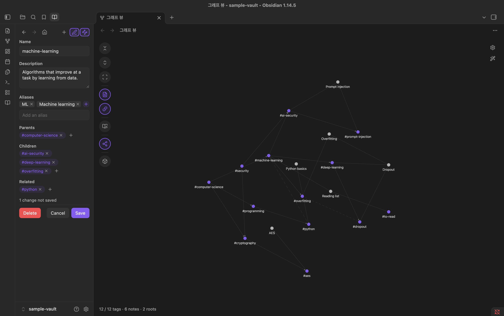
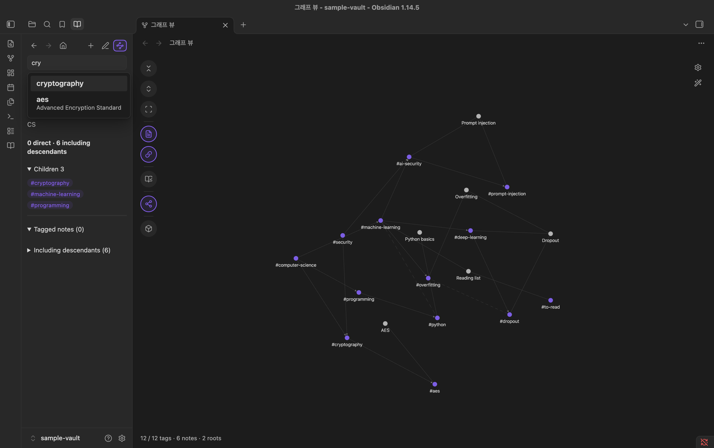

# Tag Ontology

[](https://github.com/NamhyeonKo/obsidian-tag-ontology/stargazers)
[](https://community.obsidian.md/plugins/tag-ontology)
[](https://github.com/NamhyeonKo/obsidian-tag-ontology/releases/latest)
[](https://www.npmjs.com/package/tag-ontology)
[](https://github.com/NamhyeonKo/obsidian-tag-ontology/actions/workflows/release.yml)
[](../../LICENSE)

[English](../../README.md) | **한국어** | [简体中文](README.zh-CN.md) | [繁體中文](README.zh-TW.md) | [日本語](README.ja.md) | [Español](README.es.md) | [Français](README.fr.md) | [Deutsch](README.de.md) | [Português (Brasil)](README.pt-BR.md) | [Русский](README.ru.md) | [Italiano](README.it.md)

**노트를 잇듯 태그도 이어 보세요.**

Tag Ontology는 파일을 직접 고칠 필요 없이 사이드바 탭에서 각 태그의 상위·하위·연관 태그를 정할 수 있게 해 줍니다. 그런 다음 Obsidian 기본 **그래프 뷰**에서 가지별로 접고 펼치고, 트리 배치로 전환하고, 선택한 태그에 포커스를 유지하며 탐색할 수 있습니다. 노트, 노트 사이의 링크, 필터, 색상 그룹, 표시 설정은 그대로 동작합니다.

노트는 절대 수정하지 않습니다. vault 안의 일반 JSON 파일인 태그 사전에만 쓰며, 그것도 사이드바 탭에서 태그를 추가·편집·삭제할 때만 씁니다.

## 왜 Tag Ontology를 만들었나요?

하나의 개념은 여러 분야와 동시에 연결될 수 있습니다. 예를 들어 RAG는 LLM, 정보 검색, 지식 그래프와 관련이 있습니다. 하지만 폴더나 중첩 태그로 정리할 때는 어느 한 경로 아래에 놓을지 결정해야 했고, 그 경로만으로는 다른 관계가 한눈에 들어오지 않았습니다.

문서의 위치와 원문은 유지하면서 개념 사이의 관계만 별도로 관리하고 탐색하고 싶었습니다. 그래서 태그에 여러 상위 태그와 연관 태그를 두고 그 관계를 Obsidian 그래프에서 탐색할 수 있도록 Tag Ontology를 만들었습니다. 이후 CLI와 TOW에서도 같은 관계와 규칙을 사용할 수 있게 확장했습니다.

> **시작하기:** 계층은 태그 노드로 만들어지므로 그래프 설정에서 **필터 → 태그**가 켜져 있어야 합니다. 처음 설치하면 자동으로 켜 드립니다.


> [!TIP]
> **AI 에이전트와 함께 쓰기**: [TOW](https://github.com/NamhyeonKo/tag-ontology-wiki)와 함께 사용하면 폭넓은 vault 작업과 더불어 AI 에이전트로 태그와 사전을 관리할 수 있습니다. ([자세히 보기](#관련-프로젝트))

## 주요 기능

- **사이드바에서 계층 만들기.** 노트에서 이미 쓰는 태그나 새 이름을 추가하고, 태그의 이름·설명·별칭·Facet·상위 태그·하위 태그·연관 태그를 고치거나 태그를 삭제합니다. 파일을 직접 편집할 필요가 없고, 저장할 때 다른 곳에서 바뀐 내용을 덮어쓰지 않습니다.
- **기본 그래프의 확장.** 노트, 노트 링크, 필터, 색상 그룹, 화살표 등 기본 설정이 평소처럼 동작합니다.
- **접고 펼치는 태그 계층.** 사전 태그는 루트까지 접힌 상태로 시작하고, 각 노트는 보이는 가장 가까운 상위 태그에 연결됩니다. 태그를 클릭해 선택하고 더블 클릭하면 한 단계 펼쳐지며, 노트가 더 구체적인 하위 태그로 옮겨 붙습니다. 다시 더블 클릭하면 접힙니다.
- **하위 태그 포함 노트 수 집계.** 태그마다 *직접* 달린 노트 수와, 해당 태그 *또는 하위 태그*가 달린 노트 수를 함께 보여 줍니다.
- **다중 상위 태그와 연관 태그.** 실선 화살표는 상위 태그에서 하위 태그로 향하고, 점선은 연관 태그를 잇습니다.
- **네 가지 배치.** Force, **마인드맵**, 세로 트리, 가로 트리입니다. 일반 트리는 현재 보이는 계층 기반 배치를 유지하고 루트 트리를 여러 행으로 줄바꿈합니다. 마인드맵은 선택한 루트를 0단계로 두고 현재 펼쳐진 가장 긴 부모 경로를 기준으로 간격을 정합니다. 태그 색상은 계속 전체 사전 기준 깊이를 사용합니다.
- **마인드맵.** 마인드맵은 먼저 어디서 시작할지 묻습니다. 계층 태그를 검색하거나 추천 루트 중 하나를 고르면 그 태그의 가지만 탐색합니다. **시작 태그 변경**(하단 행의 홈 버튼)을 누르면 선택 화면으로 돌아갑니다. 다른 배치로 돌아가면 이전 펼침 상태를 복원하고, 마인드맵에 다시 들어가면 선택 화면을 다시 보여 줍니다. 라벨을 선택하면 사이드바에 세부 정보가 표시되고, 화살표 버튼으로 하위 태그를 펼치거나 접습니다. 배경을 드래그해 이동하고 스크롤로 확대·축소하며 **화면에 맞추기**로 전체를 맞춥니다. 기본 그래프 필터와 저장된 펼침 상태를 공유합니다. 다른 펼쳐진 상위 태그가 닿아 있는 동안 공유 태그는 계속 보입니다. 이 배치에서는 노트를 숨깁니다.
- **3D 보기 (beta).** 같은 계층을 3차원으로 탐색합니다. 주위를 회전해 둘러보고 태그를 클릭하면 해당 태그로 날아갑니다. 그래프 도구 모음에서 모드를 전환할 수 있습니다. Force, 마인드맵, 두 트리, 3D, 온톨로지 탐색기가 한 탭을 공유하며, 모드 버튼을 우클릭하면 비교를 위해 새 탭에서 열 수 있습니다. 3개 섹션으로 구성된 톱니바퀴 패널에서 **필터**(검색, 첨부 파일, 존재하는 파일만 표시, 미연결 노트), **표시**(노트 링크 화살표, 텍스트 표시 시작점, 노드 크기, 링크 두께, 원근 라벨, 라벨 크기), **장력**(드래그 장력 및 힘 슬라이더)을 조절하고 섹션별 **기본값으로 복원**과 패널 전체 **기본 설정으로 되돌리기**를 쓸 수 있습니다. 3D나 탐색기로 전환해도 다른 캔버스는 유지되며, 가려진 3D 렌더링은 일시 중지되고, 그래프 탭을 닫으면 리소스가 해제됩니다.
- **온톨로지 탐색기 (beta).** 빈 캔버스에서 태그 하나로 시작해 우클릭으로 하위·상위·연관 태그와 노트를 오브젝트 카드로 꺼내 봅니다. Palantir의 온톨로지 그래프와 같은 방식입니다.
- **사이드바 탭.** 파일 및 검색 탭 옆의 탭에서 태그 이름이나 별칭으로 검색하고, 태그의 세부 정보를 읽고, 사전 검사를 실행합니다. 여기서 태그를 고르면 열려 있는 그래프가 그 태그로 확대·가운데 정렬합니다.
- **사전 검사.** vault에서 쓰였지만 사전에 없는 태그(비슷한 사전 이름과 함께), 아직 어떤 노트도 쓰지 않는 사전 태그, 별칭이나 다른 대소문자로 적힌 노트, 상위 태그와 하위 태그를 함께 단 노트를 나열합니다. 보고만 할 뿐 아무것도 변경하지 않습니다.
- **단일 색상 (선택).** 그래프와 사이드바의 모든 태그에 한 가지 색상을 입힙니다. 따로 고르지 않으면 테마 강조색을 따릅니다.
- **계층 깊이별 색상 (선택).** **색상 → 색상 모드 → 계층 깊이별**을 선택해 전체 사전의 루트에서 태그까지 가장 긴 경로를 기준으로 태그를 칠합니다. 필터링하거나 접어도 색상은 안정적으로 유지되며, 더 깊은 단계는 팔레트의 마지막 색상을 사용합니다. 기본값과 파스텔은 [Tailwind CSS 3.4 색상표](https://v3.tailwindcss.com/docs/customizing-colors)의 동일한 빨강→주황→노랑→초록→청록→파랑→보라→분홍 순서를 사용하며, 각각 500과 200 음영을 씁니다. 단계 수를 바꾸면 전체 범위에 맞춰 다시 샘플링됩니다. 무지개, 따뜻한 색조, 단색 그라데이션 예시 팔레트도 제공됩니다. 번호가 매겨진 색상을 가로로 편집하고 단계를 추가·제거할 수 있습니다. 그래프의 작은 범례에서도 팔레트 선택, 색상 편집, **다른 이름으로 저장…**을 사용할 수 있습니다. 범례나 설정에서 수정한 색은 공유 **작업 사본**이 되어 재시작 후에도 자동으로 유지됩니다. **다른 이름으로 저장…**은 **내 팔레트** 아래에 독립된 이름의 스냅샷을 추가하며, 예시 팔레트나 저장된 팔레트로 전환해도 작업 사본은 그대로 남습니다. 저장된 이름은 고유하며 다른 팔레트를 덮어쓰지 않습니다. **내 팔레트 → 관리…**에서 저장된 팔레트를 확인 후 삭제할 수 있으며, 현재 사용 중인 팔레트를 삭제하면 기본값으로 바뀌고 작업 사본은 유지됩니다. 이전 버전의 사용자 지정 팔레트는 **이전 색상**으로 보존되며, 예시 팔레트가 바뀌어도 기존 활성 색상은 유지됩니다. 색상은 2D, 3D, 탐색기 카드, 사이드바에 모두 적용됩니다. [Colored Tags](https://github.com/pfrankov/obsidian-colored-tags)에서 영감을 받았습니다.
- **포커스 (선택).** 선택한 태그와 바로 인접한 태그(상위·하위·연관 태그)는 밝게 유지하고 나머지는 흐리게 만듭니다. 옵션으로 그 아래의 모든 하위 태그와 노트를 포함할 수 있습니다.
- **보던 상태 기억.** 펼친 태그와 노트·연관 태그 토글이 저장되어 모든 그래프 탭에서 공유됩니다.
- **다국어 인터페이스 (11개 언어).** 기본값은 Obsidian 언어를 자동으로 따르며, **일반 → 언어**에서 English, 한국어, 日本語, 简体中文, 繁體中文, Español, Français, Deutsch, Português (Brasil), Русский, Italiano 중 하나로 직접 전환할 수 있습니다. 설정, 사이드바 사전, 3D 제어, 깊이 범례, 그래프 보기가 즉시 업데이트됩니다.

| 사이드바 탭 | 사전 검사 |
| --- | --- |
|  |  |
| **루트까지 접기** | **모두 펼치기** |
|  |  |
| **세로 트리** | **가로 트리** |
|  |  |
| **원래 테마** | **선택한 태그 포커스 유지** |
|  |  |
| **태그 편집** | **새 태그** |
|  |  |
| **검색 추천** | **태그 삭제** |
|  |  |

## 동작 방식

Tag Ontology는 기본 그래프 뷰 안에서 동작합니다. Obsidian이 필터와 색상 그룹을 적용해 이미 만들어 둔 그래프를 받아 사전 태그를 접고 그사이에 계층·연관 링크를 추가합니다. 사전에 없는 태그는 일반 태그 노드로 남습니다. 로컬 그래프에는 영향을 주지 않으며, 플러그인을 끄면 그래프 뷰가 원래대로 돌아옵니다.

3D 보기 (beta)는 별도 탭입니다. vault에서 같은 노트와 태그를 구성하고, 같은 코드로 사전을 덧입힌 뒤 three.js로 그립니다.

온톨로지 탐색기 (beta) 역시 별도 탭입니다. 사전 전체를 한꺼번에 보여 주지 않고, 캔버스에 태그를 하나씩 꺼내 놓으며 Cytoscape.js로 그립니다.

사이드바 탭에서 만든 계층은 사전 파일에 저장됩니다. 직접 읽거나 수정하려면 [고급: 사전 파일](#고급-사전-파일)을 참고하세요.

태그 사용 정보는 Obsidian의 메타데이터 캐시에서 가져오며, 모든 Markdown 노트의 frontmatter `tags`와 본문 내 `#태그`를 포함합니다.

## 설치 및 업데이트

> 자세한 설치 안내, 개발 빌드, 문제 해결 방법은 **[전체 설치 및 업데이트 가이드 (영문)](../installation.md)**를 참고하세요.

### 커뮤니티 플러그인에서 설치

- **설치**: **설정 → 커뮤니티 플러그인 → 탐색**에서 "Tag Ontology"를 검색해 설치하고 활성화하세요. [디렉터리 페이지](https://community.obsidian.md/plugins/tag-ontology)에서도 설치할 수 있습니다.
- **업데이트**: **설정 → 커뮤니티 플러그인**으로 이동해 **업데이트 확인**을 누른 뒤, **모두 업데이트** 또는 Tag Ontology 옆의 **업데이트**를 클릭하세요.

### BRAT으로 설치 (베타 릴리스)

- **설치**:
  1. [BRAT](https://github.com/TfTHacker/obsidian42-brat)을 설치하고 활성화합니다.
  2. **BRAT: Add a beta plugin for testing**을 선택하고 `NamhyeonKo/obsidian-tag-ontology`를 입력합니다.
- **업데이트**: `BRAT: Check for updates to all beta plugins`(또는 `BRAT: Check for plugin updates`) 명령을 실행합니다.

### 수동 설치

- **설치**:
  1. [최신 릴리스](https://github.com/NamhyeonKo/obsidian-tag-ontology/releases)에서 `main.js`, `manifest.json`, `styles.css`를 다운로드합니다.
  2. vault 내부의 `.obsidian/plugins/tag-ontology/` 폴더에 복사합니다.
  3. Obsidian을 다시 불러온 뒤, **설정 → 커뮤니티 플러그인**에서 **Tag Ontology**를 활성화합니다.
- **업데이트**:
  1. 최신 `main.js`, `manifest.json`, `styles.css`를 다운로드합니다.
  2. `.obsidian/plugins/tag-ontology/` 안의 파일에 덮어씁니다.
  3. `저장하지 않고 앱 다시 불러오기`(Reload app without saving) 명령을 실행하거나 Obsidian을 다시 시작합니다.

### 독립형 CLI 도구

독립형 CLI는 npm에 [`tag-ontology`](https://www.npmjs.com/package/tag-ontology)로 배포됩니다:

```sh
# 설치 없이 최신 버전 바로 실행:
npx tag-ontology@latest check --root /path/to/vault --json

# 또는 전역 설치 / 업데이트:
npm install -g tag-ontology@latest
npm update -g tag-ontology
```

> **필수 요구 사항**: 코어 **그래프 뷰** 플러그인이 켜져 있어야 하며, 그래프 설정에서 **필터 → 태그**가 활성화되어 있어야 합니다.

## 샘플 vault로 빠르게 시작하기

저장소의 [`examples/sample-vault`](../../examples/sample-vault)에는 12개 태그로 된 사전과 6개의 노트로 구성된 작은 vault가 들어 있습니다.

1. Obsidian에서 **보관함으로 폴더 열기**(Open folder as vault)를 선택하고 `examples/sample-vault`를 지정합니다.
2. 위의 방법 중 하나로 해당 vault에 플러그인을 설치합니다.
3. **Tag Ontology 열기** 리본 아이콘(책 모양)을 누르거나 명령 팔레트에서 **Tag Ontology: 그래프 열기**를 실행합니다.
4. 그래프에 태그가 보이지 않으면 그래프 설정(톱니바퀴 아이콘)에서 **필터 → 태그**를 켭니다.

`computer-science`와 `security` 두 개의 루트가 보이고 6개 노트가 여기에 연결되어 있으며, 미등록 태그 `#to-read`도 함께 나타납니다. `computer-science`를 더블 클릭한 다음 `machine-learning`을 더블 클릭하면 `Dropout` 노트가 `deep-learning`으로 이동합니다. `cryptography`와 `ai-security`에는 각각 두 개의 상위 태그가 있습니다.

이어서 사이드바 탭에서 **+**를 눌러 `machine-learning` 아래에 나만의 태그를 추가해 보세요.

## 사용법

### 사이드바 탭

**Tag Ontology 열기**(책 모양 리본 아이콘 또는 **그래프 열기** 명령)를 실행하면 그래프가 열리고 왼쪽 사이드바의 파일 및 검색 탭 옆에 **태그 사전** 탭이 앞으로 나옵니다. 그래프에서 태그를 클릭하거나 **사전 검사**를 눌러도 이 탭이 나타납니다. 탭을 드래그해 오른쪽 사이드바로 옮길 수도 있습니다.

- **상단 막대** 왼쪽에는 뒤로, 앞으로, 홈(루트 태그 및 전체 태그)이 있고, 오른쪽에는 **새 태그**, **태그 편집**, 그리고 그래프에서 해당 태그를 펼치거나 접는 버튼이 있습니다. 화면에 그래프가 없으면 그 버튼이 그래프를 열어 태그를 보여 주며, 하위 태그가 없는 태그에서는 비활성화되고 **하위 태그 없음**으로 표시됩니다.
- **태그 또는 별칭 검색**: 태그 이름이나 별칭의 일부를 입력한 뒤 클릭하거나 Enter를 눌러 추천 항목을 고릅니다. 별칭으로 일치하면 태그 아래에 별칭이 표시되므로 `convolution`이나 `합성곱`으로 `cnn`을 찾을 수 있습니다. 그래프는 선택한 태그까지 펼쳐진 뒤 그 태그로 확대하고 가운데로 맞춥니다.
- 아무 태그도 선택하지 않은 상태에서는 루트 태그를 먼저 보여 주고, 이어서 모든 태그를 첫 글자 기준 가나다/알파벳순으로 나열합니다. 목록을 스크롤해도 상단 막대와 검색창은 제자리에 고정됩니다.
- 태그를 열면 설명, 별칭, 노트 수(직접 및 하위 태그 포함), 상위·하위·연관 태그(`#tag` 링크), 그리고 연결된 노트가 표시됩니다. `#tag`를 클릭하면 해당 태그로 이동합니다.

### 사전 편집하기

- **새 태그**(상단 막대의 `+`): 노트에서 사용 중이지만 사전에 없는 태그를 사용된 노트 수 순서로 목록에서 고르거나 새 이름을 직접 입력합니다. 상위 태그를 선택하면 다른 태그 아래에 배치되고, 상위 태그를 고르지 않으면 루트 태그가 됩니다. 이미 사전에 있는 태그 중에서 하위 태그와 연관 태그도 추가할 수 있습니다.
- **태그 편집**(연필 아이콘): 이름, 설명, 별칭, Facet, 상위 태그, 하위 태그, 연관 태그를 변경합니다. 필드의 마지막 항목 뒤에 있는 **+**를 눌러 항목을 추가할 수 있습니다. 상위 태그, 하위 태그, 연관 태그는 사전에 이미 등록되어 있어야 하며, 연관 태그는 양쪽에 모두 저장됩니다. 태그 이름을 바꿔도 그 태그를 쓰는 노트는 수정되지 않고 예전 태그가 그대로 남아 사전에 없는 태그로 표시됩니다. 대소문자만 바꾼 경우(`ml`에서 `ML`로)에는 태그가 대소문자를 구분하지 않고 매칭되므로 연결이 유지됩니다.
- **kebab-case 태그 이름 제한**(설정 항목, 기본 꺼짐): 새 태그나 이름 변경 시 TOW가 검사하는 형식인 하이픈으로 연결된 영문 소문자와 숫자(예: `machine-learning`)만 허용합니다. 기존 이름은 유지됩니다.
- **삭제**(편집 폼 내부)를 누르면 먼저 확인을 요청하며 어떤 일이 일어나는지 보여 줍니다. 하위 태그는 상위 태그 아래로 이동하고, 연관 태그 목록에서 빠지며, 노트는 기존 태그를 그대로 유지합니다.
- 변경 내용은 **저장**을 누르기 전까지 폼에 머무르며, 저장하지 않은 변경 사항이 있는 상태에서 나가려 하면 먼저 확인합니다. 편집하는 사이 다른 곳에서 수정한 태그가 바뀌었다면 저장이 멈추고 알려 주며, 편집 내용은 폼에 그대로 남습니다.
- 사전은 태그 하나당 한 줄씩 저장되므로 저장 시 바뀐 줄만 변경됩니다. 다른 형식으로 작성된 파일은 처음 저장할 때 다시 포맷되며, 줄바꿈 형식(LF 또는 CRLF)은 유지됩니다.

### 그래프 도구 모음

**모두 접기**, **모두 펼치기**, **화면에 맞추기**는 그래프 하단 가운데에 한 줄로 놓이고, 나머지 둥근 버튼들은 왼쪽 세로줄에, 깊이 범례는 왼쪽 아래 모서리에 자리합니다. 마우스를 올리면 각 버튼의 이름이 나타납니다:

| 버튼 | 기능 |
| --- | --- |
| 모두 접기 | 모든 사전 태그를 루트까지 접습니다 |
| 모두 펼치기 | 모든 사전 태그를 펼칩니다 |
| 화면에 맞추기 | 도구 모음, 범례, 설정 버튼이 가리지 않는 영역 안에 그래프를 맞춥니다 |
| 노트 | 태그가 아닌 모든 노드(노트, 첨부 파일, 미해결 링크)를 표시하거나 숨깁니다 |
| 연관 태그 | 점선으로 된 연관 링크를 표시하거나 숨깁니다 |
| 사전 검사 | 사이드바 탭에 미등록 태그와 미사용 태그를 나열합니다 |
| Force / 마인드맵 / 세로 트리 / 가로 트리 / 3D / 온톨로지 탐색기 | 현재 탭의 모드를 이 순서대로 전환합니다. 현재 모드가 강조 표시됩니다. 우클릭해 **새 탭에서 열기**를 선택하면 두 모드를 나란히 비교할 수 있습니다. 3D와 탐색기는 각 **사용** 설정이 꺼져 있으면 숨겨집니다 |

- 트리 배치와 마인드맵에서는 각 태그가 상위 태그 아래에 매달리고 노트는 숨겨져 태그 관계가 잘 보입니다.
- 그래프에서 태그를 클릭하면 가운데로 이동하고 사이드바 탭에 표시됩니다. 더블 클릭하면 펼쳐지고, 다시 더블 클릭하면 접혀 탭 상단 버튼과 똑같이 동작합니다. 그 아래에서 미리 펼쳐 둔 태그는 다음번에도 펼쳐진 상태로 기억됩니다.
- 나머지 동작은 기본 그래프와 같습니다. 노트를 클릭하면 노트가 열리고, 사전에 없는 태그를 클릭하면 검색이 열립니다.

### 3D 보기 (beta)

그래프 도구 모음의 **3D** 모드 버튼이나 **3D 그래프 열기** 명령을 누르면 그래프 탭이 3D 보기로 전환되고, 다른 모드 버튼을 누르면 돌아갑니다. 다른 모드가 보이는 동안 3D 렌더링은 일시 중지됩니다. 펼친 태그, 노트·연관 태그 토글, 색상, 포커스, 사이드바 탭을 2D 그래프와 공유하므로 한쪽에서 펼친 태그는 다른 쪽에서도 펼쳐집니다.


- 빈 공간을 드래그하면 회전하고, 우클릭 드래그로 이동하며, 스크롤로 확대·축소합니다.
- 노드를 드래그하면 그 노드만 따로 움직이고, 놓으면 트리 배치처럼 제자리로 탄성 복귀합니다. 보기를 열거나 태그를 펼친 뒤 배치가 안정되면 움직임을 멈춥니다.
- 태그를 클릭하면 선택하고 그 태그로 날아가며, 더블 클릭하면 펼치거나 접습니다. 노트를 클릭하면 노트가 열립니다. 사이드바에서 태그를 선택해도 그 태그로 날아갑니다. 2D에서는 검색이 열리는 사전에 없는 태그는 여기서는 클릭해도 동작하지 않습니다.
- 도구 모음에는 **모두 접기**, **모두 펼치기**, **화면에 맞추기**, **노트**, **연관 태그**, **사전 검사**와 모드 버튼이 있습니다. **화면에 맞추기**는 그래프가 화면을 채우도록 보이는 노드 대부분을 한눈에 담으며, 멀리 떨어진 소수의 노드는 화면 밖에 남을 수 있습니다.
- 오른쪽 위의 톱니바퀴 버튼을 누르면 Obsidian 2D 그래프 패널을 본뜬 3D 설정 패널(**필터**, **표시**, **장력**)이 열립니다. 패널 헤더에 전체 섹션용 **기본 설정으로 되돌리기** 버튼이 있고, 각 섹션에도 자체 **기본값으로 복원** 버튼이 있으며, 변경 내용은 열린 모든 3D 탭에 동기화됩니다.
  - **필터**: `path:`, `file:`, `tag:`, `-` 제외, 따옴표 구문을 지원하는 검색 입력란, **첨부 파일**(기본 꺼짐), **존재하는 파일만 표시**(기본 켜짐), **미연결 노트**(기본 켜짐).
  - **표시**: 노트 링크의 **화살표**(기본 꺼짐, 계층 링크는 항상 화살표 표시), **텍스트 표시 시작점**, **노드 크기**, **링크 두께**, **원근 라벨**(기본 켜짐), **라벨 크기**(`0.5`~`2`, 기본 `0.8`).
  - **장력**: **드래그 장력**(기본 켜짐 — 노드를 끌 때 연결된 노드도 함께 당겨지며, 끄면 잡은 노드만 움직임), **중심 장력**, **반발력**, **링크 장력**, **링크 거리** (2D 그래프의 범위와 기본값 사용). 힘 슬라이더를 움직이면 시뮬레이션이 다시 활성화됩니다.
- 3D 보기는 노트, 태그, 첨부 파일, 미해결 링크를 vault에서 직접 구성하며, 톱니바퀴 설정을 2D 기본 그래프와 별도로 저장합니다.
- 3D 보기가 느리거나 쓰지 않는다면 설정에서 **3D 보기 사용 (beta)**을 끄세요. 모드 버튼과 명령이 사라지고 2D 그래프는 그대로 유지됩니다.

### 온톨로지 탐색기 (beta)

그래프 도구 모음의 **온톨로지 탐색기** 모드 버튼이나 **온톨로지 탐색기 열기** 명령을 누르면 그래프 탭이 탐색기로 전환됩니다. 다른 모드를 보는 동안에도 캔버스는 유지됩니다. 그래프와 사이드바 탭은 공유하지만, 펼친 태그, 노트·연관 태그 토글, 포커스는 공유하지 않습니다.

- 빈 캔버스에서는 어디서 시작할지 묻습니다. 태그를 검색하거나, 루트 태그를 고르거나, 사이드바에서 선택한 태그에서 이어서 시작할 수 있습니다. 사이드바 검색이나 태그 링크에서 태그를 선택해도 캔버스에 추가됩니다.
- 모든 태그는 Facet(없으면 `개념`), 직접 연결 노트 수, 하위 태그 포함 수, 하위 태그 개수를 담은 오브젝트 카드로 표시됩니다. Facet마다 고유한 색상을 가지며, Facet이 없는 태그는 태그 색상을 따릅니다.
- 태그를 우클릭하면 **하위 태그 펼치기**, **상위 태그 펼치기**, **연관 태그 펼치기**, **노트 표시** 메뉴가 나타납니다. 각 항목에는 아직 캔버스에 없는 개수가 함께 표시됩니다. 새 카드는 해당 태그 옆 열에 놓이는데, 하위 태그와 노트는 오른쪽에, 상위 태그는 왼쪽에 배치되며 캔버스에 이미 있는 카드는 움직이지 않습니다. 태그를 더블 클릭하면 하위 태그를 펼칩니다.
- 선은 2D 그래프와 마찬가지로 사전을 따릅니다. 누가 꺼냈는지와 무관하게 캔버스에 놓인 두 태그 사이에 상위에서 하위로 가는 화살표와 연관 태그 사이의 점선이 이어집니다.
- 노트가 15개를 넘는 태그는 대신 그룹 카드 하나를 보여 줍니다. 클릭하면 사이드바 탭에 최신순으로 노트를 나열해 주며, **노트 필터**로 거른 뒤 체크한 항목만 꺼내거나(**선택한 노트 꺼내기**) 최신 10개를 꺼낼 수 있습니다(**최신 10개 꺼내기**). 그룹 카드를 더블 클릭하면 최신 10개를 바로 꺼냅니다. 그룹에는 캔버스에 카드로 나와 있지 않은 해당 태그의 모든 노트가 담기며, 나중에 태그가 달린 노트는 그룹에 합류하고 캔버스에서 제거한 노트 카드는 다시 그룹으로 돌아갑니다.
- 카드를 클릭하면 사이드바 탭에 내용이 표시되고, 노트를 더블 클릭하면 노트가 열립니다. 카드는 어디로든 드래그할 수 있으며 놓은 자리에 그대로 머뭅니다. 카드를 우클릭해 **캔버스에서 제거**해도 그 카드에서 꺼낸 다른 카드들은 남습니다.
- 도구 모음에는 **화면에 맞추기**, **캔버스 비우기**, 그리고 모드 버튼이 있습니다. 캔버스는 저장되지 않으므로 탭을 닫으면 비워집니다.
- 사전이나 노트를 수정하면 카드도 함께 업데이트됩니다. 이름이 바뀐 태그와 노트는 제자리를 지키고, 삭제된 항목은 캔버스에서 사라집니다.
- 사용하지 않는다면 설정에서 **온톨로지 탐색기 사용 (beta)**을 끄세요. 모드 버튼과 명령이 사라집니다.

### 명령어

| 명령어 | 설명 |
| --- | --- |
| Tag Ontology: 그래프 열기 | 기본 그래프 뷰에서 온톨로지를 엽니다. 열려 있는 탭이 있으면 재사용합니다. |
| Tag Ontology: 3D 그래프 열기 | 열려 있는 그래프 탭을 3D로 전환하거나 새 탭을 엽니다. **3D 보기 사용 (beta)**이 켜져 있을 때만 제공됩니다. |
| Tag Ontology: 온톨로지 탐색기 열기 | 열려 있는 그래프 탭을 탐색기로 전환하거나 새 탭을 엽니다. **온톨로지 탐색기 사용 (beta)**이 켜져 있을 때만 제공됩니다. |
| Tag Ontology: 사전 다시 불러오기 | 사전과 노트 인덱스를 다시 불러옵니다. |

### 설정

설정은 Obsidian 1.13 이상과 이전 버전 모두 **일반**, **사전**, **색상**, **사이드바**, **포커스**, **추가 보기** 순서를 사용합니다. 단일 색상 및 계층 깊이별 모드에서는 색상 옵션이 표시되며, 팔레트 제어는 계층 깊이별 모드에 나타납니다. 포커스 옵션은 포커스가 켜져 있을 때 나타납니다.

| 설정 | 설명 |
| --- | --- |
| **일반** | |
| 언어 | Obsidian의 언어를 따르거나(`자동 (Obsidian 따름)`, 기본값) 플러그인 설정, 사이드바 사전, 3D 제어, 그래프 보기에 적용할 지원 언어 11개 중 하나를 직접 선택합니다. 명령어 이름과 이미 열린 탭 제목은 Obsidian을 다시 시작한 뒤에 바뀝니다. |
| **사전** | |
| 사전 경로 | vault 기준 `.json` 파일 경로입니다. 비워 두면 `tow/tag-dictionary.json`, `.tow/tag-dictionary.json`, `Tag-Dictionary.json` 순서로 사전을 자동 감지하고, 아무것도 없으면 `tow/tag-dictionary.json`을 사용합니다. 직접 입력한 경로는 항상 우선 사용됩니다. Enter를 누르거나 입력란을 벗어나면 저장됩니다. |
| kebab-case 태그 이름 제한 | 기본 꺼짐. 켜면 편집 폼에서 새 태그나 이름 변경 시 TOW 규칙에 맞게 하이픈으로 연결된 영문 소문자와 숫자만 허용합니다. 기존 이름은 유지됩니다. |
| **색상** | |
| 색상 모드 | `Obsidian 기본값`, `단일 색상`, `계층 깊이별`. 모드를 전환해도 기존 색상은 유지됩니다. |
| &nbsp;&nbsp;팔레트 | `예시 팔레트`, 현재 `작업 사본`, `내 팔레트`. 예시 팔레트는 현재 단계 수를 유지하며, 저장된 이름 있는 팔레트는 저장한 색상과 단계 수를 복원합니다. |
| &nbsp;&nbsp;단계별 색상 | 번호가 매겨진 색상을 가로로 편집하고, 단계를 추가하거나 제거합니다(최소 1개). 마지막 색상보다 깊은 단계는 마지막 색상을 유지합니다. |
| &nbsp;&nbsp;내 팔레트 | `다른 이름으로 저장…`은 이름 입력란을 열고, `관리…`는 확인 후 삭제할 수 있도록 팔레트 목록을 보여 줍니다. 현재 사용 중인 팔레트를 삭제하면 `기본값`으로 바뀌고 작업 사본은 유지됩니다. 중복된 이름은 거부됩니다. |
| &nbsp;&nbsp;태그 색상 / 계층 밖 태그 색상 | 단일 색상 모드에서는 기본 색상으로, 계층 깊이별 모드에서는 계층 밖 태그의 대체 색상으로 쓰입니다. 직접 고르기 전까지는 테마 강조색을 따르며, 초기화하면 강조색으로 돌아갑니다. |
| &nbsp;&nbsp;사이드바 제목 색상 적용 | 선택한 태그의 색상을 사이드바 제목에도 사용합니다. |
| **사이드바** | |
| 태그 목록 표시 방식 | 사이드바의 태그(루트 태그, 전체 태그, 상위·하위·연관 태그)를 줄바꿈되는 `칩` 형태 또는 한 줄에 하나씩(`목록`) 표시합니다. 기본값은 `칩`입니다. |
| **포커스** | |
| 선택한 태그 포커스 유지 | 선택한 태그와 바로 인접한 태그(상위·하위·연관 태그)를 밝게 남기고 나머지는 흐리게 표시합니다. 선택한 태그와 그 연결은 마우스를 올린 것처럼 보입니다. 기본 꺼짐. 켜면 아래 옵션이 나타납니다. |
| &nbsp;&nbsp;하위 태그 포함 | 펼쳐진 범위까지 선택한 태그 아래의 모든 하위 태그도 함께 밝게 유지합니다. 기본 켜짐. |
| &nbsp;&nbsp;노트 포함 | 선택한 태그에 달린 노트와(하위 태그 포함이 켜져 있으면) 하위 태그의 노트도 함께 밝게 유지합니다. 인접 태그에만 달린 노트는 계속 흐리게 남습니다. 기본 켜짐. |
| **추가 보기** | |
| 세로 트리 사용 | 그래프 도구 모음에 세로 트리 모드 버튼을 표시합니다. 끄면 해당 모드의 탭은 Force로 돌아갑니다. 기본 켜짐. |
| 가로 트리 사용 | 가로 트리 모드 버튼에 동일하게 동작합니다. 기본 켜짐. |
| 3D 보기 사용 (beta) | 그래프 도구 모음의 3D 모드 버튼과 `3D 그래프 열기` 명령어를 표시합니다. 끄면 3D 보기가 해제되고 3D를 보여 주던 탭은 2D로 돌아갑니다. 기본 켜짐. |
| 온톨로지 탐색기 사용 (beta) | 그래프 도구 모음의 탐색기 모드 버튼과 `온톨로지 탐색기 열기` 명령어를 표시합니다. 끄면 탐색기 캔버스가 비워지고 탐색기를 보여 주던 탭은 2D로 돌아갑니다. 기본 켜짐. |

축소 비율이 낮으면 기본 그래프가 라벨과 화살표를 숨깁니다. 확대하면 다시 보입니다.

## 고급: 사전 파일

사이드바 탭이 이 파일을 읽고 쓰므로 직접 열어 볼 필요는 없습니다. 하지만 vault 안의 일반 JSON 파일이므로 원한다면 직접 편집할 수도 있습니다.

사전 파일은 `tow/`나 `.tow/` 안을 포함해 `.json`으로 끝나는 vault 기준 경로 어디에나 둘 수 있습니다. **사전 경로** 입력란이 비어 있으면 플러그인은 `tow/tag-dictionary.json`, `.tow/tag-dictionary.json`, `Tag-Dictionary.json` 순서로 확인합니다. 새로 설치하면 `tow/tag-dictionary.json`을 생성하며, 기존 `Tag-Dictionary.json` 파일도 계속 동작하고 TOW 0.5.0–0.5.1의 `.tow/tag-dictionary.json`도 계속 읽습니다. 지정한 경로는 항상 우선 적용됩니다. 나중에 사전 파일이 없어지면 사이드바 탭에서 새로 만들 수 있는 선택지를 제공합니다.

**Obsidian Sync는 `.obsidian` 이외의 점(`.`)으로 시작하는 폴더를 동기화하지 않습니다** ([Sync 설정](https://obsidian.md/help/sync/settings)). Obsidian Sync를 사용한다면 사전을 숨김 폴더가 아닌 경로에 두세요. Git이나 파일 단위 동기화 도구는 무시 목록에 없다면 점으로 시작하는 폴더도 함께 동기화합니다.

파일은 하나의 JSON 객체입니다. 각 키는 **`#`이 빠진** 태그 이름이며, 기본 그래프처럼 대소문자를 구분하지 않고 매칭됩니다(`#ML`은 키 `ml` 사용). 키는 소문자를 권장합니다. `#lang/python` 같은 중첩 태그는 `lang/python`을 키로 사용합니다.

```json
{
  "machine-learning": {
    "aliases": ["ML"],
    "description": "Algorithms that improve at a task by learning from data.",
    "broader": ["computer-science"]
  },
  "dropout": {
    "description": "Randomly disabling units during training to reduce overfitting.",
    "broader": ["deep-learning"],
    "related": ["overfitting"],
    "facet": "technique"
  },
  "computer-science": {
    "description": "The study of computation, information and automation.",
    "broader": []
  }
}
```

| 필드 | 필수 | 타입 | 의미 |
| --- | --- | --- | --- |
| `description` | 예 | string | 태그 패널에 표시되는 설명입니다. |
| `aliases` | 아니요 | string[] | 다른 이름입니다. 검색과 사전 검사에서 미등록 태그의 후보를 제안할 때 사용됩니다. |
| `broader` | 아니요 | string[] | 상위 태그입니다. **`[]`는 루트 태그를 나타냅니다.** |
| `related` | 아니요 | string[] | 점선으로 그려지는 비계층 연관 링크입니다. |
| `facet` | 아니요 | string | `language` 같은 자유 형식 분류입니다. 편집 폼이나 CLI 변경 파일 초안에서 설정할 수 있으며, 하위 태그와 함께 쓰인 Facet 태그는 중복으로 보고되지 않습니다. |

규칙:

- **루트 태그에는 `"broader": []`가 필요합니다.** `broader` 키 자체가 없는 태그는 아직 배치되지 않은 것으로 간주되어 그래프에 나타나지 않습니다.
- `broader`나 `related`에 적힌 모든 태그는 사전에 존재해야 합니다.
- 태그는 자기 자신을 참조할 수 없으며, `broader` 링크가 순환(cycle)을 이룰 수 없습니다.
- 사전이 올바르지 않으면 Obsidian 시작 시 또는 보기를 열 때 알림으로 이유를 표시하며, 파일을 고칠 때까지 사이드바에 계속 표시됩니다. 그래프는 마지막으로 정상 불러온 버전을 유지하며, 그전까지 **새 태그**와 **태그 편집**은 비활성화됩니다.

전체 예시는 [`examples/sample-vault/tow/tag-dictionary.json`](../../examples/sample-vault/tow/tag-dictionary.json)에서 확인할 수 있습니다.

## 개인정보 보호

- 네트워크 요청, 원격 분석(telemetry), 계정이 전혀 없습니다.
- 노트의 메타데이터와 사전 파일만 읽습니다.
- 자체 설정 파일(설정 폴더 내 `plugins/tag-ontology/data.json`, 보통 `.obsidian/`)과, 사이드바에서 변경 사항을 저장할 때 사용 중인 사전 파일만 씁니다. 여기서 사전 파일은 직접 지정한 경로(이전 버전에서 저장한 사용자 지정 경로 포함) 또는 자동 탐색 순서에 따른 `tow/tag-dictionary.json`, `.tow/tag-dictionary.json`, `Tag-Dictionary.json` 중 하나입니다.

## 호환성 및 알려진 제한 사항

- **데스크톱 전용.** Obsidian 1.14.5(macOS)에서 테스트되었습니다.
- 이 플러그인은 기본 그래프 뷰의 **문서화되지 않은 내부 구현**(렌더러, PIXI, 레이아웃 워커)에 연결합니다. 향후 Obsidian 업데이트로 동작하지 않을 수 있습니다. 내부 구조가 달라진 경우 플러그인은 연결을 해제하고 기본 그래프를 그대로 둡니다.
- 큰 vault에서 노트를 표시한 채 모든 태그를 펼치면 수천 개의 노드와 링크를 다시 그리므로 잠시 멈춤이 생길 수 있습니다.
- 모든 태그를 펼치면 특히 Force 배치에서 라벨이 빽빽해집니다.
- 그래프 뷰를 패치하는 다른 플러그인과 함께 사용했을 때의 동작은 테스트되지 않았습니다.
- 3D 보기는 WebGL을 사용하며 three.js를 번들하고, 탐색기는 Cytoscape.js를 번들하므로 플러그인 파일 크기가 약 1.6 MB입니다. 각 라이브러리는 해당 탭을 열 때만 로드됩니다. 노트가 수천 개 이상 표시되면 3D 보기가 느려질 수 있으며, 노트를 숨기면 빠르게 유지됩니다.

## 로드맵

- 로컬 그래프에서도 계층 표시하기.

버그 제보와 기능 요청은 [Issues](https://github.com/NamhyeonKo/obsidian-tag-ontology/issues)에서 환영합니다. 버그를 제보할 때는 Obsidian 버전과 OS를 함께 적어 주세요.

## 라이브러리와 CLI

독립형 [`tag-ontology` 패키지](../../packages/tag-ontology/README.md)는 동일한 사전 규칙을 MIT 라이선스 ESM 라이브러리와 Node CLI로 제공합니다. vault를 검사·스캔하고, 태그 사용 현황을 보고하고, 태그 계층을 출력하며, 콘텐츠 해시 검증을 거쳐 사전 변경 사항을 미리 보고 적용합니다. Obsidian이 설치되어 있지 않아도 됩니다.

npm에 [`tag-ontology`](https://www.npmjs.com/package/tag-ontology)로 배포되어 있습니다:

```sh
npx tag-ontology check --root /path/to/vault --json
```

라이브러리 사용 예시는 [패키지 가이드](../../packages/tag-ontology/README.md)를, 명령어·JSON 필드·종료 코드·파서 제한은 [CLI 명세](../cli.md)를 참고하세요. 플러그인과 패키지는 버전과 릴리스 태그가 독립적으로 관리됩니다.

## 관련 프로젝트

### [TOW (Tag Ontology Wiki)](https://github.com/NamhyeonKo/tag-ontology-wiki)

[TOW](https://github.com/NamhyeonKo/tag-ontology-wiki)와 함께 사용하면 노트 검색, frontmatter 관리, 문서 서식 정리 같은 폭넓은 vault 작업과 더불어 AI 에이전트로 태그와 사전을 관리할 수 있습니다.

- **CLI 기반 사전 관리**: `tag-ontology` CLI를 사용해 태그를 검사하고, 사전 무결성을 검증하며, 안전하게 업데이트를 적용합니다.
- **AI 에이전트 워크플로**: 미등록 태그 발견, 온톨로지 항목 동기화, frontmatter 스키마 검증, 노트 구조 정리 같은 반복적인 vault 유지 관리를 자동화합니다.
- **시각적 그래프 통합**: 이 플러그인으로 Obsidian의 그래프 뷰 안에서 에이전트가 관리한 태그 계층을 직접 탐색하고 이동합니다.

## 개발

Node.js **22.18 이상**이 필요합니다. 테스트는 Node의 내장 타입 스트리핑(type stripping)으로 TypeScript를 직접 실행합니다.

```sh
npm ci
npm run lint        # Obsidian 리뷰 규칙 + 패키지 린트 검사
npm test            # 단위 테스트 (vault 불필요)
npm run build       # 타입 검사 + 패키지 dist + 플러그인 main.js 빌드
npm run check:package  # 실제 npm tarball 검사 및 설치 테스트
npm run deploy -- "/path/to/vault"   # main.js, manifest.json, styles.css를 vault에 복사
```

`deploy`를 실행하려면 대상 vault에 `.obsidian/` 폴더가 이미 있어야 하며, 기존 `data.json`은 보존됩니다. 복사 후 Obsidian에서 플러그인을 다시 불러오세요.

`npm run test:vault`는 관리자 전용 비공개 vault(`OBSIDIAN_VAULT_PATH`) 대상 통합 테스트입니다. 다른 기여자는 실행하지 않아도 됩니다.

### 프로젝트 구조

```text
src/
├── main.ts            # 플러그인 진입점: 명령어, 설정 탭, vault/메타데이터 이벤트
├── search.ts          # 검색창 및 편집 폼용 추천 팝오버
├── native.ts          # 기본 그래프 뷰 렌더러 후킹 (도구 모음, 사이드바 탭, 클릭, 배치)
├── graph-modes.ts     # 공용 그래프 보기 모드 전환 막대 및 새 탭에서 열기 메뉴
├── legend.ts          # 계층 깊이 범례, 팔레트 전환기 및 색상 견본
├── palettes.ts        # 팔레트 프리셋, 작업 사본 및 저장된 팔레트 라이브러리 상태
├── colors.ts          # 색상 리샘플링 및 최장 경로 계층 깊이별 색상 매핑
├── hierarchy.ts       # 사전 모델 어댑터 및 하위 포함 노트 수 집계
├── layer.ts           # 기본 그래프 데이터에 사전을 덧입히는 순수 함수
├── layout.ts          # 세로 및 가로 트리 위치 계산
├── mindmap.ts         # 접근 가능한 DOM 카드가 포함된 Cytoscape 기반 마인드맵 보기
├── mindmap-layout.ts  # 보이는 가지 기준 마인드맵 간격 및 앵커 배치
├── graph3d.ts         # 3D 보기: 동일한 계층 데이터를 3d-force-graph로 렌더링
├── controls3d.ts      # 접을 수 있는 3개 섹션 3D 설정 패널 (필터, 표시, 장력)
├── filter3d.ts        # 3D용 검색 쿼리 파서/평가기 및 미연결 노드 정리
├── geometry3d.ts      # 3D 화살표 배치, 라벨 크기 조절 및 카메라 깊이 도우미
├── three.ts           # 3D 보기가 열릴 때만 임포트되는 three.js 및 3d-force-graph
├── vault-data.ts      # 3D 보기를 위해 vault에서 기본 그래프 데이터 형태 구성
├── explorer.ts        # 온톨로지 탐색기: 오브젝트 카드로 구성된 Cytoscape.js 캔버스
├── explorer-layout.ts # 탐색기용 순수 함수: 카드 배치, Search Around 개수, 연결선
├── explorer-card.ts   # SVG 이미지 형태의 탐색기 오브젝트 카드
├── check.ts           # 사전 검사용 비정규/중복 태그 그룹화 도우미
├── settings.ts        # 설정 스키마, 기본값 및 정제(sanitization)
└── i18n/              # 11개 로케일 카탈로그, 런타임 포맷팅 및 실시간 갱신 도우미
tests/              # node:test 단위 테스트 (tests/integration은 관리자 전용)
packages/tag-ontology/
├── src/core/       # 순수 사전 검증, 계층, 사용 현황 및 편집 로직
├── src/vault/      # Node 파일 접근 및 Markdown/frontmatter 리더
├── src/cli/        # 명령줄 인자, JSON 결과 및 종료 코드
└── tests/          # 패키지 단위 및 실제 프로세스 CLI 테스트
docs/cli.md         # 버전 관리되는 CLI 명세
examples/           # 태그 사전이 포함된 샘플 vault
scripts/deploy.mjs  # 빌드 결과물을 로컬 vault로 복사
scripts/check-package.mjs  # 패킹된 npm 패키지 검사 및 실행 테스트
```

## 기여하기

커뮤니티의 모든 기여를 진심으로 환영합니다! 버그 수정, 새 기능 제안, 문서 개선 등 어떤 형태든 좋습니다:

1. 기존 [Issues](https://github.com/NamhyeonKo/obsidian-tag-ontology/issues)를 확인하거나 새 이슈를 등록합니다.
2. 저장소를 포크하고 `dev` 브랜치를 기준으로 기능 브랜치를 만듭니다.
3. 커밋 메시지는 [Conventional Commits](https://www.conventionalcommits.org/en/v1.0.0/) 규칙을 따릅니다.
4. 모든 검사가 통과하는지 확인합니다: `npm run lint && npm test && npm run build`.
5. `dev` 브랜치를 대상으로 Pull Request를 제출합니다.

전체 개발 가이드라인, 테스트 워크플로, 행동 강령은 [CONTRIBUTING.md](../../CONTRIBUTING.md) 및 [행동 강령 (Code of Conduct)](../../CODE_OF_CONDUCT.md)을 확인해 주세요.

## 후원하기

Tag Ontology는 무료 오픈 소스 소프트웨어입니다. 시간을 절약하는 데 도움이 되었다면 [Buy Me a Coffee](https://buymeacoffee.com/namhyunko)로 커피 한 잔 후원해 주실 수 있습니다.

## 감사의 말

- 기본 그래프 렌더러에 커스텀 데이터를 전달하는 접근 방식은 [Nested tags graph](https://github.com/drpilman/obsidian-graph-nested-tags)에서 영감을 받았습니다. 해당 플러그인은 설치하지 않아도 됩니다.
- 3D 보기는 모두 MIT 라이선스인 [3d-force-graph](https://github.com/vasturiano/3d-force-graph), [three-spritetext](https://github.com/vasturiano/three-spritetext), [three.js](https://threejs.org)를 기반으로 만들어졌습니다. 온톨로지 탐색기는 [Cytoscape.js](https://js.cytoscape.org)(MIT)를 기반으로 합니다. 번들된 모든 패키지의 라이선스 고지는 `main.js` 상단에 있습니다.

## 라이선스

Copyright (c) 2026 NamhyeonKo

이 프로젝트는 [MIT 라이선스](../../LICENSE)로 배포됩니다. MIT 라이선스 조건에 따라 자유롭게 사용, 수정, 배포할 수 있습니다.
