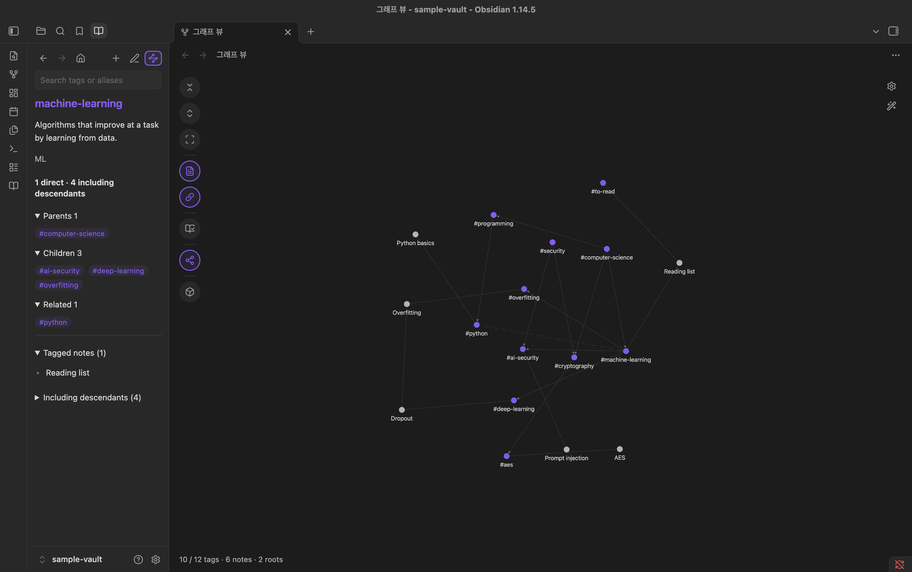
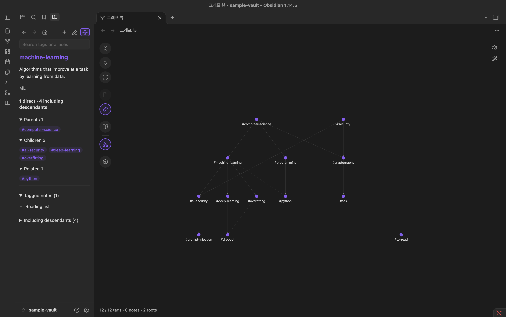

# Tag Ontology

[](https://github.com/NamhyeonKo/obsidian-tag-ontology/stargazers)
[](https://community.obsidian.md/plugins/tag-ontology)
[](https://github.com/NamhyeonKo/obsidian-tag-ontology/releases/latest)
[](https://www.npmjs.com/package/tag-ontology)
[](https://github.com/NamhyeonKo/obsidian-tag-ontology/actions/workflows/release.yml)
[](../../LICENSE)

[English](../../README.md) | [한국어](README.ko.md) | [简体中文](README.zh-CN.md) | [繁體中文](README.zh-TW.md) | [日本語](README.ja.md) | [Español](README.es.md) | [Français](README.fr.md) | [Deutsch](README.de.md) | **Português (Brasil)** | [Русский](README.ru.md) | [Italiano](README.it.md)

**Conecte suas tags do mesmo jeito que conecta notas.**

O Tag Ontology permite definir pais, filhas e tags relacionadas para cada tag diretamente em uma aba na barra lateral, sem editar nenhum arquivo manualmente. Depois, explore tudo na própria **Visualização em gráfico** do Obsidian: recolha e expanda cada ramo, alterne para um layout em árvore e mantenha a tag selecionada em foco. Notas, links entre notas, filtros, grupos de cores e opções de exibição continuam funcionando como antes.

Ele nunca altera suas notas. Ele escreve apenas no dicionário de tags — um arquivo JSON simples no seu cofre — e somente quando você adiciona, edita ou exclui uma tag na aba lateral.

## Por que Tag Ontology?

Um conceito pode se conectar a várias áreas ao mesmo tempo. Por exemplo, RAG se relaciona com LLMs, recuperação de informação e grafos de conhecimento. Ao organizar tudo com pastas ou tags aninhadas, eu precisava escolher sob qual caminho colocá-lo, e esse único caminho dificultava enxergar suas outras relações.

Eu queria gerenciar e explorar as relações entre conceitos separadamente, mantendo intactos a localização e o texto original dos documentos. Criei o Tag Ontology para que as tags pudessem ter múltiplos pais e tags relacionadas, com essas relações navegáveis no gráfico do Obsidian. Mais tarde, o estendi para que a CLI e o TOW pudessem usar as mesmas relações e regras.

> **Para começar:** a hierarquia é construída a partir dos nós de tags, então a opção **Filtros → Etiquetas** precisa estar ativada nas configurações do gráfico. Em uma instalação nova, ela já é ativada para você.


> [!TIP]
> **Uso com agentes de IA**: Combine com o [TOW](https://github.com/NamhyeonKo/tag-ontology-wiki) para gerenciar tags e dicionários com agentes de IA, junto a tarefas mais amplas no cofre. ([Saiba mais](#projetos-relacionados))

## Recursos

- **Construa sua hierarquia na barra lateral.** Adicione tags que suas notas já usam ou novos nomes, edite nome, descrição, aliases, facet, pais, filhas e tags relacionadas, e exclua tags. Sem edição manual de arquivos, e salvar nunca sobrescreve alterações feitas em outro lugar.
- **Uma extensão do gráfico nativo.** Notas, links de notas, filtros, grupos de cores, setas e as demais configurações nativas funcionam normalmente.
- **Hierarquia de tags recolhível.** As tags do dicionário começam recolhidas até suas raízes, e cada nota se liga ao ancestral visível mais próximo. Clique em uma tag para selecioná-la e dê um duplo clique para expandi-la um nível, vendo suas notas migrarem para as tags filhas mais específicas. Dê um duplo clique novamente para recolhê-la.
- **Contagem de notas acumulada (roll-up).** Para cada tag, você vê as notas marcadas *diretamente* e as notas marcadas com a tag *ou com qualquer descendente*.
- **Múltiplos pais e tags relacionadas.** Setas contínuas vão de pai para filha. Linhas tracejadas ligam tags relacionadas.
- **Quatro layouts.** Force, **Mapa mental**, árvore vertical e árvore horizontal. As árvores comuns mantêm o layout da hierarquia visível e organizam árvores raiz em linhas. O Mapa mental inicia a raiz escolhida no nível 0 e usa o caminho de pais aberto mais longo para o espaçamento. As cores das tags continuam usando a profundidade completa do dicionário.
- **Mapa mental.** O Mapa mental pergunta primeiro por onde começar: busque tags da hierarquia ou escolha uma das sugestões de raiz e explore apenas o ramo daquela tag. Use **Alterar tag inicial** (o botão de início na linha inferior) para voltar ao seletor. Voltar para outro layout restaura sua expansão anterior; entrar no Mapa mental novamente mostra o seletor. Selecione um rótulo para ver os detalhes na barra lateral e use o botão de seta para expandir ou recolher suas filhas. Arraste o fundo para mover, role para dar zoom e use Ajustar à tela para ver todo o mapa. Ele compartilha os filtros do gráfico nativo e o estado de expansão salvo. Tags compartilhadas continuam visíveis enquanto outro pai expandido as alcançar. As notas permanecem ocultas neste layout.
- **Visão 3D (beta).** A mesma hierarquia em três dimensões: orbite ao redor dela e clique em uma tag para voar até ela. Alterne os modos na barra de ferramentas do grafo. Force, Mapa mental, ambas as árvores, 3D e o explorador de ontologia compartilham uma mesma aba; clique com o botão direito em um botão de modo para abrir outra aba e comparar. Ajuste **Filtros** (busca, anexos, apenas arquivos existentes, órfãos), **Tela** (setas nos links de notas, limite para a visibilidade textual, tamanho dos nódulos, grossura dos links, rótulos em perspectiva e tamanho do rótulo) e **Forças** (tensão ao arrastar e controles deslizantes de forças) no painel de engrenagem de 3 seções, com restauração padrão por seção e para todo o painel. Alternar para 3D ou para o explorador preserva a outra tela; a renderização 3D oculta fica pausada e fechar a aba do grafo libera seus recursos.
- **Explorador de ontologia (beta).** Comece por uma tag em uma tela vazia e traga suas filhas, pais, tags relacionadas e notas com o botão direito, como cartões de objeto, no estilo dos grafos de ontologia da Palantir.
- **Uma aba na barra lateral.** Busque por nome da tag ou alias, leia os detalhes de uma tag e execute a verificação do dicionário em uma aba ao lado de Explorador de arquivos e Procurar. Escolher uma tag ali aproxima o grafo aberto nela e a centraliza.
- **Verificar dicionário.** Lista tags usadas no cofre que faltam no dicionário, com nomes semelhantes do dicionário; tags do dicionário que nenhuma nota usa ainda; notas que escrevem uma tag como alias ou com outra capitalização; e notas que trazem uma tag ampla junto de uma mais específica. Ele apenas relata e nunca altera nada.
- **Cores personalizadas (opcional).** Dê a cada tag no grafo e na barra lateral uma única cor — a cor de destaque do tema, a menos que você escolha outra.
- **Cores por profundidade da hierarquia (opcional).** Selecione **Cores → Modo de cor → Profundidade da hierarquia** para colorir tags pelo caminho mais longo da raiz até a tag no dicionário completo. Filtrar e recolher mantêm as cores estáveis, e níveis mais profundos usam a última cor da paleta. Padrão e Pastel usam a mesma sequência vermelho→laranja→amarelo→verde→ciano→azul→violeta→rosa da [tabela de cores do Tailwind CSS 3.4](https://v3.tailwindcss.com/docs/customizing-colors), usando os tons 500 e 200 respectivamente. Elas são reamostradas ao longo de toda a faixa quando os níveis mudam; exemplos Arco-íris, Quente e gradientes monocromáticos também estão disponíveis. Edite as cores numeradas na horizontal e adicione ou remova níveis. A legenda compacta do grafo oferece seleção de paleta, edição de cores e **Salvar paleta como…**. Edições ali ou nas configurações formam uma **Cópia de trabalho** compartilhada, mantida automaticamente entre reinicializações. **Salvar como…** adiciona um retrato nomeado independente em **Minhas paletas**; alternar para exemplos ou paletas salvas mantém a cópia de trabalho disponível. Os nomes salvos são únicos e nunca sobrescrevem outra paleta. **Minhas paletas → Gerenciar…** lista paletas salvas com exclusão confirmada; excluir a paleta ativa volta para Padrão e preserva a cópia de trabalho. Paletas Custom anteriores são mantidas como **My colors**, e as cores ativas existentes são preservadas ao trocar de exemplo. As cores se aplicam ao 2D, 3D, cartões do explorador e barra lateral. Inspirado no [Colored Tags](https://github.com/pfrankov/obsidian-colored-tags).
- **Foco (opcional).** Mantém brilhantes a tag selecionada e as tags vizinhas a ela (pais, filhas e relacionadas) enquanto o restante esmaece. As opções incluem todas as tags abaixo dela e suas notas.
- **Lembra a sua visualização.** Tags expandidas e as alternâncias Notas/Relacionadas ficam salvas e são compartilhadas por todas as abas de grafo.
- **Interface localizada (11 idiomas).** Segue automaticamente o idioma do Obsidian por padrão, ou permite alternar manualmente em **Geral → Idioma** entre English, 한국어, 日本語, 简体中文, 繁體中文, Español, Français, Deutsch, Português (Brasil), Русский e Italiano. Configurações, dicionário lateral, controles 3D, legendas de profundidade e visualizações de grafo atualizam em tempo real.

| Aba da barra lateral | Verificar dicionário |
| --- | --- |
|  |  |
| **Recolhido até as raízes** | **Expandido** |
|  |  |
| **Árvore vertical** | **Árvore horizontal** |
|  |  |
| **Tema original** | **Manter a tag selecionada em foco** |
|  |  |
| **Editar tag** | **Nova tag** |
|  |  |
| **Sugestões de busca** | **Excluir tag** |
|  |  |

## Como funciona

O Tag Ontology atua dentro da Visualização em gráfico nativa. Ele pega o gráfico que o Obsidian já montou com seus filtros e grupos de cores, recolhe as tags do dicionário e adiciona a hierarquia e os links relacionados entre elas. Tags que não estão no dicionário continuam como nós de tags comuns. O grafo local não é afetado, e desativar o plugin faz a Visualização em gráfico voltar ao normal.

A visão 3D (beta) é uma aba/modo separado. Ela constrói as mesmas notas e tags a partir do cofre, aplica o dicionário por cima com o mesmo código e desenha tudo com three.js.

O explorador de ontologia (beta) também é uma aba/modo separado. Ele não exibe o dicionário inteiro: você coloca tags na tela uma por uma e as desenha com Cytoscape.js.

A hierarquia que você constrói na aba da barra lateral é salva no arquivo de dicionário. Consulte [Avançado: o arquivo de dicionário](#avançado-o-arquivo-de-dicionário) se quiser lê-lo ou editá-lo diretamente.

O uso das tags vem do cache de metadados do Obsidian, que inclui `tags` no frontmatter e `#tags` no corpo de cada nota Markdown.

## Instalação e atualização

> Para detalhes completos, builds de desenvolvimento e solução de problemas, consulte o [Guia completo de instalação e atualização](../installation.md).

### Pelos Plugins da comunidade

- **Instalar**: Abra **Configurações → Plugins não oficiais → Procurar** (na seção *Plugins da comunidade*), pesquise por "Tag Ontology" e depois instale e ative. Você também pode instalá-lo pela [página no diretório](https://community.obsidian.md/plugins/tag-ontology).
- **Atualizar**: Vá em **Configurações → Plugins não oficiais**, clique em **Verificar por atualizações** e depois clique em **Atualizar todos** ou em **Atualizar** ao lado de Tag Ontology.

### Com o BRAT (versões beta)

- **Instalar**:
  1. Instale e ative o [BRAT](https://github.com/TfTHacker/obsidian42-brat).
  2. Escolha **BRAT: Add a beta plugin for testing** e informe `NamhyeonKo/obsidian-tag-ontology`.
- **Atualizar**: Execute o comando `BRAT: Check for updates to all beta plugins` (ou `BRAT: Check for plugin updates`).

### Instalação manual

- **Instalar**:
  1. Baixe `main.js`, `manifest.json` e `styles.css` do [lançamento mais recente](https://github.com/NamhyeonKo/obsidian-tag-ontology/releases).
  2. Copie-os para `.obsidian/plugins/tag-ontology/` dentro do seu cofre.
  3. Recarregue o Obsidian e ative **Tag Ontology** em **Configurações → Plugins não oficiais**.
- **Atualizar**:
  1. Baixe os arquivos `main.js`, `manifest.json` e `styles.css` mais recentes.
  2. Sobrescreva os arquivos em `.obsidian/plugins/tag-ontology/`.
  3. Execute o comando `Recarregar o app sem salvar` ou reinicie o Obsidian.

### Ferramenta CLI independente

A CLI independente está publicada no npm como [`tag-ontology`](https://www.npmjs.com/package/tag-ontology):

```sh
# Executar a versão mais recente diretamente sem instalar:
npx tag-ontology@latest check --root /path/to/vault --json

# Ou instalar / atualizar globalmente:
npm install -g tag-ontology@latest
npm update -g tag-ontology
```

> **Requisito**: O plugin nativo **Visualização em gráfico** precisa estar ativado, com **Filtros → Etiquetas** marcado nas configurações do gráfico.

## Início rápido com o cofre de exemplo

O repositório inclui um pequeno cofre em [`examples/sample-vault`](../../examples/sample-vault): um dicionário de 12 tags e seis notas.

1. No Obsidian, escolha **Abrir pasta como um cofre** e selecione `examples/sample-vault`.
2. Instale o plugin nesse cofre usando um dos métodos acima.
3. Clique no ícone da barra lateral de atalhos **Abrir Tag Ontology** (um livro) ou execute **Tag Ontology: Abrir grafo** pela paleta de comandos.
4. Se o grafo não mostrar tags, ative **Filtros → Etiquetas** nas configurações do gráfico (ícone de engrenagem).

Você verá duas raízes, `computer-science` e `security`, com as seis notas ligadas a elas, além da tag não registrada `#to-read`. Dê um duplo clique em `computer-science` e depois em `machine-learning`: a nota `Dropout` passa para `deep-learning`. `cryptography` e `ai-security` têm dois pais cada uma.

Em seguida, experimente a aba da barra lateral: pressione **+** para adicionar uma tag sua em `machine-learning`.

## Uso

### Aba da barra lateral

**Abrir Tag Ontology** (o ícone de livro na barra lateral de atalhos ou o comando **Abrir grafo**) abre o grafo e traz à frente a aba **Dicionário de tags** na barra lateral esquerda, ao lado de Explorador de arquivos e Procurar. Clicar em uma tag no grafo ou em **Verificar dicionário** também a traz para frente. Você pode arrastar a aba para a barra lateral direita.

- **A barra no topo** tem Voltar, Avançar e Início (as tags raiz e todas as tags) à esquerda, e **Nova tag**, **Editar tag** e um botão que expande ou recolhe a tag no grafo à direita. Sem nenhum grafo aberto na tela, esse botão abre um e mostra a tag; uma tag sem filhas exibe o botão desativado, com **Sem tags filhas**.
- **Buscar tags ou aliases**: digite parte do nome de uma tag ou alias e escolha uma sugestão com um clique ou Enter. Uma correspondência por alias mostra o alias abaixo da tag, de modo que `convolution` ou `합성곱` encontram `cnn`. O grafo expande até a tag escolhida, aproxima nela e a centraliza.
- Sem nenhuma tag escolhida, a aba lista as tags raiz e, em seguida, todas as tags em ordem alfabética sob sua letra inicial. A barra superior e o campo de busca ficam fixos enquanto a lista rola.
- Uma tag mostra sua descrição, aliases, contagens de notas (diretas e com descendentes), seus pais, filhas e tags relacionadas como links `#tag`, e suas notas. Clique em uma `#tag` para ir até ela.

### Editando o dicionário

- **Nova tag** (`+` na barra): escolha uma tag que suas notas usam mas que falta no dicionário, listadas por quantas notas a utilizam, ou digite um novo nome. Escolha pais para posicioná-la sob outras tags; sem pais ela se torna uma tag raiz. Você também pode adicionar filhas e tags relacionadas a partir das tags já existentes no dicionário.
- **Editar tag** (o lápis): altere nome, descrição, aliases, facet, pais, filhas e tags relacionadas. Pressione **+** após o último item de um campo para adicionar mais um. Pais, filhas e tags relacionadas já devem existir no dicionário, e tags relacionadas são salvas dos dois lados. Renomear uma tag não modifica as notas que a usam: elas mantêm a tag antiga, que passa a aparecer como fora do dicionário. Alterar apenas maiúsculas/minúsculas (`ml` para `ML`) mantém os vínculos, pois tags são comparadas sem diferenciar maiúsculas de minúsculas.
- **Tags em kebab-case** (uma configuração, desativada por padrão): uma tag nova ou renomeada deve conter apenas letras minúsculas e números separados por hífens, como `machine-learning`, o formato verificado pelo TOW. Nomes existentes são mantidos.
- **Excluir** (no formulário de edição) pede confirmação antes e mostra o que acontece: as filhas da tag passam para os pais dela, ela sai das listas de relacionadas e as notas mantêm suas tags.
- As alterações ficam no formulário até você pressionar **Salvar**, e sair com alterações não salvas pede confirmação antes. Se as tags que você alterou tiverem sido modificadas em outro lugar nesse meio tempo, o salvamento é interrompido e avisa você, mantendo suas edições no formulário.
- O dicionário é salvo com uma tag por linha, então salvar altera apenas as linhas envolvidas. Um arquivo escrito em outro layout é reformatado na primeira vez em que for salvo. Suas quebras de linha (LF ou CRLF) são mantidas.

### Barra de ferramentas do grafo

Recolher tudo, Expandir tudo e Ajustar à tela ficam em uma fileira na parte inferior central do grafo; os demais botões redondos descem pelo lado esquerdo, e a legenda de profundidade fica no canto inferior esquerdo. Cada botão mostra o nome ao passar o mouse:

| Botão | O que faz |
| --- | --- |
| Recolher tudo | Recolhe todas as tags do dicionário até a raiz |
| Expandir tudo | Expande todas as tags do dicionário |
| Ajustar à tela | Ajusta o grafo à parte da visualização deixada livre pela barra de ferramentas, legenda e botões de configuração |
| Notas | Mostra ou oculta todos os nós que não são tags (notas, anexos, links não resolvidos) |
| Relacionadas | Mostra ou oculta as linhas tracejadas de tags relacionadas |
| Verificar dicionário | Lista tags fora do dicionário e tags sem uso na aba da barra lateral |
| Force / Mapa mental / Árvore vertical / Árvore horizontal / 3D / Explorador de ontologia | Alterna o modo nesta aba, nessa ordem. O modo atual fica destacado. Clique com o botão direito para **Abrir em uma nova aba** e comparar dois modos lado a lado. 3D e o explorador ficam ocultos enquanto sua opção de ativação estiver desmarcada |

- Nos layouts em árvore e no Mapa mental, cada tag fica abaixo do seu pai e as notas ficam ocultas, para que as relações entre tags permaneçam legíveis.
- Clique em uma tag no grafo para centralizá-la e mostrá-la na aba da barra lateral. Dê um duplo clique para expandi-la e outro duplo clique para recolhê-la, como no botão do topo da aba. As tags que você expandiu abaixo dela continuam expandidas para a próxima vez.
- Todo o restante mantém o comportamento nativo: clicar em uma nota a abre, e clicar em uma tag fora do dicionário abre a busca.

### Visão 3D (beta)

O botão de modo **3D** na barra de ferramentas do grafo, ou **Abrir grafo 3D**, alterna a aba do grafo para a visão 3D; outro botão de modo a traz de volta. Enquanto outro modo está visível, a renderização 3D fica pausada. Ela compartilha as tags expandidas, as alternâncias Notas e Relacionadas, as cores, o Foco e a aba da barra lateral com o grafo 2D, então uma tag expandida em um aparece expandida no outro.


- Arraste o espaço vazio para orbitar, arraste com o botão direito para mover e role para dar zoom.
- Arraste um nó para movê-lo individualmente. Solte e ele volta elasticamente para o lugar, como nos layouts em árvore. O layout se estabiliza após abrir a visualização e após expandir, e então fica parado.
- Clique em uma tag para selecioná-la e voar até ela, e dê um duplo clique para expandi-la ou recolhê-la. Clique em uma nota para abri-la. Escolher uma tag na barra lateral também voa até ela. Clicar em uma tag fora do dicionário não faz nada aqui; no 2D, abre a busca.
- A barra de ferramentas traz Recolher tudo, Expandir tudo, Ajustar à tela, Notas, Relacionadas, Verificar dicionário e os botões de modo. Ajustar à tela enquadra a maior parte dos nós visíveis para que o grafo preencha a tela; alguns nós muito distantes podem ficar de fora.
- O botão de engrenagem no canto superior direito abre o painel de configurações 3D (**Filtros**, **Tela**, **Forças**), espelhando o painel do grafo 2D do Obsidian. O cabeçalho inclui o botão **Restaurar configurações padrão** para todas as seções, cada seção tem seu próprio botão **Restaurar padrões**, e as alterações sincronizam entre todas as abas 3D abertas.
  - **Filtros**: campo de busca com suporte a `path:`, `file:`, `tag:`, negação `-` e frases entre aspas; **Anexos** (desativado por padrão); **Apenas arquivos existentes** (ativado por padrão); e **Órfãos** (ativado por padrão).
  - **Tela**: **Setas** nos links de notas (desativado por padrão; links de hierarquia sempre mostram setas), **Limite para a visibilidade textual**, **Tamanho dos nódulos**, **Grossura dos links**, **Rótulos em perspectiva** (ativado por padrão) e **Tamanho do rótulo** (`0.5` a `2`, `0.8` por padrão).
  - **Forças**: **Tensão ao arrastar** (ativado por padrão — puxa nós conectados ao arrastar; desativado move apenas o nó arrastado), **Força centrípeta**, **Força de repulsão**, **Força dos links** e **Distância dos links**, usando os intervalos e padrões do grafo 2D. Mover um controle deslizante de força reaquece a simulação.
- A visão 3D constrói suas notas, tags, anexos e links não resolvidos diretamente do cofre e salva as configurações da engrenagem separadamente do grafo 2D nativo.
- Se a visão 3D estiver lenta ou você não a usar, desative **Habilitar visão 3D (beta)** nas configurações. O botão de modo e o comando desaparecem, e o grafo 2D não muda.

### Explorador de ontologia (beta)

O botão de modo **Explorador de ontologia** na barra de ferramentas do grafo, ou **Abrir explorador de ontologia**, alterna a aba do grafo para o explorador. Sua tela é preservada enquanto outro modo é exibido. Ele compartilha a aba da barra lateral com os grafos, mas não as tags expandidas, as alternâncias Notas e Relacionadas nem o Foco.

- Uma tela vazia pergunta por onde começar: buscar uma tag, escolher uma tag raiz ou continuar da tag selecionada na barra lateral. Escolher uma tag pela busca na barra lateral ou por um link de tag também a adiciona à tela.
- Cada tag é um cartão de objeto com seu facet (ou `conceito`), suas notas diretas, suas notas com descendentes e sua quantidade de filhas. Facets recebem cores próprias; tags sem facet usam a cor da tag.
- Clique com o botão direito em uma tag para abrir **Expandir filhas**, **Expandir pais**, **Expandir relacionadas** e **Mostrar notas**. Cada opção mostra quantas ainda não estão na tela. Os novos cartões se alinham em colunas ao lado dela — filhas e notas à direita e pais à esquerda — e nada do que já está na tela se move. Dê um duplo clique em uma tag para expandir suas filhas.
- As linhas seguem o dicionário, como no grafo 2D: setas de pai para filha e linhas tracejadas entre tags relacionadas conectam quaisquer duas tags na tela, independentemente de quem as trouxe.
- Uma tag com mais de 15 notas mostra um único cartão de grupo no lugar. Clique nele para listar suas notas na aba da barra lateral (mais recentes primeiro), filtrá-las e retirar as marcadas ou as 10 mais recentes. Dê um duplo clique nele para retirar as 10 mais recentes. O grupo guarda todas as notas da tag que não estão como cartão na tela: notas marcadas depois entram nele, e um cartão de nota removido volta para ele.
- Clique em um cartão para exibi-lo na aba da barra lateral; dê um duplo clique em uma nota para abri-la. Arraste cartões para qualquer lugar; eles ficam onde você os colocar. Clique com o botão direito em um cartão para removê-lo; os cartões trazidos a partir dele permanecem.
- A barra de ferramentas traz Ajustar à tela, Limpar tela e os botões de modo. A tela não é salva: fechar a aba a limpa.
- Editar o dicionário ou as notas atualiza os cartões: tags e notas renomeadas mantêm sua posição, e as excluídas saem da tela.
- Se não usar, desative **Habilitar explorador de ontologia (beta)** nas configurações. O botão de modo e o comando desaparecem.

### Comandos

| Comando | Descrição |
| --- | --- |
| Tag Ontology: Abrir grafo | Abre a ontologia na Visualização em gráfico nativa. Reaproveita uma aba aberta. |
| Tag Ontology: Abrir grafo 3D | Alterna a aba de grafo aberta para 3D ou abre uma nova. Disponível apenas com **Habilitar visão 3D (beta)** ativado. |
| Tag Ontology: Abrir explorador de ontologia | Alterna a aba de grafo aberta para o explorador ou abre uma nova. Disponível apenas com **Habilitar explorador de ontologia (beta)** ativado. |
| Tag Ontology: Recarregar dicionário | Recarrega o dicionário e o índice de notas. |

### Configurações

As configurações usam a mesma ordem de seções e itens no Obsidian 1.13+ e em versões anteriores: **Geral**, **Dicionário**, **Cores**, **Barra lateral**, **Foco** e **Visualizações adicionais**. Os modos Cor única e Profundidade da hierarquia mostram opções de cor; os controles de paleta aparecem no modo Profundidade da hierarquia. As opções de Foco aparecem quando o foco está ativado.

| Configuração | Descrição |
| --- | --- |
| **Geral** | |
| Idioma | Segue o idioma do Obsidian (`Automático (Obsidian)`, padrão) ou escolhe um dos 11 idiomas suportados para configurações do plugin, dicionário lateral, controles 3D e visualizações de grafo. Nomes de comandos e títulos de abas já abertas atualizam após reiniciar o Obsidian. |
| **Dicionário** | |
| Caminho do dicionário | Caminho relativo ao cofre até um arquivo `.json`. Deixe vazio para detecção automática: `tow/tag-dictionary.json`, depois `.tow/tag-dictionary.json`, depois `Tag-Dictionary.json`; quando nenhum existe, `tow/tag-dictionary.json`. Um caminho digitado por você é sempre usado. O campo salva ao pressionar Enter ou sair dele. |
| Tags em kebab-case | Desativado por padrão. Ativado: o formulário de edição aceita uma tag nova ou renomeada apenas com letras minúsculas e números ligados por hífens, o padrão verificado pelo TOW. Nomes existentes são mantidos. |
| **Cores** | |
| Modo de cor | Padrão do Obsidian, Cor única ou Profundidade da hierarquia. Cores existentes são mantidas ao trocar de modo. |
| &nbsp;&nbsp;Paleta | Exemplos, a Cópia de trabalho atual e Minhas paletas. Exemplos mantêm a quantidade de níveis ativa; paletas nomeadas restauram suas cores e contagem salvas. |
| &nbsp;&nbsp;Cores dos níveis | Edite cores numeradas na horizontal; adicione ou remova níveis (pelo menos um). Níveis além da última cor mantêm essa cor. |
| &nbsp;&nbsp;Minhas paletas | Salvar como… abre um campo de nome; Gerenciar… lista paletas para exclusão confirmada. Excluir a paleta ativa volta para Padrão e preserva a cópia de trabalho. Nomes duplicados são rejeitados. |
| &nbsp;&nbsp;Cor das tags / Cor para tags fora da hierarquia | Cor base no modo Cor única, ou cor alternativa para tags fora da hierarquia no modo Profundidade da hierarquia. Usa a cor de destaque até você escolher uma; redefinir volta para a cor de destaque. |
| &nbsp;&nbsp;Títulos coloridos na barra lateral | Usa a cor da tag selecionada em seu título na barra lateral. |
| **Barra lateral** | |
| Listas de tags | Mostra tags na barra lateral (Tags raiz, Todas as tags, Pais, Filhas e Relacionadas) como etiquetas compactas ou uma por linha. Etiquetas por padrão. |
| **Foco** | |
| Manter a tag selecionada em foco | Mantém brilhantes a tag selecionada e as tags vizinhas a ela (pais, filhas e relacionadas) e esmaece o restante. A tag selecionada e seus links ficam com aparência de foco ao passar o mouse. Desativado por padrão. Ative para exibir as opções abaixo. |
| &nbsp;&nbsp;Suas descendentes | Também mantém brilhantes todas as tags abaixo dela, até onde estiverem expandidas. Ativado por padrão. |
| &nbsp;&nbsp;Incluir notas | Também mantém brilhantes as notas da tag selecionada, e de suas descendentes quando essa opção está ativa. As notas das tags vizinhas continuam esmaecidas. Ativado por padrão. |
| **Visualizações adicionais** | |
| Habilitar árvore vertical | Mostra o botão do modo árvore vertical na barra de ferramentas do grafo. Desativar faz uma aba nesse modo voltar para Force. Ativado por padrão. |
| Habilitar árvore horizontal | O mesmo para o botão do modo árvore horizontal. Ativado por padrão. |
| Habilitar visão 3D (beta) | Mostra o botão do modo 3D na barra de ferramentas do grafo e o comando Abrir grafo 3D. Desativar libera a visão 3D; uma aba que a esteja exibindo volta para 2D. Ativado por padrão. |
| Habilitar explorador de ontologia (beta) | Mostra o botão do modo explorador na barra de ferramentas do grafo e o comando Abrir explorador de ontologia. Desativar limpa a tela do explorador; uma aba que o esteja exibindo volta para 2D. Ativado por padrão. |

Em níveis baixos de zoom, o gráfico nativo oculta rótulos e setas. Aproxime o zoom para vê-los.

## Avançado: o arquivo de dicionário

A aba da barra lateral lê e grava este arquivo, então você nunca precisa abri-lo. Ele é um JSON simples no seu cofre, portanto você também pode editá-lo manualmente.

O dicionário pode ficar em qualquer caminho relativo ao cofre terminado em `.json`, inclusive dentro de `tow/` ou `.tow/`. Com o campo **Caminho do dicionário** vazio, o plugin verifica `tow/tag-dictionary.json`, depois `.tow/tag-dictionary.json` e depois `Tag-Dictionary.json`. Instalações novas criam `tow/tag-dictionary.json`; arquivos `Tag-Dictionary.json` existentes continuam funcionando, e `.tow/tag-dictionary.json` do TOW 0.5.0–0.5.1 continua sendo lido. Um caminho escolhido por você é sempre usado. Se o dicionário sumir depois, a aba da barra lateral oferece a opção de criá-lo.

**O Obsidian Sync não sincroniza pastas iniciadas por ponto além de `.obsidian`** ([Configurações do Sync](https://obsidian.md/help/sync/settings)). Se você usa o Obsidian Sync, escolha um caminho visível para o dicionário. Git e ferramentas de sincronização de arquivos incluem pastas iniciadas por ponto, a menos que estejam ignoradas.

O arquivo é um único objeto JSON. Cada chave é uma tag **sem `#`**, comparada sem diferenciar maiúsculas de minúsculas como no gráfico nativo (`#ML` usa a chave `ml`). Recomenda-se usar chaves em minúsculas. Uma tag aninhada como `#lang/python` usa a chave `lang/python`.

```json
{
  "machine-learning": {
    "aliases": ["ML"],
    "description": "Algorithms that improve at a task by learning from data.",
    "broader": ["computer-science"]
  },
  "dropout": {
    "description": "Randomly disabling units during training to reduce overfitting.",
    "broader": ["deep-learning"],
    "related": ["overfitting"],
    "facet": "technique"
  },
  "computer-science": {
    "description": "The study of computation, information and automation.",
    "broader": []
  }
}
```

| Campo | Obrigatório | Tipo | Significado |
| --- | --- | --- | --- |
| `description` | sim | string | Exibida no painel da tag. |
| `aliases` | não | string[] | Outros nomes. Usados pela busca e pela verificação do dicionário para sugerir uma correspondência para uma tag não registrada. |
| `broader` | não | string[] | Tags pais. **`[]` marca uma tag raiz.** |
| `related` | não | string[] | Links não hierárquicos, desenhados como linhas tracejadas. |
| `facet` | não | string | Categoria livre, como `language`. Defina no formulário de edição ou no rascunho de um arquivo de alterações da CLI; uma tag de facet junto às suas tags mais específicas não é reportada como redundante. |

Regras:

- **Raízes precisam de `"broader": []`.** Uma tag sem nenhuma chave `broader` é tratada como ainda não posicionada e não aparece no grafo.
- Toda tag citada em `broader` ou `related` deve existir no dicionário.
- Uma tag não pode referenciar a si mesma, e os links `broader` não podem formar um ciclo.
- Se o dicionário for inválido, um aviso mostra o motivo quando o Obsidian inicia ou quando você abre a visualização, e a barra lateral continua mostrando o erro até você corrigir o arquivo. O grafo mantém a última versão carregada, e **Nova tag** e **Editar tag** ficam desativados até lá.

Veja [`examples/sample-vault/tow/tag-dictionary.json`](../../examples/sample-vault/tow/tag-dictionary.json) para um exemplo completo.

## Privacidade

- Nenhuma requisição de rede, telemetria ou conta.
- Lê apenas os metadados das suas notas e o arquivo do dicionário.
- Grava apenas o próprio arquivo de configurações (`plugins/tag-ontology/data.json` na pasta de configuração, normalmente `.obsidian/`) e, ao salvar uma alteração na barra lateral, o arquivo de dicionário em uso: o caminho escolhido por você (incluindo um caminho personalizado salvo em uma versão anterior) ou `tow/tag-dictionary.json`, `.tow/tag-dictionary.json` ou `Tag-Dictionary.json` na ordem de busca automática.

## Compatibilidade e limitações conhecidas

- **Apenas para desktop.** Testado no Obsidian 1.14.5 (macOS).
- O plugin se integra a **componentes internos não documentados** da Visualização em gráfico nativa (renderizador, PIXI, worker de layout). Uma futura atualização do Obsidian pode quebrar essa integração. Se os componentes internos parecerem desconhecidos, o plugin se desconecta e deixa o gráfico nativo intacto.
- Em cofres grandes, expandir todas as tags com notas visíveis redesenha alguns milhares de nós e links; espere uma breve pausa.
- Os rótulos ficam densos quando todas as tags estão expandidas, especialmente em Force.
- Não testado em conjunto com outros plugins que modificam a Visualização em gráfico.
- A visão 3D usa WebGL e empacota three.js, e o explorador empacota Cytoscape.js, portanto o arquivo do plugin tem cerca de 1,6 MB. Cada um é carregado apenas quando sua aba é aberta. Com muitos milhares de notas exibidas, a visão 3D fica mais lenta; ocultar notas a mantém rápida.

## Roteiro

- Exibir a hierarquia também no grafo local.

Relatos de bugs e pedidos de recursos são bem-vindos em [Issues](https://github.com/NamhyeonKo/obsidian-tag-ontology/issues). Para bugs, inclua sua versão do Obsidian e o sistema operacional.

## Biblioteca e CLI

O pacote independente [`tag-ontology`](../../packages/tag-ontology/README.md) expõe as mesmas regras do dicionário como uma biblioteca ESM licenciada sob MIT e uma CLI Node. Ele verifica e analisa um cofre, relata o uso das tags, mostra a hierarquia de uma tag e pré-visualiza/aplica alterações no dicionário com verificação de hash de conteúdo. Não é necessário ter o Obsidian instalado.

Ele está publicado no npm como [`tag-ontology`](https://www.npmjs.com/package/tag-ontology):

```sh
npx tag-ontology check --root /path/to/vault --json
```

Consulte o [guia do pacote](../../packages/tag-ontology/README.md) para exemplos da biblioteca e o [contrato da CLI](../cli.md) para comandos, campos JSON, códigos de saída e limites do parser. O plugin e o pacote têm versões e tags de lançamento independentes.

## Projetos relacionados

### [TOW (Tag Ontology Wiki)](https://github.com/NamhyeonKo/tag-ontology-wiki)

Quando usado em conjunto com o [TOW](https://github.com/NamhyeonKo/tag-ontology-wiki), você pode usar agentes de IA para gerenciar tags e dicionários junto com tarefas mais amplas no cofre, como busca de notas, gerenciamento de frontmatter e formatação de documentos.

- **Gerenciamento de dicionário via CLI**: Usa a CLI `tag-ontology` para inspecionar tags, validar a integridade do dicionário e aplicar atualizações seguras.
- **Fluxos de trabalho com agentes de IA**: Automatiza a manutenção repetitiva do cofre, como descobrir tags não registradas, sincronizar entradas da ontologia, verificar o esquema de frontmatter e organizar a estrutura das notas.
- **Integração visual com o grafo**: Explore e navegue pelas hierarquias de tags gerenciadas por agentes diretamente na Visualização em gráfico do Obsidian usando este plugin.

## Desenvolvimento

Requer Node.js **22.18 ou superior**. Os testes executam TypeScript diretamente com a remoção nativa de tipos do Node.

```sh
npm ci
npm run lint        # Regras de revisão do Obsidian + lint do pacote verificado
npm test            # testes unitários, sem necessidade de cofre
npm run build       # verificação de tipos + dist do pacote + main.js do plugin
npm run check:package  # inspeciona e instala o tarball npm gerado
npm run deploy -- "/path/to/vault"   # copia main.js, manifest.json e styles.css para o cofre
```

`deploy` exige uma pasta `.obsidian/` existente no cofre de destino e preserva um `data.json` existente. Recarregue o plugin no Obsidian depois.

`npm run test:vault` é o teste de integração do mantenedor contra um cofre privado (`OBSIDIAN_VAULT_PATH`). Outros colaboradores não precisam executá-lo.

### Estrutura do projeto

```text
src/
├── main.ts            # Entrada do plugin: comandos, aba de configurações, eventos de cofre/metadados
├── search.ts          # Popover de sugestões para o campo de busca e formulários de edição
├── native.ts          # Integra-se ao renderizador da Visualização em gráfico nativa (barra, aba lateral, cliques, layouts)
├── graph-modes.ts     # Barra compartilhada de troca de modo do grafo e menu Abrir em uma nova aba
├── legend.ts          # Legenda de profundidade da hierarquia, seletor de paleta e amostras de cor
├── palettes.ts        # Predefinições de paleta, cópia de trabalho e estado da biblioteca de paletas salvas
├── colors.ts          # Reamostragem de cores e mapeamento pelo caminho mais longo de profundidade da hierarquia
├── hierarchy.ts       # Adaptador do modelo de dicionário e contagens acumuladas de notas
├── layer.ts           # Funções puras que aplicam o dicionário sobre os dados do gráfico nativo
├── layout.ts          # Posições de árvore vertical e horizontal
├── mindmap.ts         # Visão de mapa mental baseada em Cytoscape com cartões DOM acessíveis
├── mindmap-layout.ts  # Espaçamento do ramo visível e posicionamento de âncoras do mapa mental
├── graph3d.ts         # A visão 3D: desenha os mesmos dados em camadas com 3d-force-graph
├── controls3d.ts      # Painel recolhível de configurações 3D em 3 seções (Filtros, Tela, Forças)
├── filter3d.ts        # Parser/avaliador de consulta de busca e remoção de órfãos para 3D
├── geometry3d.ts      # Posicionamento de setas 3D, escala de rótulos e auxiliares de profundidade de câmera
├── three.ts           # three.js e 3d-force-graph, importados apenas quando uma visão 3D é aberta
├── vault-data.ts      # Constrói o formato de dados do gráfico nativo a partir do cofre para a visão 3D
├── explorer.ts        # O explorador de ontologia: uma tela Cytoscape.js de cartões de objeto
├── explorer-layout.ts # Funções puras do explorador: posicionamento de cartões, contagens ao redor, linhas
├── explorer-card.ts   # Os cartões de objeto do explorador como imagens SVG
├── check.ts           # Auxiliares que agrupam tags não canônicas e redundantes para Verificar dicionário
├── settings.ts        # Esquema de configurações, padrões e sanitização
└── i18n/              # Catálogo em 11 idiomas, formatação em tempo de execução e atualização ao vivo
tests/              # testes unitários node:test (tests/integration é exclusivo para o mantenedor)
packages/tag-ontology/
├── src/core/       # Validação pura de dicionário, hierarquia, uso e edições
├── src/vault/      # Acesso a arquivos no Node e leitores de Markdown/frontmatter
├── src/cli/        # Argumentos de linha de comando, resultados JSON e códigos de saída
└── tests/          # Testes unitários do pacote e testes de CLI em processo real
docs/cli.md         # Contrato versionado da CLI
examples/           # Cofre de exemplo com um dicionário de tags
scripts/deploy.mjs  # Copia o build para um cofre local
scripts/check-package.mjs  # Inspeciona e exercita o pacote npm empacotado
```

## Contribuindo

Contribuições da comunidade são muito bem-vindas! Seja corrigindo bugs, propondo novos recursos ou melhorando a documentação:

1. Confira as [Issues](https://github.com/NamhyeonKo/obsidian-tag-ontology/issues) existentes ou abra uma nova.
2. Faça um fork do repositório e crie seu branch de funcionalidade a partir de `dev`.
3. Siga [Conventional Commits](https://www.conventionalcommits.org/en/v1.0.0/) para mensagens de commit.
4. Garanta que todas as verificações passem: `npm run lint && npm test && npm run build`.
5. Envie um Pull Request direcionado ao branch `dev`.

Consulte nosso [CONTRIBUTING.md](../../CONTRIBUTING.md) para diretrizes completas de desenvolvimento e fluxos de teste, além do [Código de Conduta](../../CODE_OF_CONDUCT.md).

## Apoie o projeto

O Tag Ontology é gratuito e de código aberto. Se ele economiza o seu tempo, você pode [me pagar um café](https://buymeacoffee.com/namhyunko).

## Agradecimentos

- A abordagem de fornecer dados personalizados ao renderizador nativo de grafo foi inspirada em [Nested tags graph](https://github.com/drpilman/obsidian-graph-nested-tags). Esse plugin não é necessário.
- A visão 3D é construída sobre [3d-force-graph](https://github.com/vasturiano/3d-force-graph), [three-spritetext](https://github.com/vasturiano/three-spritetext) e [three.js](https://threejs.org), todos sob licença MIT. O explorador de ontologia é construído sobre [Cytoscape.js](https://js.cytoscape.org) (MIT). Os avisos de licença de todos os pacotes empacotados ficam no topo de `main.js`.

## Licença

Copyright (c) 2026 NamhyeonKo

Este projeto é licenciado sob a [Licença MIT](../../LICENSE). Você é livre para usar, modificar e distribuir este software nos termos da Licença MIT.
