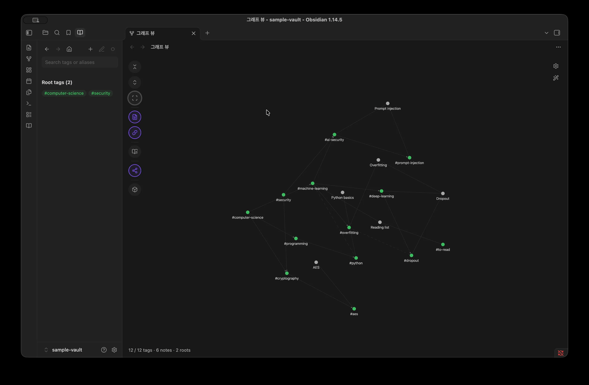
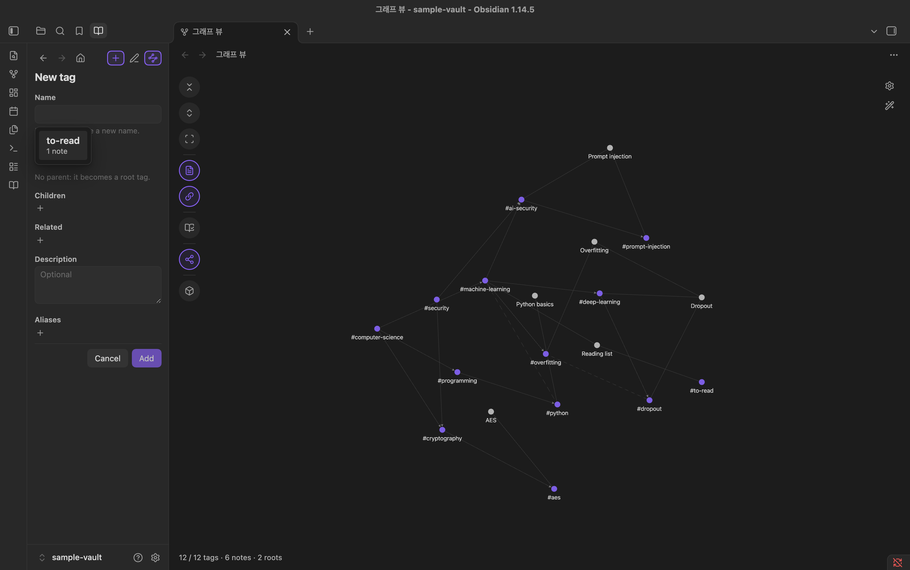

# Tag Ontology

[](https://github.com/NamhyeonKo/obsidian-tag-ontology/stargazers)
[](https://community.obsidian.md/plugins/tag-ontology)
[](https://github.com/NamhyeonKo/obsidian-tag-ontology/releases/latest)
[](https://www.npmjs.com/package/tag-ontology)
[](https://github.com/NamhyeonKo/obsidian-tag-ontology/actions/workflows/release.yml)
[](../../LICENSE)

[English](../../README.md) | [한국어](README.ko.md) | [简体中文](README.zh-CN.md) | [繁體中文](README.zh-TW.md) | [日本語](README.ja.md) | [Español](README.es.md) | [Français](README.fr.md) | [Deutsch](README.de.md) | [Português (Brasil)](README.pt-BR.md) | **Русский** | [Italiano](README.it.md)

**Связывайте теги так же, как связываете заметки.**

Tag Ontology позволяет задавать каждому тегу родителей, дочерние и связанные теги из вкладки на боковой панели без редактирования файлов вручную. Затем вы можете изучать их во встроенном представлении **Граф** в Obsidian: сворачивать и разворачивать отдельные ветви, переключаться на древовидную раскладку и держать выбранный тег в фокусе. Заметки, ссылки между заметками, фильтры, цветовые группы и настройки отображения продолжают работать как прежде.

Плагин никогда не изменяет ваши заметки. Он записывает данные только в словарь тегов — обычный JSON-файл в вашем хранилище — и лишь тогда, когда вы добавляете, редактируете или удаляете тег на боковой панели.

## Зачем нужен Tag Ontology?

Одно понятие может относиться сразу к нескольким областям. Например, RAG связан с LLM, информационным поиском и графами знаний. Когда я организовывал заметки с помощью папок или вложенных тегов, приходилось выбирать, в какую именно ветку поместить понятие, и один этот путь скрывал остальные его связи.

Мне хотелось управлять отношениями между понятиями и исследовать их отдельно, сохраняя расположение документов и исходный текст без изменений. Я создал Tag Ontology, чтобы у тегов могло быть несколько родителей и связанные теги, а по этим связям можно было перемещаться в графе Obsidian. Позднее я расширил проект, чтобы CLI и TOW могли использовать те же отношения и правила.

> **Для начала:** иерархия строится из узлов тегов, поэтому в настройках графа должен быть включён параметр **Фильтры → Теги**. При первой установке плагин включает его автоматически.



> [!TIP]
> **Работа с ИИ-агентами**: используйте плагин вместе с [TOW](https://github.com/NamhyeonKo/tag-ontology-wiki), чтобы управлять тегами и словарями с помощью ИИ-агентов наряду с более широкими задачами по хранилищу. ([Подробнее](#связанные-проекты))

## Возможности

- **Стройте иерархию на боковой панели.** Добавляйте теги, которые уже используются в заметках, или новые имена, редактируйте имя, описание, псевдонимы, `Facet`, родителей, дочерние и связанные теги, а также удаляйте теги. Никакого ручного редактирования файлов, а сохранение никогда не перезаписывает изменения, сделанные в другом месте.
- **Расширение встроенного графа.** Заметки, ссылки между заметками, фильтры, цветовые группы, направление связей и остальные стандартные настройки работают как обычно.
- **Сворачиваемая иерархия тегов.** Теги из словаря изначально свёрнуты до корневых, а каждая заметка соединяется с ближайшим видимым предком. Нажмите на тег, чтобы выбрать его, и дважды щёлкните, чтобы развернуть на один уровень — заметки перейдут к более конкретным дочерним тегам. Двойной щелчок снова свернёт ветвь.
- **Подсчёт заметок с накоплением по иерархии.** Для каждого тега отображается количество заметок, отмеченных *напрямую*, и количество заметок с этим тегом *или любым из его потомков*.
- **Несколько родителей и связанные теги.** Сплошные стрелки идут от родителя к дочернему тегу. Пунктирные линии соединяют связанные теги.
- **Четыре макета.** **Force**, **Ментальная карта**, **Вертикальное дерево** и **Горизонтальное дерево**. Обычные деревья сохраняют раскладку по видимой иерархии и переносят корневые деревья в строки. **Ментальная карта** помещает выбранный корень на уровень 0 и рассчитывает отступы по самому длинному текущему открытому пути родителей. Цвета тегов по-прежнему используют глубину по всему словарю.
- **Ментальная карта.** Сначала **Ментальная карта** спрашивает, с чего начать: найдите тег из иерархии или выберите один из предложенных корневых тегов, чтобы исследовать только его ветвь. Используйте **Сменить начальный тег** (кнопка с домиком в нижнем ряду), чтобы вернуться к выбору. Возврат к другому макету восстанавливает его прежнее состояние раскрытия; повторный вход в **Ментальную карту** снова открывает выбор. Выберите подпись, чтобы увидеть сведения на боковой панели; нажмите кнопку со стрелкой, чтобы развернуть или свернуть дочерние теги. Перетаскивайте фон для перемещения, прокручивайте для масштабирования и используйте **Поместить на экран**, чтобы увидеть карту целиком. Макет использует общие фильтры графа и сохранённое состояние раскрытия. Общие теги остаются видимыми, пока до них ведёт другой раскрытый родитель. Заметки в этом макете скрыты.
- **3D-вид (бета).** Та же иерархия в трёх измерениях: вращайте сцену и нажимайте на тег, чтобы подлететь к нему. Переключайте режимы на панели инструментов графа. **Force**, **Ментальная карта**, оба дерева, **3D** и **Проводник онтологии** работают в одной вкладке; правый клик по кнопке режима открывает отдельную вкладку для сравнения. Настраивайте **Фильтры** (поиск, **Вложения**, **Только созданные заметки**, **Объекты без связей**), **Отображение** (**Направление связей**, **Порог исчезания текста**, **Размер узла**, **Толщина линий**, **Перспективные подписи** и **Размер подписей**) и **Силы** (**Натяжение при перетаскивании** и ползунки сил) на трёхсекционной панели со значком шестерёнки — со сбросом настроек как для отдельной секции (**Сбросить настройки**), так и для всей панели (**Восстановить настройки по умолчанию**). При переключении на **3D** или проводник другой холст сохраняется; скрытая 3D-отрисовка ставится на паузу, а закрытие вкладки графа освобождает ресурсы.
- **Проводник онтологии (бета).** Начните с одного тега на пустом холсте и правым кликом выводите его дочерние теги, родителей, связанные теги и заметки в виде карточек объектов — в стиле онтологических графов Palantir.
- **Вкладка на боковой панели.** Ищите по имени тега или псевдониму, читайте сведения о теге и запускайте проверку словаря во вкладке рядом со вкладками **Файловый менеджер** и **Поиск**. Выбор тега здесь приближает и центрирует его на открытом графе.
- **Проверка словаря.** Показывает теги, используемые в хранилище, но отсутствующие в словаре, вместе с похожими именами из словаря; теги словаря, которые ещё не использует ни одна заметка; заметки, где тег записан как псевдоним или в другом регистре; а также заметки с более общим тегом рядом с более узким. Она только формирует отчёт и никогда ничего не меняет.
- **Один цвет (необязательно).** Окрасьте каждый тег на графе и на боковой панели в один цвет — акцентный цвет темы, если вы не выбрали другой.
- **Цвета по глубине иерархии (необязательно).** Выберите **Цвета → Режим цвета → По глубине иерархии**, чтобы окрашивать теги по самому длинному пути от корня до тега во всём словаре. При фильтрации и сворачивании цвета остаются стабильными, а более глубокие уровни используют последний цвет палитры. Палитры **По умолчанию** и **Пастельная** используют одинаковый порядок красный→оранжевый→жёлтый→зелёный→бирюзовый→синий→фиолетовый→розовый из [таблицы цветов Tailwind CSS 3.4](https://v3.tailwindcss.com/docs/customizing-colors) с оттенками 500 и 200 соответственно. Они равномерно перераспределяются по всему диапазону при изменении числа уровней; также доступны примеры **Радуга**, **Тёплая** и однотонные градиенты. Редактируйте пронумерованные цвета по горизонтали и добавляйте или удаляйте уровни. Компактная легенда графа предлагает выбор палитры, редактирование цветов и **Сохранить палитру как…**. Правки там или в настройках становятся общей **Рабочей копией**, автоматически сохраняемой между перезапусками. **Сохранить как…** добавляет независимую именованную палитру в **Мои палитры**; при переключении примеров или сохранённых палитр рабочая копия остаётся доступной. Сохранённые названия уникальны и никогда не перезаписывают другую палитру. **Мои палитры → Управление…** выводит список сохранённых палитр с подтверждением удаления; удаление активной палитры выбирает **По умолчанию** и сохраняет рабочую копию. Прежние пользовательские палитры сохраняются как **My colors**, а текущие активные цвета не сбрасываются при изменении примеров. Цвета применяются в 2D, 3D, карточках проводника и боковой панели. Вдохновлено [Colored Tags](https://github.com/pfrankov/obsidian-colored-tags).
- **Фокус (необязательно).** Оставляйте выбранный тег и соседние с ним теги (родителей, дочерние и связанные) яркими, пока всё остальное приглушено. Дополнительные параметры добавляют все теги ниже него и его заметки.
- **Запоминание вида.** Развёрнутые теги и переключатели **Заметки** / **Связанные** сохраняются и используются всеми вкладками графа.
- **Локализованный интерфейс (11 языков).** По умолчанию автоматически следует языку Obsidian или переключается вручную в разделе **Основные → Язык** среди English, 한국어, 日本語, 简体中文, 繁體中文, Español, Français, Deutsch, Português (Brasil), Русский и Italiano. Настройки, словарь на боковой панели, элементы управления 3D, легенды глубины и представления графа обновляются мгновенно.

| Вкладка на боковой панели | Проверка словаря |
| --- | --- |
|  |  |
| **Свёрнуто до корневых** | **Развёрнуто** |
|  |  |
| **Вертикальное дерево** | **Горизонтальное дерево** |
|  |  |
| **Стандартная тема** | **Держать выбранный тег в фокусе** |
|  |  |
| **Редактировать тег** | **Новый тег** |
|  |  |
| **Подсказки поиска** | **Удаление тега** |
|  |  |

## Как это работает

Tag Ontology работает внутри встроенного представления **Граф**. Он берёт граф, который Obsidian уже построил с учётом ваших фильтров и цветовых групп, сворачивает словарные теги и добавляет между ними иерархические и родственные связи. Теги, которых нет в словаре, остаются обычными узлами тегов. **Локальный граф** не затрагивается, а отключение плагина возвращает **Граф** к обычному виду.

**3D-вид (бета)** — это отдельная вкладка. Он собирает те же заметки и теги из хранилища, накладывает на них словарь тем же кодом и отрисовывает сцену с помощью three.js.

**Проводник онтологии (бета)** — тоже отдельная вкладка. Он не отображает весь словарь целиком: вы выкладываете теги на холст по одному, а отрисовка выполняется через Cytoscape.js.

Иерархия, которую вы строите во вкладке на боковой панели, сохраняется в файле словаря. См. [Дополнительно: файл словаря](#дополнительно-файл-словаря), если хотите прочитать или отредактировать его напрямую.

Данные об использовании тегов берутся из кэша метаданных Obsidian, который включает свойства `tags` во frontmatter и встроенные `#теги` в каждой Markdown-заметке.

## Установка и обновление

> Подробные сведения, сборки для разработки и устранение неполадок см. в [полном руководстве по установке и обновлению](../installation.md).

### Из плагинов сообщества

- **Установка**: откройте **Настройки → Сторонние плагины → Обзор** (раздел **Плагины сообщества**), найдите «Tag Ontology», затем установите и включите его. Вы также можете установить плагин с его [страницы в каталоге](https://community.obsidian.md/plugins/tag-ontology).
- **Обновление**: перейдите в **Настройки → Сторонние плагины**, нажмите **Проверить обновления**, затем нажмите **Обновить все** или **Обновить** рядом с Tag Ontology.

### Через BRAT (бета-версии)

- **Установка**:
  1. Установите и включите [BRAT](https://github.com/TfTHacker/obsidian42-brat).
  2. Выберите **BRAT: Add a beta plugin for testing** и введите `NamhyeonKo/obsidian-tag-ontology`.
- **Обновление**: выполните команду `BRAT: Check for updates to all beta plugins` (или `BRAT: Check for plugin updates`).

### Вручную

- **Установка**:
  1. Скачайте `main.js`, `manifest.json` и `styles.css` из [последнего релиза](https://github.com/NamhyeonKo/obsidian-tag-ontology/releases).
  2. Скопируйте их в папку `.obsidian/plugins/tag-ontology/` внутри вашего хранилища.
  3. Перезагрузите Obsidian и включите **Tag Ontology** в **Настройки → Сторонние плагины**.
- **Обновление**:
  1. Скачайте актуальные `main.js`, `manifest.json` и `styles.css`.
  2. Перезапишите файлы в `.obsidian/plugins/tag-ontology/`.
  3. Выполните команду `Перезагрузить приложение без сохранения` или перезапустите Obsidian.

### Автономный CLI-инструмент

Автономный CLI опубликован в npm под именем [`tag-ontology`](https://www.npmjs.com/package/tag-ontology):

```sh
# Запустить последнюю версию напрямую без установки:
npx tag-ontology@latest check --root /path/to/vault --json

# Или установить / обновить глобально:
npm install -g tag-ontology@latest
npm update -g tag-ontology
```

> **Требование:** должен быть включён встроенный плагин **Граф**, а в настройках графа должен быть активирован переключатель **Фильтры → Теги**.

## Быстрый старт с примером хранилища

В репозитории есть небольшое хранилище [`examples/sample-vault`](../../examples/sample-vault): словарь из 12 тегов и шесть заметок.

1. В Obsidian выберите **Открыть папку как хранилище** и укажите `examples/sample-vault`.
2. Установите плагин в это хранилище одним из способов выше.
3. Нажмите значок **Открыть Tag Ontology** на вертикальной панели (книга) или выполните **Tag Ontology: Открыть граф** через палитру команд.
4. Если на графе не видно тегов, включите **Фильтры → Теги** в настройках графа (значок шестерёнки).

Вы увидите два корневых тега — `computer-science` и `security`, с шестью привязанными к ним заметками, а также незарегистрированный тег `#to-read`. Дважды щёлкните `computer-science`, затем `machine-learning`: заметка `Dropout` переместится к `deep-learning`. У `cryptography` и `ai-security` по два родителя.

Затем попробуйте вкладку на боковой панели: нажмите **+**, чтобы добавить собственный тег под `machine-learning`.

## Использование

### Вкладка на боковой панели

Команда **Открыть Tag Ontology** (значок книги на вертикальной панели или **Открыть граф**) открывает граф и выводит на передний план вкладку **Словарь тегов** на левой боковой панели рядом со вкладками **Файловый менеджер** и **Поиск**. Нажатие на тег на графе или кнопки **Проверить словарь** тоже выводит её на передний план. Вкладку можно перетащить на правую боковую панель.

- **Верхняя панель** содержит кнопки «Назад», «Вперёд» и «В начало» (корневые и все теги) слева, а справа — **Новый тег**, **Редактировать тег** и кнопку, которая сворачивает или разворачивает тег в графе. Если граф не открыт, эта кнопка откроет его и покажет тег; у тега без дочерних кнопка отключена с подсказкой **Нет дочерних тегов**.
- **Поиск тегов и псевдонимов**: введите часть имени тега или псевдонима и выберите подсказку кликом или клавишей Enter. При совпадении по псевдониму он показывается под тегом, поэтому запрос `convolution` или `합성곱` найдёт `cnn`. Граф разворачивает ветвь до выбранного тега, приближает его и центрирует.
- Когда ни один тег не выбран, вкладка перечисляет корневые теги, а затем все теги в алфавитном порядке под первой буквой. Верхняя панель и поле поиска остаются на месте при прокрутке списка.
- Страница тега показывает его описание, псевдонимы, число заметок (напрямую и с потомками), его родителей, дочерние и связанные теги в виде ссылок `#tag`, а также список заметок. Нажмите на `#tag`, чтобы перейти к нему.

### Редактирование словаря

- **Новый тег** (`+` на панели): выберите тег, который есть в заметках, но отсутствует в словаре (они отсортированы по числу использующих заметок), или введите новое имя. Укажите родителей, чтобы разместить тег под другими тегами; без родителей он станет корневым. Вы также можете добавить дочерние и связанные теги из уже имеющихся в словаре.
- **Редактировать тег** (значок карандаша): измените имя, описание, псевдонимы, `Facet`, родителей, дочерние и связанные теги. Нажмите **+** после последнего элемента поля, чтобы добавить новый. Родители, дочерние и связанные теги уже должны существовать в словаре, а связанные теги сохраняются с обеих сторон. Переименование тега не изменяет заметки, которые его используют: они сохраняют старый тег, который затем отображается как отсутствующий в словаре. Изменение только регистра (`ml` на `ML`) сохраняет связь, так как теги сопоставляются без учёта регистра.
- **Имена тегов в kebab-case** (настройка, по умолчанию выключена): новый или переименованный тег принимается только из строчных букв и цифр через дефис — например, `machine-learning`, как требует TOW. Существующие имена сохраняются.
- **Удалить** (в форме редактирования) сначала запрашивает подтверждение и показывает последствия: дочерние теги перейдут под родителей удаляемого тега, он будет убран из списков связанных тегов, а заметки сохранят свои теги.
- Изменения остаются в форме, пока вы не нажмёте **Сохранить**, а при попытке уйти с несохранёнными правками появится запрос подтверждения. Если затронутые вами теги тем временем изменились извне, сохранение остановится и сообщит об этом, сохранив ваши правки в форме.
- Словарь сохраняется по одному тегу на строку, поэтому запись затрагивает только изменённые строки. Файл в другом форматировании будет переформатирован при первом сохранении. Концы строк (LF или CRLF) сохраняются.

### Панель инструментов графа

Кнопки **Свернуть все**, **Развернуть все** и **Поместить на экран** расположены в ряд по центру внизу графа; остальные круглые кнопки идут вдоль левого края, а легенда глубины стоит в левом нижнем углу. При наведении каждая кнопка показывает своё название:

| Кнопка | Назначение |
| --- | --- |
| Свернуть все | Свернуть каждый тег словаря до корня |
| Развернуть все | Развернуть все теги словаря |
| Поместить на экран | Вписать граф в область, не занятую панелью инструментов, легендой и кнопками настроек |
| Заметки | Показать или скрыть все узлы, не являющиеся тегами (заметки, вложения, неразрешённые ссылки) |
| Связанные | Показать или скрыть пунктирные связи между связанными тегами |
| Проверить словарь | Вывести незарегистрированные и неиспользуемые теги на боковой панели |
| Force / Ментальная карта / Вертикальное дерево / Горизонтальное дерево / 3D / Проводник онтологии | Переключить режим в этой вкладке (в указанном порядке). Текущий режим подсвечен. Нажмите правой кнопкой мыши для пункта **Открыть в новой вкладке**, чтобы сравнить два режима рядом. **3D** и **Проводник онтологии** скрыты, пока их настройка включения выключена |

- В древовидных макетах и **Ментальной карте** каждый тег располагается под своим родителем, а заметки скрыты, чтобы связи между тегами оставались читаемыми.
- Нажмите на тег в графе, чтобы центрировать его и открыть на боковой панели. Дважды щёлкните его, чтобы развернуть, и дважды щёлкните ещё раз, чтобы свернуть — как кнопкой в верхней части вкладки. Теги, развёрнутые ниже него, остаются раскрытыми для следующего раза.
- Всё остальное сохраняет встроенное поведение: нажатие на заметку открывает её, а нажатие на тег не из словаря запускает поиск.

### 3D-вид (бета)

Кнопка режима **3D** на панели инструментов графа или команда **Открыть 3D-граф** переключает вкладку графа в 3D-вид; любая другая кнопка режима возвращает её обратно. Пока активен другой режим, 3D-отрисовка приостанавливается. 3D-вид разделяет с 2D-графом раскрытые теги, переключатели **Заметки** и **Связанные**, цвета, **Фокус** и вкладку на боковой панели, поэтому тег, раскрытый в одном виде, остаётся раскрытым и в другом.


- Перетаскивайте пустое пространство, чтобы вращать сцену, перетаскивайте правой кнопкой мыши для панорамирования и прокручивайте колёсико для масштабирования.
- Перетащите узел, чтобы сдвинуть его отдельно. Отпустите — и он вернётся на место, как в древовидных макетах. Раскладка успокаивается после открытия вида и после раскрытия ветви, а затем остаётся неподвижной.
- Нажмите на тег, чтобы выбрать его и подлететь к нему, и дважды щёлкните, чтобы развернуть или свернуть его. Нажмите на заметку, чтобы открыть её. Выбор тега на боковой панели тоже перемещает камеру к нему. Нажатие на тег, которого нет в словаре, здесь ничего не делает; в 2D оно открывает поиск.
- На панели инструментов есть кнопки **Свернуть все**, **Развернуть все**, **Поместить на экран**, **Заметки**, **Связанные**, **Проверить словарь** и кнопки режимов. **Поместить на экран** кадрирует большинство видимых узлов так, чтобы граф заполнил экран; несколько далёких одиночных узлов могут остаться за краем.
- Кнопка с шестерёнкой в правом верхнем углу открывает панель настроек 3D (**Фильтры**, **Отображение**, **Силы**), повторяя панель 2D-графа Obsidian. В её заголовке есть кнопка **Восстановить настройки по умолчанию** для всех секций, у каждой секции есть своя кнопка **Сбросить настройки**, а изменения синхронизируются между всеми открытыми 3D-вкладками.
  - **Фильтры**: поле поиска с поддержкой `path:`, `file:`, `tag:`, отрицания `-` и фраз в кавычках; **Вложения** (выкл. по умолчанию); **Только созданные заметки** (вкл. по умолчанию); **Объекты без связей** (вкл. по умолчанию).
  - **Отображение**: **Направление связей** на связях заметок (выкл. по умолчанию; иерархические связи всегда со стрелками), **Порог исчезания текста**, **Размер узла**, **Толщина линий**, **Перспективные подписи** (вкл. по умолчанию) и **Размер подписей** (от `0.5` до `2`, по умолчанию `0.8`).
  - **Силы**: **Натяжение при перетаскивании** (вкл. по умолчанию — подтягивать связанные узлы при перетаскивании; при выключении движется только выбранный узел), **Сила притяжения**, **Сила отталкивания**, **Сила связи** и **Расстояние между узлами** с диапазонами и значениями по умолчанию 2D-графа. Изменение любого ползунка сил перезапускает симуляцию.
- 3D-вид строит свои заметки, теги, вложения и неразрешённые ссылки напрямую из хранилища и сохраняет настройки шестерёнки отдельно от встроенного 2D-графа.
- Если 3D-вид работает медленно или вы им не пользуетесь, выключите **Включить 3D-вид (бета)** в настройках. Его кнопка режима и команда исчезнут, а 2D-граф останется без изменений.

### Проводник онтологии (бета)

Кнопка режима **Проводник онтологии** на панели инструментов графа или команда **Открыть проводник онтологии** переключает вкладку графа в проводник. Его холст сохраняется, пока показан другой режим. Он делит вкладку на боковой панели с графами, но не использует их раскрытые теги, переключатели **Заметки** и **Связанные** или **Фокус**.

- Пустой холст спрашивает, с чего начать: найдите тег, выберите корневой тег или продолжите с тега, выбранного на боковой панели. Выбор тега в поиске на боковой панели или переход по ссылке на тег тоже добавляет его на холст.
- Каждый тег представлен карточкой объекта со своим `Facet` (или `понятие`), числом прямых заметок, заметок с потомками и числом дочерних тегов. Каждый `Facet` получает свой цвет; теги без него берут цвет тега.
- Нажмите правой кнопкой мыши по тегу для пунктов **Показать дочерние**, **Показать родителей**, **Показать связанные** и **Показать заметки**. Каждый пункт показывает, сколько элементов ещё нет на холсте. Новые карточки выстраиваются в столбцы рядом с выбранной: дочерние и заметки справа, родители слева, а уже размещённые на холсте карточки не сдвигаются. Дважды щёлкните по тегу, чтобы раскрыть его дочерние теги.
- Линии следуют словарю, как в 2D-графе: стрелки от родителя к дочернему тегу и пунктирные линии между связанными тегами соединяют любые два тега на холсте, независимо от того, откуда они были выведены.
- Если у тега больше 15 заметок, вместо отдельных карточек показывается одна карточка группы. Нажмите на неё, чтобы открыть список заметок на боковой панели (сначала новые), отфильтровать их и вынести на холст отмеченные или последние 10. Двойной щелчок по группе сразу выносит последние 10. Группа хранит все заметки этого тега, которых нет на холсте в виде отдельных карточек: помеченные позже заметки попадают в неё, а удалённая с холста карточка заметки возвращается обратно в группу.
- Нажмите на карточку, чтобы показать её на боковой панели; дважды щёлкните заметку, чтобы открыть её. Перетаскивайте карточки куда угодно — они остаются на месте. Правый клик по карточке убирает её с холста; выведенные из неё карточки остаются.
- На панели инструментов есть **Поместить на экран**, **Очистить холст** и кнопки режимов. Холст не сохраняется: закрытие вкладки очищает его.
- Редактирование словаря или заметок обновляет карточки: переименованные теги и заметки остаются на своих местах, а удалённые исчезают с холста.
- Если он вам не нужен, выключите **Включить проводник онтологии (бета)** в настройках. Его кнопка режима и команда исчезнут.

### Команды

| Команда | Описание |
| --- | --- |
| Tag Ontology: Открыть граф | Открыть онтологию во встроенном представлении **Граф**. Переиспользует открытую вкладку. |
| Tag Ontology: Открыть 3D-граф | Переключить открытую вкладку графа в 3D или открыть новую. Доступна только при включённом параметре **Включить 3D-вид (бета)**. |
| Tag Ontology: Открыть проводник онтологии | Переключить открытую вкладку графа в проводник или открыть новую. Доступна только при включённом параметре **Включить проводник онтологии (бета)**. |
| Tag Ontology: Перезагрузить словарь | Перезагрузить словарь и индекс заметок. |

### Настройки

В настройках используется один и тот же порядок разделов и пунктов в Obsidian 1.13+ и более ранних версиях: **Основные**, **Словарь**, **Цвета**, **Боковая панель**, **Фокус** и **Дополнительные режимы**. Параметры цвета отображаются в режимах **Один цвет** и **По глубине иерархии**; элементы управления палитрой появляются в режиме **По глубине иерархии**. Параметры фокуса появляются при включении фокуса.

| Настройка | Описание |
| --- | --- |
| **Основные** | |
| Язык | Следовать языку Obsidian (`Автоматически (Obsidian)`, по умолчанию) или выбрать один из 11 поддерживаемых языков для настроек плагина, словаря на боковой панели, элементов управления 3D и представлений графа. Названия команд и заголовки уже открытых вкладок обновятся после перезапуска Obsidian. |
| **Словарь** | |
| Путь к словарю | Относительный путь к файлу `.json` в хранилище. Оставьте пустым для автоматического поиска: `tow/tag-dictionary.json`, затем `.tow/tag-dictionary.json`, затем `Tag-Dictionary.json`; если ни один файл не найден — `tow/tag-dictionary.json`. Введённый вами путь используется всегда. Поле сохраняется при нажатии Enter или потере фокуса. |
| Имена тегов в kebab-case | По умолчанию выключено. Когда включено, форма редактирования принимает новые и переименованные теги только из строчных букв и цифр, соединённых дефисами — так, как проверяет TOW. Существующие имена сохраняются. |
| **Цвета** | |
| Режим цвета | **По умолчанию Obsidian**, **Один цвет** или **По глубине иерархии**. Существующие цвета сохраняются при переключении режимов. |
| &nbsp;&nbsp;Палитра | **Примеры**, текущая **Рабочая копия** и **Мои палитры**. Примеры сохраняют активное число уровней; сохранённые именованные палитры восстанавливают свои цвета и число уровней. |
| &nbsp;&nbsp;Цвета уровней | Редактируйте пронумерованные цвета по горизонтали; добавляйте и удаляйте уровни (должен оставаться минимум один). Уровни глубже последнего цвета сохраняют его. |
| &nbsp;&nbsp;Мои палитры | **Сохранить как…** открывает поле для имени; **Управление…** показывает список палитр для подтверждённого удаления. Удаление активной палитры переключает выбор на **По умолчанию** и сохраняет рабочую копию. Повторяющиеся имена отклоняются. |
| &nbsp;&nbsp;Цвет тега / Цвет для тегов вне иерархии | Базовый цвет в режиме **Один цвет** или запасной цвет для тегов вне иерархии в режиме **По глубине иерархии**. Следует акцентному цвету, пока вы не выберете свой; сброс возвращает акцентный цвет. |
| &nbsp;&nbsp;Цветные заголовки в панели | Использовать цвет выбранного тега для его заголовка на боковой панели. |
| **Боковая панель** | |
| Отображение списков тегов | Показывать теги на боковой панели (корневые теги, все теги, родителей, дочерние и связанные теги) в виде переносимых плашек (**Плашки**) или по одному на строку (**Список**). По умолчанию — **Плашки**. |
| **Фокус** | |
| Держать выбранный тег в фокусе | Оставлять выбранный тег и соседние с ним теги (его родителей, дочерние и связанные) яркими, приглушая остальные. Выбранный тег и его связи выглядят как при наведении. По умолчанию выключено; включите, чтобы открыть параметры ниже. |
| &nbsp;&nbsp;Дочерние теги | Также подсвечивать все нижележащие теги по мере их раскрытия. По умолчанию включено. |
| &nbsp;&nbsp;Включать заметки | Также подсвечивать заметки выбранного тега и его дочерних тегов, если они включены. Заметки соседних тегов по-прежнему приглушаются. По умолчанию включено. |
| **Дополнительные режимы** | |
| Включить вертикальное дерево | Показывать кнопку режима вертикального дерева на панели инструментов графа. Выключение возвращает вкладку в этом режиме к Force. По умолчанию включено. |
| Включить горизонтальное дерево | То же самое для кнопки режима горизонтального дерева. По умолчанию включено. |
| Включить 3D-вид (бета) | Показывать кнопку режима 3D на панели инструментов графа и команду **Открыть 3D-граф**. Выключение освобождает 3D-вид; вкладка с ним возвращается в 2D. По умолчанию включено. |
| Включить проводник онтологии (бета) | Показывать кнопку режима проводника на панели инструментов графа и команду **Открыть проводник онтологии**. Выключение очищает холст проводника; вкладка с ним возвращается в 2D. По умолчанию включено. |

При сильном отдалении встроенный граф скрывает подписи и стрелки. Приблизьте масштаб, чтобы увидеть их.

## Дополнительно: файл словаря

Вкладка на боковой панели сама читает и записывает этот файл, поэтому открывать его вручную не требуется. Это обычный JSON в вашем хранилище, поэтому при желании вы можете редактировать его и напрямую.

Словарь может находиться по любому относительному пути в хранилище, оканчивающемуся на `.json`, включая папки `tow/` или `.tow/`. Если поле **Путь к словарю** пустое, плагин проверяет `tow/tag-dictionary.json`, затем `.tow/tag-dictionary.json`, затем `Tag-Dictionary.json`. Новая установка создаёт `tow/tag-dictionary.json`; существующие файлы `Tag-Dictionary.json` продолжают работать, а `.tow/tag-dictionary.json` от TOW 0.5.0–0.5.1 по-прежнему читается. Явно указанный путь используется всегда. Если позже словарь пропадёт, вкладка на боковой панели предложит создать его.

**Obsidian Sync не синхронизирует папки, начинающиеся с точки, кроме `.obsidian`** ([настройки Sync](https://obsidian.md/help/sync/settings)). Если вы пользуетесь Obsidian Sync, выберите для словаря видимый путь. Git и файловые инструменты синхронизации переносят скрытые папки с точкой, если они не добавлены в исключения.

Файл представляет собой один JSON-объект. Каждый ключ — это имя тега **без `#`**, сопоставляемое без учёта регистра, как во встроенном графе (`#ML` использует ключ `ml`). Рекомендуются ключи в нижнем регистре. Вложенный тег вроде `#lang/python` использует ключ `lang/python`.

```json
{
  "machine-learning": {
    "aliases": ["ML"],
    "description": "Algorithms that improve at a task by learning from data.",
    "broader": ["computer-science"]
  },
  "dropout": {
    "description": "Randomly disabling units during training to reduce overfitting.",
    "broader": ["deep-learning"],
    "related": ["overfitting"],
    "facet": "technique"
  },
  "computer-science": {
    "description": "The study of computation, information and automation.",
    "broader": []
  }
}
```

| Поле | Обязательно | Тип | Значение |
| --- | --- | --- | --- |
| `description` | да | string | Отображается в панели тега. |
| `aliases` | нет | string[] | Альтернативные имена. Используются в поиске и проверке словаря для подсказки соответствия незарегистрированным тегам. |
| `broader` | нет | string[] | Родительские теги. **`[]` обозначает корневой тег.** |
| `related` | нет | string[] | Неиерархические связи, отображаются пунктирными линиями. |
| `facet` | нет | string | Произвольная категория, например `language`. Задаётся в форме редактирования или в черновике файла изменений CLI; тег с `facet` рядом со своими более узкими тегами не считается избыточным. |

Правила:

- **Корневым тегам требуется `"broader": []`.** Тег вообще без ключа `broader` считается ещё не размещённым и не отображается на графе.
- Каждый тег, указанный в `broader` или `related`, должен существовать в словаре.
- Тег не может ссылаться сам на себя, а связи `broader` не могут образовывать циклы.
- Если словарь некорректен, при запуске Obsidian или открытии представления появится уведомление с причиной, а боковая панель будет показывать ошибку до исправления файла. Граф сохранит последнюю успешно загруженную версию, а кнопки **Новый тег** и **Редактировать тег** будут отключены до исправления.

Полный пример см. в [`examples/sample-vault/tow/tag-dictionary.json`](../../examples/sample-vault/tow/tag-dictionary.json).

## Конфиденциальность

- Никаких сетевых запросов, телеметрии или учётных записей.
- Плагин читает только метаданные ваших заметок и файл словаря.
- Записывает только собственный файл настроек (`plugins/tag-ontology/data.json` в папке конфигурации, обычно `.obsidian/`) и, когда вы сохраняете правки на боковой панели, используемый файл словаря: выбранный вами путь (включая пользовательский путь из более ранней версии) или `tow/tag-dictionary.json`, `.tow/tag-dictionary.json` или `Tag-Dictionary.json` в порядке автопоиска.

## Совместимость и известные ограничения

- **Только для настольной версии.** Протестировано на Obsidian 1.14.5 (macOS).
- Плагин подключается к **недокументированным внутренним механизмам** встроенного **Графа** (рендерер, PIXI, worker раскладки). Будущее обновление Obsidian может нарушить совместимость. Если внутренняя структура окажется незнакомой, плагин отключится и оставит встроенный граф без изменений.
- В крупных хранилищах разворачивание всех тегов с включёнными заметками перерисовывает несколько тысяч узлов и связей; возможна небольшая пауза.
- Подписи становятся плотными, когда развёрнуты все теги, особенно в режиме Force.
- Не тестировалось совместно с другими плагинами, изменяющими представление графа.
- **3D-вид** использует WebGL и включает three.js, а проводник — Cytoscape.js, поэтому размер файла плагина составляет около 1,6 МБ. Каждый из них загружается только при открытии соответствующей вкладки. При показе многих тысяч заметок 3D-вид замедляется; скрытие заметок сохраняет высокую скорость.

## Планы развития

- Поддержка иерархии также в локальном графе.

Сообщения об ошибках и предложения новых функций приветствуются в [Issues](https://github.com/NamhyeonKo/obsidian-tag-ontology/issues). Для баг-репортов, пожалуйста, указывайте версию Obsidian и вашу ОС.

## Библиотека и CLI

Отдельный [пакет `tag-ontology`](../../packages/tag-ontology/README.md) предоставляет те же правила словаря в виде ESM-библиотеки под лицензией MIT и CLI для Node. Он проверяет и сканирует хранилище, формирует отчёты об использовании тегов, показывает иерархию тега, а также предпросматривает и применяет изменения словаря с проверкой хэша содержимого. Установленный Obsidian не требуется.

Пакет опубликован в npm как [`tag-ontology`](https://www.npmjs.com/package/tag-ontology):

```sh
npx tag-ontology check --root /path/to/vault --json
```

Примеры использования библиотеки см. в [руководстве по пакету](../../packages/tag-ontology/README.md), а описание команд, полей JSON, кодов выхода и ограничений парсера — в [спецификации CLI](../cli.md). У плагина и пакета независимые версии и теги релизов.

## Связанные проекты

### [TOW (Tag Ontology Wiki)](https://github.com/NamhyeonKo/tag-ontology-wiki)

В связке с [TOW](https://github.com/NamhyeonKo/tag-ontology-wiki) вы можете использовать ИИ-агентов для управления тегами и словарями, а также для более широких задач по хранилищу — поиска заметок, управления frontmatter и форматирования документов.

- **Управление словарём через CLI**: использует CLI `tag-ontology` для инспекции тегов, проверки целостности словаря и безопасного внесения изменений.
- **Рабочие процессы ИИ-агентов**: автоматизирует рутинное обслуживание хранилища, например поиск незарегистрированных тегов, синхронизацию записей онтологии, проверку схемы frontmatter и наведение порядка в структуре заметок.
- **Визуальная интеграция с графом**: исследуйте управляемые агентами иерархии тегов прямо во встроенном **Графе** Obsidian с помощью этого плагина.

## Разработка

Требуется Node.js **22.18 или новее**. Тесты запускают TypeScript напрямую со встроенной в Node очисткой типов.

```sh
npm ci
npm run lint        # правила проверки Obsidian + проверка кода пакета
npm test            # модульные тесты, хранилище не требуется
npm run build       # проверка типов + сборка пакета dist + main.js плагина
npm run check:package  # инспекция и тестовая установка собранного npm-архива
npm run deploy -- "/path/to/vault"   # копирование main.js, manifest.json, styles.css в хранилище
```

Команде `deploy` требуется существующая папка `.obsidian/` в целевом хранилище; существующий файл `data.json` сохраняется. После этого перезагрузите плагин в Obsidian.

`npm run test:vault` — интеграционный тест мейнтейнера на приватном хранилище (`OBSIDIAN_VAULT_PATH`). Другим участникам запускать его не нужно.

### Структура проекта

```text
src/
├── main.ts            # Точка входа плагина: команды, вкладка настроек, события хранилища и метаданных
├── search.ts          # Выпадающие подсказки для поля поиска и форм редактирования
├── native.ts          # Подключение к рендереру встроенного графа (панель инструментов, боковая вкладка, клики, макеты)
├── graph-modes.ts     # Общая панель переключения режимов графа и меню открытия в новой вкладке
├── legend.ts          # Легенда глубины иерархии, переключатель палитр и образцы цветов
├── palettes.ts        # Наборы палитр, рабочая копия и состояние библиотеки сохранённых палитр
├── colors.ts          # Перераспределение цветов и отображение цвета по самому длинному пути глубины иерархии
├── hierarchy.ts       # Адаптер модели словаря и подсчёт заметок с накоплением
├── layer.ts           # Чистые функции наложения словаря на данные встроенного графа
├── layout.ts          # Координаты вертикального и горизонтального дерева
├── mindmap.ts         # Представление ментальной карты на Cytoscape с доступными DOM-карточками
├── mindmap-layout.ts  # Отступы видимой ветви и размещение якорей для ментальной карты
├── graph3d.ts         # 3D-вид: отрисовывает те же наслоенные данные через 3d-force-graph
├── controls3d.ts      # Сворачиваемая трёхсекционная панель настроек 3D (Фильтры, Отображение, Силы)
├── filter3d.ts        # Парсер/вычислитель поисковых запросов и очистка объектов без связей для 3D
├── geometry3d.ts      # Размещение 3D-стрелок, масштабирование подписей и вспомогательные расчёты глубины камеры
├── three.ts           # three.js и 3d-force-graph, импортируются только при открытии 3D-вида
├── vault-data.ts      # Формирует структуру данных встроенного графа из хранилища для 3D-вида
├── explorer.ts        # Проводник онтологии: холст Cytoscape.js с карточками объектов
├── explorer-layout.ts # Чистые функции проводника: размещение карточек, счётчики поиска вокруг, линии
├── explorer-card.ts   # Карточки объектов проводника в виде SVG-изображений
├── check.ts           # Вспомогательная группировка неканонических и избыточных тегов для проверки словаря
├── settings.ts        # Схема настроек, значения по умолчанию и санитизация
└── i18n/              # Каталог из 11 локалей, форматирование во время выполнения и мгновенное обновление интерфейса
tests/              # Модульные тесты на node:test (tests/integration — только для мейнтейнера)
packages/tag-ontology/
├── src/core/       # Чистая валидация словаря, иерархия, статистика использования и правки
├── src/vault/      # Файловый доступ Node и парсеры Markdown/frontmatter
├── src/cli/        # Аргументы командной строки, JSON-результаты и коды выхода
└── tests/          # Модульные тесты пакета и тесты CLI в реальном процессе
docs/cli.md         # Версионированный контракт CLI
examples/           # Пример хранилища со словарём тегов
scripts/deploy.mjs  # Копирует сборку в локальное хранилище
scripts/check-package.mjs  # Проверяет и тестирует упакованный npm-пакет
```

## Участие в разработке

Мы тепло приветствуем вклад сообщества! Хотите ли вы исправить ошибку, предложить новую функцию или улучшить документацию:

1. Проверьте существующие [Issues](https://github.com/NamhyeonKo/obsidian-tag-ontology/issues) или создайте новую задачу.
2. Сделайте форк репозитория и создайте ветку с вашей функцией на базе `dev`.
3. Следуйте стандарту [Conventional Commits](https://www.conventionalcommits.org/en/v1.0.0/) для сообщений коммитов.
4. Убедитесь, что все проверки проходят: `npm run lint && npm test && npm run build`.
5. Отправьте Pull Request в ветку `dev`.

Полные рекомендации по разработке, процессу тестирования и нормы поведения см. в [CONTRIBUTING.md](../../CONTRIBUTING.md) и [Кодексе поведения](../../CODE_OF_CONDUCT.md).

## Поддержка

Tag Ontology — бесплатный проект с открытым исходным кодом. Если он экономит вам время, вы можете [угостить меня кофе](https://buymeacoffee.com/namhyunko).

## Благодарности

- Идея передавать пользовательские данные во встроенный рендерер графа вдохновлена [Nested tags graph](https://github.com/drpilman/obsidian-graph-nested-tags). Устанавливать тот плагин не требуется.
- 3D-вид построен на [3d-force-graph](https://github.com/vasturiano/3d-force-graph), [three-spritetext](https://github.com/vasturiano/three-spritetext) и [three.js](https://threejs.org) (все под лицензией MIT). Проводник онтологии построен на [Cytoscape.js](https://js.cytoscape.org) (MIT). Уведомления о лицензиях всех встроенных пакетов находятся в начале `main.js`.

## Лицензия

Copyright (c) 2026 NamhyeonKo

Этот проект распространяется под [лицензией MIT](../../LICENSE). Вы можете свободно использовать, изменять и распространять это программное обеспечение на условиях лицензии MIT.
