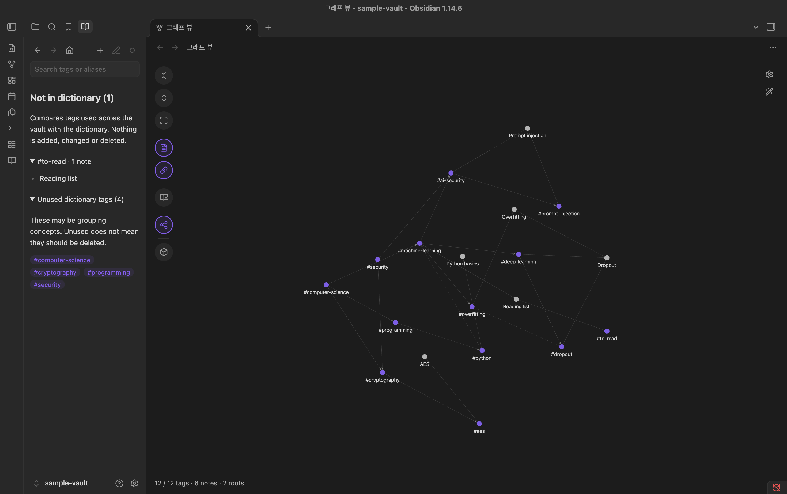
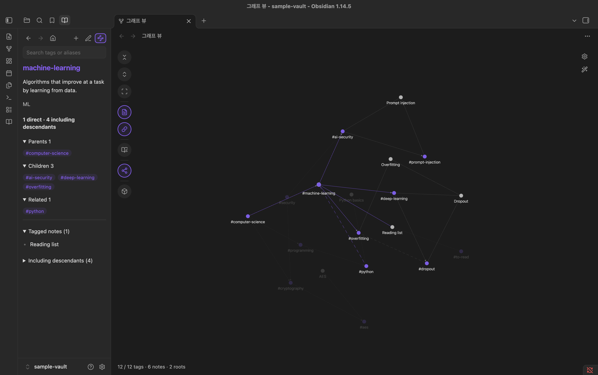

# Tag Ontology

[](https://github.com/NamhyeonKo/obsidian-tag-ontology/stargazers)
[](https://community.obsidian.md/plugins/tag-ontology)
[](https://github.com/NamhyeonKo/obsidian-tag-ontology/releases/latest)
[](https://www.npmjs.com/package/tag-ontology)
[](https://github.com/NamhyeonKo/obsidian-tag-ontology/actions/workflows/release.yml)
[](../../LICENSE)

[English](../../README.md) | [한국어](README.ko.md) | [简体中文](README.zh-CN.md) | **繁體中文** | [日本語](README.ja.md) | [Español](README.es.md) | [Français](README.fr.md) | [Deutsch](README.de.md) | [Português (Brasil)](README.pt-BR.md) | [Русский](README.ru.md) | [Italiano](README.it.md)

**像連結筆記一樣連結標籤。**

Tag Ontology 讓你可以從側邊欄分頁為每個標籤設定父層、子層與相關標籤，完全不需手動編輯任何檔案。接著就能在 Obsidian 原生的**關聯圖檢視**中探索它們：按分支展開與摺疊、切換為樹狀配置，並讓選取的標籤保持聚焦。筆記、筆記間的連結、過濾設定、群組著色與外觀設定皆維持原有運作方式。

此外掛絕不會修改你的筆記內容。只有當你在側邊欄分頁中新增、編輯或刪除標籤時，才會寫入保管庫中的純 JSON 標籤字典檔。

## 為什麼開發 Tag Ontology？

一個概念往往同時與多個領域相連。舉例來說，RAG 與 LLM、資訊檢索及知識圖譜都有關聯。若使用資料夾或巢狀標籤來整理，我必須決定把它歸入哪一條路徑下，而單靠這條路徑很難看清它與其他概念之間的關聯。

我希望在保留文件位置與原文內容的同時，另行管理並探索概念之間的關係。因此我建立了 Tag Ontology，讓標籤可以擁有多個父層與相關標籤，並能在 Obsidian 的關聯圖中巡覽這些關係。之後我進一步擴充了它，讓 CLI 與 TOW 也能套用同一套關係與規則。

> **開始使用：** 階層架構是由標籤節點建構而成，因此需要在關聯圖設定中開啟 **過濾設定 → 標籤**。全新安裝時會自動為你開啟。


> [!TIP]
> **搭配 AI Agent 使用**：與 [TOW](https://github.com/NamhyeonKo/tag-ontology-wiki) 搭配使用，可透過 AI Agent 管理標籤與字典，並一併處理更廣泛的保管庫任務。（[了解更多](#相關專案)）

## 功能特色

- **在側邊欄建構階層。** 新增筆記已在使用的標籤或自訂新名稱，編輯標籤的名稱、描述、別名、Facet、父層、子層與相關標籤，或刪除標籤。無需手動編輯檔案，且儲存時絕不會覆蓋外部所做的變更。
- **核心關聯圖的原生擴充。** 筆記、筆記連結、過濾設定、群組、方向箭頭與其他核心設定均照常運作。
- **可摺疊的標籤階層。** 字典中的標籤初始會摺疊至根節點，每篇筆記會連結至最接近的可見祖先標籤。按一下選取標籤，連按兩下即可展開一層，此時可看到筆記移轉至更具體的子層標籤。再次連按兩下即可摺疊。
- **包含子層的筆記計數。** 每個標籤都會同時顯示*直接*標記該標籤的筆記數，以及包含該標籤*或其任何後代標籤*的筆記總數。
- **多重父層與相關標籤。** 實線箭頭由父層指向子層，虛線則用來連接相關標籤。
- **四種版面配置。** 力導向、**心智圖**、垂直樹狀與水平樹狀。一般樹狀配置會保留依目前可見階層排列的方式，並將多個根標籤樹折行排布。心智圖則會從選定的根標籤（第 0 層）出發，並依目前展開的最長父層路徑來計算間距。標籤色彩仍維持採用完整字典的階層深度。
- **心智圖。** 心智圖會先詢問起始點：搜尋階層標籤或從推薦的根標籤挑選一個，接著僅探索該標籤的分支。點擊底部的**變更起始標籤**（首頁按鈕）即可回到選擇器。切回其他配置時會還原原本的展開狀態；再次進入心智圖則會重新顯示選擇器。點選標籤文字可在側邊欄檢視詳細資訊，點選箭頭按鈕可展開或摺疊其子層。拖曳背景可平移、滾輪可縮放，使用**符合視窗**可讓整張圖完整呈現。與核心關聯圖共用過濾設定與已儲存的展開狀態。只要仍有另一個已展開的父層連向共享標籤，該共享標籤就會保持可見。此配置下會隱藏筆記。
- **3D 檢視 (beta)。** 以三維空間呈現相同的階層架構：可自由旋轉環繞，點選標籤即可平滑飛躍定位。在關聯圖工具列中切換模式。力導向、心智圖、兩種樹狀配置、3D 與本體瀏覽器共用同一個分頁；在模式按鈕上按右鍵可於新分頁開啟以並排比較。從右上角的三區塊齒輪面板可調整**過濾設定**（搜尋、附件、只顯示已存在檔案、孤立連結）、**外觀設定**（筆記連線方向箭頭、文字透明度、節點尺寸、連接線寬度、透視縮放標籤與標籤大小）與**強度設定**（拖曳張力與各項力度滑桿），支援各區塊**恢復預設值**以及整份面板**還原為預設設定**。切換至 3D 或本體瀏覽器時會保留原本的畫布；隱藏時 3D 繪圖會暫停，關閉關聯圖分頁則會釋放其資源。
- **本體瀏覽器 (beta)。** 從空白畫布上的一個標籤起步，按右鍵即可將它的子層、父層、相關標籤與筆記以物件卡片的形式拉出呈現，採用類似 Palantir 本體圖的視覺風格。
- **側邊欄分頁。** 在**檔案瀏覽器**與**搜尋**旁的分頁中依標籤名稱或別名搜尋、閱讀標籤詳細資訊並執行字典檢查。在這裡點選標籤時，已開啟的關聯圖會自動縮放並置中對準該標籤。
- **字典檢查。** 列出保管庫中使用但未收錄於字典的標籤（並附帶相似的字典名稱）；字典中有定義但尚無筆記使用的標籤；將標籤寫作別名或大小寫不同的筆記；以及同時標記了上位標籤與下位標籤的筆記。檢查功能僅供檢視回報，絕不會更動任何檔案。
- **單一色彩（選用）。** 為關聯圖與側邊欄中的所有標籤指定統一色彩，未另行挑選前預設跟隨主題強調色。
- **依階層深度著色（選用）。** 選擇**色彩 → 色彩模式 → 依階層深度**，依完整字典中由根標籤至該標籤的最長路徑著色。套用過濾或摺疊分支時色彩依然穩定不變，更深的層級則沿用調色盤的最後一個顏色。**預設**與**粉彩**範例皆採用 [Tailwind CSS 3.4 色表](https://v3.tailwindcss.com/docs/customizing-colors)中相同的紅→橙→黃→綠→青→藍→紫→粉順序，分別使用 500 與 200 色階。變更層級數時會在整個色域內重新取樣；另提供**彩虹**、**暖色調**與單色漸層等範例。支援橫向編輯編號階層色彩及增減層級。精簡的關聯圖圖例也提供調色盤切換、色彩編輯與**另存新檔…**。無論在圖例或設定中修改色彩，都會自動保留為共用的**工作副本**，重啟後仍持續保存。**另存新檔…**會在**我的調色盤**下新增一份獨立命名的快照；切換範例或已儲存調色盤後，工作副本仍會留存。已儲存的名稱不可重複，絕不會覆蓋其他調色盤。**我的調色盤 → 管理…**會列出已儲存的調色盤並提供確認後刪除；若刪除目前使用中的調色盤，系統會切換回**預設**並保留工作副本。早期的自訂調色盤會保留為 **My colors**，切換範例時亦會保留現有使用中的色彩。色彩設定套用於 2D、3D、本體瀏覽器卡片及側邊欄。靈感來自 [Colored Tags](https://github.com/pfrankov/obsidian-colored-tags)。
- **聚焦（選用）。** 讓選取的標籤及其相鄰標籤（父層、子層與相關標籤）維持明亮，淡化其餘節點。亦可開啟選項，將其所有下層標籤與關聯筆記一併納入高亮。
- **記住檢視狀態。** 已展開的標籤以及**筆記**與**相關標籤**切換開關皆會自動儲存，並由所有關聯圖分頁共用。
- **多語系介面（11 種語言）。** 預設自動跟隨 Obsidian 語言，也可在**一般 → 語言**中手動切換為 English、한국어、日本語、简体中文、繁體中文、Español、Français、Deutsch、Português (Brasil)、Русский 或 Italiano。外掛設定、側邊欄字典、3D 強度與外觀面板、深度圖例及關聯圖檢視皆會即時更新。

| 側邊欄分頁 | 字典檢查 |
| --- | --- |
|  |  |
| **摺疊至根標籤** | **全部展開** |
|  |  |
| **垂直樹狀** | **水平樹狀** |
|  |  |
| **原始佈景主題** | **聚焦選取的標籤** |
|  |  |
| **編輯標籤** | **新增標籤** |
|  |  |
| **搜尋建議** | **刪除標籤** |
|  |  |

## 運作方式

Tag Ontology 在核心的關聯圖檢視中運作。它會取得 Obsidian 已套用過濾設定與群組色彩所建構的關聯圖，將字典中的標籤摺疊，並在標籤之間加入階層與相關連線。未收錄於字典的標籤仍維持一般標籤節點。局部圖譜不會受到影響，停用此外掛即可讓關聯圖恢復原狀。

3D 檢視 (beta) 為獨立分頁模式。它從保管庫建構同樣的筆記與標籤，以同一套邏輯套用字典階層，並透過 three.js 進行繪製。

本體瀏覽器 (beta) 同樣為獨立分頁模式。它不會一次呈現整個字典，而是由你逐一將標籤放到畫布上，並透過 Cytoscape.js 繪製。

你在側邊欄分頁建構的階層會儲存在字典檔案中。若想直接閱讀或編輯該檔案，請參閱[進階：字典檔案](#進階字典檔案)。

標籤的使用統計來自 Obsidian 的中繼資料快取，涵蓋所有 Markdown 筆記的 frontmatter `tags` 以及內文中的 `#標籤`。

## 安裝與更新

> 完整說明、開發版本建置與疑難排解，請參閱[完整安裝與更新指南（英文）](../installation.md)。

### 從社群外掛程式安裝

- **安裝**：開啟**設定 → 第三方外掛程式 → 瀏覽**（社群外掛程式），搜尋 "Tag Ontology"，點擊安裝並啟用。你也可以從其[社群目錄頁面](https://community.obsidian.md/plugins/tag-ontology)安裝。
- **更新**：前往**設定 → 第三方外掛程式**，點擊**檢查更新**，再點擊**全部更新**或 Tag Ontology 旁的**更新**。

### 透過 BRAT（測試版）

- **安裝**：
  1. 安裝並啟用 [BRAT](https://github.com/TfTHacker/obsidian42-brat)。
  2. 選擇 **BRAT: Add a beta plugin for testing**，並輸入 `NamhyeonKo/obsidian-tag-ontology`。
- **更新**：執行指令 `BRAT: Check for updates to all beta plugins`（或 `BRAT: Check for plugin updates`）。

### 手動安裝

- **安裝**：
  1. 從[最新版本頁面](https://github.com/NamhyeonKo/obsidian-tag-ontology/releases)下載 `main.js`、`manifest.json` 與 `styles.css`。
  2. 將它們複製到保管庫內的 `.obsidian/plugins/tag-ontology/` 資料夾中。
  3. 重新載入 Obsidian，接著在**設定 → 第三方外掛程式**中啟用 **Tag Ontology**。
- **更新**：
  1. 下載最新的 `main.js`、`manifest.json` 與 `styles.css`。
  2. 覆蓋 `.obsidian/plugins/tag-ontology/` 中的原有檔案。
  3. 執行指令 `放棄儲存並重新載入程式`（`Reload app without saving`）或重新啟動 Obsidian。

### 獨立 CLI 工具

獨立 CLI 工具已發布於 npm，套件名稱為 [`tag-ontology`](https://www.npmjs.com/package/tag-ontology)：

```sh
# 無需安裝，直接執行最新版本：
npx tag-ontology@latest check --root /path/to/vault --json

# 或進行全域安裝 / 更新：
npm install -g tag-ontology@latest
npm update -g tag-ontology
```

> **必要條件**：必須啟用核心**關聯圖檢視**外掛，並在關聯圖設定中開啟**過濾設定 → 標籤**。

## 使用範例保管庫快速開始

本存放庫在 [`examples/sample-vault`](../../examples/sample-vault) 內附帶了一個小型範例保管庫：包含 12 個標籤的字典與 6 篇筆記。

1. 在 Obsidian 中選擇**開啟資料夾為儲存庫**，然後選取 `examples/sample-vault`。
2. 透過上述任一方式在該保管庫安裝此外掛。
3. 點擊左側功能區的**開啟 Tag Ontology** 圖示（書本圖示），或從指令面板執行 **Tag Ontology: 開啟關聯圖**。
4. 若關聯圖沒有顯示標籤，請在關聯圖設定（齒輪圖示）中開啟**過濾設定 → 標籤**。

此時你應該會看到兩個根標籤 `computer-science` 與 `security`，6 篇筆記分別連結在它們之上，外加一個尚未收錄於字典的標籤 `#to-read`。連按兩下 `computer-science`，再連按兩下 `machine-learning`：`Dropout` 筆記會移動至 `deep-learning` 之下。`cryptography` 與 `ai-security` 各自擁有兩個父層標籤。

接著可以試試側邊欄分頁：按下 **+** 在 `machine-learning` 下新增一個屬於你自己的標籤。

## 使用方式

### 側邊欄分頁

點擊**開啟 Tag Ontology**（書本圖示或**開啟關聯圖**指令）會開啟關聯圖，並在左側邊欄的**檔案瀏覽器**與**搜尋**旁將**標籤字典**分頁帶到前景。在關聯圖中點擊標籤，或使用**字典檢查**時，也會將該分頁切至前景。你可以將此分頁拖曳至右側邊欄。

- **頂部工具列**：左側設有上一頁、下一頁與首頁（顯示根標籤與所有標籤）；右側則有**新增標籤**、**編輯標籤**以及在關聯圖中展開或摺疊該標籤的按鈕。若畫面上尚未開啟關聯圖，點擊該按鈕會自動開啟並定位到該標籤；若標籤沒有子層，該按鈕會呈現停用狀態並提示**無子層標籤**。
- **搜尋標籤或別名**：輸入標籤名稱或別名的部分文字，點擊或按下 Enter 選取建議項目。透過別名符合的結果會在標籤下方顯示其別名，因此輸入 `convolution` 或 `합성곱` 也能找到 `cnn`。關聯圖會展開至所選標籤，並將其縮放置中。
- 尚未選取任何標籤時，分頁會先列出根標籤，接著依首字母順序排列顯示所有標籤。捲動清單時，頂部工具列與搜尋欄會固定在上方。
- 選取標籤後，會顯示其描述、別名、筆記計數（直接計數與含子層計數）、以 `#tag` 連結顯示的父層、子層與相關標籤，以及關聯筆記。點擊任一 `#tag` 即可跳轉過去。

### 編輯字典

- **新增標籤**（工具列上的 `+`）：從依筆記使用數量排序的清單中挑選「筆記已有使用但字典缺少的標籤」，或直接輸入新名稱。指定父層可將其置於其他標籤之下；未設定父層時會成為根標籤。你也可從字典現有標籤中為它加入子層與相關標籤。
- **編輯標籤**（鉛筆圖示）：變更名稱、描述、別名、Facet、父層、子層與相關標籤。點擊欄位最後一個項目後的 **+** 即可繼續新增。父層、子層與相關標籤都必須是字典中已存在的標籤，而相關標籤會同時儲存於雙方項目中。重新命名標籤不會更改筆記中的文字：這些筆記會保留原本的標籤，並顯示為尚未收錄於字典。僅變更大小寫（例如將 `ml` 改為 `ML`）則仍會維持關聯，因為標籤比對不區分大小寫。
- **kebab-case 標籤名稱限制**（設定選項，預設關閉）：開啟後，編輯表單新增或重新命名標籤時只接受以連字號連接小寫字母與數字的名稱（例如 `machine-learning`），即 TOW 所檢查的格式。現有名稱會維持不變。
- **刪除**（位於編輯表單中）：刪除前會先確認並列出後續影響——該標籤的子層將移至其父層下方（若無父層則成為根標籤），它會從其他標籤的相關清單中移除，而筆記仍保留原標籤。
- 所有異動都暫存在表單中直到你按下**儲存**；若有尚未儲存的變更就離開表單，系統會先詢問確認。若在你編輯期間，你所變更的標籤同時在外部遭到修改，儲存將會中止並通知衝突，而你的編輯內容仍會保留在表單中。
- 字典以每個標籤一行的格式儲存，因此每次儲存僅會改動涉及的那幾行。以其他版面寫入的字典檔案會在第一次儲存時重新排版，並保留原有的換行格式（LF 或 CRLF）。

### 關聯圖工具列

**全部摺疊**、**全部展開**與**符合視窗**並排位於關聯圖底部中央；其餘圓形按鈕沿左側排列，深度圖例則位於左下角。將滑鼠游標移至任一按鈕上方即會顯示名稱：

| 按鈕 | 功能說明 |
| --- | --- |
| 全部摺疊 | 將所有字典標籤摺疊至其根標籤 |
| 全部展開 | 展開所有字典標籤 |
| 符合視窗 | 將關聯圖縮放並配置到工具列、圖例與設定按鈕未遮擋的可見區域內 |
| 筆記 | 顯示或隱藏所有非標籤節點（筆記、附件、未解析連結） |
| 相關標籤 | 顯示或隱藏虛線繪製的相關標籤連線 |
| 字典檢查 | 在側邊欄分頁中列出尚未收錄於字典及未使用的標籤 |
| 力導向 / 心智圖 / 垂直樹狀 / 水平樹狀 / 3D / 本體瀏覽器 | 依此順序在目前分頁中切換模式，目前使用中的模式會高亮顯示。在任一模式按鈕上按右鍵可選擇**在新分頁開啟**，以便並排比較兩種模式。當對應的**啟用**設定關閉時，3D 與本體瀏覽器按鈕會隱藏 |

- 在樹狀配置與心智圖中，每個標籤都會掛在其父層下方，並且隱藏筆記，讓標籤關係更清楚易讀。
- 在關聯圖中點選標籤會將其置中並於側邊欄分頁顯示。連按兩下可展開標籤，再連按兩下即可摺疊，行為與側邊欄頂部的按鈕相同。其下方先前已展開的子標籤會在下次展開時保留展開狀態。
- 其餘操作維持核心關聯圖的原本行為：點選筆記會開啟該筆記，點選未收錄於字典的標籤則會開啟搜尋。

### 3D 檢視 (beta)

點擊關聯圖工具列上的 **3D** 模式按鈕，或執行**開啟 3D 關聯圖**指令，即可將關聯圖分頁切換為 3D 檢視；點擊其他模式按鈕即可切回。顯示其他模式時，3D 繪製會暫停。它與 2D 關聯圖共用已展開的標籤、**筆記**與**相關標籤**開關、色彩設定、**聚焦**以及側邊欄分頁，因此在其中一邊展開的標籤在另一邊也會同步展開。


- 拖曳空白處可旋轉環繞視角，按住右鍵拖曳可平移，滾動滾輪可縮放。
- 拖曳節點可單獨移動它。放開後會像樹狀配置一樣彈回原本的位置。版面會在檢視開啟及展開分支後穩定下來並保持靜止。
- 點選標籤可選取並平滑飛躍至該標籤，連按兩下可展開或摺疊。點選筆記可開啟該筆記。在側邊欄選取標籤時同樣會飛躍定位過去。在此檢視中點選未收錄於字典的標籤不會有動作；在 2D 中則會開啟搜尋。
- 工具列提供**全部摺疊**、**全部展開**、**符合視窗**、**筆記**、**相關標籤**、**字典檢查**與各模式按鈕。**符合視窗**會將絕大多數可見節點納入視野以填滿畫面；少數距離較遠的節點可能會落在畫面之外。
- 點擊右上角的齒輪按鈕可開啟 3D 設定面板（**過濾設定**、**外觀設定**、**強度設定**），設計對應 Obsidian 的 2D 關聯圖面板。其標題列附有整份面板的**還原為預設設定**按鈕，每個區塊亦設有各自的**恢復預設值**按鈕，且變更會在所有開啟中的 3D 分頁間同步。
  - **過濾設定**：支援 `path:`、`file:`、`tag:`、`-` 排除及引號片語的搜尋欄；**附件**（預設關閉）；**只顯示已存在檔案**（預設開啟）；以及**孤立連結**（預設開啟）。
  - **外觀設定**：筆記連線上的**方向箭頭**（預設關閉；階層連線一律顯示箭頭）、**文字透明度**、**節點尺寸**、**連接線寬度**、**透視縮放標籤**（預設開啟）與**標籤大小**（`0.5` 至 `2`，預設為 `0.8`）。
  - **強度設定**：**拖曳張力**（預設開啟——拖曳節點時連帶拉動相連節點；關閉後僅移動抓取的節點）、**節點集中強度**、**節點間的互斥強度**、**節點間的連結強度**與**連接線距離**，各項範圍與預設值均比照 2D 關聯圖。調整任一強度滑桿都會重新啟動模擬計算。
- 3D 檢視直接從保管庫建構筆記、標籤、附件與未解析連結，並將其齒輪設定獨立儲存在 2D 核心關聯圖之外。
- 若 3D 檢視運作較慢或你不使用它，可在設定中關閉**啟用 3D 檢視 (beta)**。其模式按鈕與指令會隨之消失，2D 關聯圖不受影響。

### 本體瀏覽器 (beta)

點擊關聯圖工具列上的**本體瀏覽器**模式按鈕，或執行**開啟本體瀏覽器**指令，即可將關聯圖分頁切換至瀏覽器模式。切換為其他模式時，畫布內容會獲得保留。它與關聯圖共用側邊欄分頁，但不共用已展開的標籤、**筆記**與**相關標籤**開關或**聚焦**狀態。

- 面對空白畫布時會詢問起始點：搜尋標籤、挑選根標籤，或從側邊欄選取的標籤繼續。在側邊欄搜尋或點擊標籤連結同樣會將該標籤加入畫布。
- 每個標籤都是獨立的物件卡片，呈現其 Facet（未指定時顯示為`概念`）、直接筆記數、含子層筆記數與子層數量。不同 Facet 會有各自專屬的色彩；沒有設定 Facet 的標籤則沿用標籤色彩。
- 在標籤上按右鍵可使用**展開子層**、**展開父層**、**展開相關**與**顯示筆記**，每個項目都會標示尚未出現在畫布上的數量。新卡片會整齊排列在兩旁欄位——子層與筆記在右側，父層在左側——畫布上既有的卡片不會移動。連按兩下標籤可直接展開其子層。
- 連線依照字典規則呈現，與 2D 關聯圖一致：無論畫布上的兩個標籤是從哪張卡片引出的，只要它們存在字典關係，就會自動連上父層指向子層的實線箭頭或相關標籤之間的虛線。
- 關聯超過 15 篇筆記的標籤會改以一張群組卡片表示。點選群組卡片可在側邊欄分頁依最新時間優先列出所有筆記，方便篩選並取出勾選項目或最新 10 篇；連按兩下群組卡片會直接取出最新 10 篇。群組內始終包含該標籤下尚未成為畫布獨立卡片的所有筆記：之後新增該標籤的筆記會自動歸入群組，而你從畫布移除的筆記卡片也會退回群組中。
- 點選卡片會在側邊欄分頁顯示詳細資訊；連按兩下筆記卡片會開啟該筆記。拖曳卡片可隨意擺放，它們會停留在你放置的位置。在卡片上按右鍵可**從畫布移除**；先前由它展開的其他卡片仍會留在畫布上。
- 工具列包含**符合視窗**、**清除畫布**與各模式按鈕。畫布內容不會儲存：關閉分頁後即會清空。
- 編輯字典或筆記會即時更新畫布卡片：重新命名的標籤與筆記會保留在原位，已刪除者則會離開畫布。
- 若不使用此功能，可在設定中關閉**啟用本體瀏覽器 (beta)**。其模式按鈕與指令會隨之移除。

### 指令

| 指令 | 說明 |
| --- | --- |
| Tag Ontology: 開啟關聯圖 | 在核心關聯圖檢視中開啟標籤本體。若已有開啟的分頁則重複使用。 |
| Tag Ontology: 開啟 3D 關聯圖 | 將已開啟的關聯圖分頁切換為 3D，或另開新分頁。僅在開啟**啟用 3D 檢視 (beta)** 時提供。 |
| Tag Ontology: 開啟本體瀏覽器 | 將已開啟的關聯圖分頁切換為本體瀏覽器，或另開新分頁。僅在開啟**啟用本體瀏覽器 (beta)** 時提供。 |
| Tag Ontology: 重新載入字典 | 重新載入標籤字典與筆記索引。 |

### 設定

在 Obsidian 1.13+ 與較早版本中，設定頁採用相同的區塊與項目順序：**一般**、**字典**、**色彩**、**側邊欄**、**聚焦**與**額外檢視**。**單一色彩**與**依階層深度**模式會顯示色彩選項；調色盤控制項顯示於**依階層深度**模式；聚焦子選項則在啟用聚焦後出現。

| 設定項目 | 說明 |
| --- | --- |
| **一般** | |
| 語言 | 自動跟隨 Obsidian 語言（`自動（跟隨 Obsidian）`，預設），或從 11 種支援語言中手動選擇，套用於外掛設定、側邊欄字典、3D 設定面板與關聯圖檢視。指令名稱與已開啟的分頁標題會在重新啟動 Obsidian 後更新。 |
| **字典** | |
| 字典路徑 | 相對於保管庫的 `.json` 檔案路徑。留空則依序自動尋找：`tow/tag-dictionary.json`、`.tow/tag-dictionary.json`、`Tag-Dictionary.json`；若皆不存在，則使用 `tow/tag-dictionary.json`。輸入指定路徑後將永遠採用該路徑。按下 Enter 或離開輸入框時儲存。 |
| kebab-case 標籤名稱限制 | 預設關閉。開啟後，編輯表單新增或重新命名標籤時只接受以連字號連接小寫字母與數字的格式（即 TOW 檢查的名稱）。現有名稱會保留。 |
| **色彩** | |
| 色彩模式 | `Obsidian 預設`、`單一色彩`或`依階層深度`。切換模式時會保留現有的色彩設定。 |
| &nbsp;&nbsp;調色盤 | **範例**、目前的**工作副本**與**我的調色盤**。選擇範例會維持目前的階層數；選擇已命名的調色盤則會還原其儲存的色彩與階層數。 |
| &nbsp;&nbsp;階層色彩 | 橫向編輯編號階層色彩；可新增或移除階層（至少保留一層）。超過最後一個色階的更深層級皆沿用最後一個顏色。 |
| &nbsp;&nbsp;我的調色盤 | **另存新檔…**會開啟名稱欄位；**管理…**會列出調色盤供確認刪除。刪除使用中的調色盤會切換為**預設**並保留工作副本。重複名稱將不予受理。 |
| &nbsp;&nbsp;標籤色彩 / 階層外標籤的色彩 | 在**單一色彩**模式中作為基本標籤色彩，或在**依階層深度**模式中作為階層外標籤的備用色彩。未挑選前跟隨主題強調色；重設即恢復為強調色。 |
| &nbsp;&nbsp;側邊欄標題套用標籤色 | 讓側邊欄中選取標籤的標題使用其標籤色彩。 |
| **側邊欄** | |
| 標籤清單樣式 | 在側邊欄中（根標籤、所有標籤、父層、子層與相關標籤）以自動換行的**標籤膠囊**或每行一個的**清單**方式顯示標籤。預設為**標籤膠囊**。 |
| **聚焦** | |
| 聚焦選取的標籤 | 保持選取的標籤與相鄰標籤（父層、子層與相關標籤）明亮，並淡化其餘節點。選取的標籤與其連線會呈現游標懸停的高亮效果。預設關閉，開啟後顯示以下選項。 |
| &nbsp;&nbsp;包含後代標籤 | 同時讓其下目前已展開的所有後代標籤維持明亮。預設開啟。 |
| &nbsp;&nbsp;包含筆記 | 同時讓選取標籤（以及開啟上述選項時其後代標籤）上的筆記維持明亮。相鄰標籤上的筆記仍會淡化。預設開啟。 |
| **額外檢視** | |
| 啟用垂直樹狀配置 | 在關聯圖工具列顯示垂直樹狀模式按鈕。關閉後，處於該模式的分頁會切回力導向配置。預設開啟。 |
| 啟用水平樹狀配置 | 同樣適用於水平樹狀模式按鈕。預設開啟。 |
| 啟用 3D 檢視 (beta) | 在關聯圖工具列顯示 3D 模式按鈕並提供「開啟 3D 關聯圖」指令。關閉後會釋放 3D 檢視；正在顯示 3D 的分頁會回到 2D。預設開啟。 |
| 啟用本體瀏覽器 (beta) | 在關聯圖工具列顯示本體瀏覽器模式按鈕並提供「開啟本體瀏覽器」指令。關閉後會清除瀏覽器畫布；正在顯示瀏覽器的分頁會回到 2D。預設開啟。 |

縮放倍率較低時，核心關聯圖會隱藏文字標籤與箭頭。請放大檢視。

## 進階：字典檔案

側邊欄分頁會自動讀寫此檔案，因此你通常不需手動開啟它。這是保管庫中的純 JSON 檔案，因此你也可以手動編輯。

字典可以放置在保管庫內任何以 `.json` 結尾的相對路徑，包括 `tow/` 或 `.tow/` 資料夾中。當**字典路徑**欄位留空時，外掛會依序檢查 `tow/tag-dictionary.json`、`.tow/tag-dictionary.json` 與 `Tag-Dictionary.json`。全新安裝會建立 `tow/tag-dictionary.json`；既有的 `Tag-Dictionary.json` 檔案仍可繼續運作，同時也會繼續讀取 TOW 0.5.0–0.5.1 的 `.tow/tag-dictionary.json`。若自行設定路徑，系統永遠使用該路徑。若字典檔案事後遺失，側邊欄分頁會提供建立空白字典的選項。

**Obsidian Sync 不會同步 `.obsidian` 以外以點開頭的隱藏資料夾**（請見 [Sync 設定](https://obsidian.md/help/sync/settings)）。若你使用 Obsidian Sync，請為字典選擇一個可見路徑。Git 與檔案層級同步工具除非設定忽略，否則皆會同步點開頭的資料夾。

此檔案為單一 JSON 物件。每個鍵是不含 `#` 的標籤名稱，並如同核心關聯圖般不區分大小寫進行比對（例如 `#ML` 對應鍵 `ml`）。建議使用全小寫鍵名。像 `#lang/python` 這類巢狀標籤則使用鍵 `lang/python`。

```json
{
  "machine-learning": {
    "aliases": ["ML"],
    "description": "Algorithms that improve at a task by learning from data.",
    "broader": ["computer-science"]
  },
  "dropout": {
    "description": "Randomly disabling units during training to reduce overfitting.",
    "broader": ["deep-learning"],
    "related": ["overfitting"],
    "facet": "technique"
  },
  "computer-science": {
    "description": "The study of computation, information and automation.",
    "broader": []
  }
}
```

| 欄位 | 必填 | 型別 | 意義 |
| --- | --- | --- | --- |
| `description` | 是 | string | 顯示於側邊欄標籤面板的說明文字。 |
| `aliases` | 否 | string[] | 其他名稱。用於搜尋比對，以及在字典檢查中為未收錄標籤推薦相似項目。 |
| `broader` | 否 | string[] | 父層標籤。**`[]` 代表根標籤。** |
| `related` | 否 | string[] | 非階層關聯標籤，以虛線繪製。 |
| `facet` | 否 | string | 自由填寫的分類面向，例如 `language`。可在編輯表單或 CLI 變更草稿中設定；當某個 Facet 標籤與其下位標籤同時出現在筆記中時，不會被回報為冗餘標籤。 |

規則：

- **根標籤必須設定 `"broader": []`。** 完全沒有 `broader` 鍵的標籤會被視為尚未安置，不會出現在關聯圖中。
- 列於 `broader` 或 `related` 中的每個標籤都必須存在於字典內。
- 標籤不可參照自身，且 `broader` 連結不能構成循環。
- 若字典內容無效，Obsidian 啟動或開啟檢視時會跳出通知說明原因，且側邊欄會持續顯示該錯誤直到檔案修正為止。在此期間關聯圖會保留最後一次成功載入的版本，而**新增標籤**與**編輯標籤**將暫時停用。

完整範例請見 [`examples/sample-vault/tow/tag-dictionary.json`](../../examples/sample-vault/tow/tag-dictionary.json)。

## 隱私與安全

- 無任何網路連線請求、遙測追蹤或帳號機制。
- 僅讀取你的筆記中繼資料與標籤字典檔案。
- 僅寫入自身設定檔（位於設定資料夾中的 `plugins/tag-ontology/data.json`，通常為 `.obsidian/`），以及在側邊欄儲存變更時寫入目前使用的字典檔案：你指定的路徑（包含早期版本中儲存的自訂路徑），或依自動尋找順序決定的 `tow/tag-dictionary.json`、`.tow/tag-dictionary.json` 或 `Tag-Dictionary.json`。

## 相容性與已知限制

- **僅限桌面版。** 已於 Obsidian 1.14.5（macOS）測試通過。
- 此外掛會掛接核心關聯圖檢視的**未公開內部介面**（renderer、PIXI、layout worker）。未來的 Obsidian 更新有可能導致不相容。若偵測到內部介面異動，外掛會自動脫離並讓核心關聯圖維持原本運作。
- 在大型保管庫中，於顯示筆記的狀態下展開所有標籤會重繪數千個節點與連線，可能會有短暫延遲。
- 當所有標籤都展開時文字標籤會顯得密集，在力導向配置下尤為明顯。
- 尚未測試與其他同樣會修補關聯圖檢視之外掛併用時的相容性。
- 3D 檢視使用 WebGL 並內嵌 three.js，本體瀏覽器內嵌了 Cytoscape.js，因此外掛檔案約為 1.6 MB。兩者皆僅於各自的分頁開啟時才載入。當顯示數千篇筆記時，3D 檢視的速度會變慢；隱藏筆記可維持流暢度。

## 開發藍圖

- 在局部圖譜中也顯示標籤階層。

歡迎至 [Issues](https://github.com/NamhyeonKo/obsidian-tag-ontology/issues) 回報錯誤或提出功能建議。回報錯誤時請附上你的 Obsidian 版本與作業系統資訊。

## 函式庫與 CLI

獨立套件 [`tag-ontology`](../../packages/tag-ontology/README.md) 以 MIT 授權提供相同的字典規則，包含 ESM 函式庫與 Node CLI 工具。它可檢查與掃描保管庫、回報標籤使用情形、顯示標籤階層，並在內容雜湊檢查下預覽或套用字典變更，過程中完全不需安裝 Obsidian。

該套件已發布於 npm，名稱為 [`tag-ontology`](https://www.npmjs.com/package/tag-ontology)：

```sh
npx tag-ontology check --root /path/to/vault --json
```

函式庫用法範例請參閱[套件指南](../../packages/tag-ontology/README.md)，完整指令、JSON 欄位、結束代碼與剖析器限制請參閱 [CLI 契約文件](../cli.md)。外掛本體與 npm 套件擁有各自獨立的版本號與發布標籤。

## 相關專案

### [TOW (Tag Ontology Wiki)](https://github.com/NamhyeonKo/tag-ontology-wiki)

與 [TOW](https://github.com/NamhyeonKo/tag-ontology-wiki) 搭配使用時，你可以運用 AI Agent 管理標籤與字典，並處理筆記搜尋、frontmatter 管理及文件排版等更廣泛的保管庫作業。

- **基於 CLI 的字典管理**：使用 `tag-ontology` CLI 檢視標籤、驗證字典完整性並套用安全的更新。
- **AI Agent 工作流程**：自動化處理找出未收錄標籤、同步本體條目、驗證 frontmatter 結構與清理筆記架構等重複性保管庫維護工作。
- **視覺化關聯圖整合**：透過此外掛直接在 Obsidian 的關聯圖檢視中探索與巡覽由 Agent 維護的標籤階層。

## 開發

需要 Node.js **22.18 或更新版本**。測試直接透過 Node 內建的 TypeScript 型別剝離功能執行。

```sh
npm ci
npm run lint        # Obsidian 審查規則 + 套件檢查 lint
npm test            # 單元測試，無需保管庫
npm run build       # 型別檢查 + 套件 dist + 外掛 main.js 建置
npm run check:package  # 檢查並試裝實際打包的 npm tarball
npm run deploy -- "/path/to/vault"   # 將 main.js、manifest.json、styles.css 複製到保管庫
```

`deploy` 指令要求目標保管庫內必須已存在 `.obsidian/` 資料夾，且會保留原有的 `data.json`。部署完成後請在 Obsidian 中重新載入外掛。

`npm run test:vault` 是維護者針對私人保管庫（`OBSIDIAN_VAULT_PATH`）執行的整合測試，其他貢獻者無需執行。

### 專案結構

```text
src/
├── main.ts            # 外掛進入點：指令、設定分頁、保管庫與中繼資料事件
├── search.ts          # 搜尋欄與編輯表單使用的標籤建議彈出選單
├── native.ts          # 掛接核心關聯圖渲染器（工具列、側邊欄分頁、點擊與配置）
├── graph-modes.ts     # 共用的關聯圖模式切換列與「在新分頁開啟」選單
├── legend.ts          # 階層深度圖例、調色盤切換器與色塊控制項
├── palettes.ts        # 調色盤預設集、工作副本與已儲存調色盤庫狀態
├── colors.ts          # 色彩重新取樣與依最長路徑計算的階層深度色彩對應
├── hierarchy.ts       # 字典模型配接器與含子層的筆記計數彙總
├── layer.ts           # 將字典套疊至核心關聯圖資料上的純函式
├── layout.ts          # 垂直樹狀與水平樹狀節點座標配置
├── mindmap.ts         # 基於 Cytoscape、附帶無障礙 DOM 卡片的心智圖檢視
├── mindmap-layout.ts  # 依目前可見分支計算的心智圖間距與錨點定位
├── graph3d.ts         # 3D 檢視：使用 3d-force-graph 繪製同一份分層資料
├── controls3d.ts      # 可摺疊的三區塊 3D 設定面板（過濾設定、外觀設定、強度設定）
├── filter3d.ts        # 3D 檢視的搜尋查詢剖析/求值器與孤立節點修剪
├── geometry3d.ts      # 3D 箭頭定位、標籤縮放與攝影機景深輔助計算
├── three.ts           # three.js 與 3d-force-graph，僅於開啟 3D 檢視時才載入
├── vault-data.ts      # 為 3D 檢視從保管庫建構與核心關聯圖相同形狀的資料
├── explorer.ts        # 本體瀏覽器：基於 Cytoscape.js 的物件卡片畫布
├── explorer-layout.ts # 本體瀏覽器純函式：卡片位置、「周圍展開」計數與連線計算
├── explorer-card.ts   # 將本體瀏覽器的物件卡片繪製為 SVG 影像
├── check.ts           # 字典檢查中用來歸類非標準與冗餘標籤的輔助函式
├── settings.ts        # 設定架構、預設值與清理驗證
└── i18n/              # 11 語系字詞目錄、執行期格式化與即時介面更新輔助函式
tests/              # node:test 單元測試（tests/integration 僅供維護者使用）
packages/tag-ontology/
├── src/core/       # 純字典驗證、階層計算、使用統計與編輯操作
├── src/vault/      # Node 檔案存取與 Markdown / frontmatter 讀取器
├── src/cli/        # 命令列參數、JSON 輸出結果與結束代碼
└── tests/          # 套件單元測試與真實行程 CLI 測試
docs/cli.md         # 版本化 CLI 契約文件
examples/           # 附帶標籤字典的範例保管庫
scripts/deploy.mjs  # 將建置產物複製至本地保管庫
scripts/check-package.mjs  # 檢查並測試打包後的 npm 壓縮檔
```

## 參與貢獻

誠摯歡迎來自社群的任何貢獻！無論是修復錯誤、提出新功能構想或改善文件：

1. 查看現有的 [Issues](https://github.com/NamhyeonKo/obsidian-tag-ontology/issues) 或建立新的 Issue。
2. Fork 本存放庫並從 `dev` 分支建立你的功能分支。
3. 提交訊息請遵循 [Conventional Commits](https://www.conventionalcommits.org/en/v1.0.0/) 規範。
4. 確保所有檢查皆通過：`npm run lint && npm test && npm run build`。
5. 提交目標為 `dev` 分支的 Pull Request。

完整的開發指南、測試流程與行為準則請參閱 [CONTRIBUTING.md](../../CONTRIBUTING.md) 與[行為準則](../../CODE_OF_CONDUCT.md)。

## 贊助支持

Tag Ontology 是免費且開放原始碼的軟體。如果它為你節省了時間，歡迎[請我喝杯咖啡](https://buymeacoffee.com/namhyunko)。

## 誌謝

- 向核心關聯圖渲染器傳入自訂資料的作法受到 [Nested tags graph](https://github.com/drpilman/obsidian-graph-nested-tags) 的啟發。此外掛無需安裝該外掛即可運作。
- 3D 檢視建構於 [3d-force-graph](https://github.com/vasturiano/3d-force-graph)、[three-spritetext](https://github.com/vasturiano/three-spritetext) 與 [three.js](https://threejs.org) 之上（皆採 MIT 授權）。本體瀏覽器建構於 [Cytoscape.js](https://js.cytoscape.org)（MIT 授權）之上。所有隨附套件的授權聲明皆位於 `main.js` 檔案頂部。

## 授權條款

Copyright (c) 2026 NamhyeonKo

本專案採用 [MIT License](../../LICENSE) 授權。你可以依據 MIT 授權條款自由使用、修改與散佈本軟體。
